# Respond to producer tenders

`ofs-cs-tender-response` · oilfield services (pressure pumping) · sales · part of `oilfield-services-co`

Oil and gas producers buy fracturing programs and annual cementing and coiled tubing work through tenders, and the company has a few weeks to answer each one with a technical proposal and a priced schedule of hundreds of line items. An account manager leads the bid, a technical sales engineer estimates the stages, horsepower, fluids and sand, a pricing analyst fills in the schedule from the price book and supplier quotes, and the vice president of sales approves the price. Bids are slow because sand, trucking and fuel quotes, clarification answers and approvals all sit in queues, and error-prone because quantities and line items are copied by hand between the producer's workbook, the price book and the margin model.

| | |
|---|---|
| Unit of work | one tender response |
| Starts when | A producer issues a tender or request for quotation for a fracturing program or annual cementing or coiled tubing work. |
| Done when | The bid is declined, or submitted and the producer's award or regret notice is recorded and, if won, handed over to agreement and program planning. |
| Organisation | A listed Canadian pressure pumper of about 1,350 people serving 60-plus producers in Alberta and northeast BC, with a 20-person Calgary sales team. (1,350 employees, 2019-2022) |
| Volume | 8 cases a month (range 3 to 15) |

## Where it sits

- Starts with **tender_request** from producer (100% of cases)
- Relies on **frac_design** from te-frac-treatment-design (a standing input; it does not start a case)
- Relies on **price_book** from cs-price-book-maintenance (a standing input; it does not start a case)
- Relies on **account_plan** from cs-account-management (a standing input; it does not start a case)
- Relies on **technical_proposal** from te-technical-sales-support (a standing input; it does not start a case)
- Relies on **prequal_record** from hs-customer-safety-prequalification (a standing input; it does not start a case)
- Sends **bid_proposal** to producer (outcome: won)
- Sends **bid_proposal** to producer (outcome: lost)
- Sends **contract_award** to cs-msa-and-pricing-agreement (outcome: won)
- Sends **contract_award** to fo-frac-program-planning (outcome: won)

## Flow

```mermaid
flowchart TD
    s01["s01 Receive tender invitation<br/>Account manager"]
    s02["s02 Log tender in bid register<br/>Sales contract administrator"]
    s03{{"s03 Decide whether to bid<br/>Account manager"}}
    s04{{"s04 Approve bid strategy<br/>Vice president, sales and marketing"}}
    s05{{"s05 Check prequalification and insurance status<br/>Sales contract administrator"}}
    s06["s06 Update prequalification records<br/>HSE data and compliance coordinator"]
    s07{{"s07 Submit clarification questions<br/>Account manager"}}
    s08["s08 Wait for producer answers<br/>Outside party"]
    s09["s09 Build technical scope<br/>Technical sales engineer"]
    s10["s10 Confirm fleet and crew availability<br/>Fracturing operations manager"]
    s11{{"s11 Request sand, trucking and fuel quotes<br/>Pricing and bid analyst"}}
    s12["s12 Wait for supplier quotes<br/>Outside party"]
    s13["s13 Fill in the producer's pricing schedule<br/>Pricing and bid analyst"]
    s14["s14 Run job cost and margin model<br/>Pricing and bid analyst"]
    s15{{"s15 Review terms and draft exceptions<br/>Sales contract administrator"}}
    s16{{"s16 Review price against market<br/>Account manager"}}
    s17["s17 Legal review of tender terms<br/>Legal counsel  contracts"]
    s18{{"s18 Approve final price<br/>Vice president, sales and marketing"}}
    s19["s19 Assemble the bid package<br/>Sales contract administrator"]
    s20{{"s20 Check package against instructions<br/>Account manager"}}
    s21["s21 Upload bid to the portal<br/>Sales contract administrator"]
    s22{{"s22 Wait for evaluation<br/>Outside party"}}
    s23["s23 Prepare best and final offer<br/>Pricing and bid analyst"]
    s24{{"s24 Record award or loss<br/>Account manager"}}
    s25["s25 Hand over the award<br/>Account manager"]
    s26["s26 Debrief the loss<br/>Account manager"]
    s01 --> s02
    s02 --> s03
    s03 -->|"88%"| s04
    s03 -->|"12%"| end0
    s04 -->|"95%"| s05
    s04 -->|"5%"| end0
    s05 -->|"88%"| s07
    s05 -->|"12%"| s06
    s06 --> s07
    s07 -->|"70%"| s08
    s07 -->|"30%"| s09
    s08 --> s09
    s09 --> s10
    s10 --> s11
    s11 -->|"75%"| s12
    s11 -->|"25%"| s13
    s12 --> s13
    s13 --> s14
    s14 --> s15
    s15 -->|"75%"| s16
    s15 -->|"25%"| s17
    s16 -->|"78%"| s18
    s16 -->|"22%"| s13
    s17 --> s16
    s18 -->|"88%"| s19
    s18 -->|"12%"| s13
    s19 --> s20
    s20 -->|"92%"| s21
    s20 -->|"8%"| s19
    s21 --> s22
    s22 -->|"78%"| s24
    s22 -->|"22%"| s23
    s23 --> s18
    s24 -->|"40%"| s25
    s24 -->|"60%"| s26
    s25 --> end1
    s26 --> end2
    end0(["declined"])
    end1(["won"])
    end2(["lost"])
```

## Roles

| Role | Department | Layer | FTE on this process | Loaded cost per hour | Evidence |
|---|---|---|---:|---:|---|
| Account manager | Sales and customer relations | senior specialist | 1 | 90 CAD | C |
| Pricing and bid analyst | Sales and customer relations | individual contributor | 1.3 | 62 CAD | C |
| Technical sales engineer | Technical services and engineering | senior specialist | 0.7 | 95 CAD | C |
| Sales contract administrator | Sales and customer relations | individual contributor | 0.7 | 50 CAD | C |
| Vice president, sales and marketing | Sales and customer relations | director | 0.1 | 190 CAD | C |
| Legal counsel (contracts) | Legal, risk and regulatory | senior specialist | 0.05 | 120 CAD | C |
| Fracturing operations manager | Fracturing service line | manager | 0.05 | 120 CAD | C |
| HSE data and compliance coordinator | Health, safety and environment | individual contributor | 0.03 | 47 CAD | C |

## Steps

Hands-on time and the wait before each step show the most common value. Evidence tier A is a sourced number, B a sourced description, C the author's estimate.

| Step | Who | Kind | Hands-on | Wait before | Control | Evidence |
|---|---|---|---:|---:|---|---|
| **s01 Receive tender invitation.** The account manager gets an invitation from the producer's sourcing portal or by email for a fracturing program, or an annual cementing or coiled tubing call for bids. They open the package, note the due date, the wells or pads covered and the program window, and forward it to the contract administrator. | Account manager | intake | 20 min | 2.0 h |  | C |
| **s02 Log tender in bid register.** The contract administrator downloads every file from the portal (instructions, pricing schedule, well list, draft contract terms), saves them to the bid folder and adds a line to the bid register with the customer, scope, deadline, question deadline and owner. | Sales contract administrator | data entry | 40 min | 8.0 h |  | C |
| **s03 Decide whether to bid.** The account manager compares the scope with the account plan, the fleet calendar and the customer's payment record and recent pricing. They write a short bid or no-bid note with the expected margin, the competitors likely to bid and whether crews are free in the program window. | Account manager | judgment | 1.0 h | 12.0 h |  | B [worldoil-2018] |
| **s04 Approve bid strategy.** The vice president of sales reads the bid note, sets the pricing stance (hold price, discount to win, or price for margin) and confirms whether the company will commit a fleet. Approval is given by email or in the weekly sales meeting. | Vice president, sales and marketing | approval | 20 min | 1.0 d | Sales delegation of authority: VP sales approves every tender pursuit and price stance | C |
| **s05 Check prequalification and insurance status.** The contract administrator logs in to the producer's prequalification portal and checks the company's grade, the safety statistics on file and whether the insurance certificate and limits meet the tender. Gaps are listed for the HSE team. | Sales contract administrator | validation | 30 min | 4.0 h | Producer contractor prequalification requirement (for example an ISNetworld PASS grade) before award | B [ovintiv-suppliers], [cnrl-suppliers] |
| **s06 Update prequalification records.** The HSE data coordinator uploads the latest safety statistics, programs and insurance certificate to the portal and answers the reviewer's questions so the grade returns to passing before the bid is evaluated. | HSE data and compliance coordinator | data entry | 2.0 h | 1.0 d |  | B [ovintiv-suppliers] |
| **s07 Submit clarification questions.** The account manager collects questions from engineering and pricing (water source, sand specification, who supplies sand and fuel, standby terms, pad access) and posts them on the portal before the question deadline. | Account manager | communication | 45 min | 1.0 d |  | C |
| **s08 Wait for producer answers.** The producer's supply chain team consolidates questions from all bidders and issues an addendum or answer sheet on the portal. Work on scope continues in parallel, but price assumptions stay open until the answers arrive. | Outside party | external wait | 0 min | 3.0 d |  | C |
| **s09 Build technical scope.** The technical sales engineer reads the well list and offset data, estimates stages per well, fluid system, pump rate, horsepower, proppant and fluid volumes, and runs a design case in the modelling software. The result is the quantity sheet that drives the price. | Technical sales engineer | analysis | 8.0 h | 1.0 d |  | C |
| **s10 Confirm fleet and crew availability.** The fracturing operations manager checks the fleet calendar for the program window, the crews that will be staffed then and any equipment in the shop, and confirms which fleet would do the work or that the dates cannot be met. | Fracturing operations manager | coordination | 40 min | 12.0 h |  | B [step-2021] |
| **s11 Request sand, trucking and fuel quotes.** The pricing analyst emails sand suppliers, trucking carriers and the fuel supplier for delivered prices to the pad location for the tendered volume and window, unless the producer supplies its own sand. | Pricing and bid analyst | communication | 40 min | 4.0 h |  | C |
| **s12 Wait for supplier quotes.** Sand suppliers and carriers return delivered prices by email, often with validity limited to the quarter and with fuel surcharges that change monthly. The analyst chases late replies by phone. | Outside party | external wait | 0 min | 2.0 d |  | C |
| **s13 Fill in the producer's pricing schedule.** The pricing analyst copies the producer's line items (horsepower per hour or per stage, chemicals per litre, proppant per tonne, trucking, standby, mobilisation) into the bid workbook, looks up each item in the price book, applies the discount set in the strategy and adds pass-through costs. | Pricing and bid analyst | analysis | 8.0 h | 12.0 h |  | C |
| **s14 Run job cost and margin model.** The analyst prices the job from the cost side (pump hours and repair cost per hour, crew cost, sand and trucking, fuel, chemicals) and compares the bid revenue per well with cost to show margin per well and per fleet day. | Pricing and bid analyst | analysis | 4.0 h | 4.0 h |  | B [step-2021] |
| **s15 Review terms and draft exceptions.** The contract administrator compares the tender's contract terms with the company's existing MSA with that producer and standard positions, and drafts a list of exceptions (indemnities, payment terms, price adjustment, standby). | Sales contract administrator | review | 1.5 h | 1.0 d |  | B [bj-msa] |
| **s16 Review price against market.** The account manager compares the price per stage and per well with the last award, known competitor pricing and the customer's expectations, and sends the workbook back with changes when it is out of line. | Account manager | review | 1.5 h | 12.0 h |  | B [worldoil-2018] |
| **s17 Legal review of tender terms.** Legal counsel reads the non-standard clauses flagged by the contract administrator, judges which are acceptable and words the exceptions that go with the bid. | Legal counsel (contracts) | review | 1.5 h | 2.0 d |  | B [bj-msa], [ablawg-k4k] |
| **s18 Approve final price.** The vice president of sales reviews the price summary, margin per fleet day and exceptions and signs off, or sends it back for a lower or higher price. | Vice president, sales and marketing | approval | 30 min | 1.0 d | Sales delegation of authority: price approval below standard margin | C |
| **s19 Assemble the bid package.** The contract administrator puts together the technical proposal, completed pricing schedule, exceptions, safety statistics, equipment list and signed bid forms in the order the tender requires, and checks every requested document is present. | Sales contract administrator | drafting | 3.0 h | 8.0 h |  | C |
| **s20 Check package against instructions.** The account manager reads the package against the tender checklist, looks at the price summary once more and confirms the technical proposal matches the quantities priced. | Account manager | review | 40 min | 4.0 h |  | C |
| **s21 Upload bid to the portal.** The contract administrator uploads each file to the producer's portal, fills in the online price fields where the portal asks for them separately, submits before the deadline and saves the confirmation. | Sales contract administrator | data entry | 45 min | 4.0 h |  | C |
| **s22 Wait for evaluation.** The producer's supply chain and completions teams compare bids on price per well, fleet quality, safety record and past performance. Some come back with questions or a request for best and final pricing. | Outside party | external wait | 0 min | 14.0 d |  | B [worldoil-2018] |
| **s23 Prepare best and final offer.** The pricing analyst re-runs the margin model at lower price points, the account manager agrees a floor, and the revised schedule goes back through price approval and upload. | Pricing and bid analyst | analysis | 2.5 h | 12.0 h |  | C |
| **s24 Record award or loss.** The account manager receives the award letter or the regret notice, updates the bid register and CRM notes, and tells the operations and pricing teams the result. | Account manager | communication | 20 min | 4.0 h |  | C |
| **s25 Hand over the award.** The account manager writes a short handover note with the awarded wells, dates, price basis and exceptions accepted, and sends it with the award to the contract administrator for the MSA and pricing schedule and to fracturing program planning. | Account manager | communication | 1.0 h | 4.0 h |  | C |
| **s26 Debrief the loss.** The account manager asks the producer for feedback on where the bid ranked and why, records the winning price level if disclosed, and notes lessons in the bid register for the next round. | Account manager | analysis | 30 min | 1.0 d |  | C |

## Exceptions

| Exception | Share of cases | What happens |
|---|---:|---|
| Prequalification lapsed | 10% | The producer's portal shows an out-of-date grade or insurance certificate, which must be fixed before evaluation. |
| Repricing loop | 30% | The account manager or the vice president sends the schedule back because the price per well is out of line with the market or margin floor. |
| Best and final round | 20% | The producer asks the shortlisted bidders to sharpen their price, which repeats approval and upload. |

## Benchmarks

| Metric | Value | Unit | Population | Evidence |
|---|---|---|---|---|
| cycle_time_days | p50 38, p90 70 | calendar days from tender invitation to award or regret notice | Fracturing program and annual service tenders at a Canadian pressure pumper, 2019-2022 | C |
| win_rate | 0.4 | share of submitted bids awarded | Same | C |

## Pain points

- Line items, units and prices are re-keyed between the producer's schedule, the price book and the margin workbook, causing repricing loops. (steps s13, s14, s16; C)
- Sand, trucking and fuel quotes have short validity and arrive late, holding up the price while input costs rose in 2021-2022. (steps s11, s12; B [step-2021])
- Approvals wait on a single vice president who also handles customers. (steps s04, s18; C)

## Assumptions

- Loaded costs are the organisation file's (base wage x 1.35 for benefits, payroll taxes, WCB and overhead).
- The organisation file lists only the producer as the trigger and the producer as the receiver; the award is also handed to cs-msa-and-pricing-agreement and fo-frac-program-planning, and the prequalification record from hs-customer-safety-prequalification is an input.
- The fracturing operations manager and the HSE data coordinator take small parts in the process although the process map does not list them.
- The producer's evaluation period is modelled as one external wait; best and final rounds loop back through approval and upload.
- No public source on Canadian oilfield tender cycle times was found; step times, waits, branch shares and the cycle time benchmark are tier C.

## Sources

- [bj-msa] [Master Service Agreements in the Oilfield Services Industry](https://www.bennettjones.com/Blogs-Section/Master-Service-Agreements-in-the-Oilfield-Services-Industry) (Bennett Jones LLP (K. Iatridis and G. Stenger), 2017). MSA negotiations in oilfield services usually turn on warranties and remedies, liability and indemnification, intellectual property, insurance, and health and safety; PSAC published a template MSA and handbook of model clauses in 2017.
- [ablawg-k4k] [Alberta Decision on Knock-for-Knock Allocation of Liability in a Standard Form Drilling Contract](https://ablawg.ca/2015/07/15/alberta-decision-on-knock-for-knock-allocation-of-liability-in-a-standard-form-drilling-contract/) (ABlawg (Nigel Bankes), University of Calgary Faculty of Law, 2015). Knock-for-knock (each party bears its own losses regardless of fault) in the CAPP/CAODC standard form; Alberta court enforced it between sophisticated parties.
- [worldoil-2018] [Canadian fracer rivalry heating up amid plunging share prices](https://worldoil.com/news/2018/11/9/canadian-fracer-rivalry-heating-up-amid-plunging-share-prices/) (World Oil (Bloomberg), 2018). Canadian fracturing is a commoditised, price-competitive business; customers switched between Trican and STEP; STEP secured firm commitments for over half its fleets for 2019 ahead of the year, some tied to producers' work programs.
- [step-2021] [STEP Energy Services Ltd. Reports Fourth Quarter and Year End 2021 Results](https://www.stepenergyservices.com/news-releases/step-energy-services-ltd-reports-fourth-quarter-and-year-end-2021-results) (STEP Energy Services Ltd., 2022). Tight supply of field staff, limits on how fast recruits can be added safely, rising labour cost; prices raised for all clients in Q4 2021 and Q1 2022 to offset inflation; crews booked through Q1; spring break-up affects Canadian operations; extreme cold caused delays.
- [ovintiv-suppliers] [Supplier Resources](https://www.ovintiv.com/supplier-resources/) (Ovintiv Inc., 2026). A producer requires an ISNetworld PASS grade for field suppliers, a company sponsor before an agreement is set up, master agreements that mostly do not expire but are amended when services or risk change, and invoicing through OpenInvoice.
- [cnrl-suppliers] [Prospective Suppliers](https://www.cnrl.com/working-together/prospective-suppliers/) (Canadian Natural Resources Limited, 2026). A producer qualifies contractors for health, safety and environment through ISNetworld before work; registration and qualification do not imply an award.

Written by claude-opus on 2026-11-24.
