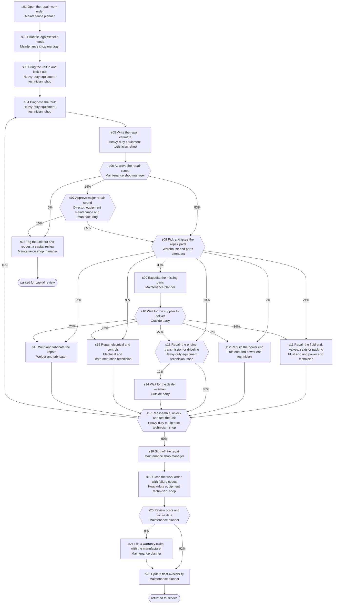

# Repair equipment and rebuild pumps

`ofs-em-corrective-repair-and-pump-rebuild` · oil and gas services (pressure pumping) · equipment maintenance · part of `oilfield-services-co`

When a frac pump, blender, cementing or coiled tubing unit or tractor fails or comes back from the field with a defect, a planner opens a repair order and the shop manager ranks it against what the fleets need next. Heavy-duty technicians diagnose the fault, the shop manager approves the estimate, and fluid end and power end technicians, mechanics, electricians or welders repair the unit before it is tested and signed off. Parts back orders, a shortage of bays and technicians, and repeat failures from poor seating or misdiagnosis decide how long units are down and how many pumps a fleet can field.

| | |
|---|---|
| Unit of work | one repair work order |
| Starts when | A crew defect write-up, a field mechanic's repair request, a PM finding or a pump failure during a job asks the shop to repair a unit. |
| Done when | The unit is repaired, tested, signed off and shown as available to operations, with the work order closed; or the unit is tagged out and parked for capital review. |
| Organisation | A Canadian pressure pumping company with six to eight crewed frac fleets, about 16 cementing units and six coiled tubing crews, maintained from district shops in Alberta and northeast BC. (1,350 employees, 2019-2022) |
| Volume | 500 cases a month (range 300 to 750) |

## Where it sits

- Starts with **repair_request** from fo-dist-yard-and-base-operations (60% of cases)
- Starts with **repair_request** from em-preventive-maintenance (17% of cases)
- Starts with **repair_request** from em-field-breakdown-support (15% of cases)
- Starts with **repair_request** from fo-frac-screen-out-and-npt-handling (8% of cases)
- Relies on **parts_issue** from sc-warehouse-and-inventory-management (a standing input; it does not start a case)
- Sends **fleet_status** to fo-frac-program-planning (outcome: returned to service)
- Sends **fleet_status** to fo-dist-job-call-intake-and-dispatch (outcome: returned to service)
- Sends **parts_requisition** to sc-parts-procurement (outcome: any)
- Sends **capital_request** to fin-capital-planning-and-approval (outcome: parked for capital review)

## Flow

## Roles

| Role | Department | Layer | FTE on this process | Loaded cost per hour | Evidence |
|---|---|---|---:|---:|---|
| Heavy-duty equipment technician (shop) | Equipment maintenance and manufacturing | individual contributor | 25 | 57 CAD | C |
| Fluid end and power end technician | Equipment maintenance and manufacturing | individual contributor | 10 | 55 CAD | C |
| Welder and fabricator | Equipment maintenance and manufacturing | individual contributor | 4.5 | 53 CAD | C |
| Electrical and instrumentation technician | Equipment maintenance and manufacturing | individual contributor | 2.5 | 60 CAD | C |
| Maintenance shop manager | Equipment maintenance and manufacturing | manager | 1.5 | 110 CAD | C |
| Maintenance planner | Equipment maintenance and manufacturing | senior specialist | 2.5 | 62 CAD | C |
| Warehouse and parts attendant | Supply chain and logistics | individual contributor | 1.5 | 38 CAD | C |
| Director, equipment maintenance and manufacturing | Equipment maintenance and manufacturing | director | 0.1 | 150 CAD | C |

## Steps

Hands-on time and the wait before each step show the most common value. Evidence tier A is a sourced number, B a sourced description, C the author's estimate.

| Step | Who | Kind | Hands-on | Wait before | Control | Evidence |
|---|---|---|---:|---:|---|---|
| **s01 Open the repair work order.** The maintenance planner reads the defect write-up, field mechanic's note or non-productive time report, checks the unit's history in the maintenance module for repeat failures and warranty status, and opens a corrective work order with the reported symptoms and priority asked for by operations. | Maintenance planner | intake | 10 min | 2.0 h |  | C |
| **s02 Prioritise against fleet needs.** At the morning shop meeting the shop manager ranks open repairs by which units the frac, cementing and coiled tubing fleets need for their next jobs, how many spare pumps each fleet has, and which technicians and bays are free. | Maintenance shop manager | judgment | 5 min | 12.0 h |  | C |
| **s03 Bring the unit in and lock it out.** When a bay and technician come free, the heavy-duty technician moves the unit into the bay, shuts it down, applies personal locks to the battery disconnect and engine start, bleeds the fluid end and verifies the engine will not start. | Heavy-duty equipment technician (shop) | physical | 20 min | 12.0 h | Alberta OHS Code Part 15, sections 212-214: isolate machinery and equipment, verify isolation and apply personal locks before maintenance | B [src5] |
| **s04 Diagnose the fault.** The technician reproduces the fault where possible, reads engine and transmission codes with the OEM laptop software, inspects for leaks, cracks and wear, and on pumps pulls valve covers or checks crosshead clearances. The finding and likely parts go on the work order. | Heavy-duty equipment technician (shop) | analysis | 1.2 h | 30 min |  | C |
| **s05 Write the repair estimate.** The technician lists the parts with part numbers from the parts catalogue and estimates labour hours, so the shop manager can compare the repair cost with the unit's value and the fleet's need for it. | Heavy-duty equipment technician (shop) | drafting | 15 min | 0 min |  | C |
| **s06 Approve the repair scope.** The shop manager checks the estimate against the unit's age, repeat failures and whether a newer unit could take its place, approves repairs within the shop limit, sends large ones to the director, and marks obsolete units that are not worth repairing. | Maintenance shop manager | approval | 8 min | 4.0 h | Company delegation of authority: repair spend above the shop manager's limit needs director approval | C |
| **s07 Approve major repair spend.** The director of equipment maintenance reviews large repairs such as engine or power end replacements, compares them with the capital plan for upgrades, and approves, defers or sends the unit for capital review. | Director, equipment maintenance and manufacturing | approval | 15 min | 1.0 d | Company delegation of authority for maintenance spend | C |
| **s08 Pick and issue the repair parts.** A warehouse attendant picks the listed parts from the base stores, issues them to the work order in the ERP and brings them to the bay. Parts that are not on the shelf or are counted wrong are reported to the planner. | Warehouse and parts attendant | physical | 20 min | 3.0 h |  | C |
| **s09 Expedite the missing parts.** The planner checks stock at other bases, phones suppliers and dealers for availability, raises an urgent requisition for the buyer, and tells operations when the unit is likely to be back. | Maintenance planner | coordination | 30 min | 2.0 h |  | C |
| **s10 Wait for the supplier to deliver.** The part comes from another base, a dealer in Edmonton or Calgary, or a manufacturer in the United States. Engines, transmissions and fluid ends had long lead times in 2021-2022, and the unit sits torn down in a bay or in the yard meanwhile. | Outside party | external wait | 0 min | 5.0 d |  | A [src1] |
| **s11 Repair the fluid end, valves, seats or packing.** A fluid end and power end technician replaces worn valves, seats, springs and packing, or lifts off a cracked or washed fluid end with the bay crane and fits a rebuilt or new one, with a second technician helping on the lift, then torques the stay rods to specification. | Fluid end and power end technician | physical | 2.5 h | 1.0 h |  | A [src1] |
| **s12 Rebuild the power end.** Two technicians remove the power end, strip it, measure the crankshaft, bearings, connecting rods and crossheads, replace worn parts, reassemble with new seals and run it in on the test stand. | Fluid end and power end technician | physical | 20.0 h | 1.0 d |  | C |
| **s13 Repair the engine, transmission or driveline.** The heavy-duty technician replaces failed engine components, turbochargers, injectors, cooling parts or transmission modules, or removes the engine or transmission when it needs an overhaul the shop does not do. | Heavy-duty equipment technician (shop) | physical | 6.0 h | 1.0 h |  | C |
| **s14 Wait for the dealer overhaul.** The engine or transmission goes to the OEM dealer for overhaul or exchange and comes back for the technician to reinstall. Dealer queues and core exchange stock decide how long the unit is down. | Outside party | external wait | 0 min | 14.0 d |  | C |
| **s15 Repair electrical and controls.** The electrical and instrumentation technician traces wiring faults, replaces harnesses, sensors and controller modules, and reloads controller settings from the OEM software. | Electrical and instrumentation technician | physical | 3.0 h | 2.0 h |  | C |
| **s16 Weld and fabricate the repair.** The welder cuts out and replaces cracked brackets, trailer cross members, decks or guards, or repairs low-pressure manifold piping, following the shop's welding procedure, and paints the repair. | Welder and fabricator | physical | 4.0 h | 4.0 h |  | C |
| **s17 Reassemble, unlock and test the unit.** The heavy-duty technician reassembles guards and covers, checks that everyone is clear, removes the locks, runs the unit to temperature and on pumps pumps water against a test choke to look for leaks, knocks and fault codes. | Heavy-duty equipment technician (shop) | validation | 1.0 h | 1.0 h | Alberta OHS Code Part 15, section 215.3: returning equipment to operation after locks are removed | B [src5] |
| **s18 Sign off the repair.** The shop manager or lead hand walks round the unit, checks the torque and test sheet and signs the work order before the unit leaves the shop. | Maintenance shop manager | review | 8 min | 2.0 h | Company quality procedure: supervisor sign-off before a repaired pressure pumping unit returns to service | C |
| **s19 Close the work order with failure codes.** The technician types labour hours, parts used, the failure code and cause from the paper job card into the maintenance module and sets the order to technically complete. | Heavy-duty equipment technician (shop) | data entry | 12 min | 4.0 h |  | C |
| **s20 Review costs and failure data.** The planner checks parts issued against the job card, corrects failure codes, compares the cost with the estimate and flags units under OEM warranty. | Maintenance planner | review | 10 min | 12.0 h | Maintenance records per unit kept for warranty claims, insurers and customer equipment audits | C |
| **s21 File a warranty claim with the manufacturer.** The planner gathers the work order, failure photos, hour readings and parts invoices and submits a warranty claim through the dealer or OEM portal, then tracks the credit in a spreadsheet. | Maintenance planner | drafting | 1.0 h | 1.0 d |  | C |
| **s22 Update fleet availability.** The planner marks the unit available on the dispatch board and the weekly fleet status sheet and tells the district or frac operations coordinator that it is ready. | Maintenance planner | communication | 4 min | 1.0 h |  | C |
| **s23 Tag the unit out and request a capital review.** The shop manager tags the unit out of service, writes a short note with the repair estimate and condition for the director and finance, and the unit goes to the parked line until an upgrade, rebuild or sale is decided. | Maintenance shop manager | drafting | 30 min | 1.0 d |  | C |

## Exceptions

| Exception | Share of cases | What happens |
|---|---:|---|
| Parts not in stock | 30% | A part is short or on back order; the planner expedites and the unit waits days to weeks. |
| Component sent to the dealer | 3% | An engine or transmission needs an overhaul the shop does not do and goes to the OEM dealer. |
| Failed test after repair | 10% | The fault returns or a new leak appears on test and the unit goes back to diagnosis. |
| Not worth repairing | 5% | The estimate exceeds the unit's value or fits a planned upgrade, so the unit is parked for capital review. |
| Warranty claim | 7% | The failure is under OEM warranty and the planner files a claim. |

## Benchmarks

| Metric | Value | Unit | Population | Evidence |
|---|---|---|---|---|
| cycle_time_days | p50 6, p90 24 | calendar days from repair order opened to closed | Corrective repair orders on pressure pumping units at a WCSB service company, 2019-2022 | C |
| fluid_end_cost_per_year | 2021 8.0, 2022 7.5 | CAD millions | Trican Well Service, stainless steel fluid ends in repair and maintenance expense | A [src1] |
| fluid_end_cost_per_quarter | Q4 2021 1.4, Q4 2022 1.2 | CAD millions | Trican Well Service | A [src1] |

## Pain points

- Parts back orders leave torn-down units in bays for weeks, worst in 2021-2022, and reduce how many pumps a fleet can field. (steps s09, s10, s14; A [src1])
- Too few bays and technicians for the repair queue, so units wait in the yard and the shop manager re-ranks the queue every morning as fleet needs change. (steps s02, s03; C)
- Fluid end costs are large and variable, and early failures from poor seating or misdiagnosis repeat the repair. (steps s04, s11, s17; A [src1])
- Failure codes and labour are typed in late from paper job cards, so repeat-failure analysis and warranty recovery are weak. (steps s19, s20, s21; C)

## Assumptions

- The organisation file lists three triggers (field breakdowns, PM findings and frac non-productive time). Their volumes (about 60, 80 and 25 repair orders a month) add to about 170, a third of the 500 a month in the file. The rest are defects written up by crews and found when units return to the yard, so this file adds fo-dist-yard-and-base-operations as the largest trigger (60 per cent).
- Repair types are mixed: fluid end, valve, seat and packing work 34 per cent, structural and welding 23, engine and transmission 27, electrical 13 and power end rebuilds 3. A power end rebuild every 5,000 to 8,000 pump hours across about 190 pumps gives about 10 to 15 a month (tier C).
- Simple valve and seat swaps done by frac crews on location between stages are not shop repair orders and are left out.
- The organisation file's maintenance-shop resource (5 at about 500 hours a month) is too small for the bay time of repairs and services, so a service bay resource of about 40 bays is used, as in the preventive maintenance file.
- The frac-pump resource is held only during hands-on repair steps, because its cost per hour is a running cost; units also sit out of service during parts and dealer waits (a median of about five days when a part is short), which a capacity model should count as lost availability rather than running cost. For non-pump units the hours apply to the unit being repaired.
- A unit parked for capital review leaves this process; the organisation file has no link from this process to capital planning or asset disposal, so one is added.
- Staffing: about 42 FTE of technicians and welders plus planners, warehouse and supervision, close to the hands-on time times 500 orders a month at 130 productive hours. With preventive maintenance (about 41 technician FTE) this uses about 80 of the 127 shop technicians in the organisation file; the rest go to iron, inspections, manufacturing and leave.
- Loaded costs are the organisation file's (wage x 1.35).

## Sources

- [src1] [Trican Well Service Ltd. Management's Discussion and Analysis for the year ended December 31, 2022](https://tricanwellservice.com/app/uploads/2023/02/TCW-Q4-2022-MDA-2023.02.22.pdf) (Trican Well Service Ltd., 2023). Stainless steel fluid end costs of $7.5 million in 2022 and $8.0 million in 2021 ($1.2 million in Q4 2022) as the item that drives variability in repair and maintenance expense; higher active equipment raised repair and maintenance costs; personnel costs include operational support personnel such as mechanics; long lead times on key parts and record inflation in 2022; maintenance capital $29.96 million in 2022 and $23.5 million in 2021; fluid ends pump abrasive slurry at up to 15,000 psi and are modular units replaced independently of the power end; spring break-up road weight limits reduce oilfield activity; seven active and five parked frac crews in 2022.
- [src5] [Occupational Health and Safety Code, Part 15: Managing the Control of Hazardous Energy](https://search-ohs-laws.alberta.ca/legislation/occupational-health-and-safety-code/part-15-managing-the-control-of-hazardous-energy/) (Government of Alberta, 2026). Part 15 sections 212 (isolation of machinery, equipment or powered mobile equipment), 213 (verifying isolation), 214 (assigning personal locks), 215 (group control procedures), 215.3 (returning to operation) and 215.4 (isolation of piping). Current page; Part 15 was in force in an earlier edition in 2019-2022.
- [src6] [Road bans](https://www.alberta.ca/road-bans) (Government of Alberta, 2026). Road bans reduce maximum weights on roads during weak or thawing conditions; spring heavy haul weights start when thaw depth reaches 25 cm; provincial highway and municipal bans; exemptions by permit from the Central Permit Office.

Written by claude-opus on 2026-11-24.
