# Build and upgrade equipment

`ofs-em-equipment-manufacturing-and-upgrade` · oil and gas services (pressure pumping) · equipment maintenance and manufacturing · part of `oilfield-services-co`

Under approved capital projects the company's own shops rebuild and upgrade its fracturing equipment, most of all converting conventional diesel frac pumps to Tier 4 dynamic gas blending engines with 3,000 HHP continuous duty pumps and idle reduction packages, and building electric versions of sand, blending and chemical units. An equipment engineer turns the fleet design into a work package for each unit, a planner and buyers order engines, transmissions, power ends and kits, and when parts and a shop bay are free the unit is stripped, refabricated, re-engined, rewired and commissioned by heavy-duty technicians, welders, pump and electrical technicians. The unit then passes a commercial vehicle inspection, is signed off by the engineer and released to the fleet, often with a punch list at its first job. Engine and component lead times, bay space while the fleet is busy, and first-of-kind fit problems set the pace.

| | |
|---|---|
| Unit of work | one unit build or upgrade (for example one frac pump converted to a Tier 4 DGB engine) |
| Starts when | A capital project for a fleet upgrade or new-build programme is approved and the unit is assigned to the shop's build schedule. |
| Done when | The upgraded or new unit has been commissioned, inspected, recorded as a capital asset and released to an active fleet, with removed engines tagged for sale. |
| Organisation | A listed Canadian pressure pumper of about 1,350 people, roughly 880 of them field staff on rotation or on call at nine district bases, with a Calgary head office for finance, HR, HSE and engineering. (1,350 employees, 2019-2022) |
| Volume | 4 cases a month (range 2 to 8) |

## Where it sits

- Starts with **capital_request** from fin-capital-planning-and-approval (100% of cases)
- Sends **equipment_unit** to fo-frac-fleet-reactivation (outcome: released to fleet)
- Sends **parts_requisition** to sc-parts-procurement (outcome: any)
- Sends **equipment_unit** to em-asset-disposal (outcome: any)

## Flow

```mermaid
flowchart TD
    s01["s01 Receive approved project and assign the unit<br/>Equipment and asset engineer"]
    s02["s02 Prepare the unit design package<br/>Equipment and asset engineer"]
    s03{{"s03 Approve design and change<br/>Director, equipment maintenance and manufacturing"}}
    s04["s04 Build work order and parts requisition<br/>Maintenance planner"]
    s05["s05 Place orders for engines and long-lead parts<br/>Procurement specialist  buyer"]
    s06["s06 Wait for engines and long-lead parts<br/>Outside party"]
    s07["s07 Receive and stage parts<br/>Warehouse and parts attendant"]
    s08{{"s08 Check kit is complete<br/>Maintenance planner"}}
    s09["s09 Wait for a bay and the unit to come off the fleet<br/>Maintenance shop manager"]
    s10["s10 Strip the old engine and drivetrain<br/>Heavy-duty equipment technician  shop"]
    s11["s11 Fabricate and modify the trailer<br/>Welder and fabricator"]
    s12{{"s12 Install engine, transmission and cooling<br/>Heavy-duty equipment technician  shop"}}
    s13["s13 Resolve fit problem with engineering<br/>Equipment and asset engineer"]
    s14["s14 Install the pump power end and fluid end<br/>Fluid end and power end technician"]
    s15["s15 Wire controls, gas train and data link<br/>Electrical and instrumentation technician"]
    s16{{"s16 Commission and load test the unit<br/>Heavy-duty equipment technician  shop"}}
    s17["s17 Troubleshoot and correct faults<br/>Electrical and instrumentation technician"]
    s18["s18 Paint, decal and number the unit<br/>Welder and fabricator"]
    s19{{"s19 Commercial vehicle inspection of the trailer<br/>Heavy-duty equipment technician  shop"}}
    s20["s20 Engineer inspects and releases the unit<br/>Equipment and asset engineer"]
    s21["s21 Close work order and record the asset<br/>Maintenance planner"]
    s22{{"s22 Hand removed engine to asset disposal<br/>Maintenance planner"}}
    s23["s23 Deliver unit to the fleet<br/>Outside party"]
    s24["s24 Travel to support the first job<br/>Field service mechanic"]
    s25["s25 Clear the first-job punch list<br/>Field service mechanic"]
    s01 --> s02
    s02 --> s03
    s03 -->|"90%"| s04
    s03 -->|"10%"| s02
    s04 --> s05
    s05 --> s06
    s06 --> s07
    s07 --> s08
    s08 -->|"80%"| s09
    s08 -->|"20%"| s06
    s09 --> s10
    s10 --> s11
    s11 --> s12
    s12 -->|"85%"| s14
    s12 -->|"15%"| s13
    s13 --> s12
    s14 --> s15
    s15 --> s16
    s16 -->|"80%"| s18
    s16 -->|"20%"| s17
    s17 --> s16
    s18 --> s19
    s19 -->|"90%"| s20
    s19 -->|"10%"| s18
    s20 --> s21
    s21 --> s22
    s22 -->|"75%"| s23
    s22 -->|"25%"| s24
    s23 --> end0
    s24 --> s25
    s25 --> end0
    end0(["released to fleet"])
```

## Roles

| Role | Department | Layer | FTE on this process | Loaded cost per hour | Evidence |
|---|---|---|---:|---:|---|
| Equipment and asset engineer | Equipment maintenance and manufacturing | senior specialist | 1.5 | 88 CAD | C |
| Maintenance planner | Equipment maintenance and manufacturing | senior specialist | 0.4 | 62 CAD | C |
| Procurement specialist (buyer) | Supply chain and logistics | individual contributor | 0.3 | 54 CAD | C |
| Warehouse and parts attendant | Supply chain and logistics | individual contributor | 0.2 | 38 CAD | C |
| Maintenance shop manager | Equipment maintenance and manufacturing | manager | 0.3 | 110 CAD | C |
| Heavy-duty equipment technician (shop) | Equipment maintenance and manufacturing | individual contributor | 4 | 57 CAD | C |
| Welder and fabricator | Equipment maintenance and manufacturing | individual contributor | 1.5 | 53 CAD | C |
| Fluid end and power end technician | Equipment maintenance and manufacturing | individual contributor | 0.8 | 55 CAD | C |
| Electrical and instrumentation technician | Equipment maintenance and manufacturing | individual contributor | 1.5 | 60 CAD | C |
| Field service mechanic | Equipment maintenance and manufacturing | individual contributor | 0.2 | 62 CAD | C |
| Director, equipment maintenance and manufacturing | Equipment maintenance and manufacturing | director | 0.05 | 150 CAD | C |

## Steps

Hands-on time and the wait before each step show the most common value. Evidence tier A is a sourced number, B a sourced description, C the author's estimate.

| Step | Who | Kind | Hands-on | Wait before | Control | Evidence |
|---|---|---|---:|---:|---|---|
| **s01 Receive approved project and assign the unit.** The equipment engineer receives the approved capital project, picks the unit numbers to be upgraded in agreement with operations and opens the unit's file with its current configuration and history. | Equipment and asset engineer | intake | 1.0 h | 1.0 d |  | C |
| **s02 Prepare the unit design package.** The engineer adapts the fleet design to this unit's trailer and model: layout drawings, engine and transmission mounts, gas train, cooling and electrical changes and the bill of materials, checking weights against axle and permit limits. | Equipment and asset engineer | analysis | 10.0 h | 1.0 d |  | C |
| **s03 Approve design and change.** The director of equipment reviews the package, cost against the capital approval and any change from the fleet design, and approves it under management of change. | Director, equipment maintenance and manufacturing | approval | 30 min | 1.0 d | Management of change for equipment modifications and capital spending authority | C |
| **s04 Build work order and parts requisition.** The maintenance planner creates the work order with operations and labour estimates in the maintenance system and raises requisitions for every item on the bill of materials not in stock. | Maintenance planner | data entry | 4.0 h | 8.0 h |  | C |
| **s05 Place orders for engines and long-lead parts.** The buyer issues purchase orders to the engine dealer and other suppliers for the DGB engine kit, transmission, continuous duty pump, radiator and controls, confirms promised dates and expedites. | Procurement specialist (buyer) | data entry | 2.0 h | 1.0 d |  | C |
| **s06 Wait for engines and long-lead parts.** Engines, transmissions and pumps arrive on suppliers' lead times of several months; in 2021-2022 promised dates slipped and partial shipments were common. | Outside party | external wait | 0 min | 70.0 d |  | B [src4], [src13] |
| **s07 Receive and stage parts.** The warehouse attendant receives the engine and parts, checks them against the purchase order and packing list, posts the goods receipt and stages a kit by the bay. | Warehouse and parts attendant | data entry | 2.0 h | 8.0 h |  | C |
| **s08 Check kit is complete.** The planner checks the staged kit against the bill of materials and work order, chases missing items and decides whether the unit can start or must wait. | Maintenance planner | validation | 1.0 h | 4.0 h |  | C |
| **s09 Wait for a bay and the unit to come off the fleet.** The shop manager schedules the unit into a bay when one is free and when operations can release the pump from its fleet, usually between pads or during break-up. | Maintenance shop manager | coordination | 1.0 h | 5.0 d |  | C |
| **s10 Strip the old engine and drivetrain.** Two heavy-duty technicians lock out the unit, drain fluids, remove the old engine, transmission, radiator and pump with the overhead crane and tag the removed engine and components for resale. | Heavy-duty equipment technician (shop) | physical | 20.0 h | 2.0 h | Alberta OHS Code: lockout of energy sources and safe lifting with overhead cranes | C |
| **s11 Fabricate and modify the trailer.** Welders cut and weld new engine and transmission mounts, the gas train and filtration brackets, guards and walkways, and reinforce the frame where the new layout needs it. | Welder and fabricator | physical | 1.2 d | 1.0 h |  | C |
| **s12 Install engine, transmission and cooling.** Heavy-duty technicians set the DGB engine, transmission and radiator, align the driveline, and connect fuel, gas, air, exhaust aftertreatment and coolant lines. | Heavy-duty equipment technician (shop) | physical | 1.7 d | 2.0 h |  | C |
| **s13 Resolve fit problem with engineering.** The engineer looks at the interference on the shop floor, revises the drawing or approves a field fix, and the welder or technician reworks the part. | Equipment and asset engineer | judgment | 3.0 h | 8.0 h |  | C |
| **s14 Install the pump power end and fluid end.** Pump technicians mount the continuous duty power end and fluid end, set packing and valves, connect lube and suction and discharge piping, and torque to specification. | Fluid end and power end technician | physical | 12.0 h | 0 min |  | C |
| **s15 Wire controls, gas train and data link.** Electrical and instrumentation technicians install the engine and pump controllers, gas blending controls, idle reduction package, sensors and the data link to the data van, and test each circuit. | Electrical and instrumentation technician | physical | 1.0 d | 1.0 h |  | C |
| **s16 Commission and load test the unit.** Technicians start the engine, check gas substitution and alarms, and run the pump against a test loop or on the test stand through its rate and pressure range while recording readings on the commissioning checklist. | Heavy-duty equipment technician (shop) | physical | 8.0 h | 4.0 h | Pressure testing procedure with exclusion zone, and the OEM commissioning procedure for DGB engines | C |
| **s17 Troubleshoot and correct faults.** An electrical technician and the engine dealer's service technician trace the fault (sensor, gas valve, software calibration or leak), correct it and hand the unit back for testing. | Electrical and instrumentation technician | analysis | 5.0 h | 8.0 h |  | C |
| **s18 Paint, decal and number the unit.** The welder and fabricator team prepare and paint repaired areas, fit guards, decals and the unit number and pressure ratings plates. | Welder and fabricator | physical | 8.0 h | 4.0 h |  | C |
| **s19 Commercial vehicle inspection of the trailer.** A licensed heavy-duty technician inspects brakes, lights, suspension, frame and tires to the commercial vehicle inspection standard and issues the inspection certificate and decal. | Heavy-duty equipment technician (shop) | validation | 3.0 h | 4.0 h | Alberta Commercial Vehicle Inspection Program (CVIP) for heavy trailers | C |
| **s20 Engineer inspects and releases the unit.** The equipment engineer checks the unit against the design, reviews the commissioning and inspection records and the weigh ticket, and signs the release to operations. | Equipment and asset engineer | approval | 2.0 h | 8.0 h | Engineering release of modified pressure pumping equipment before field use | C |
| **s21 Close work order and record the asset.** The planner closes the work order, records the new engine and pump serial numbers and configuration in the maintenance system and sends the capital cost summary to accounting for capitalisation. | Maintenance planner | data entry | 2.0 h | 1.0 d |  | C |
| **s22 Hand removed engine to asset disposal.** The planner lists the removed engine, transmission and pump with condition and hours for the asset disposal team to sell, and moves them to the surplus yard. | Maintenance planner | data entry | 30 min | 1.0 d |  | C |
| **s23 Deliver unit to the fleet.** The unit is hauled from the shop to the district base or the fleet's next pad and joins the fleet's equipment list. | Outside party | external wait | 0 min | 1.0 d |  | C |
| **s24 Travel to support the first job.** A field mechanic drives to the pad where the unit runs its first job to watch start-up and fix early faults. | Field service mechanic | travel | 4.0 h | 1.0 d |  | C |
| **s25 Clear the first-job punch list.** The field mechanic tightens leaks, adjusts settings and replaces failed sensors found on the first stages and reports design issues back to the engineer for the next units. | Field service mechanic | physical | 5.0 h | 0 min |  | C |

## Exceptions

| Exception | Share of cases | What happens |
|---|---:|---|
| Parts short at kit check | 20% | A part promised for the unit has not arrived, so the unit waits again before it can enter a bay. |
| Fit problem | 15% | The new engine or mount does not fit this trailer variant and engineering revises the design on the shop floor. |
| Commissioning fault | 20% | Testing finds a wiring, gas train or calibration fault and the unit is retested after repair. |
| First-job punch list | 25% | A field mechanic supports the unit's first job and clears early faults. |

## Benchmarks

| Metric | Value | Unit | Population | Evidence |
|---|---|---|---|---|
| cycle_time_days | p50 120, p90 200 | calendar days from capital approval to the unit released to a fleet | Tier 4 DGB pump upgrades at a Canadian pressure pumper, 2021-2022 | B [src12], [src4] |
| upgrade_cost_per_hhp | 760 | CAD per HHP | Trican fourth Tier 4 DGB fleet, 2022 | A [src12] |
| diesel_displacement | 0.85 | maximum share of diesel replaced by natural gas | CAT Tier 4 DGB engines | A [src4], [src12] |

## Pain points

- Engine and component lead times are long and promised dates slip, so units wait months and kits arrive incomplete. (steps s06, s08; B [src4], [src13])
- Units can only come into the shop when operations release them, which competes with the winter work season. (steps s09; C)
- Trailer variants differ from the fleet design, causing fit problems and rework on the first units of a programme. (steps s12, s13; C)
- Skilled heavy-duty, electrical and pump technicians were scarce in 2021-2022, limiting how many bays could work at once. (steps s10, s12, s15; B [src4])

## Assumptions

- Loaded costs are the organisation file's (base wage x 1.35).
- The case modelled is a frac pump conversion to a Tier 4 DGB engine, the most common unit in 2021-2022; electric ancillary builds follow the same steps with more electrical and less engine work.
- Engines are ordered for a whole fleet, so the per-unit wait for parts in s06 varies widely; the cycle time median is set mostly by s06 and s09.
- Fleet design engineering is spread over the units of a programme; s02 holds only this unit's share and adaptation.
- The planner, buyer, warehouse attendant, shop manager, pump technicians, field mechanic and director take part although the process map lists only engineers, welders, heavy-duty and electrical technicians.
- The frac pump unit is shown as a resource held out of service during shop work; the organisation file lists only the maintenance shop for this process.
- Running costs per hour are left off the maintenance shop and frac pump here: the organisation file's frac pump rate is for pumping (fuel and wear), which a unit in the shop does not incur, and its shop rate is for a whole shop, while one upgrade uses one bay of several.

## Sources

- [src4] [Trican Well Service Ltd. Management's Discussion and Analysis for the year ended December 31, 2022](https://tricanwellservice.com/app/uploads/2023/02/TCW-Q4-2022-MDA-2023.02.22.pdf) (Trican Well Service Ltd., 2023). Three Tier 4 DGB fleets (126,000 HHP) operating at end 2022; fourth fleet (42,000 HHP) field ready by end Q1 2023 and fifth approved for early 2024; upgrades include 3,000 HHP continuous duty pumps and idle reduction packages; fully electric sand, blending and chemical equipment developed; capital spending $103.6 million in 2022 mainly Tier 4 upgrades; supply chain challenges such as long lead times on key parts; record inflation; difficulty adding field crews and attracting and retaining qualified personnel; recruiting events; CEWS credited against personnel expenses in 2021 ($10.2 million in cost of sales); the company has safety and training programs; MD&A dated February 22, 2023.
- [src12] [Trican Announces Continuation of Low Emissions Fracturing Fleet Upgrade Program](https://tricanwellservice.com/trican-announces-continuation-of-low-emissions-fracturing-fleet-upgrade-program/) (Trican Well Service Ltd., 2022). 12 September 2022: fourth set of pumping equipment (42,000 HHP) to be upgraded from conventional diesel to CAT Tier 4 DGB engines for about $32 million, spent in 2022; total Tier 4 capacity 168,000 HHP; DGB displaces up to 85% of diesel; idle reduction technology; 2022 capital budget raised to $114 million.
- [src13] [US Onshore Pressure Pumpers Adjusting to New Market Demands](https://jpt.spe.org/us-onshore-pressure-pumpers-adjusting-new-market-demands) (Journal of Petroleum Technology (SPE), 2018). April 2018: lead time for new builds with Tier 4 engines about 7 to 8 months; Tier 4 equipment 10-15% dearer than Tier 2; longer backlogs for transmissions and fluid ends; manufacturers at capacity with refurbishments; refurbishing idle equipment cheaper than buying new.

Written by claude-opus on 2026-11-24.
