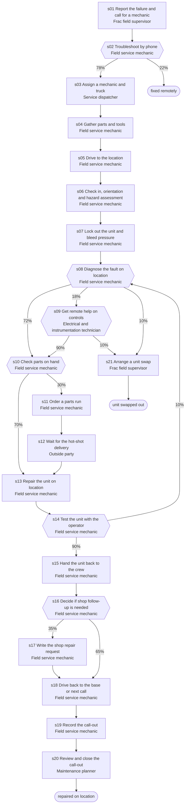

# Repair equipment on location

`ofs-em-field-breakdown-support` · oil and gas services (pressure pumping) · equipment maintenance · part of `oilfield-services-co`

When a pump, blender, cementing or coiled tubing unit fails during a job, the field supervisor calls the on-call field mechanic, who first tries to fix it by phone. If a visit is needed the mechanic gathers parts, drives to the pad or rig, completes a hazard assessment and lockout, diagnoses and repairs the unit in the open, tests it with the operator and hands it back, writing a shop repair request when the fix is temporary. Long drives to remote leases, missing parts and winter weather decide how long the crew runs short of equipment.

| | |
|---|---|
| Unit of work | one field call-out |
| Starts when | A crew on location reports a unit failure and asks for a mechanic. |
| Done when | The unit is running again on location, fixed by phone, or swapped for another unit and sent to the shop; the call-out work order is closed with hours and parts. |
| Organisation | A Canadian pressure pumping company with six to eight crewed frac fleets, about 16 cementing units and six coiled tubing crews, maintained from district shops in Alberta and northeast BC. (1,350 employees, 2019-2022) |
| Volume | 120 cases a month (range 60 to 180) |

## Where it sits

- Starts with **repair_request** from fo-frac-job-execution (65% of cases)
- Starts with **repair_request** from fo-cem-job-execution (20% of cases)
- Starts with **repair_request** from fo-ct-job-execution (15% of cases)
- Sends **repair_request** to em-corrective-repair-and-pump-rebuild (outcome: unit swapped out)
- Sends **repair_request** to em-corrective-repair-and-pump-rebuild (outcome: repaired on location)
- Sends **npt_report** to fo-frac-screen-out-and-npt-handling (outcome: any)

## Flow

## Roles

| Role | Department | Layer | FTE on this process | Loaded cost per hour | Evidence |
|---|---|---|---:|---:|---|
| Field service mechanic | Equipment maintenance and manufacturing | individual contributor | 9.5 | 62 CAD | C |
| Electrical and instrumentation technician | Equipment maintenance and manufacturing | individual contributor | 0.2 | 60 CAD | C |
| Frac field supervisor | Fracturing service line | supervisor | 0.3 | 82 CAD | C |
| Service dispatcher | District operations and dispatch | individual contributor | 0.2 | 45 CAD | C |
| Maintenance planner | Equipment maintenance and manufacturing | senior specialist | 0.2 | 62 CAD | C |

## Steps

Hands-on time and the wait before each step show the most common value. Evidence tier A is a sourced number, B a sourced description, C the author's estimate.

| Step | Who | Kind | Hands-on | Wait before | Control | Evidence |
|---|---|---|---:|---:|---|---|
| **s01 Report the failure and call for a mechanic.** The field supervisor or treater sees a pump or unit fail (an engine shutdown, a transmission fault, a hydraulic leak, a control fault), takes it offline, brings on a backup pump if there is one, and phones the on-call mechanic line with the unit number, symptoms and fault codes. | Frac field supervisor | communication | 10 min | 0 min |  | B [src3] |
| **s02 Troubleshoot by phone.** The on-call field mechanic talks the operator through checks: reading codes, resetting the controller, checking fuel filters, fluid levels and breakers. Some faults are cleared without a visit. | Field service mechanic | analysis | 20 min | 20 min |  | C |
| **s03 Assign a mechanic and truck.** The dispatcher or shop lead checks which on-call mechanic is free and closest on the dispatch board, opens a call-out work order and gives the mechanic the lease location and access directions. | Service dispatcher | coordination | 10 min | 30 min |  | C |
| **s04 Gather parts and tools.** The mechanic picks likely parts from the base stores or the after-hours parts cage (filters, sensors, hoses, valves), writes them on a sheet for the warehouse to issue later, and loads the service truck. | Field service mechanic | physical | 30 min | 15 min |  | C |
| **s05 Drive to the location.** The mechanic drives the service truck from the base to the pad or rig, often two to four hours on highway and lease roads; snow, ice and fog slow the drive. | Field service mechanic | travel | 2.5 h | 15 min |  | C |
| **s06 Check in, orientation and hazard assessment.** At the lease gate the mechanic signs in with the customer's site supervisor, completes the site orientation if new to the location, and fills in a field level hazard assessment for the repair with the frac crew. | Field service mechanic | physical | 20 min | 15 min | Alberta OHS Code Part 2 hazard assessment before work, and customer site orientation rules | C |
| **s07 Lock out the unit and bleed pressure.** The mechanic and the pump operator isolate the unit from the discharge manifold, bleed trapped pressure from the iron and fluid end, shut the engine down and apply locks under the crew's group lockout. | Field service mechanic | physical | 20 min | 15 min | Alberta OHS Code Part 15, sections 212-214: isolate machinery and equipment, verify isolation and apply personal locks before maintenance | B [src5] |
| **s08 Diagnose the fault on location.** The mechanic inspects the unit, reads codes with a laptop and checks pressures, fuel, air and hydraulics to find the failed part, and decides whether it can be fixed on site. | Field service mechanic | analysis | 45 min | 0 min |  | C |
| **s09 Get remote help on controls.** The electrical and instrumentation technician joins by phone or video, reviews fault logs the mechanic sends from the laptop and walks through wiring and sensor checks. | Electrical and instrumentation technician | analysis | 45 min | 30 min |  | C |
| **s10 Check parts on hand.** The mechanic compares the failed part with what is on the service truck and in the fleet's spares trailer, and decides whether to repair now or send for the part from the base. | Field service mechanic | judgment | 5 min | 0 min |  | C |
| **s11 Order a parts run.** The mechanic phones the base warehouse or dispatcher to pull the part and send it out with a hot-shot driver or the next crew truck. | Field service mechanic | communication | 10 min | 0 min |  | C |
| **s12 Wait for the hot-shot delivery.** A hot-shot carrier or crew truck brings the part from the base, two to six hours on the road, while the mechanic waits on location or helps the crew. | Outside party | external wait | 0 min | 5.0 h |  | C |
| **s13 Repair the unit on location.** The mechanic replaces the failed part (a sensor, starter, fuel pump, hose, cooler line or valve) in the open on the pad, often in cold and dark, while the crew keeps pumping with the remaining units. | Field service mechanic | physical | 2.0 h | 0 min |  | C |
| **s14 Test the unit with the operator.** With locks removed and the area clear, the pump operator starts the unit and runs it against the manifold at low rate while the mechanic watches for leaks and codes. | Field service mechanic | validation | 20 min | 30 min | Alberta OHS Code Part 15, section 215.3: returning equipment to operation after locks are removed | B [src5] |
| **s15 Hand the unit back to the crew.** The mechanic tells the field supervisor the unit is ready, records the repair and downtime on the crew's job log so the lost time can be explained on the field ticket, and notes any follow-up work. | Field service mechanic | communication | 10 min | 0 min |  | C |
| **s16 Decide if shop follow-up is needed.** The mechanic decides whether the fix is permanent or the unit needs a proper repair in the shop at the next move (a worn component, a leaking seal patched for now). | Field service mechanic | judgment | 5 min | 0 min |  | C |
| **s17 Write the shop repair request.** The mechanic writes a repair request with the unit number, the temporary fix and the parts likely needed, and sends it to the planner so the shop can book the unit in when it comes home. | Field service mechanic | drafting | 10 min | 0 min |  | C |
| **s18 Drive back to the base or next call.** The mechanic drives back to the base or straight to another call-out; on long trips the mechanic may stop at a camp or hotel when hours of work run out. | Field service mechanic | travel | 2.5 h | 30 min |  | C |
| **s19 Record the call-out.** Back at the base, often the next day, the mechanic types the hours, travel, parts sheet and repair notes into the call-out work order and enters the time in the field time system for call-out pay. | Field service mechanic | data entry | 15 min | 12.0 h |  | C |
| **s20 Review and close the call-out.** The planner matches the parts sheet with warehouse issues, charges the parts to the unit, checks that any repair request has been booked, and closes the work order. | Maintenance planner | review | 10 min | 1.0 d |  | C |
| **s21 Arrange a unit swap.** When the unit cannot be fixed on site, the field supervisor arranges a replacement unit from the base or another fleet with the dispatcher and the shop, and the failed unit goes home on the next tractor for a shop repair order. | Frac field supervisor | coordination | 30 min | 30 min |  | C |

## Exceptions

| Exception | Share of cases | What happens |
|---|---:|---|
| Fixed by phone | 22% | The fault is cleared by the operator with the mechanic's help and no visit is needed. |
| Part not on the truck | 25% | The part has to come from the base by hot-shot and the mechanic waits on location. |
| Cannot fix on location | 10% | The fault needs the shop; a unit is swapped in and the failed unit goes home for repair. |
| Fault persists after repair | 7% | The test shows the fault again and the mechanic goes back to diagnosis. |

## Benchmarks

| Metric | Value | Unit | Population | Evidence |
|---|---|---|---|---|
| cycle_time_days | p50 2.5, p90 4.5 | calendar days from the call to the call-out work order closed | Field call-outs to frac, cementing and coiled tubing locations at a WCSB pressure pumper, 2019-2022 | C |
| time_to_unit_back_in_line | p50 8, p90 16 | hours from call to unit running | Field call-outs repaired on location | C |

## Pain points

- Remote leases mean hours of driving each way, and in winter the drive is slowed by weather, while the fleet runs short a pump. (steps s05, s18; C)
- The part needed is often not on the truck, so the mechanic waits for a hot-shot. (steps s10, s11, s12; C)
- Repairs in the open in cold and dark are slower and more often temporary, leading to repeat call-outs and shop follow-up. (steps s13, s16; B [src3])
- Parts taken from the cage and hours worked are recorded late, so work order costs, stock counts and call-out pay need chasing. (steps s04, s19, s20; C)

## Assumptions

- One case is one call from a crew; fleets keep pumping on backup pumps during most call-outs, so the frac-fleet resource is not held, only the failed unit (frac-pump) during diagnosis and repair.
- The frac field supervisor role also stands for the cementing and coiled tubing supervisors who make 35 per cent of calls.
- The organisation file lists field mechanics and E&I technicians only; dispatchers, field supervisors and the planner also take part, and the mechanic's downtime notes feed non-productive time handling, so a link to fo-frac-screen-out-and-npt-handling is added.
- Field mechanics are on call (organisation file shift pattern); night calls wait a little longer for the mechanic to wake and reach the base, covered by the s02 and s03 waits.
- Staffing: about 10 FTE stated, close to the hands-on time times 120 calls a month at 130 productive hours. The 20 field mechanics in the organisation file also do shop work and PM on location between calls.
- Simulated cycle time runs to the work order being closed; the unit is back in line within hours, the paperwork takes days.
- Loaded costs are the organisation file's (wage x 1.35).

## Sources

- [src3] [Extending Service Life Of Equipment Components Key To Improving Frac Efficiency (Frac Facts, January 2024)](https://aogr.com/magazine/frac-facts/extending-service-life-of-equipment-components-key-to-improving-frac-efficiency) (The American Oil & Gas Reporter, 2024). An ideal pump and check valve repair interval is 500 hours, matching a four-well pad so equipment can be maintained between pad moves; a conventional spread uses 20 or more pumps including backups; in-place field maintenance is usually less cost-effective than it appears and maintenance is safer and faster with equipment shut down and lifting equipment available.
- [src5] [Occupational Health and Safety Code, Part 15: Managing the Control of Hazardous Energy](https://search-ohs-laws.alberta.ca/legislation/occupational-health-and-safety-code/part-15-managing-the-control-of-hazardous-energy/) (Government of Alberta, 2026). Part 15 sections 212 (isolation of machinery, equipment or powered mobile equipment), 213 (verifying isolation), 214 (assigning personal locks), 215 (group control procedures), 215.3 (returning to operation) and 215.4 (isolation of piping). Current page; Part 15 was in force in an earlier edition in 2019-2022.

Written by claude-opus on 2026-11-24.
