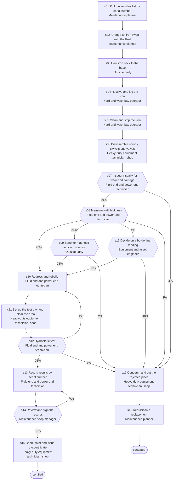

# Inspect and certify treating iron

`ofs-em-pressure-iron-certification` · oil and gas services (pressure pumping) · equipment maintenance · part of `oilfield-services-co`

Treating iron is the steel pipe, swivels, valves and fittings that carry fluid at up to 15,000 psi from the pumps to the wellhead, and uncertified or worn iron cannot go to location. A planner tracks each piece's certificate by serial number and arranges for due pieces to come home with fleet moves; yard staff wash them, technicians strip, inspect and measure wall thickness, rebuild valves, pressure test the pieces in a barricaded bay, and record, band and certify them. The work waits on fleet moves and batches, and mistyped serial numbers and missed wear are the main sources of error and risk.

| | |
|---|---|
| Unit of work | one iron item certified |
| Starts when | A piece of treating iron reaches its certificate expiry or comes back from location damaged or leaking. |
| Done when | The piece is tested, recorded, banded and staged with a valid certificate, or condemned and a replacement ordered. |
| Organisation | A Canadian pressure pumping company with six to eight crewed frac fleets, about 16 cementing units and six coiled tubing crews, maintained from district shops in Alberta and northeast BC. (1,350 employees, 2019-2022) |
| Volume | 600 cases a month (range 400 to 900) |

## Where it sits

- Starts with **work_order** from em-preventive-maintenance (75% of cases)
- Starts with **equipment_move** from fo-frac-rig-down-and-move (25% of cases)
- Sends **iron_certificate** to fo-frac-rig-up-and-pressure-test (outcome: certified)
- Sends **iron_certificate** to fo-cem-job-execution (outcome: certified)
- Sends **iron_certificate** to fo-ct-job-execution (outcome: certified)
- Sends **parts_requisition** to sc-parts-procurement (outcome: scrapped)

## Flow

## Roles

| Role | Department | Layer | FTE on this process | Loaded cost per hour | Evidence |
|---|---|---|---:|---:|---|
| Fluid end and power end technician | Equipment maintenance and manufacturing | individual contributor | 4 | 55 CAD | C |
| Heavy-duty equipment technician (shop) | Equipment maintenance and manufacturing | individual contributor | 1.8 | 57 CAD | C |
| Yard and wash bay operator | District operations and dispatch | individual contributor | 1 | 38 CAD | C |
| Maintenance planner | Equipment maintenance and manufacturing | senior specialist | 0.5 | 62 CAD | C |
| Maintenance shop manager | Equipment maintenance and manufacturing | manager | 0.2 | 110 CAD | C |
| Equipment and asset engineer | Equipment maintenance and manufacturing | senior specialist | 0.1 | 88 CAD | C |

## Steps

Hands-on time and the wait before each step show the most common value. Evidence tier A is a sourced number, B a sourced description, C the author's estimate.

| Step | Who | Kind | Hands-on | Wait before | Control | Evidence |
|---|---|---|---:|---:|---|---|
| **s01 Pull the iron due list by serial number.** The maintenance planner filters the iron register (a spreadsheet or equipment list in the maintenance module) for pieces whose certificate expires in the next 30 to 60 days, grouped by fleet, and adds pieces crews have reported as damaged or leaking. | Maintenance planner | lookup | 1 min | 12.0 h |  | C |
| **s02 Arrange an iron swap with the fleet.** The planner emails the frac operations coordinator or district dispatcher the list of pieces to send home and arranges certified replacements to go out on the next pad move, so the fleet is never short of iron on location. | Maintenance planner | coordination | 1 min | 8.0 h |  | C |
| **s03 Haul iron back to the base.** The due pieces come home on an iron trailer or float with the next equipment move, often a week or more after the swap is agreed, because iron moves only when the fleet moves between pads. | Outside party | external wait | 0 min | 4.0 d |  | C |
| **s04 Receive and log the iron.** A yard operator unloads the iron with a forklift, reads each serial number or band and ticks it off the due list, and sets aside unmarked or damaged pieces for the shop. | Yard and wash bay operator | intake | 2 min | 4.0 h |  | C |
| **s05 Clean and strip the iron.** The yard operator pressure washes sand, cement and fluid residue out of each piece, degreases threads and removes old paint bands so the surfaces can be inspected. | Yard and wash bay operator | physical | 8 min | 12.0 h |  | B [src7] |
| **s06 Disassemble unions, swivels and valves.** A technician breaks out hammer unions, removes seals, takes swivel joints apart and opens plug and check valves so that bores, seal faces and threads can be seen. | Heavy-duty equipment technician (shop) | physical | 8 min | 4.0 h |  | C |
| **s07 Inspect visually for wear and damage.** The pump technician checks threads, union wings, seal faces and bores for erosion, cracks, pitting and mismatched parts against the manufacturer's rejection criteria, and checks the part number and pressure rating stamped on each piece. | Fluid end and power end technician | validation | 5 min | 1.0 h | Company iron integrity procedure based on manufacturer inspection criteria for high-pressure flow iron and hammer unions | B [src4], [src7] |
| **s08 Measure wall thickness.** The technician takes ultrasonic thickness readings at marked points on each piece, mostly at bends and in the flow path where erosion is worst, and compares them with the minimum wall table for the part number. | Fluid end and power end technician | validation | 6 min | 30 min |  | B [src7] |
| **s09 Send for magnetic particle inspection.** On a longer cycle, pieces go to a third-party NDT company that inspects threads and high-stress areas for cracks with magnetic particles and returns a report by serial number. | Outside party | external wait | 0 min | 5.0 d |  | C |
| **s10 Redress and rebuild.** The technician replaces seals and O-rings, rebuilds plug valves with new inserts and seal kits, and greases and reassembles unions and swivels. | Fluid end and power end technician | physical | 15 min | 4.0 h |  | C |
| **s11 Set up the test bay and clear the area.** Before each test batch the technician connects the pieces to the test pump inside the barricaded test bay, restrains the line, closes the bay doors and checks that nobody is inside the exclusion zone. | Heavy-duty equipment technician (shop) | physical | 4 min | 2.0 h | Company pressure testing procedure: barricaded test bay, line restraint and exclusion zone during hydrostatic tests | B [src4] |
| **s12 Hydrostatic test.** Two technicians pump water into the pieces in stages up to the test pressure for the piece's rating, hold it for the set time while the chart recorder runs, and watch for pressure drop or leaks from outside the barrier. | Fluid end and power end technician | validation | 8 min | 0 min |  | B [src4], [src7] |
| **s13 Record results by serial number.** The technician types each piece's serial number, thickness readings, test pressure, hold time and date into the iron register and scans the chart. | Fluid end and power end technician | data entry | 2 min | 4.0 h |  | C |
| **s14 Review and sign the records.** The shop manager checks a batch of records against the charts and thickness tables, sends back pieces with missing or odd entries and signs the batch. | Maintenance shop manager | review | 1 min | 12.0 h | Customer and insurer audits of treating iron certification records; company iron integrity procedure | C |
| **s15 Band, paint and issue the certificate.** The technician fits a coloured band for the certification period and paints the piece, and the planner issues the certificate and updates the expiry date in the register. Certified iron is staged on racks for the next fleet move. | Heavy-duty equipment technician (shop) | physical | 4 min | 4.0 h |  | B [src7] |
| **s16 Decide on a borderline reading.** The equipment engineer compares the borderline thickness readings with the manufacturer's minimum wall and the piece's pressure rating, and either accepts it for a shorter period or condemns it. | Equipment and asset engineer | judgment | 5 min | 1.0 d |  | C |
| **s17 Condemn and cut the rejected piece.** The technician paints the rejected piece red, cuts or marks it so it cannot be used again, and records the reason in the iron register. | Heavy-duty equipment technician (shop) | physical | 10 min | 4.0 h | Company iron integrity procedure: condemned iron is marked and removed from service | C |
| **s18 Requisition a replacement.** The planner raises a requisition for a replacement piece of the same part number and pressure rating and notes the fleet it must go to. | Maintenance planner | data entry | 5 min | 12.0 h |  | C |

## Exceptions

| Exception | Share of cases | What happens |
|---|---:|---|
| Rejected on inspection or test | 8% | Wear, a crack indication, wall loss or a structural failure on test condemns the piece and a replacement is ordered. |
| Third-party crack inspection | 25% | Pieces on their longer cycle go to an outside NDT company for magnetic particle inspection, adding about a week. |
| Leak on test | 4% | A seal or valve leaks on the hydrostatic test and the piece is rebuilt and retested. |
| Borderline wall thickness | 4% | The engineer decides whether a piece near minimum wall can stay in service. |

## Benchmarks

| Metric | Value | Unit | Population | Evidence |
|---|---|---|---|---|
| cycle_time_days | p50 10, p90 20 | calendar days from due list to certified iron staged for the next move | Treating iron recertification at a WCSB pressure pumper, 2019-2022 | C |
| recertification_steps | clean, visual and meter NDT, hydro-test, band, paint | process steps | An oilfield service company's in-house iron recertification department | B [src7] |

## Pain points

- Iron moves only when fleets move, so due pieces come home late and certified spares must be kept to cover the swap. (steps s02, s03; C)
- The iron register is a spreadsheet keyed by serial number; mistyped serials and missing bands lead to expired iron on location or arguments at customer audits. (steps s01, s04, s13; C)
- Worn or mismatched hammer unions and eroded iron cause line failures that are a leading struck-by hazard on frac sites, so inspection quality matters more than speed. (steps s07, s08, s12; B [src4])

## Assumptions

- One case is one piece of iron (a straight joint, swivel, valve, tee or cross) taken from the due list to certified or condemned; pieces travel and are tested in batches, so waits are batch waits.
- A yearly certificate with ultrasonic thickness readings and a hydrostatic test, and magnetic particle inspection on a longer cycle (about one piece in four each year), is the common practice assumed; no published WCSB interval was found, so intervals and test pressures are tier C.
- The organisation file lists only pump technicians and heavy-duty mechanics on this process. Yard operators (washing, unloading), the planner (register and swaps) and the shop manager (sign-off) also take part, and many shops staff a dedicated iron shop crew with less experienced helpers, a role the organisation file lacks.
- Iron comes home from frac fleets with rig-down and moves, so this file adds fo-frac-rig-down-and-move as a trigger beside the PM due list.
- The test bay is added as a resource (3 bays) because the organisation file has none for pressure testing.
- Staffing: about 7.6 FTE in all (4 of them pump technicians, a sixth of the 25 in the organisation file), close to the hands-on time times 600 pieces a month at 130 productive hours.
- Loaded costs are the organisation file's (wage x 1.35).

## Sources

- [src1] [Trican Well Service Ltd. Management's Discussion and Analysis for the year ended December 31, 2022](https://tricanwellservice.com/app/uploads/2023/02/TCW-Q4-2022-MDA-2023.02.22.pdf) (Trican Well Service Ltd., 2023). Stainless steel fluid end costs of $7.5 million in 2022 and $8.0 million in 2021 ($1.2 million in Q4 2022) as the item that drives variability in repair and maintenance expense; higher active equipment raised repair and maintenance costs; personnel costs include operational support personnel such as mechanics; long lead times on key parts and record inflation in 2022; maintenance capital $29.96 million in 2022 and $23.5 million in 2021; fluid ends pump abrasive slurry at up to 15,000 psi and are modular units replaced independently of the power end; spring break-up road weight limits reduce oilfield activity; seven active and five parked frac crews in 2022.
- [src4] [903 Well Site Completion and Servicing Safety, module 2: hydraulic fracturing hazards](https://oshacademy.com/courses/training/903-well-site-completion-servicing-safety/903-2-4.php) (OSHAcademy, 2026). Struck-by hazards from high-pressure lines; mismatched or excessively worn hammer unions and line failures as causes; controls include inspecting hammer unions for excessive wear, fastening lines together, keeping non-essential personnel clear; pressure tests are taken above the maximum fracturing pressure but below the lowest component failure pressure.
- [src6] [Road bans](https://www.alberta.ca/road-bans) (Government of Alberta, 2026). Road bans reduce maximum weights on roads during weak or thawing conditions; spring heavy haul weights start when thaw depth reaches 25 cm; provincial highway and municipal bans; exemptions by permit from the Central Permit Office.
- [src7] [Recertification - 100% Quality](https://enercorp.net/recertification-100-quality/) (EnerCorp, 2022). High-pressure iron recertification steps used by a service company's in-house department: clean and prep the iron, visually inspect for defects and test it non-destructively with meters, hydro-test, band and paint; the same process for every piece.

Written by claude-opus on 2026-11-24.
