# Do preventive maintenance on fleet equipment

`ofs-em-preventive-maintenance` · oil and gas services (pressure pumping) · equipment maintenance · part of `oilfield-services-co`

Planners watch engine and pump hours and raise a work order when a unit is due, then agree with operations when the unit can come off the fleet. Heavy-duty mechanics, fluid end and power end technicians and electrical technicians service the engine, transmission, pump and controls in a shop bay or on the pad between moves, test the unit and return it to the ready line. The work competes with keeping fleets working: pumps run 18 or more hours a day, parts were short in 2021-2022, and hour readings and checklists are re-keyed by hand, so services slip and defects found during service turn into repairs.

| | |
|---|---|
| Unit of work | one preventive maintenance work order |
| Starts when | A unit reaches its service interval by engine or pump hours, or returns to the base between jobs, and the planner raises a PM work order. |
| Done when | The unit is serviced, tested and back on the ready line, and the work order is closed with hours and parts recorded; or the PM is closed and a repair work order is opened for a defect found. |
| Organisation | A Canadian pressure pumping company with six to eight crewed frac fleets, about 16 cementing units and six coiled tubing crews, maintained from district shops in Alberta and northeast BC. (1,350 employees, 2019-2022) |
| Volume | 900 cases a month (range 600 to 1,300) |

## Where it sits

- Starts with **work_order** from fo-dist-yard-and-base-operations (100% of cases)
- Relies on **parts_issue** from sc-warehouse-and-inventory-management (a standing input; it does not start a case)
- Sends **fleet_status** to fo-frac-program-planning (outcome: returned to service)
- Sends **fleet_status** to fo-dist-job-call-intake-and-dispatch (outcome: returned to service)
- Sends **parts_requisition** to sc-parts-procurement (outcome: any)
- Sends **repair_request** to em-corrective-repair-and-pump-rebuild (outcome: converted to repair)
- Sends **work_order** to em-pressure-iron-certification (outcome: any)
- Sends **work_order** to em-commercial-vehicle-inspection (outcome: any)

## Flow

```mermaid
flowchart TD
    s01["s01 Pull hour readings and build the due list<br/>Maintenance planner"]
    s02["s02 Raise the PM work order and reserve the kit<br/>Maintenance planner"]
    s03{{"s03 Pick and stage the parts kit<br/>Warehouse and parts attendant"}}
    s04["s04 Requisition short parts<br/>Maintenance planner"]
    s05["s05 Wait for the part to arrive<br/>Outside party"]
    s06{{"s06 Agree a release window with operations<br/>Maintenance planner"}}
    s07["s07 Bring the unit into a shop bay<br/>Yard and wash bay operator"]
    s08["s08 Drive the service truck to the pad<br/>Heavy-duty equipment technician  shop"]
    s09["s09 Lock out and isolate the unit<br/>Heavy-duty equipment technician  shop"]
    s10["s10 Service the engine, transmission and chassis<br/>Heavy-duty equipment technician  shop"]
    s11["s11 Service the power end and fluid end<br/>Fluid end and power end technician"]
    s12["s12 Check controls, sensors and wiring<br/>Electrical and instrumentation technician"]
    s13{{"s13 Record findings and decide on defects<br/>Heavy-duty equipment technician  shop"}}
    s14{{"s14 Approve extra work or open a repair<br/>Maintenance shop manager"}}
    s15["s15 Make the minor repair<br/>Heavy-duty equipment technician  shop"]
    s16{{"s16 Run and test the unit<br/>Heavy-duty equipment technician  shop"}}
    s17["s17 Return the unit to the ready line<br/>Yard and wash bay operator"]
    s18["s18 Close out the work order<br/>Heavy-duty equipment technician  shop"]
    s19{{"s19 Review and close the work order<br/>Maintenance planner"}}
    s20["s20 Update fleet availability<br/>Maintenance planner"]
    s01 --> s02
    s02 --> s03
    s03 -->|"88%"| s06
    s03 -->|"12%"| s04
    s04 --> s05
    s05 --> s06
    s06 -->|"78%"| s07
    s06 -->|"22%"| s08
    s07 --> s09
    s08 --> s09
    s09 --> s10
    s10 --> s11
    s11 --> s12
    s12 --> s13
    s13 -->|"82%"| s16
    s13 -->|"18%"| s14
    s14 -->|"50%"| s15
    s14 -->|"50%"| end0
    s15 --> s16
    s16 -->|"93%"| s17
    s16 -->|"7%"| s10
    s17 --> s18
    s18 --> s19
    s19 -->|"90%"| s20
    s19 -->|"10%"| s18
    s20 --> end1
    end0(["converted to repair"])
    end1(["returned to service"])
```

## Roles

| Role | Department | Layer | FTE on this process | Loaded cost per hour | Evidence |
|---|---|---|---:|---:|---|
| Maintenance planner | Equipment maintenance and manufacturing | senior specialist | 4.5 | 62 CAD | C |
| Heavy-duty equipment technician (shop) | Equipment maintenance and manufacturing | individual contributor | 27 | 57 CAD | C |
| Fluid end and power end technician | Equipment maintenance and manufacturing | individual contributor | 8 | 55 CAD | C |
| Electrical and instrumentation technician | Equipment maintenance and manufacturing | individual contributor | 3 | 60 CAD | C |
| Maintenance shop manager | Equipment maintenance and manufacturing | manager | 0.6 | 110 CAD | C |
| Warehouse and parts attendant | Supply chain and logistics | individual contributor | 1.5 | 38 CAD | C |
| Yard and wash bay operator | District operations and dispatch | individual contributor | 2.5 | 38 CAD | C |

## Steps

Hands-on time and the wait before each step show the most common value. Evidence tier A is a sourced number, B a sourced description, C the author's estimate.

| Step | Who | Kind | Hands-on | Wait before | Control | Evidence |
|---|---|---|---:|---:|---|---|
| **s01 Pull hour readings and build the due list.** The maintenance planner exports engine and pump hour readings from the engine controllers, telematics and the data van job summaries, and enters any paper readings from the yard log into the work order module. A spreadsheet compares each unit's hours since last service with its intervals (engine service about every 250 hours, power end oil about every 500 hours) and flags units due within the next pad. | Maintenance planner | lookup | 6 min | 2.0 h |  | B [src2], [src3] |
| **s02 Raise the PM work order and reserve the kit.** The planner creates a preventive work order against the unit number in the ERP maintenance module, attaches the task list for the service level due and reserves the standard parts kit (filters, oils, packing, valve and seat sets). Hours and the last service date are copied from the spreadsheet. | Maintenance planner | data entry | 8 min | 1.0 h |  | C |
| **s03 Pick and stage the parts kit.** A warehouse attendant prints the reservation, picks the filters, oils and wear parts, issues them to the work order in the ERP and stages them on a cart at the bay. When the shelf count is wrong or a part is short, the attendant tells the planner. | Warehouse and parts attendant | physical | 15 min | 4.0 h |  | C |
| **s04 Requisition short parts.** The planner checks other bases' stock in the ERP, phones the nearest base to send the part on the next hot-shot, or raises a purchase requisition for the buyer marked with the unit's due date. | Maintenance planner | data entry | 20 min | 2.0 h |  | C |
| **s05 Wait for the part to arrive.** The part comes from another base or from a supplier in Calgary, Edmonton or the United States. In 2021-2022 lead times on engine and pump parts stretched and some kits waited weeks; the unit keeps working past its interval or is parked. | Outside party | external wait | 0 min | 3.0 d |  | A [src1] |
| **s06 Agree a release window with operations.** The planner calls or emails the frac operations coordinator or district dispatcher to agree when the unit can come off the fleet, usually between pads or when a spare pump can take its place. If the unit is staying on a pad through a short move, they agree to service it on location instead. | Maintenance planner | coordination | 10 min | 12.0 h |  | B [src3] |
| **s07 Bring the unit into a shop bay.** A yard operator moves the washed unit from the yard into a free service bay with a tractor or yard truck, chocks it and hands the keys and the work order to the technician. Units wait in the yard when every bay is taken by repairs. | Yard and wash bay operator | physical | 15 min | 6.0 h |  | C |
| **s08 Drive the service truck to the pad.** Two heavy-duty technicians, one of them experienced on pumps, load the kit, oils and a parts washer into a service truck and drive to the pad, often two to four hours from the base on highway and lease roads. They check in with the frac field supervisor and wait for the pumps to be shut down at the end of the last stage. | Heavy-duty equipment technician (shop) | travel | 2.0 h | 3.0 h |  | C |
| **s09 Lock out and isolate the unit.** The technician shuts down the engine, applies a personal lock and tag to the battery disconnect and the engine start, bleeds pressure from the fluid end and discharge line, and tries to start the engine to verify isolation. On a pad the frac crew's group lockout box is used. | Heavy-duty equipment technician (shop) | physical | 10 min | 30 min | Alberta OHS Code Part 15, sections 212-214: isolate machinery and equipment, verify isolation and apply personal locks before maintenance | B [src5] |
| **s10 Service the engine, transmission and chassis.** The heavy-duty technician drains and replaces engine and transmission oil, changes fuel, oil and air filters, takes an oil sample for the lab, checks belts, hoses, coolant, radiators and the trailer brakes, lights and tires against the checklist. | Heavy-duty equipment technician (shop) | physical | 1.2 h | 0 min |  | C |
| **s11 Service the power end and fluid end.** On pump units the fluid end and power end technician changes the power end oil and filters, inspects plungers, packing, valves and seats, replaces worn consumables, checks crosshead clearances and torques the fluid end bolts. On other unit types the step is a short check of pumps and hydraulics. | Fluid end and power end technician | physical | 30 min | 0 min |  | B [src2], [src3] |
| **s12 Check controls, sensors and wiring.** The electrical and instrumentation technician checks the engine and pump controller, pressure transducers, the remote control cable and lighting, reads stored fault codes with a laptop and replaces damaged connectors. | Electrical and instrumentation technician | physical | 20 min | 0 min |  | C |
| **s13 Record findings and decide on defects.** The heavy-duty technician writes findings on the checklist and decides whether any defect found (a cracked bracket, a leaking cooler, a worn crosshead) is outside the PM scope. Small fixes are done now; larger ones need the shop manager. | Heavy-duty equipment technician (shop) | judgment | 10 min | 0 min |  | C |
| **s14 Approve extra work or open a repair.** The shop manager looks at the defect, the parts needed and when operations needs the unit back, and either approves fixing it under the PM work order or opens a separate repair work order and releases the unit's PM as complete with a deferred defect. | Maintenance shop manager | approval | 10 min | 4.0 h | Company maintenance policy: work outside the PM task list needs shop manager approval and a separate repair order above a cost limit | C |
| **s15 Make the minor repair.** The technician replaces the cracked bracket, hose or cooler line using shop stock and adds the parts and hours to the work order. | Heavy-duty equipment technician (shop) | physical | 1.5 h | 2.0 h |  | C |
| **s16 Run and test the unit.** The heavy-duty technician removes the locks after checking that all tools and people are clear, starts the engine, runs it to temperature and, on pumps, pumps water against a test choke at low pressure to look for leaks, knocks and abnormal temperatures. | Heavy-duty equipment technician (shop) | validation | 30 min | 30 min | Alberta OHS Code Part 15, section 215.3: returning equipment to operation after locks are removed | B [src5] |
| **s17 Return the unit to the ready line.** A yard operator moves the unit out of the bay to the ready line, or on a pad the technicians hand it back to the frac field supervisor, who adds it to the pump line-up for the next pad. | Yard and wash bay operator | physical | 15 min | 30 min |  | C |
| **s18 Close out the work order.** The technician types the labour hours, hour meter reading, parts used and findings from the paper checklist into the work order, attaches the oil sample label number and sets the status to technically complete. | Heavy-duty equipment technician (shop) | data entry | 10 min | 4.0 h |  | C |
| **s19 Review and close the work order.** The planner checks the completed work order against the task list and parts issued, corrects the next due hours, raises iron certification or commercial vehicle inspection work orders when the unit's iron or annual inspection is due, and closes the order. | Maintenance planner | review | 6 min | 12.0 h | Maintenance records kept per unit for warranty, insurer and customer audits of equipment maintenance programs | C |
| **s20 Update fleet availability.** The planner marks the unit available on the dispatch board and in the weekly fleet status spreadsheet, and emails district operations and the frac operations coordinators when a unit they were waiting for is ready. | Maintenance planner | communication | 4 min | 1.0 h |  | C |

## Exceptions

| Exception | Share of cases | What happens |
|---|---:|---|
| Short or missing part | 12% | The kit is short because the shelf count was wrong or the part is on back order; the planner sources it from another base or a supplier and the unit runs past its interval or waits. |
| Service on the pad | 22% | The unit cannot come off the fleet, so two technicians drive to the pad and service it during the move between wells or pads. |
| Defect found during service | 18% | The technician finds a defect beyond the PM task list; half are fixed under the PM, the other half become repair work orders. |
| Failed run test | 7% | A leak or fault on the run test sends the unit back for rework. |

## Benchmarks

| Metric | Value | Unit | Population | Evidence |
|---|---|---|---|---|
| cycle_time_days | p50 4, p90 11 | calendar days from work order raised to closed in the maintenance module | Preventive work orders on frac, cementing and coiled tubing units and their tractors at a WCSB pressure pumper, 2019-2022 | C |
| power_end_oil_interval | 500 | pump operating hours | Frac pump power ends (example interval in trade press) | B [src2] |
| pump_operating_hours_per_day | low 18, high 22 | hours a day | Frac pumps on continuous pad operations | B [src2] |
| target_pump_service_interval | 500 | hours, about one four-well pad | Frac pumps and check valves | B [src3] |

## Pain points

- Units that are making money on a pad are hard to release, so services slip past their interval and failures move into the field. (steps s06, s14; B [src3])
- Parts shortages and wrong shelf counts hold up kits, worst in 2021-2022 when lead times stretched. (steps s03, s04, s05; A [src1])
- Hour readings and paper checklists are re-keyed into the work order module days later, so due dates drift and work order costs are incomplete. (steps s01, s18, s19; C)
- In spring break-up every parked unit comes in at once and the shops run extended hours while bays are full. (steps s07; B [src1], [src6])

## Assumptions

- One work order covers one unit's scheduled service; pump units, tractors, trailers, blenders, cementing and coiled tubing units are mixed, and the touch ranges cover the mix (a tractor service takes one to two hours, a pump service four to eight).
- The work order is raised by the planner when the yard logs a returned unit or when hour readings show a service due, so the trigger is the yard and base operations process as in the organisation file.
- The organisation file lists the resource maintenance-shop with 5 items at about 500 hours a month (2,500 bay hours). Preventive and corrective work orders need roughly 6,000 to 12,000 bay hours a month, so this file models a service bay resource (about 40 bays across 5 shops) instead.
- The frac-pump resource is held for the engine service step as a stand-in for the unit being out of service; for non-pump units the hours apply to the unit being serviced.
- Staffing: about 41 FTE of shop technicians (heavy-duty, pump and E&I) plus planners, yard and warehouse staff, about 48 FTE in all, close to the hands-on time times 900 work orders a month at 130 productive hours per FTE. Shop technicians work extended hours, which explains why waits are short once a unit is in a bay.
- Loaded costs are the organisation file's (wage x 1.35).
- Simulated cycle time includes the paperwork tail (close-out and planner review); the unit is usually back on the ready line two to three days before the work order closes.

## Sources

- [src1] [Trican Well Service Ltd. Management's Discussion and Analysis for the year ended December 31, 2022](https://tricanwellservice.com/app/uploads/2023/02/TCW-Q4-2022-MDA-2023.02.22.pdf) (Trican Well Service Ltd., 2023). Stainless steel fluid end costs of $7.5 million in 2022 and $8.0 million in 2021 ($1.2 million in Q4 2022) as the item that drives variability in repair and maintenance expense; higher active equipment raised repair and maintenance costs; personnel costs include operational support personnel such as mechanics; long lead times on key parts and record inflation in 2022; maintenance capital $29.96 million in 2022 and $23.5 million in 2021; fluid ends pump abrasive slurry at up to 15,000 psi and are modular units replaced independently of the power end; spring break-up road weight limits reduce oilfield activity; seven active and five parked frac crews in 2022.
- [src2] [New Engines, Pumps Aid Frac Fleets (Frac Facts, August 2021)](https://www.aogr.com/magazine/frac-facts/new-engines-pumps-aid-frac-fleets) (The American Oil & Gas Reporter, 2021). Frac pumps clock 18 to 22 hours a day; example of extending oil replacement intervals from 500 to 700 hours; a condition-based service model raised average fluid end life by 400 hours.
- [src3] [Extending Service Life Of Equipment Components Key To Improving Frac Efficiency (Frac Facts, January 2024)](https://aogr.com/magazine/frac-facts/extending-service-life-of-equipment-components-key-to-improving-frac-efficiency) (The American Oil & Gas Reporter, 2024). An ideal pump and check valve repair interval is 500 hours, matching a four-well pad so equipment can be maintained between pad moves; a conventional spread uses 20 or more pumps including backups; in-place field maintenance is usually less cost-effective than it appears and maintenance is safer and faster with equipment shut down and lifting equipment available.
- [src5] [Occupational Health and Safety Code, Part 15: Managing the Control of Hazardous Energy](https://search-ohs-laws.alberta.ca/legislation/occupational-health-and-safety-code/part-15-managing-the-control-of-hazardous-energy/) (Government of Alberta, 2026). Part 15 sections 212 (isolation of machinery, equipment or powered mobile equipment), 213 (verifying isolation), 214 (assigning personal locks), 215 (group control procedures), 215.3 (returning to operation) and 215.4 (isolation of piping). Current page; Part 15 was in force in an earlier edition in 2019-2022.
- [src6] [Road bans](https://www.alberta.ca/road-bans) (Government of Alberta, 2026). Road bans reduce maximum weights on roads during weak or thawing conditions; spring heavy haul weights start when thaw depth reaches 25 cm; provincial highway and municipal bans; exemptions by permit from the Central Permit Office.

Written by claude-opus on 2026-11-24.
