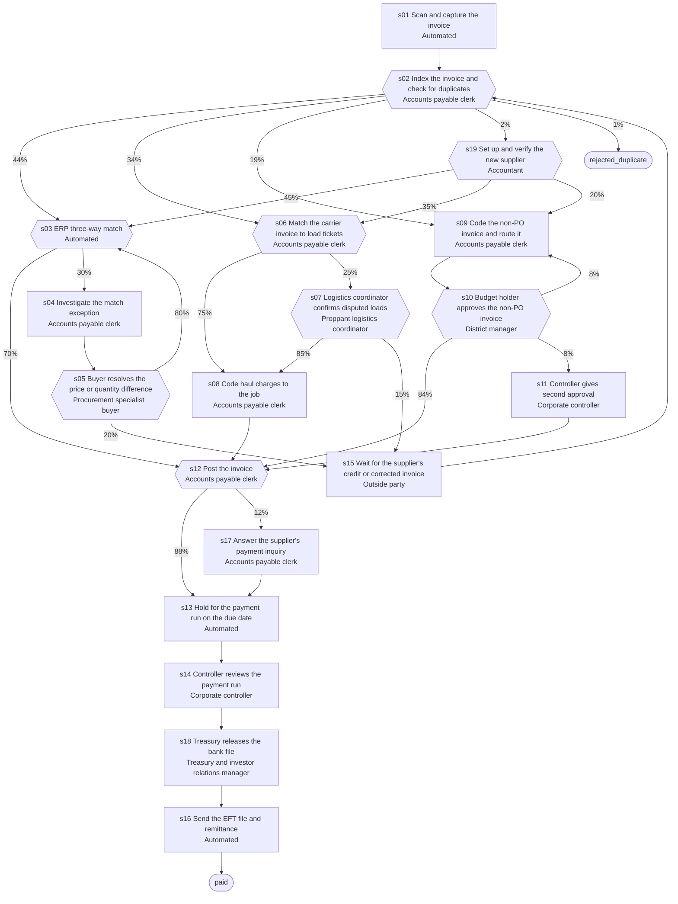

# Pay suppliers and carriers

`ofs-fin-accounts-payable` · oil and gas services (pressure pumping) · finance · part of `oilfield-services-co`

Accounts payable clerks receive supplier and carrier invoices, check each one against the purchase order and goods receipt, or for sand hauling against the load tickets, get non-PO invoices approved, post them and pay them in weekly EFT runs when they fall due. Most of the effort goes into exceptions: price and quantity differences that buyers must settle, missing receipts, and carrier statements whose loads do not match the logistics team's tickets. Payments are released only after the controller and treasury approve the run.

| | |
|---|---|
| Unit of work | one supplier or carrier invoice |
| Starts when | A supplier or carrier invoice arrives by email, the supplier network or post. |
| Done when | The invoice is paid by EFT or cheque and posted, or is rejected as a duplicate. |
| Organisation | A Canadian pressure pumping company buying sand, trucking, chemicals, cement, fuel, gases and parts from a few hundred suppliers, with a ten-person accounts payable team in Calgary paying through an ERP with OCR scanning and weekly EFT runs. (1,350 employees, 2019-2022) |
| Volume | 4,500 cases a month (range 3,000 to 6,500) |

## Where it sits

- Starts with **supplier_invoice** from trucking-carrier (33% of cases)
- Starts with **supplier_invoice** from sand-supplier (7% of cases)
- Starts with **supplier_invoice** from oem-supplier (30% of cases)
- Starts with **supplier_invoice** from chemical-supplier (8% of cases)
- Starts with **supplier_invoice** from cement-supplier (5% of cases)
- Starts with **supplier_invoice** from fuel-supplier (12% of cases)
- Starts with **supplier_invoice** from gas-supplier (5% of cases)
- Relies on **load_ticket** from sc-last-mile-sand-hauling (a standing input; it does not start a case)
- Relies on **purchase_order** from sc-parts-procurement (a standing input; it does not start a case)
- Relies on **goods_receipt** from sc-warehouse-and-inventory-management (a standing input; it does not start a case)
- Sends **supplier_payment** to trucking-carrier (outcome: paid)
- Sends **supplier_payment** to sand-supplier (outcome: paid)
- Sends **supplier_payment** to oem-supplier (outcome: paid)
- Sends **supplier_payment** to chemical-supplier (outcome: paid)
- Sends **supplier_payment** to cement-supplier (outcome: paid)
- Sends **supplier_payment** to fuel-supplier (outcome: paid)
- Sends **supplier_payment** to gas-supplier (outcome: paid)
- Sends **ledger_postings** to fin-month-end-close (outcome: any)
- Sends **cash_requirement** to fin-treasury-and-credit-facility (outcome: any)
- Sends **supplier_invoice** to fin-field-ticket-to-invoice (outcome: any)

## Flow

## Roles

| Role | Department | Layer | FTE on this process | Loaded cost per hour | Evidence |
|---|---|---|---:|---:|---|
| Accounts payable clerk | Finance | individual contributor | 9.5 | 40 CAD | C |
| Procurement specialist (buyer) | Supply chain and logistics | individual contributor | 2 | 54 CAD | C |
| Proppant logistics coordinator | Supply chain and logistics | individual contributor | 1.5 | 52 CAD | C |
| District manager | District operations and dispatch | manager | 0.6 | 125 CAD | C |
| Accountant | Finance | senior specialist | 0.4 | 68 CAD | C |
| Corporate controller | Finance | manager | 0.5 | 135 CAD | C |
| Treasury and investor relations manager | Finance | manager | 0.15 | 115 CAD | C |

## Steps

Hands-on time and the wait before each step show the most common value. Evidence tier A is a sourced number, B a sourced description, C the author's estimate.

| Step | Who | Kind | Hands-on | Wait before | Control | Evidence |
|---|---|---|---:|---:|---|---|
| **s01 Scan and capture the invoice.** Invoices emailed to the AP mailbox or received on paper are scanned and read by OCR into the ERP's invoice inbox with supplier, invoice number, date, amount, GST and PO number; invoices from supplier networks arrive as data. The batch runs several times a day. | Automated | system auto | 0 min | 4.0 h |  | C |
| **s02 Index the invoice and check for duplicates.** The AP clerk confirms the OCR fields against the image, corrects misread amounts or PO numbers, checks the supplier's GST number and searches for the same invoice number and amount already entered. She routes the invoice by type: PO, carrier haul statement or non-PO. | Accounts payable clerk | data entry | 3 min | 1.0 d |  | C |
| **s03 ERP three-way match.** The ERP compares the invoice with the purchase order price and the goods receipt quantity, within set tolerances. Matched invoices go straight to posting; differences go to the clerk's exception queue. | Automated | system auto | 0 min | 0 min | Internal control over financial reporting: three-way match of PO, receipt and invoice before payment | C |
| **s04 Investigate the match exception.** The clerk opens the PO, receipt and invoice side by side and works out whether the price, the quantity or a missing receipt is the problem, then emails the buyer or the warehouse with the details. | Accounts payable clerk | analysis | 12 min | 1.0 d |  | C |
| **s05 Buyer resolves the price or quantity difference.** The procurement specialist checks the agreed price and the delivery with the supplier and the warehouse, then amends the PO, has the receipt posted, or asks the supplier for a credit or corrected invoice. | Procurement specialist (buyer) | judgment | 15 min | 2.0 d |  | B [corpay-ap-benchmarks] |
| **s06 Match the carrier invoice to load tickets.** For sand hauling and other carrier invoices the clerk compares each load on the statement with the logistics team's load tickets and bills of lading: date, truck, origin terminal, well site, weight and standby hours, using the logistics spreadsheet or report. Lines without a ticket or with extra standby are flagged. | Accounts payable clerk | validation | 10 min | 1.0 d |  | B [aogr-proppant-2018] |
| **s07 Logistics coordinator confirms disputed loads.** The proppant logistics coordinator checks the disputed loads against dispatch records, telematics and wellsite delivery confirmations, talks to the carrier's dispatcher and approves or rejects each line. | Proppant logistics coordinator | review | 20 min | 1.0 d |  | C |
| **s08 Code haul charges to the job.** The clerk codes each approved haul line to the job and well so that billing can rebill pass-through hauling to the customer, and attaches the load tickets. | Accounts payable clerk | data entry | 4 min | 1.0 h |  | C |
| **s09 Code the non-PO invoice and route it.** For rentals, services, utilities and other non-PO invoices the clerk enters the GL account, cost centre and job if known, and routes the invoice in the ERP workflow to the budget holder named by the supplier or the district. | Accounts payable clerk | data entry | 6 min | 4.0 h |  | C |
| **s10 Budget holder approves the non-PO invoice.** The district manager (or the relevant shop or department manager) checks that the service was received and the cost is his, and approves, corrects the coding, or rejects it. Field managers approve in batches when they are in the office. | District manager | approval | 4 min | 2.0 d | Delegation of authority: non-PO spend approved by the budget holder | C |
| **s11 Controller gives second approval.** Invoices above the budget holder's limit go to the controller, who checks the contract or quote behind the charge before approving. | Corporate controller | approval | 5 min | 1.0 d | Delegation of authority: invoices above set limits approved by the corporate controller | C |
| **s12 Post the invoice.** The clerk posts the matched or approved invoice in the ERP, which records the liability and the due date from the supplier's payment terms. | Accounts payable clerk | data entry | 2 min | 4.0 h |  | C |
| **s13 Hold for the payment run on the due date.** The posted invoice waits until its due date, then the ERP picks it up in the weekly payment proposal. Most suppliers are paid on 30-day terms counted from the invoice date, some later. | Automated | system auto | 0 min | 14.0 d |  | C [trican-mda-2022] |
| **s14 Controller reviews the payment run.** The controller reviews the weekly payment proposal for large or unusual payments, new or changed bank details and cash position, removes items to hold, and approves the run. | Corporate controller | review | 0.5 min | 1.0 d | Payment runs prepared by AP and approved by the controller; AP cannot release payments | C |
| **s15 Wait for the supplier's credit or corrected invoice.** The supplier or carrier is asked for a credit memo or a corrected invoice and sends it when their billing team gets to it; the original is held. | Outside party | external wait | 0 min | 7.0 d |  | C |
| **s16 Send the EFT file and remittance.** The ERP creates the EFT file for the bank and emails remittance advices to suppliers; cheques are printed for the few suppliers without banking details. | Automated | system auto | 0 min | 1.0 d |  | C |
| **s17 Answer the supplier's payment inquiry.** A supplier or carrier calls or emails asking when an invoice will be paid; the clerk looks up its status, due date and any hold and replies, or asks the supplier to resend an invoice AP never received. | Accounts payable clerk | communication | 10 min | 1.0 d |  | C |
| **s18 Treasury releases the bank file.** The treasury manager logs into the bank portal and gives the second release of the EFT file after checking the total against the approved run and the cash forecast. | Treasury and investor relations manager | approval | 0.2 min | 4.0 h | Dual authorisation of bank payments: a second signer releases the EFT file | C |
| **s19 Set up and verify the new supplier.** An accountant outside AP sets up the new supplier from its vendor form, checks the GST registration and confirms the bank details by calling a known contact before payment can be made. | Accountant | validation | 30 min | 1.0 d | Vendor master changes made and verified outside accounts payable to prevent payment fraud | C |

## Exceptions

| Exception | Share of cases | What happens |
|---|---:|---|
| PO match exception | 13% | Price, quantity or missing receipt on a PO invoice; the buyer fixes the PO or receipt, or asks the supplier for a credit. |
| Disputed haul loads | 8% | Carrier statement lines with no load ticket or disputed standby; logistics confirms or rejects them. |
| Supplier credit or reissue | 4% | The supplier or carrier must send a credit memo or corrected invoice before payment. |
| Non-PO approval delay | 19% | Non-PO invoices wait for field managers to approve them between trips to the field. |

## Benchmarks

| Metric | Value | Unit | Population | Evidence |
|---|---|---|---|---|
| cycle_time_days | p50 30, p90 50 | calendar days from invoice receipt to payment | WCSB oilfield services supplier invoices, 2019-2022 (estimate) | C [trican-mda-2022], [corpay-ap-benchmarks] |
| ap_invoice_cycle_time_cross_industry_days | 15 | days, median, receipt to payment | APQC Open Standards Benchmarking, cross-industry (as reported by Corpay, 2026) | A [corpay-ap-benchmarks] |
| ap_ftes_per_billion_revenue | top_performers 6.2, bottom_performers 21.6 | AP FTEs per $1 billion revenue | APQC, reported via CFO.com and Corpay | A [corpay-ap-benchmarks] |

## Pain points

- Carrier statements cover many loads that must be matched one by one to load tickets held by the logistics team, and missing tickets or standby disputes need the coordinator's time. (steps s06, s07; B [aogr-proppant-2018])
- PO price and quantity exceptions wait in buyers' queues while suppliers call about payment. (steps s04, s05, s17; C)
- Non-PO invoices wait for field managers who approve in batches between field trips. (steps s10; C)
- OCR misreads and duplicate submissions from suppliers who email and post the same invoice need manual checks. (steps s01, s02; C)

## Assumptions

- Loaded costs are the organisation file's (base wage x 1.35).
- The OCR capture tool is added as a workflow system (ocr-capture); the organisation file has no separate system for it.
- District managers (non-PO approvers), an accountant (supplier master) and the treasury manager (second payment release) are added; they are in the organisation file but not listed for this process.
- Average invoice of about $8,000-12,000 is an estimate used to check the organisation file's 4,500 invoices a month against direct costs.
- The wait for the due date (s13) dominates the cycle time and depends on negotiated terms; the APQC 15-day median is a processing benchmark for companies that measure receipt to payment and is not comparable to paying on terms.
- Invoices for sand bought by customers directly are not handled here.
- The simulated median (about 24 days, p90 about 34) is below the 30-day estimate; the difference is in the assumed payment terms at s13 and is within the range of terms suppliers were paid on.
- Hands-on time implies about 12 AP clerk FTE against the organisation file's 10 clerks; either the clerks ran at bottom-quartile productivity with overtime, or step times here are slightly high. 4,500 invoices a month by 10 clerks is about 5,400 invoices per clerk a year.
- Matched and approved PO invoices take no human approval beyond the three-way match, as is common in ERP-based AP in 2019-2022.

## Sources

- [trican-mda-2022] [Trican Well Service Ltd. Management's Discussion and Analysis for the year ended December 31, 2022](https://tricanwellservice.com/app/uploads/2023/02/TCW-Q4-2022-MDA-2023.02.22.pdf) (Trican Well Service Ltd., 2023). A job is typically represented by an invoice and invoice frequency depends on how often the customer asks to be billed during a project; 7,625 jobs in 2022 and 7,291 in 2021; Q4 2022 revenue $236.5 million and Q4 2021 $156.4 million; trade and other receivables $175.4 million at December 31, 2022 and $127.8 million at December 31, 2021; trade and other payables $90.9 million at December 31, 2022; Q4 2022 direct costs $133.4 million; more than 60 customers; one customer 40% of accounts receivable in 2022 (35% in 2021) and 31% of revenue; expected credit losses measured with a provision matrix; working capital and credit facilities cover timing differences between cash collections and payments.
- [corpay-ap-benchmarks] [AP Team Productivity: Benchmarks and How Automation Moves Them](https://www.corpay.com/resources/blog/ap-team-productivity-benchmarks) (Corpay, 2026). Table attributed to APQC Open Standards Benchmarking: cost per invoice $6.00 median; invoice cycle time 15 days median from receipt to payment; about 5% exception rate (95% of disbursements error-free the first time); APQC work reported via CFO.com: top performers 6.2 or fewer AP FTEs per $1 billion of revenue, bottom performers 21.6 or more. Cross-industry figures reported by a payments vendor in 2026.
- [aogr-proppant-2018] [Real-Time Data Collection Optimizes Proppant Logistics](https://www.aogr.com/magazine/cover-story/real-time-data-collection-optimizes-proppant-logistics) (The American Oil & Gas Reporter, 2018). August 2018: container sand delivery adds work for frac van personnel recording delivery tickets; about 200 containers a day on a wellsite; bill of lading data tied to each container and stage and sent electronically for verification and billing to payables.

Written by claude-opus on 2026-11-24.
