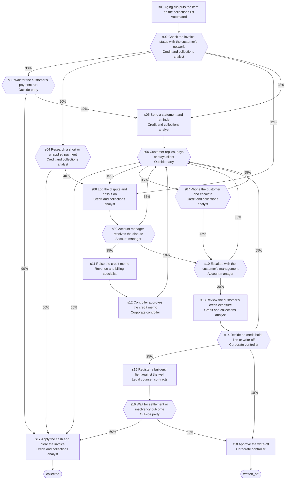

# Collect customer payments

`ofs-fin-accounts-receivable-and-collections` · oil and gas services (pressure pumping) · finance · part of `oilfield-services-co`

Credit and collections analysts work the receivables that do not clear on their own: invoices past their due date, payments that arrive short or without a usable remittance, and invoices the customer has disputed. They check the invoice's status in the customer's e-invoicing network, send statements and reminders, phone customers' payables staff, and pass disputes to account managers. Collections are slow because producers pay on long cycles and only after invoice approval, and because a few large customers hold much of the balance; when a producer gets into financial trouble the company puts the account on hold, may register a builders' lien against the well, and sometimes writes the debt off.

| | |
|---|---|
| Unit of work | one collection follow-up (an overdue, short-paid or disputed invoice taken up by the credit team) |
| Starts when | The weekly aging run flags an invoice past its due date, or the daily cash application leaves a payment short, unapplied or with a deduction. |
| Done when | The cash is applied and the invoice cleared, or the balance is written off with approval. |
| Organisation | A Canadian pressure pumping company with more than 60 producer customers, one of which holds 35-40% of receivables, and a five-person credit and collections team in the Calgary finance department. (1,350 employees, 2019-2022) |
| Volume | 250 cases a month (range 150 to 400) |

## Where it sits

- Starts with **invoice** from fin-field-ticket-to-invoice (75% of cases)
- Starts with **customer_payment** from producer (25% of cases)
- Sends **cash_receipts** to fin-treasury-and-credit-facility (outcome: collected)
- Sends **ledger_postings** to fin-month-end-close (outcome: any)
- Sends **ar_aging** to cs-account-management (outcome: any)
- Sends **collection_notice** to producer (outcome: any)

## Flow

## Roles

| Role | Department | Layer | FTE on this process | Loaded cost per hour | Evidence |
|---|---|---|---:|---:|---|
| Credit and collections analyst | Finance | individual contributor | 2.4 | 50 CAD | C |
| Account manager | Sales and customer relations | senior specialist | 1.5 | 90 CAD | C |
| Revenue and billing specialist | Finance | individual contributor | 0.2 | 45 CAD | C |
| Corporate controller | Finance | manager | 0.3 | 135 CAD | C |
| Legal counsel (contracts) | Legal, risk and regulatory | senior specialist | 0.1 | 120 CAD | C |

## Steps

Hands-on time and the wait before each step show the most common value. Evidence tier A is a sourced number, B a sourced description, C the author's estimate.

| Step | Who | Kind | Hands-on | Wait before | Control | Evidence |
|---|---|---|---:|---:|---|---|
| **s01 Aging run puts the item on the collections list.** Each week the ERP aging report lists invoices past their due date by customer, and each day the bank file of EFT and cheque payments is matched to open invoices; items that cannot be matched in full drop into the credit analyst's worklist. | Automated | system auto | 0 min | 1.0 d |  | C |
| **s02 Check the invoice status with the customer's network.** The credit analyst looks the invoice up in the customer's e-invoicing network and the ERP: whether it was approved, is still with an approver, was rejected, or is scheduled for a payment run, and whether a remittance came in. | Credit and collections analyst | lookup | 10 min | 1.0 d |  | B [cenovus-invoicing] |
| **s03 Wait for the customer's payment run.** Approved invoices are paid in the producer's next scheduled payment run, often weekly or twice a month and on the producer's own terms counted from approval rather than from the invoice date. | Outside party | external wait | 0 min | 5.0 d |  | B [yager-2015] |
| **s04 Research a short or unapplied payment.** The analyst reads the remittance advice from the customer's network or email, matches the payment to invoices, and works out any deduction: a disputed line, a credit taken twice, a GST difference or an invoice the customer never received. | Credit and collections analyst | analysis | 30 min | 4.0 h |  | C |
| **s05 Send a statement and reminder.** The analyst emails the customer's payables contact a statement of overdue invoices with copies of the invoices and signed tickets, asking for a payment date. | Credit and collections analyst | communication | 10 min | 1.0 h |  | C |
| **s06 Customer replies, pays or stays silent.** The customer's payables team checks its system and pays, replies with a reason such as a missing approval or a dispute, or does not answer. | Outside party | external wait | 0 min | 7.0 d |  | C |
| **s07 Phone the customer and escalate.** The analyst phones the customer's payables lead, and if there is still no commitment asks the account manager to raise it with the customer's operations contact. | Credit and collections analyst | communication | 20 min | 4.0 h |  | C |
| **s08 Log the dispute and pass it on.** The analyst records the dispute reason and amount in the collections notes and sends it to the account manager, copying billing, with the invoice, tickets and the customer's comment. | Credit and collections analyst | coordination | 20 min | 1.0 h |  | C |
| **s09 Account manager resolves the dispute.** The account manager discusses the disputed price, quantity or standby with the customer's completions or drilling lead, using the signed ticket and tender pricing, and agrees that the charge stands, that a credit is due, or that it needs escalation. | Account manager | judgment | 1.0 h | 3.0 d |  | C |
| **s10 Escalate with the customer's management.** At the weekly aging meeting the account manager, credit team and controller review the oldest balances; the account manager then calls a senior contact at the customer, sometimes tying payment to further work. | Account manager | communication | 45 min | 3.0 d |  | C |
| **s11 Raise the credit memo.** A billing specialist prepares the credit memo in the ERP for the agreed amount, referencing the original invoice, the dispute notes and the account manager's email confirming the agreement. | Revenue and billing specialist | data entry | 30 min | 1.0 d |  | C |
| **s12 Controller approves the credit memo.** The controller checks the credit memo against the dispute notes and approves it, after which the customer is told and the remaining balance is collected. | Corporate controller | approval | 10 min | 1.0 d | Internal control over financial reporting: credit memos approved by someone other than the preparer | C |
| **s13 Review the customer's credit exposure.** The analyst pulls the customer's total balance, aging, credit limit, recent payment pattern and public news or a credit report, and summarises the exposure, including work booked for the coming weeks. | Credit and collections analyst | analysis | 1.0 h | 1.0 d |  | B [trican-mda-2022] |
| **s14 Decide on credit hold, lien or write-off.** The controller, with the account manager's input, decides whether to put the account on hold for new work, register a lien against the well, keep collecting, or provide for and write off the balance when the producer is insolvent. | Corporate controller | judgment | 30 min | 2.0 d | Company credit policy: credit holds and liens approved by the corporate controller | C |
| **s15 Register a builders' lien against the well.** Legal counsel prepares a statement of lien for the unpaid well work and registers it against the producer's mineral lease with the Minister of Energy within 90 days of the last work, then diarises the 180-day deadline for a lis pendens and an action. | Legal counsel (contracts) | drafting | 2.0 h | 3.0 d | Builders' Lien Act (Alberta): liens for work on an oil or gas well registered within 90 days; lis pendens within 180 days | B [bj-liens-2014] |
| **s16 Wait for settlement or insolvency outcome.** The producer pays to clear the lien, negotiates a settlement, or enters receivership or CCAA proceedings, in which case the company files a claim and waits for the distribution. | Outside party | external wait | 0 min | 42.0 d |  | B [bj-liens-2014] |
| **s17 Apply the cash and clear the invoice.** The analyst applies the payment to the invoice in the ERP, clears any approved credit memo against it and notes the collection in the follow-up log. | Credit and collections analyst | data entry | 10 min | 1.0 d |  | C |
| **s18 Approve the write-off.** The controller approves writing off the balance against the expected credit loss allowance, with support from legal for insolvent customers, and the analyst posts the entry. | Corporate controller | approval | 40 min | 7.0 d | IFRS 9 expected credit loss allowance and company write-off approval limits, reviewed by the external auditor | B [trican-mda-2022] |

## Exceptions

| Exception | Share of cases | What happens |
|---|---:|---|
| Short payment or deduction | 20% | A payment arrives short or without remittance; the analyst researches and disputes the deduction. |
| Disputed invoice and credit | 12% | The customer disputes a charge; the account manager agrees a credit and a credit memo is approved. |
| Escalation to customer management | 7% | No reply to reminders and calls; the account manager escalates with the customer's management. |
| Distressed producer: lien and write-off | 1% | A producer in financial trouble is put on credit hold, a lien is registered and part is written off. |

## Benchmarks

| Metric | Value | Unit | Population | Evidence |
|---|---|---|---|---|
| cycle_time_days | p50 21, p90 60 | calendar days from the item entering the collections list to cash applied or write-off | Overdue and short-paid producer invoices at a WCSB pressure pumper, 2019-2022 (estimate) | C [trican-mda-2022], [yager-2015] |
| days_sales_outstanding_year_end | 2021 75, 2022 68 | days (receivables / Q4 revenue x 92) | Trican Well Service, December 31 2021 and 2022 | A [trican-mda-2022] |
| largest_customer_share_of_receivables | 2021 0.35, 2022 0.4 | share of accounts receivable | Trican Well Service | A [trican-mda-2022] |

## Pain points

- Producers pay only after invoice approval and on their own long cycles, so many items are 'overdue' only because they are still with an approver. (steps s02, s03, s06; B [yager-2015])
- Remittances arrive in portals and emails in different formats, so short payments and deductions take research. (steps s04; C)
- Disputes depend on account managers who are often with customers or on bids, and credit memos need controller approval. (steps s09, s11, s12; C)
- Concentration in one large customer and producer distress in 2019-2020 made credit decisions and liens slow and high-stakes. (steps s13, s14, s15, s16; B [trican-mda-2022], [bj-liens-2014])

## Assumptions

- Loaded costs are the organisation file's (base wage x 1.35).
- Routine cash application of the roughly 620 payments a month that match automatically is not a case here; only exceptions and overdue items are. Credit analyst FTE is set above the hands-on estimate to cover it.
- Billing specialists (credit memos) and legal counsel (liens) are added; the organisation file lists only credit analysts, the controller and account managers for this process.
- The organisation file links this process only to invoices and payments; disputes also feed back to fin-field-ticket-to-invoice as credit memos, which is not shown as a business object link.
- Lien registration is shown for Alberta wells; BC has a similar Builders Lien Act. Shares of liens and write-offs are low ordinary-year values; 2020 had more.
- The simulated median (about 15 days, p90 about 43) is below the 21-day estimate: items already approved and scheduled for payment clear in about a week and pull the median down. The estimate is unsourced, so the gap is left.

## Sources

- [trican-mda-2022] [Trican Well Service Ltd. Management's Discussion and Analysis for the year ended December 31, 2022](https://tricanwellservice.com/app/uploads/2023/02/TCW-Q4-2022-MDA-2023.02.22.pdf) (Trican Well Service Ltd., 2023). A job is typically represented by an invoice and invoice frequency depends on how often the customer asks to be billed during a project; 7,625 jobs in 2022 and 7,291 in 2021; Q4 2022 revenue $236.5 million and Q4 2021 $156.4 million; trade and other receivables $175.4 million at December 31, 2022 and $127.8 million at December 31, 2021; trade and other payables $90.9 million at December 31, 2022; Q4 2022 direct costs $133.4 million; more than 60 customers; one customer 40% of accounts receivable in 2022 (35% in 2021) and 31% of revenue; expected credit losses measured with a provision matrix; working capital and credit facilities cover timing differences between cash collections and payments.
- [cenovus-invoicing] [Invoicing for suppliers](https://www.cenovus.com/contractor/invoicing-for-suppliers.html) (Cenovus Energy, 2026). No paper invoices; for OpenInvoice purchase orders suppliers submit field tickets for approval, monitor OpenInvoice for approved field tickets and only then submit invoices from them; back-up such as daily time tickets attached; invoices against approved goods receipts; WBS/AFE and work order coding formats that must be entered in OpenInvoice. Current page; describes the practice of a large Canadian producer.
- [yager-2015] [The Broken Payment Model That Costs The Oil Industry Millions](https://oilprice.com/Energy/Energy-General/The-Broken-Payment-Model-That-Costs-The-Oil-Industry-Millions.html) (OilPrice.com (David Yager, Calgary), 2015). Canadian oilfield services commentary (July 2015): the field ticket is prepared by the contractor's representative and signed by the producer's representative; the invoice must be perfect to be paid; payment delays follow when billing procedures are not followed; three-month payment is an accepted norm and some producers will not pay before 90 and possibly 120 days; many vendors carry receivables over 90 days.
- [bj-liens-2014] [Oil, Gas, Mines, Minerals: Security under the Alberta Builders' Lien Act](https://www.bennettjones.com/Insights/Blogs/2014/06/Oil-Gas-Mines-Minerals-Security-under-the-Alberta-Builders-Lien-Act) (Bennett Jones LLP, 2014). A lien against a mineral interest for work on an oil or gas well or well site generally must be registered within 90 days of the last work or materials; liens on Crown mineral leases are registered with the Minister of Energy; a certificate of lis pendens and an action are needed within 180 days or the lien expires; the lien does not attach to sale proceeds, so security can be weak.

Written by claude-opus on 2026-11-24.
