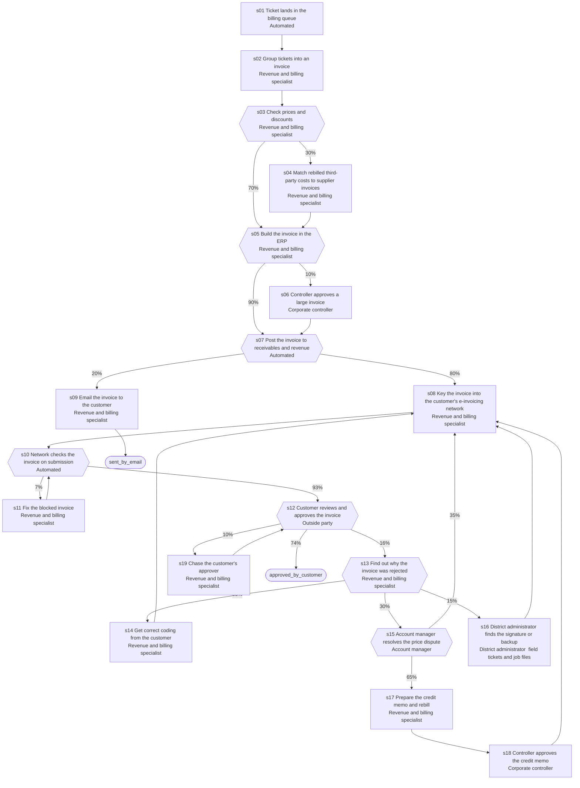

# Turn field tickets into invoices

`ofs-fin-field-ticket-to-invoice` · oil and gas services (pressure pumping) · finance · part of `oilfield-services-co`

Billing specialists in head office turn signed field tickets into customer invoices. They group the tickets for a job, well or pad according to each customer's billing rules, check prices and rebilled third-party costs, build the invoice in the ERP and key it with the customer's cost coding into the customer's e-invoicing network, attaching the signed tickets. Invoices are slowed by waiting for all daily tickets of a pad and for supplier invoices to rebill, and are rejected by customers for wrong coding, price differences or missing signatures, which sends them back for rework and resubmission.

| | |
|---|---|
| Unit of work | one customer invoice (one job, one well or one pad, made of one or more field tickets) |
| Starts when | Signed or customer-approved field tickets are released to the billing queue in the ERP. |
| Done when | The customer has approved the invoice for payment in its e-invoicing network, or has received an emailed invoice with no dispute, and the invoice sits in accounts receivable. |
| Organisation | A Canadian pressure pumping company billing more than 60 oil and gas producers per job from signed field tickets, with a central billing team in the Calgary finance department and most invoices submitted through customers' e-invoicing networks. (1,350 employees, 2019-2022) |
| Volume | 620 cases a month (range 300 to 800) |

## Where it sits

- Starts with **signed_field_ticket** from fo-dist-field-ticket-preparation (100% of cases)
- Relies on **price_book** from cs-price-book-maintenance (a standing input; it does not start a case)
- Relies on **system_change** from it-erp-and-application-support (a standing input; it does not start a case)
- Relies on **supplier_invoice** from fin-accounts-payable (a standing input; it does not start a case)
- Sends **invoice** to producer (outcome: approved_by_customer)
- Sends **invoice** to fin-accounts-receivable-and-collections (outcome: approved_by_customer)
- Sends **invoice** to producer (outcome: sent_by_email)
- Sends **invoice** to fin-accounts-receivable-and-collections (outcome: sent_by_email)
- Sends **ledger_postings** to fin-month-end-close (outcome: any)

## Flow

## Roles

| Role | Department | Layer | FTE on this process | Loaded cost per hour | Evidence |
|---|---|---|---:|---:|---|
| Revenue and billing specialist | Finance | individual contributor | 11 | 45 CAD | C |
| Corporate controller | Finance | manager | 0.2 | 135 CAD | C |
| Account manager | Sales and customer relations | senior specialist | 0.4 | 90 CAD | C |
| District administrator (field tickets and job files) | District operations and dispatch | individual contributor | 0.1 | 40 CAD | C |

## Steps

Hands-on time and the wait before each step show the most common value. Evidence tier A is a sourced number, B a sourced description, C the author's estimate.

| Step | Who | Kind | Hands-on | Wait before | Control | Evidence |
|---|---|---|---:|---:|---|---|
| **s01 Ticket lands in the billing queue.** When the district releases a ticket, the ERP adds it to the billing work queue for the customer's billing specialist with the ticket image, job number and attachments. Queues are refreshed overnight. | Automated | system auto | 0 min | 0 min |  | C |
| **s02 Group tickets into an invoice.** The billing specialist checks the customer's billing rule (per job, per well, per pad or monthly) and collects all tickets that belong on the invoice. For a frac pad she waits until the last day ticket of the well or pad is released, and for multi-day coiled tubing work until the job is finished. | Revenue and billing specialist | coordination | 20 min | 1.0 d |  | B [trican-mda-2022] |
| **s03 Check prices and discounts.** She compares each ticket line with the customer's price book or tender pricing in the ERP, applies the discount tier, fuel surcharge, minimum charges and proppant pricing, and looks for charges the district may have priced from an old price book. | Revenue and billing specialist | validation | 25 min | 4.0 h |  | B [cnrl-oi-standards] |
| **s04 Match rebilled third-party costs to supplier invoices.** For sand hauling, water, rentals and other pass-through items she finds the supplier invoice in accounts payable, checks the quantities against the field ticket and adds the contract markup. If the supplier has not yet invoiced, the invoice waits or goes out with an estimate the customer may reject. | Revenue and billing specialist | lookup | 30 min | 4.0 d |  | B [chevron-smart-2021] |
| **s05 Build the invoice in the ERP.** She creates the billing document from the ticket lines, enters the customer's AFE or cost centre and approver from the ticket, applies GST and attaches the signed tickets and backup. Large invoices are flagged for the controller. | Revenue and billing specialist | data entry | 25 min | 2.0 h |  | C |
| **s06 Controller approves a large invoice.** The controller reviews invoices over the approval threshold, usually multi-well frac pads, for pricing, discounts and revenue recognition before they are released. | Corporate controller | approval | 10 min | 1.0 d | Delegation of authority: invoices above a set value approved by the corporate controller | C |
| **s07 Post the invoice to receivables and revenue.** The ERP posts the invoice to the customer's receivable account and to revenue by service line and district in the nightly run, and prints the PDF for submission. | Automated | system auto | 0 min | 0 min |  | C |
| **s08 Key the invoice into the customer's e-invoicing network.** The billing specialist re-keys the invoice header and lines into the customer's network (mostly OpenInvoice), selects the customer site and approver code, enters AFE or cost centre, WBS and GL coding and every field ticket number, and uploads the signed tickets and backup. | Revenue and billing specialist | data entry | 20 min | 4.0 h |  | B [cnrl-oi-standards], [cenovus-invoicing] |
| **s09 Email the invoice to the customer.** For customers without a network, she emails the invoice PDF with the signed tickets to the customer's accounts payable mailbox and notes the date sent in the ERP. | Revenue and billing specialist | communication | 8 min | 2.0 h |  | C |
| **s10 Network checks the invoice on submission.** The customer's network runs its rules as soon as the invoice is submitted: required fields, price book and PO match, valid coding format and duplicate field ticket numbers. Invoices with a red alert cannot be submitted. | Automated | system auto | 0 min | 0 min | Customer invoice submission standards enforced by the e-invoicing network | B [cnrl-oi-standards] |
| **s11 Fix the blocked invoice.** The billing specialist reads the red alert in the network, corrects the price book reference, coding format, currency or duplicate ticket number, and resubmits the invoice. | Revenue and billing specialist | data entry | 12 min | 1.0 h |  | C |
| **s12 Customer reviews and approves the invoice.** The customer's field approver and cost accountant check the invoice against the approved tickets, their AFE and their contract pricing, then approve it for payment, reject it with a reason, or leave it waiting in their queue. | Outside party | external wait | 0 min | 6.0 d |  | B [chevron-smart-2021], [yager-2015] |
| **s13 Find out why the invoice was rejected.** She reads the rejection comment, opens the ticket and contract, and sorts the problem: wrong coding, a disputed price or quantity, or a missing signature or backup. | Revenue and billing specialist | analysis | 20 min | 1.0 d |  | B [enverus-pain-points] |
| **s14 Get correct coding from the customer.** She emails the customer's approver or cost accountant for the right AFE, cost centre or WBS, and waits for the reply before re-keying. | Revenue and billing specialist | communication | 15 min | 2.0 d |  | C |
| **s15 Account manager resolves the price dispute.** The account manager talks to the customer's completions or drilling lead about the disputed price, discount or quantity, using the tender pricing and the signed ticket, and agrees either that the charge stands or that a credit will be given. | Account manager | judgment | 1.0 h | 3.0 d |  | C |
| **s16 District administrator finds the signature or backup.** The billing specialist asks the district administrator to get the ticket signed or approved by the customer's field representative, or to find the missing supplier ticket, and resubmits once it arrives. | District administrator (field tickets and job files) | coordination | 30 min | 2.0 d |  | C |
| **s17 Prepare the credit memo and rebill.** She raises a credit memo for the disputed invoice and a corrected invoice in the ERP, referencing the original invoice and the agreement with the customer. | Revenue and billing specialist | data entry | 30 min | 8.0 h |  | C |
| **s18 Controller approves the credit memo.** The controller reviews the credit memo against the agreed outcome and approves it; billing staff cannot post credits they raised themselves. | Corporate controller | approval | 10 min | 1.0 d | Internal control over financial reporting: credit memos approved by someone other than the preparer | C |
| **s19 Chase the customer's approver.** Each week she runs the list of e-invoices not approved after two weeks and emails or calls the customer's approver, copying the account manager for large invoices. | Revenue and billing specialist | communication | 10 min | 1.0 d |  | C |

## Exceptions

| Exception | Share of cases | What happens |
|---|---:|---|
| Waiting on supplier invoice for rebill | 30% | Pass-through sand hauling, water or rental charges cannot be billed until the supplier's invoice arrives. |
| Coding rejection | 9% | Customer rejects for wrong AFE, cost centre or WBS; new coding is requested and the invoice re-keyed. |
| Price dispute and credit | 5% | Customer disputes a price or quantity; the account manager agrees a credit, a credit memo and rebill follow. |
| Submission blocked by network rules | 7% | The e-invoicing network blocks the invoice for a price book, PO or duplicate ticket alert. |

## Benchmarks

| Metric | Value | Unit | Population | Evidence |
|---|---|---|---|---|
| cycle_time_days | p50 14, p90 40 | calendar days from ticket released to billing to invoice approved by the customer | WCSB oilfield service invoices to producers, 2019-2022 (estimate) | C [trican-mda-2022] |
| days_sales_outstanding_year_end | 2021 75, 2022 68 | days (receivables / Q4 revenue x 92) | Trican Well Service, December 31 2021 and 2022 | A [trican-mda-2022] |
| producer_payment_norm_days | 90 | days (accepted norm per commentator; some producers 90-120) | Canadian oilfield services, mid-2010s | B [yager-2015] |

## Pain points

- Each customer has its own coding format, approver codes and portal rules, and coding errors are the most common rejection. (steps s08, s13, s14; B [enverus-pain-points], [cnrl-oi-standards], [cenovus-invoicing])
- The invoice is built in the ERP and then re-keyed into the customer's network, so the same data is entered twice. (steps s05, s08; B [enverus-51ofs])
- Pass-through charges wait on supplier invoices, holding up the whole customer invoice. (steps s04; C)
- Invoices sit unapproved in customer queues for weeks and need weekly chasing. (steps s12, s19; B [yager-2015])

## Assumptions

- Loaded costs are the organisation file's (base wage x 1.35).
- Account managers are added because they settle price disputes; the organisation file lists only billing specialists, district administrators and the controller for this process.
- Accounts payable supplies supplier invoices for rebilled third-party costs, shown as a standing input from fin-accounts-payable.
- The process ends when the customer approves the invoice (or it is emailed); payment, short payments and collection follow-up belong to fin-accounts-receivable-and-collections.
- Emailed invoices (about 20%) end on sending, so their customer review time is not in this process; this pulls the simulated median below the e-invoice median.
- The simulated median (about 15.5 days, p90 about 33) agrees with the 14-day estimate; it is driven by customer approval waits in the e-invoicing network and by pads waiting for their last daily tickets.
- Year-end receivables to Q4 revenue gives 68-75 days of sales outstanding; this includes the field ticket, billing and customer payment-term periods and is a cross-check rather than this process's cycle time.

## Sources

- [trican-mda-2022] [Trican Well Service Ltd. Management's Discussion and Analysis for the year ended December 31, 2022](https://tricanwellservice.com/app/uploads/2023/02/TCW-Q4-2022-MDA-2023.02.22.pdf) (Trican Well Service Ltd., 2023). A job is typically represented by an invoice and invoice frequency depends on how often the customer asks to be billed during a project; 7,625 jobs in 2022 and 7,291 in 2021; Q4 2022 revenue $236.5 million and Q4 2021 $156.4 million; trade and other receivables $175.4 million at December 31, 2022 and $127.8 million at December 31, 2021; trade and other payables $90.9 million at December 31, 2022; Q4 2022 direct costs $133.4 million; more than 60 customers; one customer 40% of accounts receivable in 2022 (35% in 2021) and 31% of revenue; expected credit losses measured with a provision matrix; working capital and credit facilities cover timing differences between cash collections and payments.
- [enverus-pain-points] [7 Field Ticketing Pain Points in Upstream Oil & Gas and How Digital Solutions Are Changing the Game](https://www.enverus.com/blog/7-field-ticketing-pain-points-in-upstream-oil-gas-and-how-digital-solutions-are-changing-the-game/) (Enverus, 2025). Vendor blog (November 2025, US practice): technicians drive paper tickets to field offices for approval; lost or damaged tickets delay payment for weeks; most ticket disputes are about coding errors or who requested the work rather than price, and supplier-provided coding raises dispute rates; duplicate charges and inflated hours are hard to catch on paper; the average time from service to ticket submission is over seven days when tickets go through back-office staff; digital ticketing users process invoices 3-4 times faster than paper users.
- [enverus-51ofs] [Get Paid Faster With Digital Field Tickets (51 Oilfield Services customer story)](https://www.enverus.com/customer-story/get-paid-faster-with-digital-field-tickets/) (Enverus, 2024). Vendor case study (July 2024, Texas roustabout contractor): paper process of keying tickets into a spreadsheet, scanning and emailing to head office, re-keying into accounting, printing, tracking down the company man for a signature and re-keying into OpenInvoice; about 900 field tickets a month for one customer; tickets entered three times; with mobile tickets and same-day electronic approval, tickets usually approved the next day; ticket submission to payment fell from 1-2 months to 7-10 days; operators use spend codes; OpenInvoice used by most E&P companies in the US market.
- [chevron-smart-2021] [CBU Wells Supplier Rules for SMART Submissions (March 30, 2021)](https://canada-test.chevron.com/-/media/canada/work-with-us/documents/Wells-Supplier-Rules-for-SMART-Mar-2021.pdf) (Chevron Canada, 2021). Rules for drilling, completions/frac and intervention suppliers: invoices that break the rules are rejected and sent back for correction; work location as pad LSD or well UWI; amount approved on the attached ticket must match the final invoice; backup for third-party charges; field ticket with a stamp carrying WBS elements and GL account and a digital signature must be attached; GL account and WBS on the invoice must match the stamp.
- [cenovus-invoicing] [Invoicing for suppliers](https://www.cenovus.com/contractor/invoicing-for-suppliers.html) (Cenovus Energy, 2026). No paper invoices; for OpenInvoice purchase orders suppliers submit field tickets for approval, monitor OpenInvoice for approved field tickets and only then submit invoices from them; back-up such as daily time tickets attached; invoices against approved goods receipts; WBS/AFE and work order coding formats that must be entered in OpenInvoice. Current page; describes the practice of a large Canadian producer.
- [cnrl-oi-standards] [Canadian Natural Supplier Submission Guidelines (OpenInvoice submission standards), last updated August 2025](https://www.cnrl.com/content/uploads/2025/08/Canadian-Natural-OI-Submission-Standards.pdf) (Canadian Natural Resources Limited, 2025). Invoice header and line requirements in OpenInvoice; all field ticket numbers entered and duplicates not allowed; price book on the invoice must match the PO price book or a red alert blocks submission; PO compliance alerts; credits entered as negative quantities; approver codes by site and department.
- [yager-2015] [The Broken Payment Model That Costs The Oil Industry Millions](https://oilprice.com/Energy/Energy-General/The-Broken-Payment-Model-That-Costs-The-Oil-Industry-Millions.html) (OilPrice.com (David Yager, Calgary), 2015). Canadian oilfield services commentary (July 2015): the field ticket is prepared by the contractor's representative and signed by the producer's representative; the invoice must be perfect to be paid; payment delays follow when billing procedures are not followed; three-month payment is an accepted norm and some producers will not pay before 90 and possibly 120 days; many vendors carry receivables over 90 days.

Written by claude-opus on 2026-11-24.
