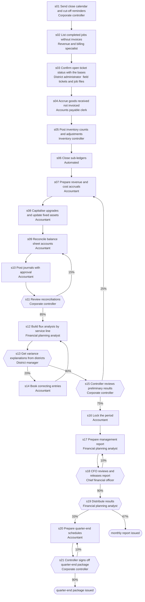

# Close the books monthly

`ofs-fin-month-end-close` · oil and gas services (pressure pumping) · finance (accounting and reporting) · part of `oilfield-services-co`

Each month the finance team closes the ledger and produces results by service line and district for management, and at quarter-end the package for the public financial statements. Billing specialists and district administrators work out which completed jobs have no signed field ticket yet so that revenue can be accrued, accounts payable accrues goods received but not invoiced, inventory counts are posted, and about eight accountants prepare accruals, capitalise equipment upgrades, reconcile balance sheet accounts and post journals. A financial analyst explains variances with district managers, the controller reviews and the CFO signs off the management report. Unsigned field tickets, late supplier invoices for sand, trucking and parts, and spreadsheet reconciliations are what make the close slow and the accruals uncertain.

| | |
|---|---|
| Unit of work | one monthly close |
| Starts when | The calendar month ends; the close calendar starts on the first working day of the next month. |
| Done when | The period is locked in the ERP, balance sheet accounts are reconciled and reviewed, and the controller and CFO have issued the monthly management report by service line (at quarter-end also the package for quarterly reporting). |
| Organisation | A listed Canadian pressure pumper of about 1,350 people, roughly 880 of them field staff on rotation or on call at nine district bases, with a Calgary head office for finance, HR, HSE and engineering. (1,350 employees, 2019-2022) |
| Volume | 1 cases a month (range 1 to 1) |

## Where it sits

- Starts with **ledger_postings** from fin-field-ticket-to-invoice (40% of cases)
- Starts with **ledger_postings** from fin-accounts-payable (25% of cases)
- Starts with **ledger_postings** from fin-payroll-processing (15% of cases)
- Starts with **ledger_postings** from fin-accounts-receivable-and-collections (10% of cases)
- Starts with **ledger_postings** from fin-government-subsidy-claims (5% of cases)
- Starts with **ledger_postings** from em-asset-disposal (5% of cases)
- Relies on **inventory_count** from sc-warehouse-and-inventory-management (a standing input; it does not start a case)
- Relies on **field_ticket** from fo-dist-field-ticket-preparation (a standing input; it does not start a case)
- Sends **management_report** to exec-operations-performance-review (outcome: any)
- Sends **management_report** to fin-budget-and-forecast (outcome: any)
- Sends **financial_statements** to fin-quarterly-reporting-and-disclosure (outcome: quarter-end package issued)

## Flow

## Roles

| Role | Department | Layer | FTE on this process | Loaded cost per hour | Evidence |
|---|---|---|---:|---:|---|
| Accountant | Finance | senior specialist | 4 | 68 CAD | C |
| Corporate controller | Finance | manager | 0.3 | 135 CAD | C |
| Financial planning analyst | Finance | individual contributor | 1 | 63 CAD | C |
| Revenue and billing specialist | Finance | individual contributor | 0.8 | 45 CAD | C |
| District administrator (field tickets and job files) | District operations and dispatch | individual contributor | 0.5 | 40 CAD | C |
| Accounts payable clerk | Finance | individual contributor | 0.4 | 40 CAD | C |
| Inventory controller | Supply chain and logistics | individual contributor | 0.2 | 45 CAD | C |
| District manager | District operations and dispatch | manager | 0.1 | 125 CAD | C |
| Chief financial officer | Executive office | executive | 0.03 | 230 CAD | C |

## Steps

Hands-on time and the wait before each step show the most common value. Evidence tier A is a sourced number, B a sourced description, C the author's estimate.

| Step | Who | Kind | Hands-on | Wait before | Control | Evidence |
|---|---|---|---:|---:|---|---|
| **s01 Send close calendar and cut-off reminders.** The controller sends the close calendar with due dates by day, reminds districts to release field tickets and goods receipts and confirms the date the sub-ledgers will be closed. | Corporate controller | communication | 30 min | 0 min |  | C |
| **s02 List completed jobs without invoices.** Billing specialists run the job list from the field ticket system and ERP, mark every job completed in the month that has not been invoiced, and record why: ticket unsigned on the customer's portal, disputed, or not yet priced. | Revenue and billing specialist | analysis | 5.0 h | 12.0 h |  | C |
| **s03 Confirm open ticket status with the bases.** District administrators check each open ticket on the list, add the expected amount from the price book and job notes, and chase customer field supervisors for signatures that would let the job be invoiced before the cut-off. | District administrator (field tickets and job files) | communication | 2.5 h | 2.0 h |  | C |
| **s04 Accrue goods received not invoiced.** AP clerks run the received-not-invoiced report, add sand, trucking, fuel and rental charges known from load tickets and supplier statements but not yet invoiced, and send the accrual list to accounting. | Accounts payable clerk | analysis | 4.0 h | 4.0 h |  | C |
| **s05 Post inventory counts and adjustments.** The inventory controller posts month-end counts of sand, chemicals, cement and parts from the bases and plants, investigates large differences with the warehouse and books the adjustments. | Inventory controller | data entry | 3.0 h | 8.0 h |  | C |
| **s06 Close sub-ledgers.** The ERP closes billing, payables, inventory and fixed asset sub-ledgers for the month, runs depreciation and posts the sub-ledger totals to the general ledger. | Automated | system auto | 0 min | 4.0 h |  | C |
| **s07 Prepare revenue and cost accruals.** Accountants turn the unbilled jobs and cost accrual lists into journal entries by service line and district, accrue payroll for days worked but not paid and bonuses, and reverse last month's accruals. | Accountant | judgment | 7.0 h | 1.0 h |  | C |
| **s08 Capitalise upgrades and update fixed assets.** An accountant moves completed equipment upgrade and rebuild costs from capital work in progress to fixed assets, checks capital versus repair coding on large work orders and books disposals. | Accountant | analysis | 4.0 h | 0 min |  | C |
| **s09 Reconcile balance sheet accounts.** Accountants reconcile cash, receivables, unbilled revenue, inventory, prepaid, fixed asset, payroll clearing, accrued liabilities and tax accounts in Excel templates, each to sub-ledger reports, bank statements or schedules, and explain reconciling items. | Accountant | validation | 16.0 h | 0 min |  | C |
| **s10 Post journals with approval.** Each journal with its support is approved by an accountant other than the preparer or by the controller above the threshold, then posted to the ledger. | Accountant | approval | 2.0 h | 2.0 h | Internal control over financial reporting: journal entries approved by someone other than the preparer (NI 52-109 certification) | C |
| **s11 Review reconciliations.** The controller reviews the key reconciliations for cash, unbilled revenue, inventory, accruals and payroll clearing, signs them off or sends back items that are unexplained or aged. | Corporate controller | review | 3.0 h | 4.0 h | Documented review of balance sheet reconciliations relied on by the external auditor | C |
| **s12 Build flux analysis by service line.** A financial analyst pulls the trial balance into the reporting workbook, compares revenue, margin and costs by service line and district with last month, budget and job counts, and lists every variance above the threshold. | Financial planning analyst | analysis | 5.0 h | 1.0 h |  | C |
| **s13 Get variance explanations from districts.** The analyst emails or calls district managers about unusual costs, margins and job counts, and they explain from what they know of the month: repairs, standby, a lost customer or a price change. | District manager | communication | 1.0 h | 12.0 h |  | C |
| **s14 Book correcting entries.** An accountant books the correcting or missed accrual found in the variance review, attaches the district manager's explanation as support and re-runs the trial balance for the analyst. | Accountant | data entry | 1.0 h | 1.0 h |  | C |
| **s15 Controller reviews preliminary results.** The controller reads the results by service line with the variance explanations, challenges accruals and estimates such as unsigned tickets and bonuses, and either accepts the numbers or asks for top-side adjustments. | Corporate controller | review | 2.0 h | 4.0 h |  | C |
| **s16 Lock the period.** An accountant runs the last checks, closes the period in the ERP so no further postings can be made and saves the trial balance. | Accountant | data entry | 30 min | 1.0 h |  | C |
| **s17 Prepare management report.** The financial analyst updates the monthly report with revenue, adjusted EBITDA and margin by service line, jobs, revenue per job, fleet utilisation, headcount and capital spending, with comments on the month. | Financial planning analyst | drafting | 6.0 h | 1.0 h |  | C |
| **s18 CFO reviews and releases report.** The CFO reads the report, asks for clarifications on large variances and releases it to the executive team and service line directors. | Chief financial officer | approval | 1.0 h | 12.0 h |  | C |
| **s19 Distribute results.** The analyst sends the report and service line packs to executives, service line directors and district managers, and loads actuals into the forecast model. | Financial planning analyst | communication | 45 min | 1.0 h |  | C |
| **s20 Prepare quarter-end schedules.** At quarter-end accountants add the tax provision, impairment indicator review, provisions, lease and share-based compensation schedules and the covenant calculation that the quarterly statements and lenders need. | Accountant | analysis | 12.0 h | 4.0 h |  | C |
| **s21 Controller signs off quarter-end package.** The controller ties the schedules to the trial balance, reviews the judgements and hands the package to the reporting team and the external auditor's review. | Corporate controller | review | 4.0 h | 8.0 h | NI 52-109 CEO and CFO certification of interim filings; interim statements filed within 45 days of quarter-end (NI 51-102) | C |

## Exceptions

| Exception | Share of cases | What happens |
|---|---:|---|
| Unsigned field tickets at cut-off | 100% | Every month some completed jobs have no customer-approved ticket, so revenue is accrued at estimated amounts and corrected when invoiced. |
| Controller changes an accrual | 25% | The controller's review changes an estimate and the accruals, reconciliations and analysis are redone. |
| Variance reveals a missed entry | 20% | A district manager's explanation shows a missed accrual or miscoding and a correcting entry is booked. |
| Quarter-end | 33% | Quarter-end months add tax, impairment, covenant and disclosure schedules for the quarterly statements. |

## Benchmarks

| Metric | Value | Unit | Population | Evidence |
|---|---|---|---|---|
| cycle_time_days | p50 6.4, p90 10 | calendar days from running the trial balance to completed consolidated statements | About 2,300 organisations in APQC's Open Standards Benchmarking (published 2018); median 6.4, bottom quartile 10 or more days | A [src5] |
| top_quartile_close_days | 4.8 | calendar days | APQC Open Standards Benchmarking | A [src5] |

## Pain points

- Revenue for jobs without signed tickets must be estimated job by job from the field and corrected later. (steps s02, s03, s07; C)
- Supplier invoices for sand, trucking and parts arrive weeks after the work, so large cost accruals depend on load tickets and supplier statements. (steps s04; C)
- Reconciliations and the flux analysis are built by hand in Excel each month and most of the work is squeezed into the first week. (steps s09, s12; A [src5])
- Explanations wait for district managers who are busy with operations. (steps s13; C)

## Assumptions

- Loaded costs are the organisation file's (base wage x 1.35).
- The case runs from the first working day after month-end to the released management report (or quarter-end package); preparatory work during the month is excluded.
- Triggered_by shares are the author's split of the ledger postings each feeding process contributes; the close starts on the calendar, not on any one posting.
- Billing specialists, district administrators, AP clerks, the inventory controller, district managers and the CFO take part although the process map lists only accountants, the controller and financial analysts.
- Field tickets from fo-dist-field-ticket-preparation are added as an input because unsigned tickets drive the revenue accrual.
- The APQC benchmark is cross-industry and measures trial balance to consolidated statements; the simulated cycle also includes the CFO's release, so it can run longer than the benchmark (simulated median about 9 days against 6.4).
- Stated FTE (about 7.3) is more than twice the hands-on time of one close because accountants and analysts also reconcile accounts, review costs and answer audit requests during the rest of the month, which is not modelled as close steps.

## Sources

- [src5] [Metric of the Month: Cycle Time for Monthly Close](https://www.cfo.com/news/metric-of-the-month-cycle-time-for-monthly-close/) (CFO.com (APQC data), 2018). APQC Open Standards Benchmarking, about 2,300 organisations: cycle time from running the trial balance to consolidated statements is 4.8 days or less for the top quartile, 6.4 days at the median and 10 or more days for the bottom quartile; barriers are mostly data quality, non-standard charts of accounts and workload concentrated at month-end.

Written by claude-opus on 2026-11-24.
