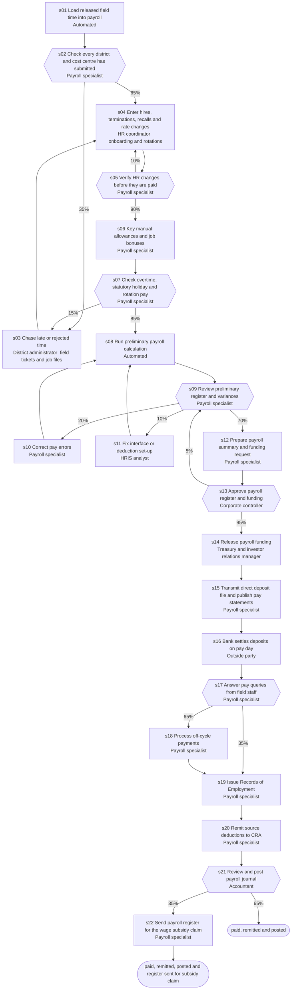

# Run payroll

`ofs-fin-payroll-processing` · oil and gas services (pressure pumping) · finance (payroll) · part of `oilfield-services-co`

Every two weeks the payroll team turns approved field time, salaries and HR changes into pay for about 1,350 employees, most of them field staff paid hourly with overtime, day rates, job bonuses and living-out allowances. Six payroll specialists in Calgary receive time released by the district bases, enter new hires, terminations and rate changes, key manual allowances from spreadsheets, check overtime, run and review the calculation, get the controller's approval and send the direct deposit file to the bank. After pay day they answer pay questions, cut off-cycle payments, issue Records of Employment, remit source deductions to the Canada Revenue Agency within three working days and post the payroll journal. Late or wrong field time, rotation overtime rules and constant hiring and layoffs make the work error-prone, and most runs need some off-cycle corrections.

| | |
|---|---|
| Unit of work | one biweekly payroll run (about 1,350 employees) |
| Starts when | The district bases release approved field time for the two-week pay period to payroll after the period closes. |
| Done when | Employees are paid by direct deposit on pay day, off-cycle corrections and Records of Employment are issued, source deductions are remitted to CRA and the payroll journal is posted to the general ledger. |
| Organisation | A listed Canadian pressure pumper of about 1,350 people, roughly 880 of them field staff on rotation or on call at nine district bases, with a Calgary head office for finance, HR, HSE and engineering. (1,350 employees, 2019-2022) |
| Volume | 2.17 cases a month (range 2 to 3) |

## Where it sits

- Starts with **timesheet** from fo-dist-crew-scheduling-and-rotation (100% of cases)
- Relies on **employee_record** from hr-onboarding (a standing input; it does not start a case)
- Relies on **staffing_change** from hr-layoffs-and-recall (a standing input; it does not start a case)
- Relies on **pay_rates** from hr-compensation-and-benefits (a standing input; it does not start a case)
- Sends **pay_deposit** to employee-bank (outcome: any)
- Sends **payroll_remittance** to cra (outcome: any)
- Sends **ledger_postings** to fin-month-end-close (outcome: any)
- Sends **payroll_register** to fin-government-subsidy-claims (outcome: paid, remitted, posted and register sent for subsidy claim)

## Flow

## Roles

| Role | Department | Layer | FTE on this process | Loaded cost per hour | Evidence |
|---|---|---|---:|---:|---|
| Payroll specialist | Finance | individual contributor | 3.5 | 47 CAD | C |
| District administrator (field tickets and job files) | District operations and dispatch | individual contributor | 0.4 | 40 CAD | C |
| HR coordinator (onboarding and rotations) | Human resources | individual contributor | 0.6 | 41 CAD | C |
| HRIS analyst | Human resources | individual contributor | 0.2 | 62 CAD | C |
| Corporate controller | Finance | manager | 0.05 | 135 CAD | C |
| Treasury and investor relations manager | Finance | manager | 0.03 | 115 CAD | C |
| Accountant | Finance | senior specialist | 0.1 | 68 CAD | C |

## Steps

Hands-on time and the wait before each step show the most common value. Evidence tier A is a sourced number, B a sourced description, C the author's estimate.

| Step | Who | Kind | Hands-on | Wait before | Control | Evidence |
|---|---|---|---:|---:|---|---|
| **s01 Load released field time into payroll.** When the district administrators release the period's approved time, the HRIS imports the hours, travel, standby and bonus codes for each employee into the open pay period and produces an import exception list. | Automated | system auto | 0 min | 0 min |  | C |
| **s02 Check every district and cost centre has submitted.** A payroll specialist compares the import report with the list of district bases, service lines and active employees, looks for missing districts, employees with no hours who are on rotation, and codes the import rejected. | Payroll specialist | validation | 1.5 h | 4.0 h |  | C |
| **s03 Chase late or rejected time.** The district administrator is phoned or emailed about the missing time, gets the supervisor's daily sheets from location, corrects codes and re-releases the time, sometimes after the cut-off. | District administrator (field tickets and job files) | communication | 45 min | 8.0 h |  | C |
| **s04 Enter hires, terminations, recalls and rate changes.** The HR coordinator enters new hire records with SIN, TD1 forms and banking, terminations with last day and reason, recalls after break-up, promotions and pay grid changes in the HRIS before the cut-off. | HR coordinator (onboarding and rotations) | data entry | 7.0 h | 1.0 h |  | C |
| **s05 Verify HR changes before they are paid.** A payroll specialist checks each change against the signed offer, termination form or rate letter, confirms banking and tax forms, and sends back anything that does not match. HR enters, payroll verifies. | Payroll specialist | validation | 3.0 h | 1.0 h | Internal control over payroll: the person who sets up employees and rates is not the person who approves them for pay | C |
| **s06 Key manual allowances and job bonuses.** Payroll specialists key living-out allowances, subsistence, job and stage bonuses, safety bonuses and retention payments from district spreadsheets that the time capture screens cannot hold, each specialist taking a group of districts. | Payroll specialist | data entry | 8.0 h | 2.0 h |  | C |
| **s07 Check overtime, statutory holiday and rotation pay.** Payroll specialists run reports of daily and weekly hours, compare overtime paid with the daily and weekly thresholds and any averaging agreements, add general holiday pay and flag employees whose hours look impossible for their rotation. | Payroll specialist | validation | 6.0 h | 30 min | Alberta Employment Standards Code: overtime, averaging agreements and general holiday pay; BC Employment Standards Act for BC-based staff | C |
| **s08 Run preliminary payroll calculation.** The payroll system calculates gross pay, CPP, EI, income tax, benefits and garnishment deductions and net pay for every employee and produces the preliminary register and variance reports. | Automated | system auto | 0 min | 30 min |  | C |
| **s09 Review preliminary register and variances.** A senior payroll specialist compares gross pay by district and cost centre with the last run, and scans for negative or zero nets, unusually large cheques, employees paid twice and new hires with no banking. | Payroll specialist | review | 6.0 h | 1.0 h |  | C |
| **s10 Correct pay errors.** The specialist corrects the hours, earnings or deduction lines found in review, documents each correction and asks for the calculation to be run again. | Payroll specialist | data entry | 1.0 h | 30 min |  | C |
| **s11 Fix interface or deduction set-up.** The HRIS analyst traces why an import, benefit deduction or tax set-up produced wrong results, fixes the configuration or mapping and tells payroll when the run can be repeated. | HRIS analyst | analysis | 2.0 h | 4.0 h |  | C |
| **s12 Prepare payroll summary and funding request.** The senior specialist prints the final register totals, net pay, employer and employee source deductions and the change from the last run, and writes the funding request with the amount and value date. | Payroll specialist | drafting | 45 min | 30 min |  | C |
| **s13 Approve payroll register and funding.** The controller reviews the summary against the last run and the headcount, asks about large changes and approves the register and funding by email or signature. | Corporate controller | approval | 30 min | 4.0 h | Payroll approval by someone outside the payroll team before funds are released (internal control over financial reporting) | C |
| **s14 Release payroll funding.** The treasury manager sets up the transfer of net pay to the payroll account in the bank portal and a second signer releases it. | Treasury and investor relations manager | data entry | 15 min | 2.0 h | Dual authorisation of bank payments | C |
| **s15 Transmit direct deposit file and publish pay statements.** The payroll specialist finalises the run, sends the direct deposit file to the bank at least two banking days before pay day and publishes electronic pay statements with hours, rates, earnings and deductions. | Payroll specialist | data entry | 30 min | 4.0 h | Alberta Employment Standards: pay within 10 consecutive days after the end of the pay period and a statement of earnings each pay period | B [src2] |
| **s16 Bank settles deposits on pay day.** The bank processes the direct deposit file overnight on its settlement cycle and the net pay reaches each employee's own bank account on the morning of pay day. | Outside party | external wait | 0 min | 2.0 d |  | C |
| **s17 Answer pay queries from field staff.** Payroll specialists answer calls and emails from employees and supervisors about missing hours, overtime, bonuses and deductions, look up the time and earnings and decide whether an off-cycle payment is owed. | Payroll specialist | communication | 10.0 h | 4.0 h |  | C |
| **s18 Process off-cycle payments.** For missed hours, missed bonuses and final pay the specialist enters an off-cycle run or manual cheque, gets it approved by the payroll lead and sends the deposit. | Payroll specialist | data entry | 4.0 h | 1.0 d |  | C |
| **s19 Issue Records of Employment.** For each employee who left or was laid off in the period the specialist completes the electronic Record of Employment with insurable hours and earnings and the reason code and submits it to Service Canada. | Payroll specialist | data entry | 4.0 h | 12.0 h | Employment Insurance Regulations: electronic ROE within 5 calendar days after the end of the pay period with the interruption of earnings | A [src3] |
| **s20 Remit source deductions to CRA.** The specialist totals income tax, CPP and EI withheld plus the employer share for the remitting period and pays it through the bank to the Canada Revenue Agency by the third working day after the period ends. | Payroll specialist | data entry | 40 min | 1.0 d | Income Tax Act and CRA remitting rules for accelerated threshold 2 remitters | A [src1] |
| **s21 Review and post payroll journal.** An accountant reviews the payroll journal produced by the interface, checks that debits by cost centre and service line equal net pay, deductions and accruals, and posts it to the ledger. | Accountant | review | 1.0 h | 1.0 d |  | C |
| **s22 Send payroll register for the wage subsidy claim.** During the CEWS period the specialist exports the register with eligible remuneration by employee and week and sends it to the accountant preparing the wage subsidy claim. | Payroll specialist | data entry | 1.0 h | 1.0 d |  | B [src4] |

## Exceptions

| Exception | Share of cases | What happens |
|---|---:|---|
| Late field time | 35% | One or more districts release time late or with rejected codes and payroll chases it before the cut-off. |
| Off-cycle corrections | 65% | Missed hours, bonuses or final pay are paid in an off-cycle run after pay day. |
| System set-up fault | 10% | A deduction, tax or interface set-up error forces the HRIS analyst to fix the configuration and the calculation to be repeated. |

## Benchmarks

| Metric | Value | Unit | Population | Evidence |
|---|---|---|---|---|
| cycle_time_days | p50 10, p90 13 | calendar days from approved field time reaching payroll to remittance and journal posted | Biweekly payroll at a Canadian oilfield service company, 2019-2022 | C [src2], [src1] |
| pay_due_after_period_end | 10 | calendar days (legal maximum) | Alberta employees | A [src2] |

## Pain points

- Districts release time late or with wrong codes, so payroll chases supervisors on remote locations near the cut-off. (steps s02, s03; C)
- Allowances and job bonuses are keyed by hand from spreadsheets because the time capture cannot hold them, which causes most pay errors. (steps s06, s09; C)
- Most runs end with off-cycle payments and queries from field staff, adding a third of a run's work after pay day. (steps s17, s18; C)
- Hiring waves and break-up layoffs add many set-ups, terminations and ROEs with short legal deadlines. (steps s04, s19; B [src3], [src4])

## Assumptions

- Loaded costs are the organisation file's (base wage x 1.35).
- The case starts when approved time reaches payroll; compiling and approving field time belongs to fo-dist-crew-scheduling-and-rotation and is not repeated here.
- Cadence is recorded as 'weekly' because the format has no biweekly option; runs are every two weeks (2.17 a month).
- The organisation file lists payroll-specialist, hris-analyst, controller and hr-coordinator; district-admin (late time), treasury-ir-manager (funding release) and accountant (journal) also take part.
- Off-cycle runs are part of the regular run they correct rather than separate cases.
- Benefit carrier, pension and garnishment remittances, T4 year-end and wage subsidy claim preparation are outside this workflow.
- The simulated median (about 12 days) runs slightly above the 10-day benchmark because it includes the remittance calendar wait and journal posting after pay day; pay day itself falls about 7 days after time arrives, inside the Alberta 10-day limit.
- Stated FTE (about 4.9) is roughly twice the hands-on time per run because payroll specialists' time between runs also goes to queries, audits, set-up and reporting that are not modelled step by step.

## Sources

- [src1] [When to remit (pay) source deductions: remitter types and due dates](https://www.canada.ca/en/revenue-agency/services/tax/businesses/topics/payroll/remitting-source-deductions/how-when-remit-due-dates.html) (Canada Revenue Agency, 2026). Remitter types set by average monthly withholding two years earlier; accelerated threshold 2 (AMWA of $100,000 or more) remits up to four times a month for the periods ending on the 7th, 14th, 21st and month-end, each due on the third working day after the period ends.
- [src2] [Payment of earnings](https://www.alberta.ca/payment-earnings) (Government of Alberta (Employment Standards), 2026). Pay periods may be weekly, bi-weekly, semi-monthly or monthly; regular pay is due within 10 consecutive days after the end of the pay period; a statement of earnings with hours, rates, earnings and deductions is required each pay period; termination pay within 10 days after the pay period end or 31 days after the last day of employment; records kept 3 years.
- [src3] [How to complete the Record of Employment form](https://www.canada.ca/en/employment-social-development/programs/ei/ei-list/reports/roe-guide.html) (Employment and Social Development Canada, 2026). For weekly, biweekly and semi-monthly pay periods an electronic ROE is due no later than 5 calendar days after the end of the pay period in which the interruption of earnings occurs.
- [src4] [Trican Well Service Ltd. Management's Discussion and Analysis for the year ended December 31, 2022](https://tricanwellservice.com/app/uploads/2023/02/TCW-Q4-2022-MDA-2023.02.22.pdf) (Trican Well Service Ltd., 2023). Three Tier 4 DGB fleets (126,000 HHP) operating at end 2022; fourth fleet (42,000 HHP) field ready by end Q1 2023 and fifth approved for early 2024; upgrades include 3,000 HHP continuous duty pumps and idle reduction packages; fully electric sand, blending and chemical equipment developed; capital spending $103.6 million in 2022 mainly Tier 4 upgrades; supply chain challenges such as long lead times on key parts; record inflation; difficulty adding field crews and attracting and retaining qualified personnel; recruiting events; CEWS credited against personnel expenses in 2021 ($10.2 million in cost of sales); the company has safety and training programs; MD&A dated February 22, 2023.

Written by claude-opus on 2026-11-24.
