# Blend and deliver bulk cement

`ofs-fo-cem-bulk-blending-and-delivery` · oil and gas services (pressure pumping) · field operations (cementing) · part of `oilfield-services-co`

Before a rig can cement casing, the district bulk plant must blend dry oilwell cement with the additives the lab specified, in the right proportions for that well, and haul it to the lease in pneumatic bulk trucks. Bulk plant operators check the blend sheet against the approved lab design, weigh and blend the batches, take a sample for the lab and load the trucks; Class 1 drivers then haul the blend, often 150 to 300 km on lease roads, and blow it into field silos or feed the pumper during the job. The work is slow and error-prone because rigs keep moving the casing point, so blends wait in bins or trucks wait on location, a weighing or additive error only shows up if the lab tests the blend or the job goes wrong, and winter roads, storms and spring road bans add delays.

| | |
|---|---|
| Unit of work | one cement blend and its delivery to the wellsite |
| Starts when | Dispatch books a cement job on the dispatch board and sends the bulk plant a blend request with the approved slurry design from the lab. |
| Done when | The blend has been offloaded at the wellsite and the delivery and driver logs are closed, or the job was cancelled and the held blend reused or scrapped. |
| Organisation | A Canadian pressure pumping company running about 16 cementing units from Alberta and northeast BC district bases with bulk blending plants, plus a Calgary cement and fluids laboratory and engineering office. (1,350 employees, 2019-2022) |
| Volume | 400 cases a month (range 200 to 520) |

## Where it sits

- Starts with **dispatch_order** from fo-dist-job-call-intake-and-dispatch (100% of cases)
- Relies on **slurry_design** from te-cement-slurry-design-and-lab-testing (a standing input; it does not start a case)
- Relies on **bulk_cement_delivery** from sc-cement-and-additive-supply (a standing input; it does not start a case)
- Sends **cement_blend** to fo-cem-job-execution (outcome: delivered)
- Sends **replenishment_request** to sc-cement-and-additive-supply (outcome: any)
- Sends **shipment_request** to sc-dangerous-goods-shipping (outcome: delivered)
- Sends **load_ticket** to fo-dist-field-ticket-preparation (outcome: delivered)

## Flow

```mermaid
flowchart TD
    s01["s01 Enter job and send blend request<br/>Service dispatcher"]
    s02{{"s02 Check blend sheet against approved design<br/>Bulk plant operator"}}
    s03["s03 Chase lab for approved design<br/>Bulk plant operator"]
    s04{{"s04 Check silo and additive stock<br/>Bulk plant operator"}}
    s05["s05 Request cement or additive replenishment<br/>Bulk plant operator"]
    s06["s06 Wait for cement or additive delivery<br/>Outside party"]
    s07["s07 Calculate batch weights and print blend ticket<br/>Bulk plant operator"]
    s08["s08 Hold pre-shift hazard assessment and plant checks<br/>Bulk plant operator"]
    s09["s09 Weigh and blend batches<br/>Bulk plant operator"]
    s10{{"s10 Take blend sample from conveying line<br/>Bulk plant operator"}}
    s11["s11 Courier blend sample to the lab<br/>Outside party"]
    s12{{"s12 Run blend confirmation test<br/>Laboratory technologist"}}
    s13["s13 Recommend blend correction<br/>Laboratory technologist"]
    s14["s14 Re-blend or add additive<br/>Bulk plant operator"]
    s15["s15 Assign bulk trucks and drivers<br/>Service dispatcher"]
    s16{{"s16 Wait for rig call time<br/>Outside party"}}
    s17["s17 Inspect and load bulk trucks<br/>Bulk cement truck driver"]
    s18["s18 Record load and update inventory<br/>Bulk plant operator"]
    s19["s19 Haul blend to the wellsite<br/>Bulk cement truck driver"]
    s20["s20 Wait on location for the cement crew<br/>Outside party"]
    s21{{"s21 Rig in and offload blend<br/>Bulk cement truck driver"}}
    s22["s22 Haul leftover blend back to the plant<br/>Bulk cement truck driver"]
    s23["s23 Decide use of held blend<br/>Cementing supervisor"]
    s24["s24 Drive back to base<br/>Bulk cement truck driver"]
    s25["s25 Close delivery ticket and driver log<br/>Bulk cement truck driver"]
    s01 --> s02
    s02 -->|"85%"| s04
    s02 -->|"15%"| s03
    s03 --> s04
    s04 -->|"90%"| s07
    s04 -->|"10%"| s05
    s05 --> s06
    s06 --> s07
    s07 --> s08
    s08 --> s09
    s09 --> s10
    s10 -->|"55%"| s11
    s10 -->|"45%"| s15
    s11 --> s12
    s12 -->|"90%"| s15
    s12 -->|"10%"| s13
    s13 --> s14
    s14 --> s10
    s15 --> s16
    s16 -->|"95%"| s17
    s16 -->|"5%"| s23
    s17 --> s18
    s18 --> s19
    s19 --> s20
    s20 --> s21
    s21 -->|"78%"| s24
    s21 -->|"22%"| s22
    s22 --> s25
    s23 --> end0
    s24 --> s25
    s25 --> end1
    end0(["blend_cancelled"])
    end1(["delivered"])
```

## Roles

| Role | Department | Layer | FTE on this process | Loaded cost per hour | Evidence |
|---|---|---|---:|---:|---|
| Bulk plant operator | Cementing service line | individual contributor | 11 | 42 CAD | C |
| Bulk cement truck driver | Cementing service line | individual contributor | 55 | 44 CAD | B [src7] |
| Service dispatcher | District operations and dispatch | individual contributor | 1.5 | 45 CAD | C |
| Laboratory technologist | Technical services and engineering | individual contributor | 0.6 | 48 CAD | C |
| Cementing supervisor | Cementing service line | supervisor | 0.3 | 78 CAD | C |

## Steps

Hands-on time and the wait before each step show the most common value. Evidence tier A is a sourced number, B a sourced description, C the author's estimate.

| Step | Who | Kind | Hands-on | Wait before | Control | Evidence |
|---|---|---|---:|---:|---|---|
| **s01 Enter job and send blend request.** The dispatcher enters the cement job on the dispatch board with the rig, lease location, casing string and expected call time, and emails or phones the district bulk plant a blend request with the tonnage and the lab's slurry design number. | Service dispatcher | intake | 15 min | 0 min |  | C |
| **s02 Check blend sheet against approved design.** The bulk plant operator opens the lab record for the design, compares the cement class, additive names and percentages by weight of cement, and the tonnage with the request, and checks the lab has marked the design approved for this well. | Bulk plant operator | validation | 15 min | 2.0 h |  | C |
| **s03 Chase lab for approved design.** The operator phones or emails the lab and the cement engineer to ask for the approved design or a corrected blend sheet, because the pilot tests are still running or the request named an old revision. | Bulk plant operator | communication | 10 min | 8.0 h |  | C |
| **s04 Check silo and additive stock.** The operator checks the silo level gauges for the cement class and counts the additive bags or totes on the floor, compares them with the batch needs and the inventory figure in the ERP, and notes anything short. | Bulk plant operator | lookup | 15 min | 15 min |  | C |
| **s05 Request cement or additive replenishment.** The operator emails supply chain a replenishment request for the short cement class or additive with the quantity and the job date, and asks whether a pneumatic trailer can come before the job. | Bulk plant operator | communication | 15 min | 30 min |  | C |
| **s06 Wait for cement or additive delivery.** The cement supplier's pneumatic trailer or the additive shipment arrives at the plant and is blown into the silo or stacked in the warehouse, which takes from a few hours for a district transfer to two days from the supplier. | Outside party | external wait | 0 min | 1.0 d |  | C |
| **s07 Calculate batch weights and print blend ticket.** The operator converts the design's additive percentages by weight of cement into kilograms per batch for the plant's weigh tank size and the number of batches, writes them on the blend ticket and records the batch plan in the blend log spreadsheet. | Bulk plant operator | analysis | 20 min | 15 min |  | C |
| **s08 Hold pre-shift hazard assessment and plant checks.** The two plant operators complete a field level hazard assessment for blending (silica dust, confined bins, air pressure, moving conveyors), check compressor, dust collector and scale readings, and put on respirators before opening the bins. | Bulk plant operator | physical | 15 min | 15 min | Alberta OHS Code Part 2 sections 7-8 (hazard assessment with worker participation) and Part 4 silica provisions; company bulk plant lockout and confined space procedures | B [src8] |
| **s09 Weigh and blend batches.** The operators weigh cement into the weigh tank, add the dry additives by hand or from additive bins, and air-blend each batch by transferring it between tanks two or three times until it is uniform, repeating until the full tonnage is in the storage bin. | Bulk plant operator | physical | 2.0 h | 1.0 h |  | C |
| **s10 Take blend sample from conveying line.** During the last transfer the operator cuts samples from the conveying line into a labelled pail, records the blend ticket number, and keeps a retained sample at the plant; for intermediate, production and critical jobs a sample goes to the lab. | Bulk plant operator | physical | 15 min | 0 min |  | B [src4] |
| **s11 Courier blend sample to the lab.** The sample travels to the cement laboratory with a hot-shot driver, a crew truck heading that way or the next courier run, together with a jug of the rig's mix water when the lab does not already have it. | Outside party | external wait | 0 min | 6.0 h |  | C |
| **s12 Run blend confirmation test.** A laboratory technologist mixes the field blend with the rig water, runs thickening time in the consistometer at the well's test schedule and a fluid loss test, and compares the results with the pilot results for the same design before entering them in the lab database. | Laboratory technologist | validation | 1.2 h | 4.0 h | Company cementing quality standard: field blend tested against pilot design for intermediate and production casing | B [src4], [src5] |
| **s13 Recommend blend correction.** The technologist works out how much retarder or other additive to add to the bin to bring thickening time back into the design window, checks it with a quick lab mix, and phones the correction to the bulk plant. | Laboratory technologist | analysis | 40 min | 30 min |  | C |
| **s14 Re-blend or add additive.** The plant operators add the corrective additive to the blend and transfer it again until uniform, or dump and re-blend when the error cannot be corrected, then record the change on the blend ticket. | Bulk plant operator | physical | 1.5 h | 1.0 h |  | C |
| **s15 Assign bulk trucks and drivers.** The dispatcher picks the bulk trucks and drivers for the job from the dispatch board, checking drivers' hours under the oil well service vehicle permit and truck availability, and tells the plant when the trucks will load. | Service dispatcher | coordination | 15 min | 30 min |  | B [src7] |
| **s16 Wait for rig call time.** The blend stays in the bin until the rig is close to landing casing; rigs move the call time when drilling or running casing goes faster or slower, and sometimes cancel or defer the job. | Outside party | external wait | 0 min | 10.0 h |  | C |
| **s17 Inspect and load bulk trucks.** Each driver completes the pre-trip inspection, spots the truck under the plant's loading spout, loads the blend and weighs the truck on the scale, then seals the hatches and checks the air system. | Bulk cement truck driver | physical | 1.0 h | 30 min |  | C |
| **s18 Record load and update inventory.** The plant operator records each truck's scale weight against the blend ticket, writes the bill of lading and load ticket, and books the cement and additives used out of plant inventory in the ERP. | Bulk plant operator | data entry | 20 min | 0 min |  | C |
| **s19 Haul blend to the wellsite.** The drivers haul the loaded trucks from the district base to the lease, usually two to four hours on highways and lease roads, slowed by winter conditions, storms and spring road-ban weight limits. | Bulk cement truck driver | travel | 3.0 h | 0 min |  | B [src9] |
| **s20 Wait on location for the cement crew.** The trucks wait on the lease until the rig has finished running and circulating casing and the cementing crew is ready; drivers log the waiting time as off duty when they do no work. | Outside party | external wait | 0 min | 2.0 h |  | B [src7] |
| **s21 Rig in and offload blend.** The drivers rig in hoses, blow the blend into field silos or feed the cementing unit's mixing system directly during the job, keeping air pressure and rate steady so the pumper holds slurry density, then rig out. | Bulk cement truck driver | physical | 2.0 h | 0 min |  | C |
| **s22 Haul leftover blend back to the plant.** When excess cement remains, a driver hauls it back to the base and blows it into the plant's reclaim bin, labelled with the blend ticket so the plant can decide whether to reuse it. | Bulk cement truck driver | travel | 3.5 h | 0 min |  | C |
| **s23 Decide use of held blend.** The cementing supervisor for the district decides whether the blend held for a cancelled or deferred job can be kept for the rescheduled job, blended into another design after a lab check, or must be scrapped, and tells the plant. | Cementing supervisor | judgment | 20 min | 12.0 h |  | C |
| **s24 Drive back to base.** The drivers drive the empty trucks back to the district base, fuel them and park them in the yard, reporting any defect found on the trip. | Bulk cement truck driver | travel | 3.0 h | 0 min |  | C |
| **s25 Close delivery ticket and driver log.** Each driver completes the electronic log with driving, on-duty and waiting time, attaches the signed delivery ticket and scale ticket, and hands any paper copies to the district office for the field ticket. | Bulk cement truck driver | data entry | 15 min | 30 min |  | B [src7] |

## Exceptions

| Exception | Share of cases | What happens |
|---|---:|---|
| Lab design not yet approved | 15% | The pilot tests are still running or the request named an old design revision, so the plant waits before blending. |
| Stock short | 10% | A cement class or additive is short and must be replenished before blending. |
| Blend fails confirmation test | 6% | The field blend's thickening time or fluid loss does not match the pilot, and the plant corrects or re-blends it. |
| Job cancelled or deferred | 5% | The rig cancels or defers the cement job after the blend is made. |
| Leftover blend | 21% | Excess cement is hauled back to the plant's reclaim bin. |

## Benchmarks

| Metric | Value | Unit | Population | Evidence |
|---|---|---|---|---|
| cycle_time_days | p50 2.2, p90 4.5 | calendar days from blend request to delivery record closed | WCSB primary cementing blends, 2019-2022 | C |
| bulk_trucks_per_job | low 1, mode 2, high 4 | trucks | Surface, intermediate and production casing jobs | C |

## Pain points

- Rigs move the casing call time by hours or days, so blends sit in bins and trucks and drivers wait on the lease. (steps s16, s20; C [src7])
- A weighing or additive error in the blend is only caught when the blend is lab tested; untested blends carry the error to the job. (steps s07, s09, s12; B [src4])
- Blend sheets are re-keyed from the lab design into the plant's batch calculation and again into the ERP and field ticket. (steps s02, s07, s18; C)
- Winter road conditions, storms and spring road bans slow or stop heavy bulk trucks. (steps s19, s24; B [src9])

## Assumptions

- Loaded hourly costs and headcounts are taken from the organisation file (wage x 1.35).
- One blend per cement job; two bulk trucks on an ordinary job, shown with people = 2 on the driving and offloading steps.
- The blend is sampled for the lab on about 55% of jobs (intermediate, production and critical casing); surface casing blends usually keep only a retained sample.
- Dispatcher and laboratory technologist take part in this process but are not listed among the process_map roles in the organisation file.
- The process_map entry sends a shipment request to dangerous goods shipping on every job; in practice dry cement is not a regulated dangerous good and only some liquid additives sent with the crew need TDG paperwork, so the link is kept but is occasional.
- Load tickets go to field ticket preparation; this link is not in the organisation file.
- The lab facility in the organisation file is one resource per laboratory, which a single test does not tie up; the blend test holds one consistometer instead, a resource the organisation file lacks (count of 10 across the company labs is an estimate).
- occupied_min on the truck steps is per truck; with two trucks a job, truck-hours are about twice the simulated figure, roughly 9,000 truck-hours a month at 400 jobs against the organisation file's 45 trucks at a mode of 190 available hours (8,550), so the truck fleet is fully used at mode volume.
- Bulk truck hours are counted in this process, not in the cement job process, to avoid double counting.

## Sources

- [src3] [Management's Discussion and Analysis for the year ended December 31, 2022](https://tricanwellservice.com/app/uploads/2023/02/TCW-Q4-2022-MDA-2023.02.22.pdf) (Trican Well Service Ltd., 2023). Cementing activity tracks the WCSB rig count (201 rigs in Q4 2022, 176 in Q4 2021); 17 cementing units operated in Q4 2022; annual average of 16 cementing units in the field in 2021 and 2022; cementing about 16-19% of revenue; 1,335,000 tonnes of proppant pumped in 2022 and 1,364,000 in 2021; oilfield cement and proppant sourced from suppliers in Canada and the United States.
- [src4] [Shear rate has greater influence on cement slurry properties than total mixing energy](https://www.ogj.com/home/article/17234341/shear-rate-has-greater-influence-on-cement-slurry-properties-than-total-mixing-energy) (Oil & Gas Journal (Paul Padgett, Halliburton Energy Services), 1996). Bulk-blend samples taken from the conveying line during blending and mixed in the lab with the actual mixing water under the API procedure; field mixing equipment runs at lower shear than lab blenders, so field slurry properties (free water especially) often differ from lab values; thickening time and fluid loss changed only slightly with mixing energy.
- [src5] [Oil Well Cement Testing Simple Guide](https://www.drillingmanual.com/oil-well-cement-testing-simple-guide/) (Drilling Manual, None). Thickening time in an HPHT consistometer (70 Bc end point, some operators 50 Bc); crush tests on moulded cubes after 8, 16 or 24 hours; ultrasonic cement analyser runs usually about 24 hours; fluid loss collected for 30 minutes at circulating temperature; free water test stands about two hours; rheology on a Fann viscometer for displacement and ECD modelling.
- [src7] [Commercial Vehicle Drivers Hours of Service Regulations (SOR/2005-313), section 63, version in force 2019-06-12 to 2021-06-11](https://laws-lois.justice.gc.ca/eng/regulations/SOR-2005-313/section-63-20190612.html) (Justice Laws Website, Government of Canada, 2019). Oil well service vehicle permits: three 24-hour off-duty periods in any 24 days instead of the regular cycle; waiting or standby time at a well site may be logged off duty if no work is done; drivers need oil and gas field safety training.
- [src8] [Occupational Health and Safety Code (table of contents)](https://search-ohs-laws.alberta.ca/legislation/occupational-health-and-safety-code/) (Government of Alberta, None). Part 2 Hazard Assessment, Elimination and Control: section 7 hazard assessment, section 8 worker participation, section 9 hazard elimination and control; Part 4 harmful substances including section 28 general provisions for asbestos, silica, coal dust and lead and section 40 health assessments for silica exposure; Part 18 respiratory protective equipment.
- [src9] [Road bans](https://www.alberta.ca/road-bans) (Government of Alberta, None). Road bans lower maximum weights when roads are weak or thawing; spring heavy-haul period starts when thaw depth reaches 25 cm, post-thaw from about June 16; exemptions by permit through the Central Permit Office; local bans set by counties and municipal districts.

Written by claude-opus on 2026-11-24.
