# Cement casing

`ofs-fo-cem-job-execution` · oil and gas services (pressure pumping) · field operations (cementing) · part of `oilfield-services-co`

After a drilling rig runs a string of steel casing into a new well, a cementing crew pumps cement down the casing and up the gap between the casing and the rock, so the well is sealed from groundwater and other zones. A cementing supervisor and two pump operators confirm the well data and the cement program, drive the cementing unit to the lease, wait for the rig to finish running and circulating casing, hold a hazard assessment, rig up and pressure test, then mix and pump spacer and slurry, drop the plug and displace it, and watch for cement returns at surface. The job has to start when the casing lands, at any hour and in any weather, so crews spend much of their time travelling and waiting; equipment failures, float failures and missing cement returns lead to extra work and, for the producer, to a remedial program under AER Directive 009.

| | |
|---|---|
| Unit of work | one cement job (one casing string on one well) |
| Starts when | Dispatch receives the rig's call that casing is about to be run and issues a dispatch order with the cement program to a cementing crew. |
| Done when | The casing is cemented, the crew has rigged out and returned to base, and the job report and signed field ticket are submitted; or the job was cancelled before the crew left. |
| Organisation | A Canadian pressure pumping company running about 16 cementing units from Alberta and northeast BC district bases with bulk blending plants, plus a Calgary cement and fluids laboratory and engineering office. (1,350 employees, 2019-2022) |
| Volume | 400 cases a month (range 200 to 520) |

## Where it sits

- Starts with **dispatch_order** from fo-dist-job-call-intake-and-dispatch (100% of cases)
- Relies on **cement_program** from te-cement-slurry-design-and-lab-testing (a standing input; it does not start a case)
- Relies on **cement_blend** from fo-cem-bulk-blending-and-delivery (a standing input; it does not start a case)
- Relies on **hazard_assessment** from hs-pre-job-hazard-assessment (a standing input; it does not start a case)
- Relies on **iron_certificate** from em-pressure-iron-certification (a standing input; it does not start a case)
- Sends **cement_job_report** to fo-dist-field-ticket-preparation (outcome: job_complete)
- Sends **cement_job_report** to fo-cem-post-job-reporting (outcome: job_complete)
- Sends **remedial_request** to fo-cem-remedial-and-abandonment-cementing (outcome: any)
- Sends **repair_request** to em-field-breakdown-support (outcome: any)
- Sends **incident_report** to hs-incident-reporting-and-investigation (outcome: any)
- Sends **equipment_move** to fo-dist-yard-and-base-operations (outcome: job_complete)

## Flow

```mermaid
flowchart TD
    s01["s01 Confirm call-out and assign crew<br/>Service dispatcher"]
    s02["s02 Review cement program and calculate job<br/>Cementing supervisor"]
    s03{{"s03 Confirm well data with the customer<br/>Cementing supervisor"}}
    s04["s04 Revise program for changed well data<br/>Completions design engineer"]
    s05["s05 Inspect and load the cementing unit<br/>Cementing pump operator"]
    s06{{"s06 Wait for call-out time<br/>Outside party"}}
    s07["s07 Drive cementing unit to the lease<br/>Cementing pump operator"]
    s08["s08 Drive supervisor pickup to the lease<br/>Cementing supervisor"]
    s09["s09 Wait for the rig to land and circulate casing<br/>Outside party"]
    s10["s10 Hold hazard assessment and pre-job safety meeting<br/>Cementing supervisor"]
    s11["s11 Rig up to the casing<br/>Cementing pump operator"]
    s12{{"s12 Pressure test the lines<br/>Cementing pump operator"}}
    s13["s13 Agree final job plan with the customer<br/>Cementing supervisor"]
    s14["s14 Pump spacer and mix slurry<br/>Cementing pump operator"]
    s15{{"s15 Monitor density, pressure and returns<br/>Cementing supervisor"}}
    s16["s16 Manage equipment failure during the job<br/>Cementing supervisor"]
    s17{{"s17 Drop plug and displace<br/>Cementing pump operator"}}
    s18["s18 Shut in for failed floats<br/>Cementing supervisor"]
    s19{{"s19 Check cement returns and record the job<br/>Cementing supervisor"}}
    s20["s20 Report missing returns to the customer<br/>Cementing supervisor"]
    s21["s21 Wash up and rig out<br/>Cementing pump operator"]
    s22["s22 Complete job report and field ticket<br/>Cementing supervisor"]
    s23{{"s23 Customer signs field ticket<br/>Outside party"}}
    s24["s24 Drive back to base<br/>Cementing pump operator"]
    s25["s25 Debrief and hand in job records<br/>Cementing supervisor"]
    s01 --> s02
    s02 --> s03
    s03 -->|"83%"| s05
    s03 -->|"17%"| s04
    s04 --> s05
    s05 --> s06
    s06 -->|"96%"| s07
    s06 -->|"4%"| end0
    s07 --> s08
    s08 --> s09
    s09 --> s10
    s10 --> s11
    s11 --> s12
    s12 -->|"94%"| s13
    s12 -->|"6%"| s11
    s13 --> s14
    s14 --> s15
    s15 -->|"97%"| s17
    s15 -->|"3%"| s16
    s16 --> s17
    s17 -->|"95%"| s19
    s17 -->|"5%"| s18
    s18 --> s19
    s19 -->|"90%"| s21
    s19 -->|"10%"| s20
    s20 --> s21
    s21 --> s22
    s22 --> s23
    s23 -->|"92%"| s24
    s23 -->|"8%"| s22
    s24 --> s25
    s25 --> end1
    end0(["job_cancelled"])
    end1(["job_complete"])
```

## Roles

| Role | Department | Layer | FTE on this process | Loaded cost per hour | Evidence |
|---|---|---|---:|---:|---|
| Cementing supervisor | Cementing service line | supervisor | 30 | 78 CAD | C |
| Cementing pump operator | Cementing service line | individual contributor | 58 | 48 CAD | C |
| Service dispatcher | District operations and dispatch | individual contributor | 1 | 45 CAD | C |
| Completions design engineer | Technical services and engineering | senior specialist | 0.4 | 90 CAD | C |

## Steps

Hands-on time and the wait before each step show the most common value. Evidence tier A is a sourced number, B a sourced description, C the author's estimate.

| Step | Who | Kind | Hands-on | Wait before | Control | Evidence |
|---|---|---|---:|---:|---|---|
| **s01 Confirm call-out and assign crew.** The dispatcher takes the rig's call with the expected casing landing time, checks which cementing crew and unit are free and within hours, assigns them on the dispatch board and phones the supervisor with the lease location and the job number. | Service dispatcher | coordination | 20 min | 0 min |  | C |
| **s02 Review cement program and calculate job.** The cementing supervisor opens the cement program and lab report, checks casing size and depth, hole size, slurry volumes, densities and displacement volume, and works out the pump schedule, expected pressures and the materials and water needed. | Cementing supervisor | analysis | 45 min | 2.0 h |  | B [src2] |
| **s03 Confirm well data with the customer.** The supervisor phones the customer's wellsite supervisor to confirm the casing tally and shoe depth, float equipment, final hole size or caliper, mud weight and the required cement top, and notes any change from the program. | Cementing supervisor | communication | 20 min | 30 min |  | C |
| **s04 Revise program for changed well data.** The cement engineer reruns volumes and placement for the new depth, caliper or cement top, checks the slurry's thickening time still covers the longer job, and emails a revised program to the supervisor and bulk plant. | Completions design engineer | analysis | 1.0 h | 2.0 h |  | A [src1] |
| **s05 Inspect and load the cementing unit.** The two operators complete the pre-trip inspection of the cementing unit, check the treating iron certificates, load spacer and wash chemicals, plugs and the cement head, and fill water tanks if the lease has no water. | Cementing pump operator | physical | 1.0 h | 1.0 h |  | C |
| **s06 Wait for call-out time.** The crew waits at the base or in town until the rig is close to landing casing; rigs move the time when drilling or casing runs go faster or slower, and occasionally cancel or postpone the job. | Outside party | external wait | 0 min | 6.0 h |  | C |
| **s07 Drive cementing unit to the lease.** The operators drive the cementing unit and any pickup with chemicals to the lease, usually two to four hours on highway and lease roads, slowed by snow, ice and spring road bans. | Cementing pump operator | travel | 3.0 h | 0 min |  | B [src9] |
| **s08 Drive supervisor pickup to the lease.** The supervisor drives separately in a crew pickup, calling the rig on the way for an updated casing depth and rig status, and arrives with the job paperwork and data acquisition laptop. | Cementing supervisor | travel | 3.0 h | 0 min |  | C |
| **s09 Wait for the rig to land and circulate casing.** The crew waits on location while the rig finishes running casing, lands it and circulates the hole clean; waits range from minutes to most of a shift when casing runs are slow or the hole is tight. | Outside party | external wait | 0 min | 3.0 h |  | C |
| **s10 Hold hazard assessment and pre-job safety meeting.** The supervisor checks in with the customer's wellsite supervisor and the rig manager, completes the field level hazard assessment for the job with the crew, and leads the pre-job safety meeting with rig and service hands on pressure areas, muster points and roles. | Cementing supervisor | communication | 30 min | 0 min | Alberta OHS Code Part 2 sections 7-8: hazard assessment before work begins, with worker participation; customer site safety rules | B [src8] |
| **s11 Rig up to the casing.** The operators spot the unit, lay treating iron from the unit to the cement head on the casing, connect water and bulk supply lines, load the plugs into the cement head and set up density and pressure sensors. | Cementing pump operator | physical | 1.2 h | 0 min |  | C |
| **s12 Pressure test the lines.** The operators fill the lines and raise pressure in steps to a test pressure above the highest expected job pressure, hold it and watch for leaks while everyone stays out of the line-of-fire area. | Cementing pump operator | physical | 15 min | 0 min | Company pressure pumping standard: pressure test of treating lines above maximum expected pressure before pumping | C |
| **s13 Agree final job plan with the customer.** The supervisor goes over final slurry and displacement volumes, excess, pump rates and pressure limits with the customer's wellsite supervisor, confirms the rig has finished circulating, and gets the go-ahead to pump. | Cementing supervisor | communication | 15 min | 0 min | AER Directive 009 items 4 and 10: surface casing cemented full length; production and intermediate volumes from caliper log plus at least 20% excess (licensee's requirement, applied through the program) | A [src1] |
| **s14 Pump spacer and mix slurry.** The operators pump the spacer, then mix the lead and tail slurries on the fly from the bulk supply and water, holding density to the program while pumping at the planned rate. | Cementing pump operator | physical | 1.3 h | 0 min |  | C |
| **s15 Monitor density, pressure and returns.** The supervisor watches density, rate and pressure on the acquisition screen, checks mud returns at the shaker with the rig crew, logs volumes pumped and calls corrections to the operators. | Cementing supervisor | validation | 1.3 h | 0 min | AER Directive 009 items 15-16: flow returns visually monitored during cementing and full details of the operation recorded | A [src1] |
| **s16 Manage equipment failure during the job.** The supervisor decides whether to finish on the backup pump, slow the rate or stop, keeps the slurry moving if possible, tells the customer and calls the district for repair or a backup unit, then records the event for an incident and repair report. | Cementing supervisor | judgment | 45 min | 0 min |  | C |
| **s17 Drop plug and displace.** The operators release the top plug and pump displacement fluid at the planned volume, slow down near the end, bump the plug at the calculated volume and bleed back to check the float equipment holds. | Cementing pump operator | physical | 40 min | 0 min |  | C |
| **s18 Shut in for failed floats.** When the floats leak back, the supervisor agrees with the customer to shut in the casing with pressure held until the cement sets, and the crew keeps the unit rigged up and watches the pressure. | Cementing supervisor | judgment | 1.0 h | 0 min |  | C |
| **s19 Check cement returns and record the job.** The supervisor records whether cement came back to surface, the volume of returns and any losses, compares them with the program, and notes the result for the customer's casing cement report. | Cementing supervisor | validation | 15 min | 0 min | AER Directive 009 items 5, 15 and 16: cement top determined and AER contacted if surface casing returns are not obtained; cement-top log and remedial program for production casing | A [src1] |
| **s20 Report missing returns to the customer.** The supervisor tells the customer's wellsite supervisor that returns were lost or short, records the estimated cement top and losses, and passes a remedial request (top-up or squeeze) to the district so the producer can meet its Directive 009 duty. | Cementing supervisor | communication | 30 min | 0 min |  | A [src1] |
| **s21 Wash up and rig out.** The operators flush the unit and lines with water, break down and load the treating iron, clean up any spilled cement and leave the cement head for the rig or load it back on the unit. | Cementing pump operator | physical | 1.2 h | 0 min |  | C |
| **s22 Complete job report and field ticket.** While the crew rigs out, the supervisor completes the job report and electronic field ticket: materials and volumes pumped, unit and crew hours, pressures, returns and any extra charges. | Cementing supervisor | data entry | 45 min | 0 min |  | C |
| **s23 Customer signs field ticket.** The customer's wellsite supervisor reviews the ticket items and job report on the tablet and signs, or asks for a change to charges, volumes or hours. | Outside party | external wait | 0 min | 15 min |  | C |
| **s24 Drive back to base.** The operators drive the unit back to the district base, fuel it and park it, and the supervisor follows in the pickup; long drives at the end of a shift are a fatigue risk managed by journey management. | Cementing pump operator | travel | 3.0 h | 0 min |  | C |
| **s25 Debrief and hand in job records.** The supervisor submits the job report and data file, reports equipment defects in the maintenance system and any incident in the HSE system, and briefs the district on anything the next job needs to know. | Cementing supervisor | communication | 30 min | 1.0 h |  | C |

## Exceptions

| Exception | Share of cases | What happens |
|---|---:|---|
| Well data changed | 17% | Depth, hole size or required cement top differ from the program, so the engineer revises volumes before the job. |
| Job cancelled or postponed | 4% | The rig cancels or postpones the job before the crew leaves. |
| Leak on pressure test | 6% | A connection leaks and must be remade before pumping. |
| Equipment failure during the job | 3% | A pump, mixer or bulk supply problem forces a backup pump or a slower rate; it creates repair and incident reports and can lead to remedial work. |
| Floats do not hold | 5% | Casing is shut in with pressure held until the cement sets. |
| No or low cement returns | 10% | Cement did not reach surface or returns were short; a remedial request goes to the district and the producer deals with the AER. |

## Benchmarks

| Metric | Value | Unit | Population | Evidence |
|---|---|---|---|---|
| cycle_time_days | p50 1.7, p90 2.8 | calendar days from dispatch order to job records handed in | WCSB primary casing cement jobs, 2019-2022 | C |
| minimum_cement_compressive_strength | 3500 | kPa after 48 hours at the temperature of the uppermost hydrocarbon zone | Production and intermediate casing slurries with fillers, Alberta | A [src1] |
| cementing_units_operating | 16 | units (annual average 2021 and 2022) | Trican Well Service | A [src3] |

## Pain points

- Crews and units wait for the rig to call them out and again on location while casing is run and circulated; this ties up units that are already fully booked in winter. (steps s06, s09; C [src3])
- Well data change at the last minute (deeper casing point, larger hole), forcing program revisions and extra blend. (steps s03, s04; C)
- Lost or short returns lead to cement-top logs and remedial work for the producer and can damage the relationship with the customer. (steps s19, s20; A [src1])
- Long drives before and after long shifts expose crews to fatigue and winter road risk. (steps s07, s24; C)

## Assumptions

- Loaded hourly costs and headcounts are taken from the organisation file (wage x 1.35).
- A crew is one cementing supervisor and two pump operators, as the organisation file's cementing crew resource says; the operators attend the hazard assessment and pre-job meeting, but that time is only counted for the supervisor.
- Bulk truck drivers take part in the job but their time and trucks are counted in the bulk blending and delivery process, so the bulk-truck-driver role and bulk truck resource listed in the process_map are left out here.
- Directive 009 duties belong to the licensee (the producer); the cementing crew supplies the job record and follows the program.
- Unit and crew hours held per job (about 14 to 15 hours including travel and waiting) times 400 jobs a month exceed the organisation file's 16-17 units at a mode of 200 available hours a month; either the available hours or the job volume in the organisation file is low.
- Dispatcher and design engineer take part but are not listed among the process_map roles.
- The simulated median cycle time (about 2 days) is slightly above the benchmark estimate of 1.7 days because the triangular waits for the call-out and on location have long upper tails; both rest on estimates, not measured job logs.

## Sources

- [src1] [Directive 009: Casing Cementing Minimum Requirements (edition of May 14, 2025)](https://static.aer.ca/prd/documents/directives/Directive009.pdf) (Alberta Energy Regulator, 2025). Licensee is responsible for satisfactory cementing. Surface casing cemented full length; if returns are not obtained or the annular level drops, the cement top must be determined and the AER contacted about remedial action (items 4-5). Surface casing centralized top, bottom and every 50 m (item 7). Production and intermediate cement volume from caliper log plus at least 20% excess (item 10). Fillers allowed only if compressive strength is at least 3,500 kPa after 48 hours at the temperature of the uppermost hydrocarbon zone, using 4.4 C surface and 2.7 C/100 m where unknown (items 11-12). Flow returns visually monitored during cementing; cement-top log and remedial program to the AER within 60 days of rig release when returns are missing (item 15). Full details recorded on tour reports or a casing cement report (item 16). Required cement tops by township from figure 1 (items 9, 24). The 2025 edition only adds brine-hosted minerals to the 2022 edition; the same requirements applied in 2019-2022.
- [src2] [Cementing](https://tricanwellservice.com/cementing/) (Trican Well Service Ltd., None). Cement programs prepared by engineers using simulation software for slurry placement, sheath integrity, wellbore properties and temperature; pre-flushes and spacers; surface, intermediate, production, liner, horizontal, plug, remedial and squeeze cementing; lost-circulation blends for the WCSB; R&D facilities and operational support laboratories with lab technicians.
- [src3] [Management's Discussion and Analysis for the year ended December 31, 2022](https://tricanwellservice.com/app/uploads/2023/02/TCW-Q4-2022-MDA-2023.02.22.pdf) (Trican Well Service Ltd., 2023). Cementing activity tracks the WCSB rig count (201 rigs in Q4 2022, 176 in Q4 2021); 17 cementing units operated in Q4 2022; annual average of 16 cementing units in the field in 2021 and 2022; cementing about 16-19% of revenue; 1,335,000 tonnes of proppant pumped in 2022 and 1,364,000 in 2021; oilfield cement and proppant sourced from suppliers in Canada and the United States.
- [src8] [Occupational Health and Safety Code (table of contents)](https://search-ohs-laws.alberta.ca/legislation/occupational-health-and-safety-code/) (Government of Alberta, None). Part 2 Hazard Assessment, Elimination and Control: section 7 hazard assessment, section 8 worker participation, section 9 hazard elimination and control; Part 4 harmful substances including section 28 general provisions for asbestos, silica, coal dust and lead and section 40 health assessments for silica exposure; Part 18 respiratory protective equipment.
- [src9] [Road bans](https://www.alberta.ca/road-bans) (Government of Alberta, None). Road bans lower maximum weights when roads are weak or thawing; spring heavy-haul period starts when thaw depth reaches 25 cm, post-thaw from about June 16; exemptions by permit through the Central Permit Office; local bans set by counties and municipal districts.

Written by claude-opus on 2026-11-24.
