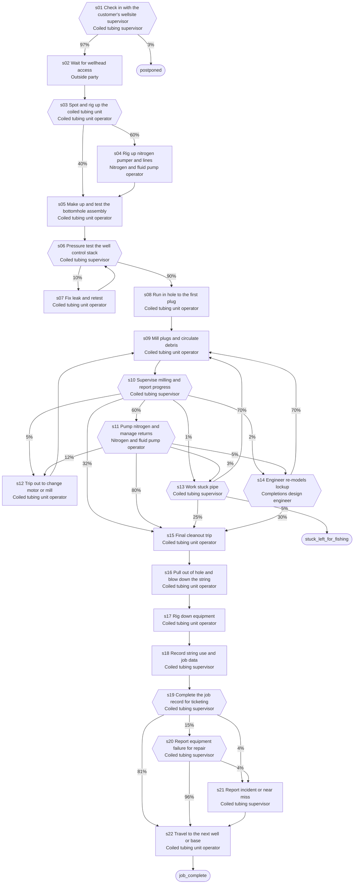

# Run coiled tubing jobs

`ofs-fo-ct-job-execution` · oil and gas services · field operations (coiled tubing) · part of `oilfield-services-co`

A 24-hour coiled tubing crew arrives on a well pad, rigs up the injector, reel and blowout preventer on the wellhead, pressure tests the stack, runs the continuous steel string to the first frac plug and mills out every plug in the horizontal section while pumping fluid, and nitrogen when needed, to carry the debris back to surface. The supervisor watches weights and pressures against the program limits, and the crew pulls out, rigs down, records the job and string use, and moves to the next well. Jobs stretch when the location is not ready, when weather stops crane lifts, when a motor stalls or a mill wears out and has to be changed, when the pipe gets stuck, or when the string locks up short of total depth in a long lateral.

| | |
|---|---|
| Unit of work | one coiled tubing job (usually one well's plug millout or cleanout) |
| Starts when | The crew arrives on the lease with the issued coiled tubing program after travel arranged by dispatch. |
| Done when | All plugs are milled and the well is cleaned to the agreed depth, the equipment is rigged down and moved, and the job record and string usage are passed on; or the job is postponed or ends with the string stuck. |
| Organisation | A Canadian pressure pumping company with six 24-hour coiled tubing crews and nine units, milling frac plugs and cleaning out horizontal wells for WCSB producers. (1,350 employees, 2019-2022) |
| Volume | 80 cases a month (range 40 to 110) |

## Where it sits

- Starts with **ct_program** from fo-ct-job-planning (100% of cases)
- Relies on **hazard_assessment** from hs-pre-job-hazard-assessment (a standing input; it does not start a case)
- Relies on **iron_certificate** from em-pressure-iron-certification (a standing input; it does not start a case)
- Relies on **dispatch_order** from fo-dist-job-call-intake-and-dispatch (a standing input; it does not start a case)
- Relies on **site_safety_requirements** from producer (a standing input; it does not start a case)
- Sends **ct_job_report** to fo-dist-field-ticket-preparation (outcome: job_complete)
- Sends **ct_job_report** to fo-ct-post-job-reporting (outcome: job_complete)
- Sends **string_usage_record** to fo-ct-string-management (outcome: job_complete)
- Sends **string_usage_record** to fo-ct-string-management (outcome: stuck_left_for_fishing)
- Sends **incident_report** to hs-incident-reporting-and-investigation (outcome: stuck_left_for_fishing)
- Sends **repair_request** to em-field-breakdown-support (outcome: any)
- Sends **incident_report** to hs-incident-reporting-and-investigation (outcome: any)
- Sends **ct_job_report** to fo-dist-field-ticket-preparation (outcome: postponed)

## Flow

## Roles

| Role | Department | Layer | FTE on this process | Loaded cost per hour | Evidence |
|---|---|---|---:|---:|---|
| Coiled tubing supervisor | Coiled tubing and nitrogen service line | supervisor | 7 | 80 CAD | C |
| Coiled tubing unit operator | Coiled tubing and nitrogen service line | individual contributor | 32 | 50 CAD | C |
| Nitrogen and fluid pump operator | Coiled tubing and nitrogen service line | individual contributor | 7 | 47 CAD | C |
| Completions design engineer | Technical services and engineering | senior specialist | 0.1 | 90 CAD | B [trican-ct] |

## Steps

Hands-on time and the wait before each step show the most common value. Evidence tier A is a sourced number, B a sourced description, C the author's estimate.

| Step | Who | Kind | Hands-on | Wait before | Control | Evidence |
|---|---|---|---:|---:|---|---|
| **s01 Check in with the customer's wellsite supervisor.** The coiled tubing supervisor signs in at the lease, meets the customer's wellsite supervisor, confirms the well, plug count and program revision, the simultaneous operations on the pad (frac, wireline, flowback), muster points and where the units can be spotted. | Coiled tubing supervisor | communication | 30 min | 0 min |  | C |
| **s02 Wait for wellhead access.** The crew waits until fracturing or wireline on the pad has moved off the well, the frac stack is ready for the coiled tubing stack and the customer gives access; the field level hazard assessment and safety meeting (documented separately) are held in this time. | Outside party | external wait | 0 min | 45 min |  | C |
| **s03 Spot and rig up the coiled tubing unit.** Operators spot the unit, reel trailer and crane, lift the injector and gooseneck, install the blowout preventer, stripper and riser on the wellhead, stab the string through the injector, lay the treating iron to the pump and flowback, and tie in the return tank. | Coiled tubing unit operator | physical | 3.5 h | 0 min | Company lifting and rig-up procedures; crane lift plan; IRP 21 well control equipment | B [irp21] |
| **s04 Rig up nitrogen pumper and lines.** Nitrogen operators spot the pumper and transport, cool down the pump, lay and secure iron to the coiled tubing manifold, and check liquid nitrogen volume against the program, working alongside the coiled tubing rig-up. | Nitrogen and fluid pump operator | physical | 2.5 h | 0 min |  | C |
| **s05 Make up and test the bottomhole assembly.** Two operators install the coiled tubing connector, pull test it, then make up check valves, disconnect, agitator, motor and mill per the program, and surface test the motor by pumping through it before stabbing into the stack. | Coiled tubing unit operator | physical | 1.0 h | 0 min | Coiled tubing program: connector pull and pressure test before run in | C |
| **s06 Pressure test the well control stack.** The supervisor leads low and high pressure tests of the blowout preventer, stripper, riser and treating lines to the program's test pressures, records the charts, function tests the rams from the accumulator, and gets the customer's representative to witness before opening the well. | Coiled tubing supervisor | validation | 1.0 h | 15 min | IRP 21 well control equipment and pressure control equipment testing; customer well control requirements | B [irp21] |
| **s07 Fix leak and retest.** Operators bleed off, find the leaking connection, seal or stripper element, replace the seal or remake the connection, and hand back to the supervisor for a new test. | Coiled tubing unit operator | physical | 1.5 h | 0 min |  | B [irp21] |
| **s08 Run in hole to the first plug.** The unit operator runs the string in at the program speeds, watching weight and circulating pressure on the cab display, pumping at low rate, and tags the first plug; an assistant watches the reel and returns. | Coiled tubing unit operator | physical | 2.0 h | 10 min |  | C |
| **s09 Mill plugs and circulate debris.** Around the clock the operator mills each plug with set-down weight and pump rate inside the motor's limits, pumps sweeps, makes short trips to carry cuttings up the lateral, and runs to the next plug; an assistant watches returns, screens and fluid volumes, and crews change at each 12-hour shift. | Coiled tubing unit operator | physical | 8.0 h | 0 min |  | B [hal-fasdrill], [trican-ct] |
| **s10 Supervise milling and report progress.** The supervisor on shift watches weights and pressures against the program limits, keeps the plug tally and job log, sends progress to the customer and the engineer watching streamed data, and decides when to trip out for a worn mill, stalled motor or overpull. | Coiled tubing supervisor | judgment | 8.0 h | 0 min |  | B [trican-ct] |
| **s11 Pump nitrogen and manage returns.** Nitrogen operators pump at the program rate to lighten returns from the long lateral, watch tank levels and pressure, order top-up transports through the supervisor, and adjust rates on the supervisor's instruction. | Nitrogen and fluid pump operator | physical | 7.0 h | 0 min |  | C |
| **s12 Trip out to change motor or mill.** The crew pulls the string to surface, lays down the BHA, changes the stalled motor or worn mill from the spares on the unit, retests the connector, and runs back in to the last plug depth before milling resumes. | Coiled tubing unit operator | physical | 6.0 h | 0 min |  | C |
| **s13 Work stuck pipe.** The supervisor stops, calls the operations manager and engineer, and works the pipe within its weight and fatigue limits, pumping friction reducer or nitrogen and cycling up and down; if it will not free, the string is cut and the well handed back for fishing. | Coiled tubing supervisor | judgment | 4.0 h | 0 min | Coiled tubing program stuck pipe contingency and string limits | C |
| **s14 Engineer re-models lockup.** The engineer compares the measured weights with the force model, refits the friction factor, and recommends metal lubricant, more friction reducer, an agitator run or stopping short; the customer decides whether to continue. | Completions design engineer | analysis | 1.0 h | 30 min |  | B [trican-ct], [step-coilplus] |
| **s15 Final cleanout trip.** With all plugs milled the operator runs to bottom, pumps a final sweep and circulates bottoms up until returns are clean, then pulls back through the build section slowly to sweep debris out. | Coiled tubing unit operator | physical | 2.0 h | 0 min |  | C |
| **s16 Pull out of hole and blow down the string.** The operator pulls the string to surface, closes in the well, lays down the BHA, and pumps nitrogen or fluid through the string to displace it before the reel travels, recording the final depths and pressures. | Coiled tubing unit operator | physical | 2.0 h | 0 min |  | C |
| **s17 Rig down equipment.** Operators bleed down and break the treating iron, pull the string back out of the injector, lift off the injector and stack, secure the reel, load tools and chemicals, and walk the lease before the units leave; nitrogen operators rig down their pumper at the same time. | Coiled tubing unit operator | physical | 2.5 h | 0 min | Company lifting and rig-down procedures; lease walk-around | C |
| **s18 Record string use and job data.** While the crew rigs down, the supervisor exports the depth, weight and pressure data, records trips, maximum depths and pressures for the string fatigue update, and saves the charts and pressure test records to the job folder for the engineer. | Coiled tubing supervisor | data entry | 45 min | 0 min |  | C |
| **s19 Complete the job record for ticketing.** The supervisor fills in the job record on the tablet: hours on location, crew, plugs milled, depths, fluid, chemical and nitrogen volumes, consumables, standby and non-productive time with causes, so the district can build the field ticket. | Coiled tubing supervisor | drafting | 1.0 h | 15 min |  | C |
| **s20 Report equipment failure for repair.** The supervisor phones the shop and enters a repair request for the failed motor, injector, pump or reel component with symptoms and hours, so a field mechanic or the shop can fix it before the next job. | Coiled tubing supervisor | communication | 20 min | 0 min |  | C |
| **s21 Report incident or near miss.** The supervisor phones the HSE advisor and the operations manager, writes the initial incident or near miss report with the crew's account, and notifies the customer's wellsite supervisor before the crew leaves. | Coiled tubing supervisor | communication | 45 min | 0 min | Alberta OHS Act and BC Workers Compensation Act incident reporting; customer reporting requirements | C |
| **s22 Travel to the next well or base.** The crew drives the coiled tubing unit, reel trailer, support units and pickups to the next pad or back to the district base, logging hours in the electronic logs; most moves are within the same area. | Coiled tubing unit operator | travel | 2.0 h | 0 min |  | C |

## Exceptions

| Exception | Share of cases | What happens |
|---|---:|---|
| Pressure test leak | 10% | A seal or connection leaks on the stack test and is repaired and retested. |
| Motor or mill change | 12% | A stalled motor or worn mill forces a round trip to surface. |
| Stuck pipe | 3% | Debris or sand packs off around the string; most are freed, a few strings are cut and left for fishing. |
| Lockup short of total depth | 5% | Friction stops the string before the last plugs; the engineer re-models and the crew adds lubricant or an agitator, or the customer accepts the depth reached. |
| Waiting on location | 40% | The pad is not ready or weather stops crane lifts; the crew waits on standby, which the customer may be charged for. |

## Benchmarks

| Metric | Value | Unit | Population | Evidence |
|---|---|---|---|---|
| cycle_time_days | p50 1.6, p90 3.0 | calendar days from arrival on lease to leaving for the next site | WCSB coiled tubing plug millouts and cleanouts, 2019-2022 | C |
| plug milling time | 4.5 | minutes per composite plug (best-case vendor result) | Williston Basin, 90 plugs in two wells | A [hal-fasdrill] |
| coiled tubing revenue per operating day | 51278 | CAD per operating day | STEP Energy Services Canadian coiled tubing, 2021 | A [step-2021] |

## Pain points

- Crews wait on location for frac or wireline to clear the well or for weather to allow crane lifts, holding a unit and crew without milling. (steps s02, s03; B [step-2021])
- Motor stalls, worn mills and stuck pipe force round trips that can add half a day to a job. (steps s12, s13; C)
- Long laterals push strings to lockup; re-modelling and lubricant or agitator runs add time and sometimes leave plugs unmilled. (steps s14; B [step-coilplus], [trican-ct])
- Job records for ticketing are written at the end of a long shift; missed standby hours, chemicals or nitrogen volumes surface as ticket disputes later. (steps s19; C)

## Assumptions

- Loaded cost per hour comes from the organisation file (base wage x 1.35).
- The cycle starts at arrival on lease; travel from the base or previous job to the lease is in fo-dist-job-call-intake-and-dispatch, and travel at the end of the job to the next site is counted here.
- The field level hazard assessment and each shift's safety meeting happen during s02 and at crew changes; their labour is counted in hs-pre-job-hazard-assessment, not here.
- Step times are elapsed hours for a crew on 12-hour shifts; `people` is the number on shift, so labour counts both shifts as one crew-on-shift.
- A motor or mill change loops back to a full milling step; in practice only the remaining plugs are milled, so the simulation overstates time on the 15-20% of jobs with a trip by a few hours.
- 60% of coiled tubing jobs use nitrogen; nitrogen-only jobs are in fo-ct-nitrogen-services.
- The simulated median (about 1.9 days) is slightly above the 1.6-day benchmark because it includes waiting on location and the move to the next site; 80 jobs a month at that length need about 150 crew-days a month, close to the organisation file's 459 coiled tubing operating days in Q4 2019 (about 153 a month) and to six crews at STEP's 2021 utilisation.
- Design engineer support during jobs is not in the process map's role list; the nitrogen-unit and pickup-fleet resources are used but not listed in the process map.

## Sources

- [trican-ct] [Trican - Coiled Tubing](https://tricanwellservice.com/coiled-tubing/) (Trican Well Service Ltd., 2026). Coiled tubing services: milling frac plugs, ports, stage tools and cement, cleanouts, coiled tubing fracturing, E-Coil logging, acidizing; tubing sizes 1.25 to 2.875 inches; in-house engineering uses force analysis and hydraulic modelling to recommend the coiled tubing configuration; engineers and operations analyse well conditions before milling; nitrogen supplied as required; job data streamed in real time to the engineering group; work on live wells without joining pipe on a rig floor.
- [step-2021] [STEP Energy Services Ltd. Reports Fourth Quarter and Year End 2021 Results](https://www.stepenergyservices.com/news-releases/step-energy-services-ltd-reports-fourth-quarter-and-year-end-2021-results) (STEP Energy Services Ltd., 2022). Canadian coiled tubing: 1,569 operating days in 2021 and 1,373 in 2020 with 7 and 5 active units of 16; 448 operating days in Q4 2021; revenue per operating day $51,278 in 2021; units designed for the deepest wells in the WCSB; weather delays in late December 2021; spring break-up affects northern operations in Q2.
- [irp21] [DACC IRP Volume 21: Coiled Tubing Operations](https://www.energysafetycanada.com/resource/dacc-irp-volume-21-coiled-tubing-operations) (Energy Safety Canada, 2021). Industry recommended practice for coiled tubing fluid conveyance (fracturing, acidizing, sand, scale and wax removal) and mechanical work on oil and gas wells; sections on operations planning, well control equipment, accumulator equipment, coiled tubing specifications, fluids and circulating systems, quality assurance of well pressure control equipment and elastomeric seals; sanctioned September 2021 after a review opened in 2018 (an earlier edition applied before).
- [hal-fasdrill] [Fas Drill Ultra frac plugs reduce time and difficulty of millout](https://www.halliburton.com/en/resources/fas-drill-ultra-frac-plugs-reduce-time-difficulty-millout) (Halliburton, 2026). Williston Basin case: 90 composite frac plugs milled from two wellbores in under 40 hours with 2-inch coiled tubing, average 4.5 minutes per plug, less than half the mill time of a typical composite plug; 10,000 ft vertical and horizontal sections. Page undated; vendor case study.
- [step-coilplus] [COIL+ sets new Montney depth record as adoption accelerates in Canada](https://www.stepenergyservices.com/articles/coil-tm-sets-new-montney-depth-record-as-adoption-accelerates-in-canada) (STEP Energy Services Ltd., 2026). Montney coiled tubing run to 8,295 m measured depth with a 5,824 m lateral; friction factor and lockup limit reach in long laterals; agitators used to delay lockup. Dated 2026, after the reference period; used only to show that lateral reach and lockup set the limits of coiled tubing millouts.

Written by claude-opus on 2026-11-24.
