# Plan a coiled tubing job

`ofs-fo-ct-job-planning` · oil and gas services · field operations (coiled tubing) · part of `oilfield-services-co`

Before a coiled tubing crew goes to a well, an engineer turns the customer's well data into a written program: which string and bottomhole tools to use, how far the pipe can be pushed along the horizontal section before it locks up, what pump rates and fluids will carry plug debris out, and whether the chosen string has enough fatigue life left. The coiled tubing supervisor and operations manager review it, the customer's completions engineer approves it, and dispatch and the crew line up the unit, string and tools. It is slow when the customer sends incomplete surveys or plug depths, when a long lateral is near the reach limit and has to be re-modelled with other strings or friction reducers, and when the right string is on a unit at another job.

| | |
|---|---|
| Unit of work | one coiled tubing program (one well or one job) |
| Starts when | District dispatch issues a dispatch order for a coiled tubing millout, cleanout or acid job and sends it to the coiled tubing engineer and supervisor. |
| Done when | An approved coiled tubing program with force, hydraulic and fatigue checks is filed and issued to the crew, and the unit, string and tools are prepared; or the job is cancelled by the customer. |
| Organisation | A Canadian pressure pumping company with six 24-hour coiled tubing crews that mill frac plugs and clean out long horizontal wells for WCSB producers, with engineers in a Calgary technical group. (1,350 employees, 2019-2022) |
| Volume | 80 cases a month (range 40 to 110) |

## Where it sits

- Starts with **dispatch_order** from fo-dist-job-call-intake-and-dispatch (100% of cases)
- Relies on **string_record** from fo-ct-string-management (a standing input; it does not start a case)
- Relies on **site_safety_requirements** from producer (a standing input; it does not start a case)
- Relies on **iron_certificate** from em-pressure-iron-certification (a standing input; it does not start a case)
- Sends **ct_program** to fo-ct-job-execution (outcome: program_issued)
- Sends **ct_program** to producer (outcome: program_issued)
- Sends **ct_program** to hs-pre-job-hazard-assessment (outcome: program_issued)

## Flow

```mermaid
flowchart TD
    s01["s01 Open the job file from the dispatch order<br/>Completions design engineer"]
    s02["s02 Request well data from the customer<br/>Completions design engineer"]
    s03["s03 Wait for the customer's well data<br/>Outside party"]
    s04{{"s04 Check the well data is complete<br/>Completions design engineer"}}
    s05["s05 Look up strings available in the district<br/>Completions design engineer"]
    s06{{"s06 Run the tubing force model<br/>Completions design engineer"}}
    s07{{"s07 Evaluate reach options and re-model<br/>Completions design engineer"}}
    s08["s08 Run the hydraulics model<br/>Completions design engineer"]
    s09{{"s09 Check string fatigue and pressure limits<br/>Completions design engineer"}}
    s10["s10 Arrange a string swap<br/>Coiled tubing operations manager"]
    s11["s11 Specify bottomhole assembly and confirm tools<br/>Coiled tubing supervisor"]
    s12["s12 Draft the coiled tubing program<br/>Completions design engineer"]
    s13{{"s13 Operations manager reviews the program<br/>Coiled tubing operations manager"}}
    s14["s14 Send the program to the customer for approval<br/>Completions design engineer"]
    s15{{"s15 Wait for the customer's approval<br/>Outside party"}}
    s16["s16 Supervisor and engineer hand over the job<br/>Coiled tubing supervisor"]
    s17["s17 Confirm unit, string, nitrogen and crew on the board<br/>Service dispatcher"]
    s18{{"s18 Check pressure control equipment certification<br/>Coiled tubing supervisor"}}
    s19["s19 Prepare the unit and tools at the base<br/>Coiled tubing unit operator"]
    s20["s20 Issue the final program to the field<br/>Completions design engineer"]
    s01 --> s02
    s02 --> s03
    s03 --> s04
    s04 -->|"85%"| s05
    s04 -->|"15%"| s02
    s05 --> s06
    s06 -->|"75%"| s08
    s06 -->|"25%"| s07
    s07 -->|"85%"| s08
    s07 -->|"15%"| s05
    s08 --> s09
    s09 -->|"90%"| s11
    s09 -->|"10%"| s10
    s10 --> s05
    s11 --> s12
    s12 --> s13
    s13 -->|"88%"| s14
    s13 -->|"12%"| s12
    s14 --> s15
    s15 -->|"83%"| s16
    s15 -->|"12%"| s12
    s15 -->|"5%"| end0
    s16 --> s17
    s17 --> s18
    s18 -->|"40%"| s19
    s18 -->|"60%"| s20
    s19 --> s20
    s20 --> end1
    end0(["cancelled"])
    end1(["program_issued"])
```

## Roles

| Role | Department | Layer | FTE on this process | Loaded cost per hour | Evidence |
|---|---|---|---:|---:|---|
| Completions design engineer | Technical services and engineering | senior specialist | 4.8 | 90 CAD | B [trican-ct] |
| Coiled tubing supervisor | Coiled tubing and nitrogen service line | supervisor | 0.7 | 80 CAD | C |
| Coiled tubing operations manager | Coiled tubing and nitrogen service line | manager | 0.4 | 112 CAD | C |
| Service dispatcher | District operations and dispatch | individual contributor | 0.3 | 45 CAD | C |
| Coiled tubing unit operator | Coiled tubing and nitrogen service line | individual contributor | 2.1 | 50 CAD | C |

## Steps

Hands-on time and the wait before each step show the most common value. Evidence tier A is a sourced number, B a sourced description, C the author's estimate.

| Step | Who | Kind | Hands-on | Wait before | Control | Evidence |
|---|---|---|---:|---:|---|---|
| **s01 Open the job file from the dispatch order.** The coiled tubing engineer reads the dispatch order email, creates a job folder on the network drive from the program template, and notes the customer, well licence, pad, service (plug millout, cleanout, acid) and the target start date from dispatch. | Completions design engineer | intake | 20 min | 2.0 h |  | C |
| **s02 Request well data from the customer.** The engineer emails the customer's completions engineer for the wellbore schematic, directional survey, casing and liner sizes, plug type and depths from the frac summary, expected wellhead pressure, H2S content and any site requirements, or pulls them from the customer's file share. | Completions design engineer | communication | 20 min | 30 min |  | C |
| **s03 Wait for the customer's well data.** The customer's completions engineer or wellsite supervisor collects the survey, frac report and plug tally, which are often not final until fracturing on the pad has finished, and emails them back to the engineer. | Outside party | external wait | 0 min | 12.0 h |  | C |
| **s04 Check the well data is complete.** The engineer checks that the survey reaches total depth, that plug depths and counts match the frac summary, that casing weights and the restriction list (liner tops, ports, landing nipples) are given, and that pressures and H2S are stated; missing items go back to the customer. | Completions design engineer | validation | 20 min | 1.0 h |  | B [trican-ct], [nov-cerberus] |
| **s05 Look up strings available in the district.** The engineer opens the string records to see which reels are on units in the district, their outside diameter, wall thickness, length after cuts, welds and the fatigue life already used along their length, and picks a candidate string for the depth and pressure of this well. | Completions design engineer | lookup | 20 min | 30 min |  | B [trican-ct], [nov-cerberus] |
| **s06 Run the tubing force model.** The engineer loads the survey, completion and candidate string into the modelling software and runs trips in and out with plug-milling weight on bit, checking predicted lockup depth, set-down weight at total depth, pick-up weight against string yield and helical buckling; repeat wells on a pad only need the new survey. | Completions design engineer | analysis | 40 min | 1.0 h |  | B [trican-ct], [nov-cerberus] |
| **s07 Evaluate reach options and re-model.** For long laterals near the reach limit the engineer tries a larger or tapered string, metal-to-metal lubricant or friction reducer in the fluid, an agitator or extended reach tool, and lower circulating pressure, reruns the model for each, and notes the chosen option and its cost for the customer. | Completions design engineer | judgment | 1.5 h | 2.0 h |  | B [trican-ct], [step-coilplus] |
| **s08 Run the hydraulics model.** The engineer models pump rates and circulating pressures through the string and motor, annular velocity needed to carry plug debris and sand up the lateral, wellhead and return pressures, and the nitrogen rate if the well needs energised returns, and sets the pump schedule and sweep plan. | Completions design engineer | analysis | 30 min | 30 min |  | B [trican-ct], [nov-cerberus] |
| **s09 Check string fatigue and pressure limits.** The engineer runs the fatigue model for the planned trips at the expected circulating pressure, adds the predicted damage to the string's used life, and checks burst and collapse limits against maximum wellhead pressure; if the string would pass the company's retirement limit or has thin wall, another string is needed. | Completions design engineer | analysis | 20 min | 15 min | Company string management standard: string fatigue and pressure rating checked before each job (IRP 21 coiled tubing specifications) | B [irp21], [nov-cerberus] |
| **s10 Arrange a string swap.** The operations manager decides where a suitable reel can come from (another unit, the base or a new string from the mill), agrees with dispatch which unit will carry it, and books a reel swap or spooling at the base with the shop. | Coiled tubing operations manager | coordination | 1.0 h | 12.0 h |  | C |
| **s11 Specify bottomhole assembly and confirm tools.** The coiled tubing supervisor who will run the job reviews the models, picks the connector, check valves, disconnect, motor, agitator and mill size for the plug type, and phones the tool room to confirm the motor and mills are redressed and available for the start date. | Coiled tubing supervisor | coordination | 40 min | 4.0 h |  | C |
| **s12 Draft the coiled tubing program.** The engineer writes the program in the company template: well summary, string and BHA, pressure control stack and test pressures, run-in speeds and weight limits, plug milling procedure, pump and sweep schedule, fluid and chemical list, nitrogen volumes, contingencies for stuck pipe and motor stall, and hazard notes for the site. | Completions design engineer | drafting | 1.0 h | 1.0 h |  | B [irp21] |
| **s13 Operations manager reviews the program.** The operations manager reads new, deep or non-routine programs and checks limits, contingencies and test pressures against company standards; routine repeat-well programs get a quick scan. Errors and missing contingencies go back to the engineer. | Coiled tubing operations manager | review | 15 min | 4.0 h | Company engineering review of coiled tubing programs before issue | C |
| **s14 Send the program to the customer for approval.** The engineer emails the program and model plots to the customer's completions engineer, with any options that change cost such as an agitator, extra friction reducer or a larger string. | Completions design engineer | communication | 15 min | 30 min |  | C |
| **s15 Wait for the customer's approval.** The customer's completions engineer reviews the program against the well plan and the frac results, approves it, asks for changes such as a different plug count or fluid, or postpones or cancels the job when the pad schedule changes. | Outside party | external wait | 0 min | 12.0 h |  | C |
| **s16 Supervisor and engineer hand over the job.** The supervisor and engineer talk through the approved program by phone or in the district office: the reach margin, weight and pressure limits, where debris is expected, contingency triggers, and what real-time data the engineer wants to watch during the job. | Coiled tubing supervisor | review | 30 min | 4.0 h |  | C |
| **s17 Confirm unit, string, nitrogen and crew on the board.** The dispatcher checks the board for the coiled tubing unit carrying the chosen string, the nitrogen pumper and transports, fluid trucks and the 24-hour crew, moves bookings when the previous job runs long, and confirms the start time with the customer's wellsite supervisor. | Service dispatcher | coordination | 25 min | 4.0 h |  | C |
| **s18 Check pressure control equipment certification.** The supervisor checks that the blowout preventer, stripper, riser and treating iron on the unit have current pressure test and recertification records for the well's pressure rating, and asks the shop for replacements where a certificate is expired. | Coiled tubing supervisor | validation | 20 min | 2.0 h | IRP 21 well control equipment and quality assurance of pressure control equipment; customer well control requirements | B [irp21] |
| **s19 Prepare the unit and tools at the base.** Operators at the base change stripper elements, function test the BOP rams and accumulator, check the injector chains and gooseneck, confirm the reel and string length, load the BHA, mills, motor and chemicals, and record the checks before the unit is released to travel. | Coiled tubing unit operator | physical | 4.0 h | 12.0 h | Company pre-mobilisation equipment checklist; IRP 21 accumulator and well control equipment | B [irp21] |
| **s20 Issue the final program to the field.** The engineer saves the approved program as a PDF in the job folder, emails it to the supervisor, night supervisor and customer, and updates the planned equipment list used later for the field ticket. | Completions design engineer | data entry | 15 min | 1.0 h |  | C |

## Exceptions

| Exception | Share of cases | What happens |
|---|---:|---|
| Incomplete well data | 15% | Survey, plug depths or restrictions are missing and the engineer has to ask again, often waiting for fracturing on the pad to finish. |
| Reach marginal | 25% | Long laterals model close to lockup and need lubricant, an agitator, or a bigger or tapered string. |
| String swap | 12% | No reel in the district has enough fatigue life, wall or length; a reel is moved or spooled at the base. |
| Customer changes the program | 12% | The customer changes plug counts, fluids or timing after frac results, and the program is revised. |

## Benchmarks

| Metric | Value | Unit | Population | Evidence |
|---|---|---|---|---|
| cycle_time_days | p50 4, p90 9 | calendar days from dispatch order to issued program | Coiled tubing millout and cleanout programs, WCSB, 2019-2022 | C |
| coiled tubing revenue per operating day | 51278 | CAD per operating day | STEP Energy Services Canadian coiled tubing, 2021 | A [step-2021] |
| operating days per active unit | 224 | days per year | STEP Canadian coiled tubing, 2021 (1,569 days, 7 active units) | A [step-2021] |

## Pain points

- Plug depths and surveys arrive late or incomplete because the customer finalises them only after fracturing, pushing modelling into the last day. (steps s03, s04; C)
- Long laterals sit near the lockup limit, so models are rerun with several strings, lubricants and tools, and string choice depends on which reel is free. (steps s06, s07, s10; B [trican-ct], [step-coilplus])
- String fatigue records are kept in modelling files and spreadsheets updated after each job; a late update means the next program uses an understated used life. (steps s05, s09; C)

## Assumptions

- Loaded cost per hour comes from the organisation file (base wage x 1.35).
- The coiled tubing engineer is one of the organisation file's completions design engineers; the file has no separate coiled tubing engineer role.
- Dispatcher and coiled tubing operator take part but are not in the process map's role list.
- Unit preparation at the base happens only when the unit is between jobs (40%); otherwise checks are done on location and fall in fo-ct-job-execution.
- Travel to the lease is documented in fo-dist-job-call-intake-and-dispatch; this file ends when the program is issued and the unit is ready.
- The simulated median (about 6 days) is above the 4-day tier C benchmark because the waits for customer data and approval each average about a day; customers that book millouts with complete data and pre-approved pad programs fall near the benchmark, so the benchmark is kept as a separate estimate rather than tuned to the model.
- Nitrogen-only jobs (about 60 a month) are planned in fo-ct-nitrogen-services and are not counted here.

## Sources

- [trican-ct] [Trican - Coiled Tubing](https://tricanwellservice.com/coiled-tubing/) (Trican Well Service Ltd., 2026). Coiled tubing services: milling frac plugs, ports, stage tools and cement, cleanouts, coiled tubing fracturing, E-Coil logging, acidizing; tubing sizes 1.25 to 2.875 inches; in-house engineering uses force analysis and hydraulic modelling to recommend the coiled tubing configuration; engineers and operations analyse well conditions before milling; nitrogen supplied as required; job data streamed in real time to the engineering group; work on live wells without joining pipe on a rig floor.
- [step-2021] [STEP Energy Services Ltd. Reports Fourth Quarter and Year End 2021 Results](https://www.stepenergyservices.com/news-releases/step-energy-services-ltd-reports-fourth-quarter-and-year-end-2021-results) (STEP Energy Services Ltd., 2022). Canadian coiled tubing: 1,569 operating days in 2021 and 1,373 in 2020 with 7 and 5 active units of 16; 448 operating days in Q4 2021; revenue per operating day $51,278 in 2021; units designed for the deepest wells in the WCSB; weather delays in late December 2021; spring break-up affects northern operations in Q2.
- [irp21] [DACC IRP Volume 21: Coiled Tubing Operations](https://www.energysafetycanada.com/resource/dacc-irp-volume-21-coiled-tubing-operations) (Energy Safety Canada, 2021). Industry recommended practice for coiled tubing fluid conveyance (fracturing, acidizing, sand, scale and wax removal) and mechanical work on oil and gas wells; sections on operations planning, well control equipment, accumulator equipment, coiled tubing specifications, fluids and circulating systems, quality assurance of well pressure control equipment and elastomeric seals; sanctioned September 2021 after a review opened in 2018 (an earlier edition applied before).
- [nov-cerberus] [Cerberus Modeling Software](https://nov.com/products/cerberus-modeling-software) (NOV, 2026). Commercial intervention modelling software used to predict and analyse cumulative forces at each stage of a coiled tubing job, also covering wireline, slickline and jointed pipe; runs on Windows desktops.
- [step-coilplus] [COIL+ sets new Montney depth record as adoption accelerates in Canada](https://www.stepenergyservices.com/articles/coil-tm-sets-new-montney-depth-record-as-adoption-accelerates-in-canada) (STEP Energy Services Ltd., 2026). Montney coiled tubing run to 8,295 m measured depth with a 5,824 m lateral; friction factor and lockup limit reach in long laterals; agitators used to delay lockup. Dated 2026, after the reference period; used only to show that lateral reach and lockup set the limits of coiled tubing millouts.

Written by claude-opus on 2026-11-24.
