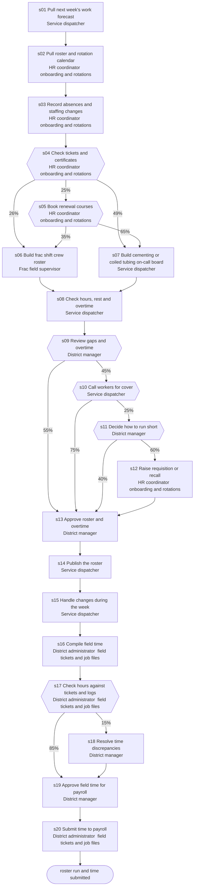

# Schedule crews and rotations

`ofs-fo-dist-crew-scheduling-and-rotation` · oilfield services (pressure pumping) · field operations · part of `oilfield-services-co`

Each week every district builds the crew roster for each service line: who works each seat on the fracturing shift crews, and who is on call for cementing and coiled tubing jobs. The HR coordinator brings in absences, new hires and expiring tickets, a frac field supervisor or a dispatcher drafts the roster, the dispatcher checks it against hours-of-service and overtime rules, and the district manager fills gaps and approves overtime. After the week, the district administrator compiles field time for payroll. The work is slow and error-prone because rosters, tickets, logs and time sheets sit in separate systems and spreadsheets, and short-staffed crews in 2021-2022 meant many calls for cover.

| | |
|---|---|
| Unit of work | one weekly crew schedule for a service line in a district |
| Starts when | The weekly planning cycle starts for the coming week, with the latest pad programs and job bookings. |
| Done when | The roster has been published and run for the week, and the week's approved field time has been released to payroll. |
| Organisation | A listed Canadian pressure pumper of about 1,350 people, roughly 880 of them in the field, with 24-hour frac and coiled tubing crews on rotation and on-call cementing crews based at nine districts. (1,350 employees, 2019-2022) |
| Volume | 40 cases a month (range 30 to 50) |

## Where it sits

- Starts with **pad_program** from fo-frac-program-planning (35% of cases)
- Starts with **dispatch_order** from fo-dist-job-call-intake-and-dispatch (65% of cases)
- Relies on **training_record** from hs-training-and-competency (a standing input; it does not start a case)
- Relies on **hos_exception** from hs-hours-of-service-and-fatigue-management (a standing input; it does not start a case)
- Relies on **staffing_change** from hr-layoffs-and-recall (a standing input; it does not start a case)
- Relies on **competency_signoff** from hr-performance-and-progression (a standing input; it does not start a case)
- Relies on **new_hire** from hr-onboarding (a standing input; it does not start a case)
- Sends **crew_roster** to fo-frac-program-planning (outcome: any)
- Sends **crew_roster** to fo-dist-job-call-intake-and-dispatch (outcome: any)
- Sends **crew_roster** to hs-hours-of-service-and-fatigue-management (outcome: any)
- Sends **job_requisition** to hr-field-recruitment-and-hiring (outcome: any)
- Sends **training_enrolment** to hs-training-and-competency (outcome: any)
- Sends **timesheet** to fin-payroll-processing (outcome: roster run and time submitted)

## Flow

## Roles

| Role | Department | Layer | FTE on this process | Loaded cost per hour | Evidence |
|---|---|---|---:|---:|---|
| Service dispatcher | District operations and dispatch | individual contributor | 1.6 | 45 CAD | C |
| HR coordinator (onboarding and rotations) | Human resources | individual contributor | 0.6 | 41 CAD | C |
| Frac field supervisor | Fracturing service line | supervisor | 0.4 | 82 CAD | C |
| District manager | District operations and dispatch | manager | 0.5 | 125 CAD | C |
| District administrator (field tickets and job files) | District operations and dispatch | individual contributor | 0.9 | 40 CAD | C |

## Steps

Hands-on time and the wait before each step show the most common value. Evidence tier A is a sourced number, B a sourced description, C the author's estimate.

| Step | Who | Kind | Hands-on | Wait before | Control | Evidence |
|---|---|---|---:|---:|---|---|
| **s01 Pull next week's work forecast.** The dispatcher lists the work expected next week for the service line in the district: pad programs and frac start dates from program planning, cementing and coiled tubing jobs already booked, and rig activity that will generate calls. | Service dispatcher | lookup | 40 min | 4.0 h |  | C |
| **s02 Pull roster and rotation calendar.** The HR coordinator exports the current roster for the service line and district from the HRIS with each person's position, rotation (for example 14 days on and 7 off for frac crews) and next days off. | HR coordinator (onboarding and rotations) | lookup | 30 min | 4.0 h |  | C |
| **s03 Record absences and staffing changes.** The HR coordinator enters vacation, sick days, injuries on modified duty, resignations, new hires finishing orientation and recalls from layoff, so the roster shows who is really available. | HR coordinator (onboarding and rotations) | data entry | 30 min | 1.0 h |  | B [step-2021] |
| **s04 Check tickets and certificates.** The HR coordinator compares the available people with the learning system for expired or soon-to-expire tickets (H2S Alive, first aid, dangerous goods, driver licence class and medicals) and customer-required training. | HR coordinator (onboarding and rotations) | validation | 25 min | 30 min | Alberta OHS Code competent worker requirements and producers' site entry training requirements | B [cnrl-suppliers] |
| **s05 Book renewal courses.** The HR coordinator books the people with expiring tickets into the next course at the training centre or an outside provider and marks those days as unavailable on the roster. | HR coordinator (onboarding and rotations) | coordination | 30 min | 2.0 h |  | C |
| **s06 Build frac shift crew roster.** The frac field supervisor fills every seat on each shift crew (treater, data van, pump operators, blender, sand) from the available people, balancing experience so each shift has a qualified lead in every position, and lines up crew changes with the pad schedule. | Frac field supervisor | drafting | 2.0 h | 8.0 h |  | C |
| **s07 Build cementing or coiled tubing on-call board.** The dispatcher sets up next week's on-call board for cementing or coiled tubing crews: which supervisor and operators are on call each day, who is on days off, and spare operators to cover peaks. | Service dispatcher | drafting | 1.5 h | 4.0 h |  | C |
| **s08 Check hours, rest and overtime.** The dispatcher checks the draft against the hours-of-service cycle (at least three 24-hour periods off in any 24 days and 72 hours off after a permit cycle), driver logs and the monthly hours that trigger overtime, and flags people who would exceed them. | Service dispatcher | validation | 40 min | 2.0 h | Commercial Vehicle Drivers Hours of Service Regulations (SOR/2005-313) s.63 oil well service vehicle permit off-duty cycle; Alberta Employment Standards oilwell servicing overtime (12 hours a day or 191 hours a month) | A [hos63], [ab-es-ows] |
| **s09 Review gaps and overtime.** The district manager reviews the checked roster, the open seats, the planned overtime and the forecast work, and decides whether the week can be covered as drafted. | District manager | review | 30 min | 8.0 h |  | B [step-2021] |
| **s10 Call workers for cover.** The dispatcher phones and texts people on days off, spare operators and other district dispatchers to fill the open seats, recording who accepts extra shifts and the overtime that creates. | Service dispatcher | communication | 45 min | 1.0 h |  | C |
| **s11 Decide how to run short.** The district manager decides whether to run a crew one person short where safe, ask the service line to move a job, hold a crew over within hours limits, or ask HR to recruit or recall. | District manager | judgment | 30 min | 2.0 h |  | B [step-2021] |
| **s12 Raise requisition or recall.** The HR coordinator opens a job requisition in the HRIS for the missing positions, or contacts laid-off employees on the recall list, and tells the recruiter the start date needed. | HR coordinator (onboarding and rotations) | data entry | 30 min | 4.0 h |  | C |
| **s13 Approve roster and overtime.** The district manager approves the final roster and the planned overtime and holdovers, which commits the labour budget for the week. | District manager | approval | 15 min | 4.0 h | District labour budget: overtime and holdovers approved by the district manager | C |
| **s14 Publish the roster.** The dispatcher posts the roster on the dispatch board, texts each person their days and crew, and sends it to program planning, the other service lines and the hours-of-service coordinator. | Service dispatcher | communication | 30 min | 1.0 h |  | C |
| **s15 Handle changes during the week.** As the week runs, the dispatcher replaces people who call in sick, quit or are hurt, moves crews when pads start late or rigs move, and keeps the roster and hours check current. | Service dispatcher | coordination | 1.0 h | 2.0 d | Commercial Vehicle Drivers Hours of Service Regulations (SOR/2005-313) s.63 oil well service vehicle permit off-duty cycle; Alberta Employment Standards oilwell servicing overtime (12 hours a day or 191 hours a month) | C |
| **s16 Compile field time.** After the week closes, the district administrator compiles each person's hours, travel, standby and field bonuses from the supervisors' daily time sheets and the signed field tickets into the field time capture screens. | District administrator (field tickets and job files) | data entry | 2.5 h | 3.0 d |  | C |
| **s17 Check hours against tickets and logs.** The district administrator compares the time entered with the field tickets and driver logs, and flags hours with no matching job, missing days and overtime that was not approved. | District administrator (field tickets and job files) | validation | 1.0 h | 4.0 h |  | C |
| **s18 Resolve time discrepancies.** The district manager calls the crew supervisors about the flagged hours, decides which hours stand and has the administrator correct the entries. | District manager | judgment | 30 min | 1.0 d |  | C |
| **s19 Approve field time for payroll.** The district manager approves the week's field time in the HRIS, confirming hours, overtime and bonuses against the approved roster. | District manager | approval | 20 min | 12.0 h | Payroll internal control: manager approval of hours before pay, separate from the person who enters them | C |
| **s20 Submit time to payroll.** The district administrator locks the approved week and releases it to the payroll team before the payroll cut-off, and answers payroll's questions about unusual codes. | District administrator (field tickets and job files) | data entry | 10 min | 12.0 h |  | C |

## Exceptions

| Exception | Share of cases | What happens |
|---|---:|---|
| Expiring tickets | 25% | Some crew members need ticket renewals and are booked into courses, reducing who can work. |
| Open seats | 45% | The roster cannot be filled from people on shift; the dispatcher calls for cover and the district manager decides how to run short. |
| Time discrepancies | 15% | Entered hours do not match tickets or logs and must be resolved before payroll. |

## Benchmarks

| Metric | Value | Unit | Population | Evidence |
|---|---|---|---|---|
| cycle_time_days | p50 12, p90 15 | calendar days from start of weekly planning to field time released to payroll | Weekly rosters at a WCSB service company district, 2019-2022 | C |

## Pain points

- Rosters, tickets, driver logs and time sheets sit in different systems and spreadsheets, so availability and rest checks are manual. (steps s02, s04, s08; C)
- Short staffing in 2021-2022 meant frequent calls for cover, overtime and holdovers. (steps s09, s10, s11; B [step-2021])
- Field time is re-keyed from paper or tablet time sheets and checked against tickets by hand before payroll. (steps s16, s17, s18; C)

## Assumptions

- Loaded costs are the organisation file's (base wage x 1.35).
- The trigger is the weekly cycle: fracturing rosters follow pad programs and cementing and coiled tubing on-call boards follow dispatch bookings; the organisation file lists only pad programs as the trigger.
- The district administrator, who compiles field time, takes part although the process map does not list that role; new hires from hr-onboarding and training bookings to hs-training-and-competency are links the process map lacks.
- The week the roster runs is modelled as calendar waits before s16 and s17; the elapsed cycle time is set mainly by that week.
- Crew change travel and crew time on location are not counted here; they belong to the field execution processes.

## Sources

- [hos63] [Commercial Vehicle Drivers Hours of Service Regulations (SOR/2005-313), section 63 (oil well service vehicle permits), version in force 2019-06-12 to 2021-06-11](https://laws-lois.justice.gc.ca/eng/regulations/SOR-2005-313/section-63-20190612.html) (Justice Laws Website, Government of Canada, 2019). Oil well service vehicle permit: at least three 24-hour off-duty periods in any 24 days, 72 consecutive hours off before returning to standard rules, well-site standby logged as off-duty only if no work is done and it is not part of the 8-hour minimum.
- [step-2021] [STEP Energy Services Ltd. Reports Fourth Quarter and Year End 2021 Results](https://www.stepenergyservices.com/news-releases/step-energy-services-ltd-reports-fourth-quarter-and-year-end-2021-results) (STEP Energy Services Ltd., 2022). Tight supply of field staff, limits on how fast recruits can be added safely, rising labour cost; prices raised for all clients in Q4 2021 and Q1 2022 to offset inflation; crews booked through Q1; spring break-up affects Canadian operations; extreme cold caused delays.
- [ab-es-ows] [Oilwell servicing - employment standards exceptions](https://www.alberta.ca/es-exceptions-oilwell-servicing) (Government of Alberta, 2026). Oilwell servicing (including cementing and fracturing) overtime is paid after 12 hours a day or 191 hours a month, whichever is greater; the 12-consecutive-hour confinement rule does not apply; OHS duties on extended hours still apply.
- [cnrl-suppliers] [Prospective Suppliers](https://www.cnrl.com/working-together/prospective-suppliers/) (Canadian Natural Resources Limited, 2026). A producer qualifies contractors for health, safety and environment through ISNetworld before work; registration and qualification do not imply an award.

Written by claude-opus on 2026-11-24.
