# Move equipment between pads and bases

`ofs-fo-dist-equipment-mobilization` · oil and gas services (pressure pumping) · field operations (district logistics) · part of `oilfield-services-co`

A frac fleet is 30 to 50 heavy units: pump trailers, blender, data van, chemical units, iron and manifold trailers, sand storage, light towers and crew trucks. Moving it from one pad, or from a district base after maintenance, to the next pad takes route planning, oversize and overweight permits, checks of road bans and county road use rules, and booking company tractors, Class 1 operators and third-party carriers for the units the fleet cannot pull itself. The operations coordinator, a service dispatcher, the field supervisor, the pump operators who drive the tractors, and sometimes the district manager, a field mechanic and outside carriers take part. Spring thaw road bans, winter storms, soft lease roads and drivers' hours limits decide when a move can start, and a move often needs two trips because there are fewer drivers than trailers.

| | |
|---|---|
| Unit of work | one fleet move (pad to pad, or base to pad) |
| Starts when | The pad program's mobilization plan or the rig-down at the previous pad gives the units to move, origin, destination and target arrival. |
| Done when | All units staged on the new lease and handed to the rig-up crew, carrier tickets reconciled and the fleet location updated. |
| Organisation | A Canadian pressure pumping company with six to eight crewed frac fleets working multi-well pads in Alberta and northeast BC from district bases, with a Calgary engineering and sales office. (1,350 employees, 2019-2022) |
| Volume | 18 cases a month (range 8 to 28) |

## Where it sits

- Starts with **mobilization_plan** from fo-frac-rig-down-and-move (65% of cases)
- Starts with **mobilization_plan** from fo-frac-program-planning (35% of cases)
- Relies on **road_ban_order** from transport-regulator (a standing input; it does not start a case)
- Sends **move_permit** to transport-regulator (outcome: any)
- Sends **haul_order** to trucking-carrier (outcome: any)
- Sends **equipment_move** to fo-frac-rig-up-and-pressure-test (outcome: units_on_lease)

## Flow

```mermaid
flowchart TD
    s01["s01 Receive move requirement<br/>Frac operations coordinator"]
    s02["s02 Build the move list and load count<br/>Frac operations coordinator"]
    s03{{"s03 Check road bans and plan the route<br/>Service dispatcher"}}
    s04["s04 Wait for bans to lift or roads to firm<br/>Outside party"]
    s05["s05 Arrange county road use approval<br/>Service dispatcher"]
    s06["s06 Apply for oversize and overweight permits<br/>Service dispatcher"]
    s07{{"s07 Wait for permit approval<br/>Outside party"}}
    s08["s08 Book tractors, drivers and carriers<br/>Service dispatcher"]
    s09{{"s09 Wait for carrier confirmation<br/>Outside party"}}
    s10["s10 Approve spot-rate carrier<br/>District manager"]
    s11["s11 Prepare the journey management plan<br/>Frac field supervisor"]
    s12["s12 Pre-trip inspections on move day<br/>Frac pump operator  Class 1 equipment operator"]
    s13["s13 Decide to depart<br/>Frac field supervisor"]
    s14["s14 Drive the convoy to the new pad<br/>Frac pump operator  Class 1 equipment operator"]
    s15{{"s15 Carriers haul storage, crane and support units<br/>Outside party"}}
    s16{{"s16 Recover a broken-down or stuck unit<br/>Field service mechanic"}}
    s17["s17 Return for the second load<br/>Frac pump operator  Class 1 equipment operator"]
    s18{{"s18 Check in at the lease<br/>Frac field supervisor"}}
    s19["s19 Wait for lease access<br/>Outside party"]
    s20["s20 Hand units to the rig-up crew<br/>Frac field supervisor"]
    s21["s21 Close out the move<br/>Service dispatcher"]
    s01 --> s02
    s02 --> s03
    s03 -->|"78%"| s06
    s03 -->|"10%"| s05
    s03 -->|"12%"| s04
    s04 --> s03
    s05 --> s06
    s06 --> s07
    s07 -->|"92%"| s08
    s07 -->|"8%"| s06
    s08 --> s09
    s09 -->|"85%"| s11
    s09 -->|"15%"| s10
    s10 --> s11
    s11 --> s12
    s12 --> s13
    s13 --> s14
    s14 --> s15
    s15 -->|"12%"| s16
    s15 -->|"45%"| s17
    s15 -->|"43%"| s18
    s16 -->|"50%"| s17
    s16 -->|"50%"| s18
    s17 --> s18
    s18 -->|"88%"| s20
    s18 -->|"12%"| s19
    s19 --> s20
    s20 --> s21
    s21 --> end0
    end0(["units_on_lease"])
```

## Roles

| Role | Department | Layer | FTE on this process | Loaded cost per hour | Evidence |
|---|---|---|---:|---:|---|
| Frac operations coordinator | Fracturing service line | senior specialist | 0.8 | 62 CAD | C |
| Service dispatcher | District operations and dispatch | individual contributor | 2 | 45 CAD | C |
| District manager | District operations and dispatch | manager | 0.2 | 125 CAD | C |
| Frac field supervisor | Fracturing service line | supervisor | 1 | 82 CAD | C |
| Frac pump operator (Class 1 equipment operator) | Fracturing service line | individual contributor | 16 | 48 CAD | C |
| Field service mechanic | Equipment maintenance and manufacturing | individual contributor | 0.3 | 62 CAD | C |

## Steps

Hands-on time and the wait before each step show the most common value. Evidence tier A is a sourced number, B a sourced description, C the author's estimate.

| Step | Who | Kind | Hands-on | Wait before | Control | Evidence |
|---|---|---|---:|---:|---|---|
| **s01 Receive move requirement.** The operations coordinator receives the mobilization plan with the fleet, origin, destination legal land location and target arrival from the pad program, or a rig-down notice from the field supervisor at the current pad. | Frac operations coordinator | intake | 30 min | 0 min |  | C |
| **s02 Build the move list and load count.** The coordinator lists every unit by number with dimensions and gross and axle weights from the fleet roster, marks which units company tractors pull and which need carriers, cranes or pilot vehicles, and counts trips needed for the drivers available. | Frac operations coordinator | analysis | 1.5 h | 4.0 h |  | C |
| **s03 Check road bans and plan the route.** The dispatcher checks the provincial road ban list and county and municipal ban orders, bridge limits and county road use rules along candidate routes, calls the producer about lease road condition, and picks a route that keeps loaded units legal. | Service dispatcher | lookup | 1.5 h | 2.0 h |  | B [src3] |
| **s04 Wait for bans to lift or roads to firm.** Loaded pump trailers cannot travel while seasonal bans or soft lease roads hold; the fleet waits at the old pad or base until a ban percentage changes, a frost window opens or the producer firms the road. | Outside party | external wait | 0 min | 3.0 d |  | B [src3] |
| **s05 Arrange county road use approval.** The dispatcher contacts the county or municipal district for a road use agreement or ban exemption for the local roads to the lease, fills the request form and waits for written approval. | Service dispatcher | communication | 1.0 h | 1.0 d |  | B [src3] |
| **s06 Apply for oversize and overweight permits.** For units not covered by annual permits the dispatcher enters each move in the provincial TRAVIS permitting system: unit, axle weights, dimensions, route and dates, and pays the fee. | Service dispatcher | data entry | 1.0 h | 1.0 h | Alberta Commercial Vehicle Dimension and Weight Regulation; oversize and overweight permits through TRAVIS | B [src4] |
| **s07 Wait for permit approval.** The provincial permit office reviews the application; routine routes are issued automatically or within hours, unusual loads or routes take days or come back with a changed route. | Outside party | external wait | 0 min | 12.0 h |  | B [src5], [src4] |
| **s08 Book tractors, drivers and carriers.** The dispatcher assigns company tractors and Class 1 operators, checks each driver's hours and off-duty days, and books outside carriers for sand storage, crane, light towers, tanks and pilot cars. | Service dispatcher | coordination | 2.0 h | 2.0 h | Commercial Vehicle Drivers Hours of Service Regulations, oil well service vehicle permit conditions | B [src12] |
| **s09 Wait for carrier confirmation.** Outside carriers confirm trucks and drivers for the move day, or report they cannot cover it in a busy period. | Outside party | external wait | 0 min | 8.0 h |  | C |
| **s10 Approve spot-rate carrier.** The district manager approves using a spot carrier at a higher rate, or moving the move date, after comparing the cost with fleet standby at the new pad. | District manager | approval | 30 min | 4.0 h | Delegated spending authority for third-party trucking | C |
| **s11 Prepare the journey management plan.** The field supervisor writes the journey plan: convoy order, route hazards, check-in points and times, radio channel, pilot vehicle positions and what to do on a breakdown, and files it with HSE. | Frac field supervisor | drafting | 1.0 h | 2.0 h | Company journey management procedure under the OHS hazard assessment duty | B [src11] |
| **s12 Pre-trip inspections on move day.** When the last stage at the old pad is pumped and units are rigged down, operators do circle checks on tractors and trailers: brakes, lights, tires, chains and load securement, and start their electronic logs. | Frac pump operator (Class 1 equipment operator) | physical | 45 min | 2.0 d | National Safety Code trip inspection requirements for commercial vehicles | C |
| **s13 Decide to depart.** The field supervisor checks the weather, road reports and daylight, and holds the convoy if visibility, ice or wind make oversize travel unsafe or not permitted. | Frac field supervisor | judgment | 15 min | 0 min |  | C |
| **s14 Drive the convoy to the new pad.** Operators drive the tractors and units in convoy over highways, county roads and the lease road, checking in at the planned points; travel is often one to four hours each way. | Frac pump operator (Class 1 equipment operator) | travel | 3.0 h | 0 min |  | C |
| **s15 Carriers haul storage, crane and support units.** Outside carriers haul the sand storage units, crane, light towers and tanks on the same day, arriving in the order the spotting plan needs. | Outside party | physical | 5.0 h | 0 min |  | C |
| **s16 Recover a broken-down or stuck unit.** A field mechanic drives out to fix a tire, air or electrical fault, or arranges a winch or tow for a unit stuck on a soft lease road. | Field service mechanic | physical | 2.5 h | 3.0 h |  | C |
| **s17 Return for the second load.** Because there are fewer drivers and tractors than trailers, a group of operators drives back to the old pad or base for the remaining units and repeats the haul. | Frac pump operator (Class 1 equipment operator) | travel | 6.0 h | 30 min |  | C |
| **s18 Check in at the lease.** The field supervisor reports arrival to the producer's wellsite supervisor and checks that the lease is open; if the lease is not ready, units stage at the lease entrance or a staging area. | Frac field supervisor | coordination | 30 min | 0 min |  | C |
| **s19 Wait for lease access.** Units wait at the staging area until the producer's drilling rig or other contractors clear the pad or the lease road is repaired. | Outside party | external wait | 0 min | 8.0 h |  | C |
| **s20 Hand units to the rig-up crew.** The field supervisor confirms every unit on the move list has arrived and is staged, and releases the move to the rig-up crew and the coordinator. | Frac field supervisor | communication | 20 min | 0 min |  | C |
| **s21 Close out the move.** The dispatcher updates unit locations on the dispatch board and ERP, checks driver hours in telematics, matches carrier tickets to bookings and passes them to accounts payable. | Service dispatcher | data entry | 1.0 h | 8.0 h |  | C |

## Exceptions

| Exception | Share of cases | What happens |
|---|---:|---|
| Road ban or soft road hold | 12% | Seasonal bans or soft lease roads stop loaded units; the move waits days. |
| County road use approval | 10% | Local road use agreement or ban exemption needed from a county. |
| No regular carrier | 15% | District manager approves a spot carrier or a later date. |
| Breakdown en route | 12% | A unit breaks down or gets stuck and a field mechanic recovers it. |
| Lease not accessible | 12% | Units stage until the producer opens the pad. |

## Benchmarks

| Metric | Value | Unit | Population | Evidence |
|---|---|---|---|---|
| cycle_time_days | p50 7, p90 13 | days from move requirement received to move closed out (units handed to rig-up plus ticket close-out) | WCSB frac fleet moves, 2019-2022 | C |
| TRAVIS single trip over-dimensional review time (City of Calgary) | 4 | business days (maximum stated) | City of Calgary single trip permits | B [src5] |

## Pain points

- Spring thaw road bans and municipal bans can stop a move for days, idling a fleet and crew. (steps s03, s04; B [src3])
- Fewer drivers than trailers means second trips, stretching the move and drivers' hours. (steps s14, s17; C [src12])
- Carrier availability is tight in peak months, forcing spot rates or date changes. (steps s09, s10; C)

## Assumptions

- Loaded hourly costs are taken from the organisation file.
- Volume 8-18-28 moves a month, a little below the organisation file's 8-20-30, since pad-corridor work lets a fleet move short distances without a full mobilization.
- Tractor occupied minutes are summed over about 22 tractors on the main haul and 10 on a second trip.
- The move permit is produced by the transport regulator in response to the dispatcher's application; the interface keeps the organisation file's direction.
- The service dispatcher does most of the permit and booking work but is not listed in the organisation file's process_map roles; the field mechanic and outside trucking carrier also take part.
- The pre-trip inspection wait is the time between the move being planned and the previous pad finishing; it dominates elapsed time.
- Simulated median of about 8.4 days is above the 7-day estimate because the permit and carrier waits are modelled in sequence; in practice the dispatcher often books carriers while permits are pending, so the real median is likely nearer 6-7 days.
- Resource cost in the simulation applies the fleet's running cost per hour to hours it is held idle waiting for bans or lease access, so it overstates cash cost; the hours themselves are the useful measure of lost fleet time.

## Sources

- [src3] [Road bans](https://www.alberta.ca/road-bans) (Government of Alberta, 2026). Road bans reduce maximum weights on roads during weak or thawing conditions; provincial road ban list and municipal bans for local roads; notification service for ban orders; Road Ban Exemption Permit Request to the Central Permit Office; spring heavy-haul period starts when thaw depth reaches 25 cm, post-thaw from about June 16, summer July 1.
- [src4] [Commercial vehicle oversize and overweight permits](https://www.alberta.ca/commercial-vehicle-oversize-and-overweight-permits) (Government of Alberta, 2026). Oversize and overweight permits applied for through TRAVIS Web or a TRAVIS agent; some permits only through the Central Permit Office; fees set by the Commercial Vehicle Dimension and Weight Regulation; travel on banned roads prohibited above ban percentages.
- [src5] [Over-dimensional permit](https://www.calgary.ca/roads/permits/over-dimension-loads.html) (City of Calgary, 2026). TRAVIS is the Government of Alberta permitting system; single trip over-dimensional applications through TRAVIS may take up to 4 business days for review; annual permits five business days.
- [src11] [Occupational Health and Safety Code (legislation search)](https://search-ohs-laws.alberta.ca/legislation/occupational-health-and-safety-code/) (Government of Alberta, 2026). OHS Code Part 2 Hazard Assessment, Elimination and Control, section 7 Hazard assessment and section 8 Worker participation.
- [src12] [Commercial Vehicle Drivers Hours of Service Regulations (SOR/2005-313), section 63, version in force 2019-06-12 to 2021-06-11](https://laws-lois.justice.gc.ca/eng/regulations/SOR-2005-313/section-63-20190612.html) (Justice Laws Website, Government of Canada, 2019). Oil well service vehicle permits: at least three 24-hour off-duty periods in any 24 days, 72 consecutive hours off after permit driving, waiting time at a well site may be logged off duty if no work is done; permit requires field safety training.

Written by claude-opus on 2026-11-24.
