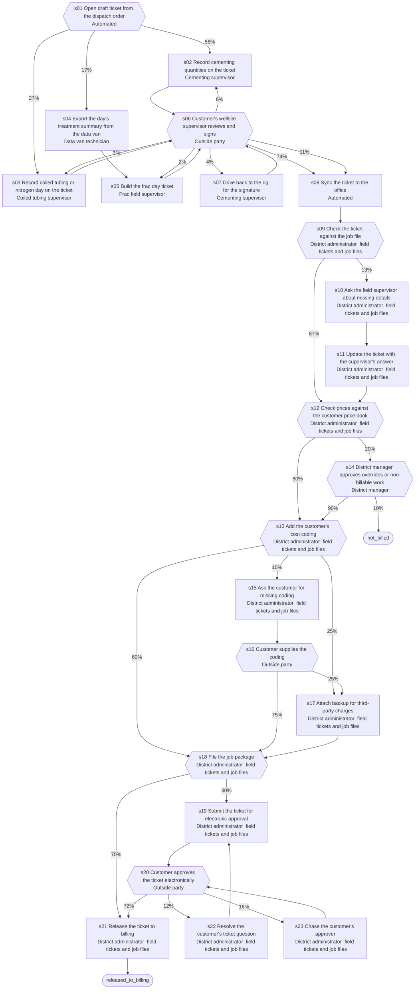

# Prepare and get field tickets signed

`ofs-fo-dist-field-ticket-preparation` · oil and gas services (pressure pumping) · field operations · part of `oilfield-services-co`

At the end of each cementing job, each coiled tubing day and each frac pumping day the field supervisor records the services, equipment hours, materials and standby on a tablet field ticket, and the customer's wellsite supervisor reviews and signs it. District administrators then check the ticket against the job file and the customer's price book, add the customer's cost coding (AFE, cost centre or WBS) and release it to billing. Tickets stall when the customer's representative has left the lease, when coding is missing, when quantities are disputed, and when customers require a second approval of the ticket in their e-invoicing network before any invoice can be sent.

| | |
|---|---|
| Unit of work | one field ticket (one cementing job, one coiled tubing or nitrogen day, or one frac pumping day on a pad) |
| Starts when | A cementing job, a coiled tubing or nitrogen shift, or a frac pumping day ends and the supervisor opens the ticket that was created from the dispatch order. |
| Done when | The ticket is signed or approved by the customer, priced, coded and released to billing in the ERP, or it is closed as not billable. |
| Organisation | A Canadian pressure pumping company with frac, cementing and coiled tubing crews working from district bases in Alberta and northeast BC, where field supervisors write tickets on tablets and district administrators check them before billing. (1,350 employees, 2019-2022) |
| Volume | 750 cases a month (range 350 to 950) |

## Where it sits

- Starts with **cement_job_report** from fo-cem-job-execution (50% of cases)
- Starts with **cement_job_report** from fo-cem-remedial-and-abandonment-cementing (6% of cases)
- Starts with **ct_job_report** from fo-ct-job-execution (20% of cases)
- Starts with **ct_job_report** from fo-ct-nitrogen-services (7% of cases)
- Starts with **treatment_data** from fo-frac-job-execution (17% of cases)
- Relies on **price_book** from cs-price-book-maintenance (a standing input; it does not start a case)
- Relies on **system_change** from it-erp-and-application-support (a standing input; it does not start a case)
- Sends **signed_field_ticket** to fin-field-ticket-to-invoice (outcome: released_to_billing)
- Sends **field_ticket** to customer-wellsite-supervisor (outcome: any)

## Flow

## Roles

| Role | Department | Layer | FTE on this process | Loaded cost per hour | Evidence |
|---|---|---|---:|---:|---|
| Cementing supervisor | Cementing service line | supervisor | 2.1 | 78 CAD | C |
| Coiled tubing supervisor | Coiled tubing and nitrogen service line | supervisor | 0.9 | 80 CAD | C |
| Frac field supervisor | Fracturing service line | supervisor | 0.7 | 82 CAD | C |
| Data van technician | Fracturing service line | individual contributor | 0.5 | 56 CAD | C |
| District administrator (field tickets and job files) | District operations and dispatch | individual contributor | 8.5 | 40 CAD | C |
| District manager | District operations and dispatch | manager | 0.4 | 125 CAD | C |

## Steps

Hands-on time and the wait before each step show the most common value. Evidence tier A is a sourced number, B a sourced description, C the author's estimate.

| Step | Who | Kind | Hands-on | Wait before | Control | Evidence |
|---|---|---|---:|---:|---|---|
| **s01 Open draft ticket from the dispatch order.** When the crew rigs out, the field ticket app opens a draft ticket already filled from the dispatch order and the customer's price book: customer, well licence and surface location, job type, unit numbers and the crew list. Nobody types this part; it comes across from the dispatch board and the ERP price book. | Automated | system auto | 0 min | 0 min |  | C |
| **s02 Record cementing quantities on the ticket.** The cementing supervisor sits in the unit cab after rig-out and enters sacks of each blend, additives, water and spacer volumes, pump hours, bulk truck kilometres, crew hours and any standby while waiting on the rig. He checks the numbers against the pump chart and the bulk ticket and adds notes on anything that went wrong. | Cementing supervisor | data entry | 25 min | 20 min |  | B [yager-2015], [enverus-51ofs] |
| **s03 Record coiled tubing or nitrogen day on the ticket.** At the end of the shift the coiled tubing supervisor enters unit and crew hours, depth run, plugs milled, fluid and nitrogen volumes, chemicals, tubing footage charges and standby. Multi-day jobs get one ticket per day that the customer signs each morning. | Coiled tubing supervisor | data entry | 30 min | 1.0 h |  | B [yager-2015], [enverus-51ofs] |
| **s04 Export the day's treatment summary from the data van.** The data van technician runs the stage reports for the day from the acquisition system: fluid volumes, proppant tonnes by type, chemical volumes and pumping time for each stage. The report can only be run when the van is not monitoring a live stage, usually at the overnight shutdown or between stages, and is then attached to the frac ticket. | Data van technician | data entry | 25 min | 4.0 h |  | B [aogr-proppant-2018] |
| **s05 Build the frac day ticket.** The frac field supervisor adds pump hours by unit, horsepower charges, blender and data van days, iron and manifold rental, crew charges, proppant and chemicals from the stage summary, sand hauling and any third-party items. He starts on the equipment and crew lines while the data van technician runs the stage reports, then compares the pumped stages with the customer's stage count before showing the ticket to the company man. | Frac field supervisor | data entry | 40 min | 0 min |  | B [yager-2015], [enverus-51ofs] |
| **s06 Customer's wellsite supervisor reviews and signs.** The customer's wellsite supervisor (the company man) reads the ticket on the tablet or a printout, compares quantities with his own daily report and signs, or disputes a line. If he has left the lease or is busy with the rig, the ticket goes unsigned and is either taken back to him later or sent to the customer for electronic approval. | Outside party | review | 8 min | 1.0 h | Customer master service agreements and invoicing standards: field ticket signed by the customer's field representative | B [yager-2015], [chevron-smart-2021] |
| **s07 Drive back to the rig for the signature.** When the company man had left before the ticket was ready, the cementing supervisor stops at the rig or the customer's field office on the next trip through the area to get the ticket signed. Lease roads, rig moves and weather decide when that trip can happen. | Cementing supervisor | travel | 1.2 h | 18.0 h | Journey management and fatigue rules under company driving policy and the Alberta OHS Code Part 2 hazard assessment | B [enverus-pain-points] |
| **s08 Sync the ticket to the office.** The tablet uploads the ticket and its attachments to the field ticket server once the truck reaches cell or Wi-Fi coverage. Remote leases in northwest Alberta and northeast BC often have no signal, so upload waits until the crew is back on the highway or at the base. | Automated | system auto | 0 min | 30 min |  | B [enverus-51ofs] |
| **s09 Check the ticket against the job file.** The district administrator opens the ticket next to the dispatch order, the job report or treatment summary, the bulk and haul tickets and the crew time sheet. She checks that every unit and person on the job is charged, hours agree with the job log and the signature matches the customer's representative. | District administrator (field tickets and job files) | validation | 20 min | 16.0 h |  | C |
| **s10 Ask the field supervisor about missing details.** The administrator emails or texts the supervisor with the lines in question: a missing unit, hours that do not match the time sheet, or a material with no quantity. Supervisors on a 14-day rotation answer when they are off shift or between jobs. | District administrator (field tickets and job files) | communication | 10 min | 30 min |  | C |
| **s11 Update the ticket with the supervisor's answer.** When the supervisor replies, the administrator corrects the quantities on the ticket, notes who confirmed the change and re-checks the totals. If the change affects a signed quantity the customer is told when the ticket is sent. | District administrator (field tickets and job files) | data entry | 10 min | 1.0 d |  | C |
| **s12 Check prices against the customer price book.** The administrator compares each line with the customer's price book or tender pricing in the ERP: list price, discount, fuel surcharge and minimum charges. Overrides, unusual standby and lines for failed or repeated work go to the district manager. | District administrator (field tickets and job files) | validation | 15 min | 30 min |  | B [cnrl-oi-standards] |
| **s13 Add the customer's cost coding.** The administrator enters the customer's AFE or cost centre, WBS element, GL account and approver code from the company man's stamp, the dispatch order or the customer's coding list. Coding formats differ by producer and are checked by the customer's e-invoicing system later. | District administrator (field tickets and job files) | lookup | 10 min | 0 min |  | B [chevron-smart-2021], [cenovus-invoicing] |
| **s14 District manager approves overrides or non-billable work.** The district manager reviews the ticket with the reason for the override: a negotiated discount, standby the customer caused, or a failed job that should not be charged. He approves the charge, changes it, or marks the ticket as not billable and notes the reason for the account manager. | District manager | approval | 12 min | 1.0 d | Company pricing authority matrix: discounts, standby and write-offs approved by the district manager | C |
| **s15 Ask the customer for missing coding.** The administrator emails the company man or the customer's completions or drilling coordinator asking for the AFE, cost centre or WBS for the well. Many producers issue AFEs late or change them when a well moves between budgets. | District administrator (field tickets and job files) | communication | 8 min | 0 min |  | C |
| **s16 Customer supplies the coding.** The customer's representative or office replies with the coding, sometimes after checking with their cost accountant. Requests are often chased more than once. | Outside party | external wait | 2 min | 2.0 d |  | B [enverus-pain-points] |
| **s17 Attach backup for third-party charges.** For sand hauling, water, rentals and other rebilled items the administrator collects the supplier tickets from the proppant logistics team or the supplier, scans them and attaches them to the field ticket. Customers will not approve third-party lines without backup. | District administrator (field tickets and job files) | lookup | 20 min | 1.0 d |  | B [chevron-smart-2021] |
| **s18 File the job package.** The administrator saves the ticket, job report, pump charts and backup in the job folder and checks whether this customer accepts a signed ticket or needs its own electronic ticket approval. Unsigned tickets and customers that approve tickets in their e-invoicing network go to that route. | District administrator (field tickets and job files) | data entry | 5 min | 1.0 h |  | B [cenovus-invoicing] |
| **s19 Submit the ticket for electronic approval.** The administrator uploads the ticket and backup to the customer's e-invoicing network as a field ticket for approval, or emails a PDF to the customer's representative for producers without one, and enters the coding the network asks for. | District administrator (field tickets and job files) | data entry | 10 min | 2.0 h |  | B [cenovus-invoicing], [enverus-51ofs] |
| **s20 Customer approves the ticket electronically.** The customer's field approver opens the ticket in the network, checks it against their daily report and approves it, rejects it with a comment, or leaves it in the queue. Approvers are field staff who clear queues when they get to a desk. | Outside party | approval | 3 min | 3.0 d | Customer field ticket approval in its e-invoicing network before an invoice is accepted | B [enverus-51ofs] |
| **s21 Release the ticket to billing.** The administrator marks the ticket billable in the ERP, which moves it to the billing queue with its attachments and locks the quantities. Only signed or customer-approved tickets may be released. | District administrator (field tickets and job files) | data entry | 4 min | 1.0 h | Billing policy: only tickets signed or approved by the customer are released for invoicing | C |
| **s22 Resolve the customer's ticket question.** The administrator reads the rejection comment, checks it with the field supervisor or the job file, and either corrects the ticket, adds missing backup or explains the charge in a reply before resubmitting. | District administrator (field tickets and job files) | analysis | 30 min | 1.0 d |  | C |
| **s23 Chase the customer's approver.** Once a week the administrator runs the list of tickets waiting for approval and emails or phones the approvers, copying the account manager for large or old tickets. | District administrator (field tickets and job files) | communication | 6 min | 1.0 d |  | C |

## Exceptions

| Exception | Share of cases | What happens |
|---|---:|---|
| Quantity dispute on location | 11% | The company man disputes a quantity, so the supervisor corrects the ticket before it is signed. |
| Signature missing | 15% | The customer representative left before signing; the supervisor returns or the ticket goes for electronic approval. |
| Missing customer coding | 15% | No AFE or cost centre for the well; the administrator waits days for the customer to supply one. |
| Electronic ticket rejected or stalled | 8% | The customer's approver rejects the ticket or leaves it unworked and it is chased weekly. |
| Not billable | 2% | Failed or repeated work the district manager decides not to charge. |

## Benchmarks

| Metric | Value | Unit | Population | Evidence |
|---|---|---|---|---|
| cycle_time_days | p50 3, p90 11 | calendar days from end of job or shift to ticket released to billing | WCSB pressure pumping tickets on tablet ticketing, 2019-2022 (estimate) | C [enverus-pain-points] |
| paper_ticket_service_to_submission_days | 7 | days (average, more than) | US upstream suppliers using paper tickets (vendor webinar, 2025) | B [enverus-pain-points] |

## Pain points

- Customer representatives leave the lease or are busy with the rig, leaving tickets unsigned and forcing return trips or a second electronic approval. (steps s06, s07, s20; B [enverus-pain-points], [enverus-51ofs])
- Missing or wrong AFE and cost centre coding is the most common reason tickets stop, and producers use different formats. (steps s13, s15, s16; B [enverus-pain-points], [cenovus-invoicing])
- Supervisors on rotation answer office queries days later, and third-party backup has to be collected from logistics and suppliers. (steps s10, s11, s17; C)
- Electronic ticket approvals sit in customer field approvers' queues and need weekly chasing. (steps s20, s23; C)

## Assumptions

- Loaded costs are the organisation file's (base wage x 1.35).
- The validator's simulation is memoryless: a quantity dispute at s06 returns to the cementing, coiled tubing or frac entry step in proportion to the ticket mix, so a single simulated case may switch service line; averages are right.
- The return trip for a signature (s07) is shown with the cementing supervisor because cementing crews leave the lease right after the job; coiled tubing and frac supervisors stay on the pad and get the signature next morning inside s06.
- The decision at s18 between a signed ticket and electronic approval is drawn independently of the earlier signature outcome; 30% covers the 11% left unsigned plus customers that require their own ticket approval.
- Frac data van technicians are added to the process because they produce the treatment summary the frac ticket is built from; the organisation file's process map lists only supervisors and district administrators.
- The frac supervisor builds the equipment and crew part of the ticket while the data van technician runs the stage reports, so s04 and s05 are marked as concurrent.
- No step uses 'people': each ticket step is done by one person; crew work is in the job execution processes.
- District managers are added as approvers of price overrides and non-billable decisions.
- Volume is set at about 750 tickets a month, above the organisation file's 640, because frac and coiled tubing work is ticketed per day while invoices are per job.
- The customer's representative appears as role 'external'; the few minutes of their time at s06, s16 and s20 are included in the validator's hands-on totals.
- The simulated median (about 4.2 days, p90 about 12) is above the 3-day estimate because the office check usually waits overnight and about a third of tickets take the electronic approval or coding-request paths; both are unsourced estimates, so the gap is left rather than tuned away.

## Sources

- [trican-mda-2022] [Trican Well Service Ltd. Management's Discussion and Analysis for the year ended December 31, 2022](https://tricanwellservice.com/app/uploads/2023/02/TCW-Q4-2022-MDA-2023.02.22.pdf) (Trican Well Service Ltd., 2023). A job is typically represented by an invoice and invoice frequency depends on how often the customer asks to be billed during a project; 7,625 jobs in 2022 and 7,291 in 2021; Q4 2022 revenue $236.5 million and Q4 2021 $156.4 million; trade and other receivables $175.4 million at December 31, 2022 and $127.8 million at December 31, 2021; trade and other payables $90.9 million at December 31, 2022; Q4 2022 direct costs $133.4 million; more than 60 customers; one customer 40% of accounts receivable in 2022 (35% in 2021) and 31% of revenue; expected credit losses measured with a provision matrix; working capital and credit facilities cover timing differences between cash collections and payments.
- [enverus-pain-points] [7 Field Ticketing Pain Points in Upstream Oil & Gas and How Digital Solutions Are Changing the Game](https://www.enverus.com/blog/7-field-ticketing-pain-points-in-upstream-oil-gas-and-how-digital-solutions-are-changing-the-game/) (Enverus, 2025). Vendor blog (November 2025, US practice): technicians drive paper tickets to field offices for approval; lost or damaged tickets delay payment for weeks; most ticket disputes are about coding errors or who requested the work rather than price, and supplier-provided coding raises dispute rates; duplicate charges and inflated hours are hard to catch on paper; the average time from service to ticket submission is over seven days when tickets go through back-office staff; digital ticketing users process invoices 3-4 times faster than paper users.
- [enverus-51ofs] [Get Paid Faster With Digital Field Tickets (51 Oilfield Services customer story)](https://www.enverus.com/customer-story/get-paid-faster-with-digital-field-tickets/) (Enverus, 2024). Vendor case study (July 2024, Texas roustabout contractor): paper process of keying tickets into a spreadsheet, scanning and emailing to head office, re-keying into accounting, printing, tracking down the company man for a signature and re-keying into OpenInvoice; about 900 field tickets a month for one customer; tickets entered three times; with mobile tickets and same-day electronic approval, tickets usually approved the next day; ticket submission to payment fell from 1-2 months to 7-10 days; operators use spend codes; OpenInvoice used by most E&P companies in the US market.
- [chevron-smart-2021] [CBU Wells Supplier Rules for SMART Submissions (March 30, 2021)](https://canada-test.chevron.com/-/media/canada/work-with-us/documents/Wells-Supplier-Rules-for-SMART-Mar-2021.pdf) (Chevron Canada, 2021). Rules for drilling, completions/frac and intervention suppliers: invoices that break the rules are rejected and sent back for correction; work location as pad LSD or well UWI; amount approved on the attached ticket must match the final invoice; backup for third-party charges; field ticket with a stamp carrying WBS elements and GL account and a digital signature must be attached; GL account and WBS on the invoice must match the stamp.
- [cenovus-invoicing] [Invoicing for suppliers](https://www.cenovus.com/contractor/invoicing-for-suppliers.html) (Cenovus Energy, 2026). No paper invoices; for OpenInvoice purchase orders suppliers submit field tickets for approval, monitor OpenInvoice for approved field tickets and only then submit invoices from them; back-up such as daily time tickets attached; invoices against approved goods receipts; WBS/AFE and work order coding formats that must be entered in OpenInvoice. Current page; describes the practice of a large Canadian producer.
- [cnrl-oi-standards] [Canadian Natural Supplier Submission Guidelines (OpenInvoice submission standards), last updated August 2025](https://www.cnrl.com/content/uploads/2025/08/Canadian-Natural-OI-Submission-Standards.pdf) (Canadian Natural Resources Limited, 2025). Invoice header and line requirements in OpenInvoice; all field ticket numbers entered and duplicates not allowed; price book on the invoice must match the PO price book or a red alert blocks submission; PO compliance alerts; credits entered as negative quantities; approver codes by site and department.
- [yager-2015] [The Broken Payment Model That Costs The Oil Industry Millions](https://oilprice.com/Energy/Energy-General/The-Broken-Payment-Model-That-Costs-The-Oil-Industry-Millions.html) (OilPrice.com (David Yager, Calgary), 2015). Canadian oilfield services commentary (July 2015): the field ticket is prepared by the contractor's representative and signed by the producer's representative; the invoice must be perfect to be paid; payment delays follow when billing procedures are not followed; three-month payment is an accepted norm and some producers will not pay before 90 and possibly 120 days; many vendors carry receivables over 90 days.
- [aogr-proppant-2018] [Real-Time Data Collection Optimizes Proppant Logistics](https://www.aogr.com/magazine/cover-story/real-time-data-collection-optimizes-proppant-logistics) (The American Oil & Gas Reporter, 2018). August 2018: container sand delivery adds work for frac van personnel recording delivery tickets; about 200 containers a day on a wellsite; bill of lading data tied to each container and stage and sent electronically for verification and billing to payables.

Written by claude-opus on 2026-11-24.
