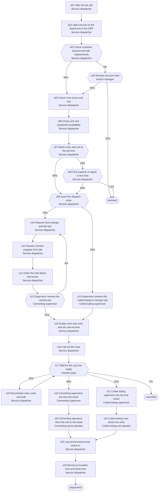

# Take job calls and dispatch crews

`ofs-fo-dist-job-call-intake-and-dispatch` · oilfield services (pressure pumping) · field operations · part of `oilfield-services-co`

Drilling rigs and producers phone the district dispatch desks around the clock for cementing, coiled tubing and nitrogen jobs, often only a day or two before the casing is run. The dispatcher checks the customer's account, which crews are rested enough to drive and work under hours of service rules, and which units are free, then orders the lab design and the bulk cement and calls the crew out. Rig timing slips by hours or days, so jobs are rescheduled again and again and crews often wait on location. Errors come from details taken down by phone and typed into both the dispatch board and the ERP.

| | |
|---|---|
| Unit of work | one job request |
| Starts when | A drilling rig, producer or wellsite supervisor calls or emails a district dispatch desk with a cementing, coiled tubing or nitrogen job. |
| Done when | The crew and units are on location and the job is handed to hazard assessment and execution, or the job is declined or cancelled. |
| Organisation | A listed Canadian pressure pumper of about 1,350 people with nine district bases in Alberta and northeast BC and separate 24-hour dispatch lines for cementing and for coiled tubing and nitrogen. (1,350 employees, 2019-2022) |
| Volume | 580 cases a month (range 280 to 720) |

## Where it sits

- Starts with **job_request** from drilling-contractor (55% of cases)
- Starts with **job_request** from producer (45% of cases)
- Relies on **crew_roster** from fo-dist-crew-scheduling-and-rotation (a standing input; it does not start a case)
- Relies on **fleet_status** from em-preventive-maintenance (a standing input; it does not start a case)
- Relies on **fleet_status** from em-corrective-repair-and-pump-rebuild (a standing input; it does not start a case)
- Relies on **cement_program** from te-cement-slurry-design-and-lab-testing (a standing input; it does not start a case)
- Relies on **hos_exception** from hs-hours-of-service-and-fatigue-management (a standing input; it does not start a case)
- Sends **job_request** to te-cement-slurry-design-and-lab-testing (outcome: any)
- Sends **dispatch_order** to fo-cem-bulk-blending-and-delivery (outcome: any)
- Sends **dispatch_order** to fo-cem-job-execution (outcome: dispatched)
- Sends **dispatch_order** to fo-ct-job-planning (outcome: dispatched)
- Sends **dispatch_order** to fo-ct-nitrogen-services (outcome: dispatched)
- Sends **dispatch_order** to hs-pre-job-hazard-assessment (outcome: dispatched)
- Sends **dispatch_order** to fo-dist-daily-operations-call (outcome: any)

## Flow

## Roles

| Role | Department | Layer | FTE on this process | Loaded cost per hour | Evidence |
|---|---|---|---:|---:|---|
| Service dispatcher | District operations and dispatch | individual contributor | 11 | 45 CAD | C |
| District manager | District operations and dispatch | manager | 0.15 | 125 CAD | C |
| Cementing supervisor | Cementing service line | supervisor | 12 | 78 CAD | C |
| Cementing pump operator | Cementing service line | individual contributor | 20 | 48 CAD | C |
| Coiled tubing supervisor | Coiled tubing and nitrogen service line | supervisor | 5 | 80 CAD | C |
| Coiled tubing unit operator | Coiled tubing and nitrogen service line | individual contributor | 12 | 50 CAD | C |

## Steps

Hands-on time and the wait before each step show the most common value. Evidence tier A is a sourced number, B a sourced description, C the author's estimate.

| Step | Who | Kind | Hands-on | Wait before | Control | Evidence |
|---|---|---|---:|---:|---|---|
| **s01 Take the job call.** The dispatcher answers the cement or coiled tubing and nitrogen dispatch line, or reads an email from a rig or producer, and writes down the customer, well licence and surface location, casing or tubing sizes, depths, job type, requested on-location time and the wellsite supervisor's phone number. | Service dispatcher | intake | 10 min | 5 min |  | B [trican-contact] |
| **s02 Open the job on the board and in the ERP.** The dispatcher creates the job on the dispatch board with the requested time, then opens a job number in the ERP so materials, the field ticket and the invoice can be tied to it, typing the same customer, well and job details twice. | Service dispatcher | data entry | 10 min | 10 min |  | C |
| **s03 Check customer account and site requirements.** The dispatcher checks that the customer has a current MSA and pricing schedule, is not on credit hold, has given a PO or AFE number if required, and looks up the producer's site safety requirements and prequalification status. | Service dispatcher | validation | 5 min | 0 min | Credit policy and MSA requirement: no work without a current agreement and open credit | B [ovintiv-suppliers], [cnrl-suppliers] |
| **s04 Resolve account hold.** The district manager phones the account manager or credit analyst to decide whether the job can go ahead on a one-off basis, waits for a payment or signed agreement, or declines the job. | District manager | judgment | 30 min | 4.0 h |  | C |
| **s05 Check crew hours and rest.** The dispatcher checks which on-call crews are rested: hours worked in the last days and month, days off taken in the 24-day cycle under the oil well service vehicle permit, and electronic driver logs, so the crew can legally drive and work the job. | Service dispatcher | validation | 10 min | 0 min | Commercial Vehicle Drivers Hours of Service Regulations (SOR/2005-313) and the oil well service vehicle permit (s.63); Alberta Employment Standards oilwell servicing overtime rules | B [hos63], [ab-es-ows] |
| **s06 Check unit and equipment availability.** The dispatcher checks which cementing units, bulk trucks, coiled tubing units and nitrogen pumpers are free and not in the shop, using the board and the maintenance status list. | Service dispatcher | lookup | 6 min | 0 min |  | C |
| **s07 Match crew and unit to the job time.** The dispatcher weighs the requested time against crews already committed, rig timings that might slip and the travel distance from the base, and decides whether the job can be covered when asked. | Service dispatcher | judgment | 8 min | 0 min |  | C |
| **s08 Find capacity or agree a new time.** The dispatcher calls the other district dispatchers to borrow a crew or unit, calls the rig to offer a later time, or asks the district manager whether to hold a crew over. If nothing works the job is declined and goes to a competitor. | Service dispatcher | coordination | 30 min | 1.0 h |  | B [step-2021] |
| **s09 Issue the dispatch order.** The dispatcher writes the dispatch order with the job details, lease directions, customer site requirements and contacts, and sends it to the service line by email or the board. | Service dispatcher | drafting | 10 min | 0 min |  | C |
| **s10 Request slurry design and lab test.** For a cementing job the dispatcher sends the well data and the customer's cement program request to the lab, which designs the slurry and runs thickening time and strength tests with the field water and blend. | Service dispatcher | communication | 5 min | 10 min |  | C |
| **s11 Receive cement program from lab.** The dispatcher receives the lab report and cement program, checks that it matches the job (casing size, depth, volumes) and attaches it to the dispatch order. | Service dispatcher | lookup | 5 min | 12.0 h |  | C |
| **s12 Order the bulk blend and trucks.** The dispatcher sends the blend recipe, tonnage and load-out time to the bulk plant and books bulk trucks to haul cement to the lease ahead of the crew. | Service dispatcher | communication | 10 min | 10 min |  | C |
| **s13 Supervisor reviews the cement job.** The cementing supervisor reads the dispatch order and cement program, checks volumes, displacement and pressures against the well, confirms the blend and additives, and phones the wellsite supervisor about rig status. | Cementing supervisor | review | 25 min | 2.0 h |  | C |
| **s14 Supervisor reviews the coiled tubing or nitrogen job.** The coiled tubing supervisor reviews the program, string size and fatigue life, nitrogen volumes and the wellhead and pressure details, and confirms the crew and equipment needed. | Coiled tubing supervisor | review | 30 min | 4.0 h |  | C |
| **s15 Assign crew and units and set call-out time.** The dispatcher books the named crew members and unit numbers on the board for the job and sets a call-out time that allows for load-out, travel and the customer's requested on-location time. | Service dispatcher | data entry | 10 min | 10 min |  | C |
| **s16 Call out the crew.** The dispatcher phones or texts each crew member with the call-out time, lease and job, and confirms each one acknowledges; a sick or unreachable person is replaced from the on-call list. | Service dispatcher | communication | 12 min | 1.0 h |  | C |
| **s17 Wait for the rig to be ready.** The rig or the producer's wellsite supervisor calls with the timing as casing is run or the well is prepared. Rig timing often slips by hours or days, and road and weather conditions can close the lease road. | Outside party | external wait | 0 min | 12.0 h |  | B [ab-roadbans] |
| **s18 Reschedule crew, units and bulk.** The dispatcher moves the job on the board, re-checks crew hours for the new time, re-notifies the crew and the bulk plant, and resolves clashes with other jobs that the change creates. | Service dispatcher | coordination | 20 min | 15 min | Commercial Vehicle Drivers Hours of Service Regulations (SOR/2005-313) and the oil well service vehicle permit (s.63); Alberta Employment Standards oilwell servicing overtime rules | C |
| **s19 Cementing supervisor pre-trip and travel.** The cementing supervisor holds a short pre-trip meeting at the base, files the journey plan with dispatch and drives the pickup to the lease ahead of or with the unit. | Cementing supervisor | travel | 2.5 h | 30 min | Company journey management and check-in procedure for crews driving to remote leases (Alberta OHS Code hazard assessment and working alone requirements) | C |
| **s20 Cementing operators drive the unit to the lease.** Two cementing operators drive the pump unit to the lease under the journey plan, check in with dispatch at set points and at arrival, and follow road ban and load limits on local roads. | Cementing pump operator | travel | 2.5 h | 0 min | Company journey management and check-in procedure for crews driving to remote leases (Alberta OHS Code hazard assessment and working alone requirements) | B [ab-roadbans], [hos63] |
| **s21 Coiled tubing supervisor pre-trip and travel.** The coiled tubing supervisor holds the pre-trip meeting, files the journey plan and drives to the lease, where the unit, reel trailer and nitrogen pumper follow. | Coiled tubing supervisor | travel | 3.0 h | 30 min | Company journey management and check-in procedure for crews driving to remote leases (Alberta OHS Code hazard assessment and working alone requirements) | C |
| **s22 Coiled tubing crew drives the units.** Three operators drive the coiled tubing unit, reel trailer and nitrogen or fluid pumper to the lease, checking in with dispatch, with oversize loads following permit routes and road ban limits. | Coiled tubing unit operator | travel | 3.0 h | 0 min | Company journey management and check-in procedure for crews driving to remote leases (Alberta OHS Code hazard assessment and working alone requirements) | B [ab-roadbans] |
| **s23 Log arrival and journey check-in.** The dispatcher records the crew's arrival call against the journey plan, closes the journey, and follows up if a crew is overdue for a check-in. | Service dispatcher | communication | 3 min | 0 min | Company journey management and check-in procedure for crews driving to remote leases (Alberta OHS Code hazard assessment and working alone requirements) | C |
| **s24 Record on-location time and hand over.** Once the rig is ready, the dispatcher records the on-location and standby times from the supervisor's call for the field ticket, and hands the job to the crew's hazard assessment and execution. Standby on location before the rig is ready is common. | Service dispatcher | data entry | 6 min | 30 min |  | B [hos63] |

## Exceptions

| Exception | Share of cases | What happens |
|---|---:|---|
| Rig timing change | 33% | The rig or producer moves the job time, so the dispatcher re-books the crew, units and bulk and re-checks hours; several changes on one job are common. |
| No capacity at requested time | 20% | All rested crews or units are committed; the dispatcher borrows from another district, negotiates a later time or declines. |
| Account hold | 4% | The customer is on credit hold or has no current agreement and the district manager decides whether to proceed. |
| Cement redesign | 6% | The supervisor finds the program does not fit the well (wrong depth, casing or temperature) and it goes back to the lab. |

## Benchmarks

| Metric | Value | Unit | Population | Evidence |
|---|---|---|---|---|
| cycle_time_days | p50 2.0, p90 4.5 | calendar days from job call to crew on location | Cementing, coiled tubing and nitrogen job calls at a WCSB service company, 2019-2022 | C |
| share_of_jobs_rescheduled | 0.33 | share of jobs with at least one timing change | Same | C |

## Pain points

- Rig timing slips force repeated rebooking of crews, units and bulk trucks and leave crews on standby at the lease. (steps s17, s18, s24; C)
- Job details taken by phone are typed into the board and the ERP separately, so errors surface only on location or on the invoice. (steps s01, s02; C)
- Hours of service and rest checks are done by hand across logs, rosters and time records during the winter peak, when crews are short. (steps s05, s08; B [hos63], [step-2021])

## Assumptions

- Loaded costs are the organisation file's (base wage x 1.35); field roles include rotation overtime premiums.
- The validator's simulation chooses the cementing or coiled tubing travel branch at s17 independently of the earlier split at s09; the shares (75% cementing) are the same, so averages are right, but a single simulated case may mix the two paths.
- Cementing and coiled tubing operators are added because they drive the units to the lease; the organisation file's process map lists only supervisors, dispatchers and the district manager.
- Standby on location is a wait before s24 with no resource attached; crew and unit standby hours are billed and recorded in the job execution and field ticket processes.
- Bulk trucks travel under fo-cem-bulk-blending-and-delivery and are not counted here.
- Dispatcher FTE is set above the hands-on estimate because desks are staffed around the clock regardless of call volume.
- The simulated median (about 2.7 days) is above the 2-day benchmark because each timing change adds a fresh rig wait and cementing jobs also wait for lab testing; both the waits and the benchmark are unsourced estimates, so the gap is left rather than tuned away.

## Sources

- [hos63] [Commercial Vehicle Drivers Hours of Service Regulations (SOR/2005-313), section 63 (oil well service vehicle permits), version in force 2019-06-12 to 2021-06-11](https://laws-lois.justice.gc.ca/eng/regulations/SOR-2005-313/section-63-20190612.html) (Justice Laws Website, Government of Canada, 2019). Oil well service vehicle permit: at least three 24-hour off-duty periods in any 24 days, 72 consecutive hours off before returning to standard rules, well-site standby logged as off-duty only if no work is done and it is not part of the 8-hour minimum.
- [trican-contact] [Trican - Contact us](https://tricanwellservice.com/contact-us/) (Trican Well Service Ltd., 2026). Separate dispatch telephone lines for cementing, fracturing, and coiled tubing and nitrogen.
- [step-2021] [STEP Energy Services Ltd. Reports Fourth Quarter and Year End 2021 Results](https://www.stepenergyservices.com/news-releases/step-energy-services-ltd-reports-fourth-quarter-and-year-end-2021-results) (STEP Energy Services Ltd., 2022). Tight supply of field staff, limits on how fast recruits can be added safely, rising labour cost; prices raised for all clients in Q4 2021 and Q1 2022 to offset inflation; crews booked through Q1; spring break-up affects Canadian operations; extreme cold caused delays.
- [ab-es-ows] [Oilwell servicing - employment standards exceptions](https://www.alberta.ca/es-exceptions-oilwell-servicing) (Government of Alberta, 2026). Oilwell servicing (including cementing and fracturing) overtime is paid after 12 hours a day or 191 hours a month, whichever is greater; the 12-consecutive-hour confinement rule does not apply; OHS duties on extended hours still apply.
- [ovintiv-suppliers] [Supplier Resources](https://www.ovintiv.com/supplier-resources/) (Ovintiv Inc., 2026). A producer requires an ISNetworld PASS grade for field suppliers, a company sponsor before an agreement is set up, master agreements that mostly do not expire but are amended when services or risk change, and invoicing through OpenInvoice.
- [cnrl-suppliers] [Prospective Suppliers](https://www.cnrl.com/working-together/prospective-suppliers/) (Canadian Natural Resources Limited, 2026). A producer qualifies contractors for health, safety and environment through ISNetworld before work; registration and qualification do not imply an award.
- [ab-roadbans] [Road bans](https://www.alberta.ca/road-bans) (Government of Alberta, 2026). Road bans reduce allowed weights on thawing roads; spring weights depend on measured thaw depth; local road bans are set by counties and municipal districts.

Written by claude-opus on 2026-11-24.
