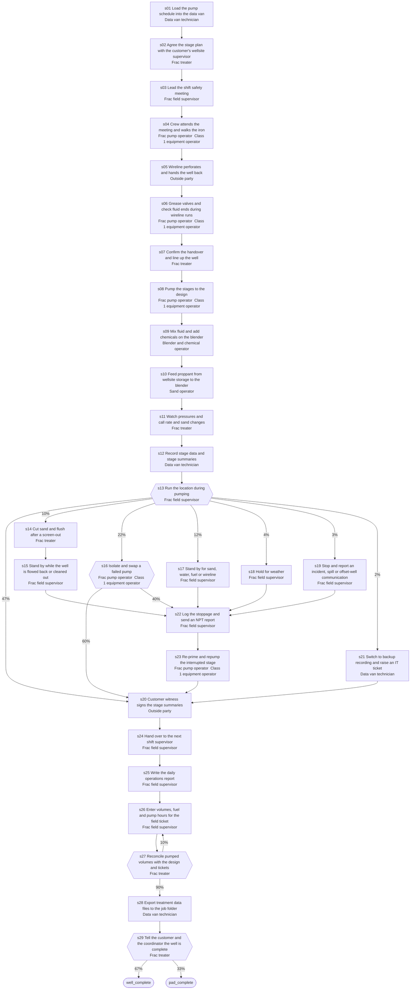

# Pump fracturing stages on one well

`ofs-fo-frac-job-execution` · oilfield services (pressure pumping) · field operations (fracturing) · part of `oilfield-services-co`

A 24-hour frac crew pumps every stage of one horizontal well to the treatment design, usually alternating with a second well on the same pad while the producer's wireline crew perforates the next stage (zipper fracturing). The treater calls rate and sand changes from the data van, pump, blender and sand operators run the equipment, and the field supervisor runs the location and deals with the customer's wellsite supervisor. Time is lost between stages waiting on wireline, and whenever a pump fails, a stage screens out, sand, water or fuel run short, or weather stops work, the whole fleet and crew stand by. Volumes pumped, fuel and pump hours are then re-keyed from the data van and paper sheets into the field ticket.

| | |
|---|---|
| Unit of work | one well fractured (all stages of one horizontal well) |
| Starts when | The rig-up and pressure test record for the pad is signed off and the customer's wellsite supervisor releases the first well for fracturing. |
| Done when | The last stage of the well is pumped, volumes are reconciled and entered for the field ticket, data files are exported, and the customer is told the well is complete (and, for the last well, that the pad is complete). |
| Organisation | A TSX-listed Canadian pressure pumping company with six to eight 24-hour frac crews working for producers in Alberta and northeast BC, run from district bases with a Calgary head office. (1,350 employees, 2019-2022) |
| Volume | 50 cases a month (range 15 to 70) |

## Where it sits

- Starts with **pressure_test_record** from fo-frac-rig-up-and-pressure-test (100% of cases)
- Relies on **frac_design** from te-frac-treatment-design (a standing input; it does not start a case)
- Relies on **hazard_assessment** from hs-pre-job-hazard-assessment (a standing input; it does not start a case)
- Relies on **sand_on_location** from fo-frac-onsite-proppant-and-fluid-management (a standing input; it does not start a case)
- Relies on **chemical_delivery** from sc-chemical-procurement-and-blending (a standing input; it does not start a case)
- Relies on **fuel_delivery** from sc-fuel-supply (a standing input; it does not start a case)
- Relies on **fuel_delivery** from fo-frac-dual-fuel-management (a standing input; it does not start a case)
- Relies on **wireline_handover** from wireline-contractor (a standing input; it does not start a case)
- Relies on **stage_instruction** from customer-wellsite-supervisor (a standing input; it does not start a case)
- Relies on **system_change** from it-field-connectivity-and-data-van-support (a standing input; it does not start a case)
- Sends **treatment_data** to fo-frac-post-job-reporting (outcome: any)
- Sends **treatment_data** to fo-dist-field-ticket-preparation (outcome: any)
- Sends **treatment_data** to customer-wellsite-supervisor (outcome: any)
- Sends **npt_report** to fo-frac-screen-out-and-npt-handling (outcome: any)
- Sends **repair_request** to em-field-breakdown-support (outcome: any)
- Sends **incident_report** to hs-incident-reporting-and-investigation (outcome: any)
- Sends **spill_report** to hs-environmental-spill-response (outcome: any)
- Sends **it_ticket** to it-field-connectivity-and-data-van-support (outcome: any)
- Sends **pad_complete** to fo-frac-rig-down-and-move (outcome: pad_complete)

## Flow

## Roles

| Role | Department | Layer | FTE on this process | Loaded cost per hour | Evidence |
|---|---|---|---:|---:|---|
| Frac field supervisor | Fracturing service line | supervisor | 14.4 | 82 CAD | C |
| Frac treater | Fracturing service line | senior specialist | 14 | 70 CAD | C |
| Data van technician | Fracturing service line | individual contributor | 14 | 56 CAD | C |
| Frac pump operator (Class 1 equipment operator) | Fracturing service line | individual contributor | 190 | 48 CAD | B [alis_wseo] |
| Blender and chemical operator | Fracturing service line | individual contributor | 25 | 52 CAD | C |
| Sand operator | Fracturing service line | individual contributor | 13.5 | 49 CAD | C |

## Steps

Hands-on time and the wait before each step show the most common value. Evidence tier A is a sourced number, B a sourced description, C the author's estimate.

| Step | Who | Kind | Hands-on | Wait before | Control | Evidence |
|---|---|---|---:|---:|---|---|
| **s01 Load the pump schedule into the data van.** The data van technician opens the treatment design for the well and builds the stage-by-stage pump schedule in the acquisition software: fluid volumes, rates, proppant ramps by mesh and chemical loadings. They set alarm limits for treating pressure and check sensor zeroes on the treating line. | Data van technician | data entry | 1.0 h | 15 min |  | C |
| **s02 Agree the stage plan with the customer's wellsite supervisor.** The treater walks the customer's wellsite supervisor (company man) through the pump schedule, stage order across the pad wells and any changes from the design, such as a lower maximum pressure or a different proppant ramp. Both initial the schedule; changes later in the well also need the supervisor's agreement. | Frac treater | review | 45 min | 30 min | Customer completion program and master service agreement: deviations from the treatment design need the wellsite supervisor's approval | C |
| **s03 Lead the shift safety meeting.** At each shift change the field supervisor holds the safety meeting at the data van: the day's stages, pressure limits, red-zone rules around the treating iron, hazards on the field level hazard assessment and who is the designated spotter. The supervisor records attendance and signs the hazard assessment. Time shown is this well's share of the meetings on the pad. | Frac field supervisor | communication | 1.0 h | 30 min | Alberta OHS Code Part 2 hazard assessment and company pre-job safety meeting at every shift change on a pressure pumping location | C |
| **s04 Crew attends the meeting and walks the iron.** Pump, blender and sand operators on the incoming shift attend the meeting, then walk the treating iron, check valve positions and look for leaks or loose restraints before pressure comes back on. Each operator signs the hazard assessment. | Frac pump operator (Class 1 equipment operator) | physical | 1.0 h | 0 min | Alberta OHS Code Part 2 hazard assessment and company pre-job safety meeting at every shift change on a pressure pumping location | C |
| **s05 Wireline perforates and hands the well back.** The producer's wireline crew pumps down a plug and perforating guns, sets the plug, fires the guns and pulls out, then tells the treater the well is ready. With zipper fracturing most of this runs while the other well on the pad is being pumped; the time shown is the dead time this well adds: well swaps and stages where wireline is not ready when the pumps are. | Outside party | external wait | 8.3 h | 0 min |  | B [jpt_zipper] |
| **s06 Grease valves and check fluid ends during wireline runs.** While wireline works, a few pump operators grease the pump valves and plug valves, check fluid ends for washed seats and leaks, top up oil and fuel and swap any pump flagged by the treater. This maintenance between stages decides how many pumping hours the fleet gets in a day. | Frac pump operator (Class 1 equipment operator) | physical | 6.7 h | 0 min |  | B [step_case] |
| **s07 Confirm the handover and line up the well.** Before each stage the treater confirms with wireline and the wellsite supervisor that the guns fired and the plug is set, checks the wellhead valve positions on the frac stack for the right well, and equalises pressure before opening. Time is about five minutes per stage summed over the well. | Frac treater | validation | 2.3 h | 0 min | Company and IRP 24 surface operations practice: valve line-up and pressure equalisation check before opening a well to the pumps | C |
| **s08 Pump the stages to the design.** Pump operators bring the pumps up to rate on the treater's call and run them from the pump control cab through pad, proppant ramps and flush on every stage, watching engine and transmission readings. Time shown is total pumping time for the well, about 28 stages of 60 to 90 minutes. | Frac pump operator (Class 1 equipment operator) | physical | 1.4 d | 0 min |  | B [step21], [step_case] |
| **s09 Mix fluid and add chemicals on the blender.** The blender operator runs the blender tub and liquid additive pumps, holding friction reducer, crosslinker, breaker and biocide rates to the schedule and keeping tub level steady. They watch chemical tote levels and call for a tote change before one runs dry. | Blender and chemical operator | physical | 1.2 d | 0 min |  | C |
| **s10 Feed proppant from wellsite storage to the blender.** The sand operator runs the conveyors from the storage units to the blender, switching mesh sizes at the stage changes the treater calls and keeping the blender hopper full during the ramps. They watch storage levels and warn the treater when a mesh is running low. | Sand operator | physical | 1.2 d | 0 min |  | B [sahara] |
| **s11 Watch pressures and call rate and sand changes.** The treater watches treating pressure, rate and proppant concentration on the data van screens, compares them with the design and calls changes: cut the ramp if net pressure climbs, drop rate, extend the pad or go to flush early. They decide on the spot when a pressure trend signals a screen-out. | Frac treater | judgment | 1.2 d | 0 min | Maximum allowable treating pressure and pressure relief settings from the treatment design and the producer's wellhead rating | C |
| **s12 Record stage data and stage summaries.** The data van technician keeps acquisition running, marks stage start and end, notes events such as rate cuts or pump trips and prints or emails a one-page stage summary (volumes, average and maximum pressure, proppant by mesh) after each stage for the wellsite supervisor. | Data van technician | data entry | 1.2 d | 0 min |  | C |
| **s13 Run the location during pumping.** The field supervisor coordinates everything around the pumps: sand and fuel trucks, wireline timing, water transfer, crew breaks, and the customer's questions. When something stops pumping they decide with the treater what to do next and who to call. | Frac field supervisor | coordination | 1.2 d | 0 min |  | C [step21] |
| **s14 Cut sand and flush after a screen-out.** When treating pressure climbs fast and the well stops taking proppant, the treater cuts sand, calls a flush and, if pressure reaches the limit, shuts the pumps down. They tell the wellsite supervisor and the field supervisor and start the screen-out procedure. | Frac treater | judgment | 45 min | 0 min | Maximum allowable treating pressure and pressure relief settings from the treatment design | C |
| **s15 Stand by while the well is flowed back or cleaned out.** The crew waits while the well is flowed back to clear sand from the perforations, or while the customer brings in coiled tubing to clean out. The supervisor keeps the crew busy on maintenance and tracks the stop and start times. The screen-out workflow covers the decisions made during this time. | Frac field supervisor | coordination | 45 min | 8.0 h |  | C |
| **s16 Isolate and swap a failed pump.** When a pump trips or a fluid end washes out, operators isolate it with the plug valves, bleed it off and either repair it on location or swap in the standby pump. Pumping often continues at lower rate on the other pumps; a blender or manifold failure stops the stage. | Frac pump operator (Class 1 equipment operator) | physical | 1.2 h | 5 min | Company energy isolation and bleed-off procedure for high-pressure treating iron (Alberta OHS Code hazardous energy control) | C |
| **s17 Stand by for sand, water, fuel or wireline.** Pumping stops because a mesh has run out in storage, the water transfer cannot keep up, fuel is late or wireline has a misfire or stuck tool. The supervisor chases the logistics coordinator, the water contractor or the wellsite supervisor and logs the standby time. | Frac field supervisor | coordination | 30 min | 4.0 h |  | C |
| **s18 Hold for weather.** Extreme cold freezes lines and water, lightning or high winds stop work around the iron, or a storm stops trucks reaching the pad. The supervisor shuts down, keeps lines circulating or heated where possible and restarts when conditions allow. | Frac field supervisor | coordination | 30 min | 8.0 h | Company cold weather and lightning stop-work rules | B [step21] |
| **s19 Stop and report an incident, spill or offset-well communication.** Pumping stops for an injury, a fluid release at surface or a pressure response at an offset well reported by the customer. The supervisor makes the site safe, calls the customer and the HSE advisor, and starts the incident or spill report; the customer files any Directive 083 communication-event report with the AER. | Frac field supervisor | communication | 1.5 h | 0 min | AER Directive 083 communication-event reporting (licensee) and Alberta OHS incident reporting | B [d083] |
| **s20 Customer witness signs the stage summaries.** The customer's wellsite supervisor reads the stage summaries, compares proppant placed with the design and initials them, or notes stages that were cut short. These signed sheets back up the field ticket later. | Outside party | review | 20 min | 30 min |  | C |
| **s21 Switch to backup recording and raise an IT ticket.** If the acquisition computer, a sensor or the satellite link fails, the data technician switches to the backup recorder or paper logging so pumping can continue, and raises a ticket with IT for the data van. | Data van technician | data entry | 45 min | 0 min |  | C |
| **s22 Log the stoppage and send an NPT report.** The supervisor writes down when pumping stopped and restarted, the cause, the units affected and who they think is responsible, and sends it to the operations manager and the customer. This opens the non-productive time workflow. | Frac field supervisor | data entry | 30 min | 15 min |  | C |
| **s23 Re-prime and repump the interrupted stage.** After the stoppage the crew primes the pumps, re-pressures the lines and repumps the interrupted stage from pad, or finishes it with a modified ramp agreed with the wellsite supervisor. | Frac pump operator (Class 1 equipment operator) | physical | 2.5 h | 15 min |  | C |
| **s24 Hand over to the next shift supervisor.** The outgoing supervisor walks the incoming one through stages done, pump issues, truck schedule and any open problem with the customer, and writes the handover in the shift log. | Frac field supervisor | communication | 30 min | 10 min |  | C |
| **s25 Write the daily operations report.** Each morning the supervisor writes the daily report for the operations manager and the customer: stages pumped, volumes, pumping hours, downtime by cause and plans for the next 24 hours, copied from the data van summaries and the shift log into a spreadsheet template. | Frac field supervisor | drafting | 1.0 h | 30 min |  | C |
| **s26 Enter volumes, fuel and pump hours for the field ticket.** The supervisor keys proppant by mesh, fluid and chemical volumes, pump hours, fuel used and any standby hours into the tablet field ticket, from the data van summary, tote counts and fuel tickets. | Frac field supervisor | data entry | 45 min | 20 min |  | C |
| **s27 Reconcile pumped volumes with the design and tickets.** The treater compares proppant, fluid and chemical totals in the data van with the field ticket lines, the sand operator's storage drawdown and the design, and sends back any line that does not match. | Frac treater | validation | 40 min | 20 min |  | C |
| **s28 Export treatment data files to the job folder.** The data technician exports the well's raw data, stage summaries and charts from the acquisition system and copies them to the job folder on the document server, which feeds post-job reporting and the field ticket. | Data van technician | data entry | 30 min | 15 min |  | C |
| **s29 Tell the customer and the coordinator the well is complete.** The treater emails the wellsite supervisor and the frac operations coordinator that the well's last stage is pumped, with the final totals. For the last well on the pad this also starts rig-down and the move to the next pad. | Frac treater | communication | 10 min | 0 min |  | C |

## Exceptions

| Exception | Share of cases | What happens |
|---|---:|---|
| Screen-out | 10% | A stage stops taking proppant; the crew flushes and waits for flowback or a coiled tubing cleanout before repumping. |
| Pump or blender failure | 22% | A unit fails and is swapped; four in ten stop the stage. |
| Supply or wireline standby | 12% | Sand, water, fuel or wireline is not ready and the fleet stands by. |
| Weather hold | 4% | Cold, lightning or storms stop work. |
| Incident, spill or offset-well communication | 3% | Pumping stops for a safety or environmental event that must be reported. |
| Field ticket correction | 10% | Reconciliation finds a wrongly keyed line. |

## Benchmarks

| Metric | Value | Unit | Population | Evidence |
|---|---|---|---|---|
| cycle_time_days | p50 3.0, p90 4.5 | calendar days attributable to one well, from release of the well to completion notice (fleet time plus the reporting tail) | WCSB multi-stage horizontal wells, 2019-2022 | C [step21] |
| pumping_hours_per_day | low 14.0, high 18.9 | hours of pumping per 24-hour day | STEP Canada frac pads, Q4 2018 to 2019 | A [step_case] |
| stages_per_day | sequential 3.75, zipper 7 | stages per day on a pad | US shale pads (Halliburton quote), 2014 | A [jpt_zipper] |
| proppant_per_operating_day | 1036 | tonnes per fracturing operating day | STEP Canada 2021 (1,012,000 tonnes over 977 days) | A [step21] |

## Pain points

- The fleet and crew sit idle between stages while wireline perforates; zipper fracturing hides most but not all of it. (steps s05, s07; B [jpt_zipper])
- Stoppages for screen-outs, pump failures, supplies and weather hold the whole fleet and a crew of about 20 people, worth $3,000 to $5,000 an hour in fleet running cost alone. (steps s15, s16, s17, s18; B [step21])
- Pumping hours per day depend on how well pump maintenance fits into the gaps between stages. (steps s06, s16; A [step_case])
- Volumes and pump hours are re-keyed from the data van and paper sheets into the field ticket, and errors surface at reconciliation or in billing disputes. (steps s25, s26, s27; C)

## Assumptions

- Repeated per-stage work (about 28 stages per well, low 12, high 55) is summed into one step per activity, so each step's touch time is the total for the well. This keeps the graph readable and avoids long geometric loops; it means each well takes at most one stoppage branch, which understates the spread of wells with several stoppages.
- With zipper fracturing two wells are pumped alternately. The cycle time counts only the fleet time attributable to this well (its pumping, its share of meetings and well-swap dead time), plus the reconciliation and reporting done after its last stage while the next well is pumped; it is not the full calendar span from its first to last stage, which is about the length of the whole pad. The simulated p90 (about 4 days) is below the 4.5-day benchmark because each simulated well takes at most one stoppage.
- Concurrent steps s08-s13 are the same pumping hours seen from each role on shift (13 pump operators, 2 blender operators, one sand operator, treater, data technician, supervisor). Labour is touch time times people.
- Field staff work 12-hour shifts on a 14-on, 7-off style rotation, about 240 on-site hours a month, not the 130 productive hours the validator's staffing check assumes. Stated FTE is the share of each role's headcount spent on pumping, so it matches the check closely only by coincidence of these two effects.
- The frac-pump resource is used only on pump swaps; routine pump running cost is inside the frac-fleet hourly cost so it is not counted twice.
- Wells per month (15-50-70) follow the organisation file; with STEP's 1,040 tonnes per operating day, 50 wells a month is consistent with 6-7 crews only if the average well takes about 2,250 tonnes, which matches the organisation file's proppant totals.
- Loaded costs come from the organisation file (base wage x 1.35).

## Sources

- [step21] [STEP Energy Services Ltd. Reports Fourth Quarter and Year End 2021 Results](https://www.stepenergyservices.com/news-releases/step-energy-services-ltd-reports-fourth-quarter-and-year-end-2021-results) (STEP Energy Services Ltd., 2022). Canadian fracturing 2021: 977 operating days and 1,012,000 tonnes of proppant (about 1,040 tonnes per operating day); 704 days and 776,000 tonnes in 2020; four spreads with 200,000 HP; Q4 2021 work hit by extended delays on a client location from challenging well conditions and by late-December weather; smaller jobs reduce proppant per day; spring break-up restricts equipment moves.
- [jpt_zipper] [Shale Evolution: Zipper Fracture Takes Hold (Trent Jacobs)](https://jpt.spe.org/shale-evolution-zipper-fracture-takes-hold) (Journal of Petroleum Technology (SPE), 2014). Zipper fracturing alternates wells on a pad so wireline perforates one well while another is fractured; six to eight stages a day with zipper versus three and a half to four when each well is done end to end; wireline plug-and-perf between stages normally 2 to 3 hours and up to 5 hours on a single well, down to about 15 minutes of dead time with zipper.
- [step_case] [Case Study: Increasing Pumping Hours Through Optimized Operations - STEP Energy Services](https://energynow.ca/2019/12/case-study-increasing-pumping-hours-through-optimized-operations-step-energy-services/) (EnergyNow, 2019). Canadian frac pads: average pumping hours per day rose from 14.03 (Q4 2018, three pads) to 18.93 on a four-well pad for one client, and from 15.47 (February 2019) to 17.95 (August 2019) for another; gains from managing maintenance schedules, bi-weekly meetings with operators and pre- and post-pad reviews; post-job data delivered to clients through an online tool.
- [sahara] [Well Site Sand Storage (Sahara)](https://www.sourceenergyservices.com/distribution/well-site-sand-storage) (Source Energy Services Ltd., 2026). Wellsite proppant storage unit with 1,800 tonnes of capacity, unloading two trucks at once from any trailer configuration, fully enclosed with dust collection to limit silica exposure, real-time inventory monitoring; record of 6,155 tonnes supplied to the blender in a day.
- [d083] [Directive 083: Hydraulic Fracturing - Subsurface Integrity](https://www.aer.ca/regulating-development/rules-and-directives/directives/directive-083) (Alberta Energy Regulator, 2026). Directive covers managing subsurface integrity during hydraulic fracturing, including well control at offset wells and protection of nonsaline aquifers; communication events with an offset well are reported on the Hydraulic Fracturing Communication Event Form, events affecting aquifers or water wells and integrity failures with a surface release go to the AER 24-hour response line.
- [alis_wseo] [Occupations in Alberta: Well Service Equipment Operator](https://alis.alberta.ca/occinfo/occupations-in-alberta/occupation-profiles/well-service-equipment-operator) (Government of Alberta (alis), 2024). Pumping services use high-pressure pumping equipment and chemicals, fluids or gases; operators monitor control panels and gauges, may mix materials, assemble and connect equipment, work outdoors in all weather, long hours and much travel; tickets include Energy Safety Canada eGSO, WHMIS, H2S, TDG and first aid; pump operators often need a Class 1 licence.

Written by claude-opus on 2026-11-24.
