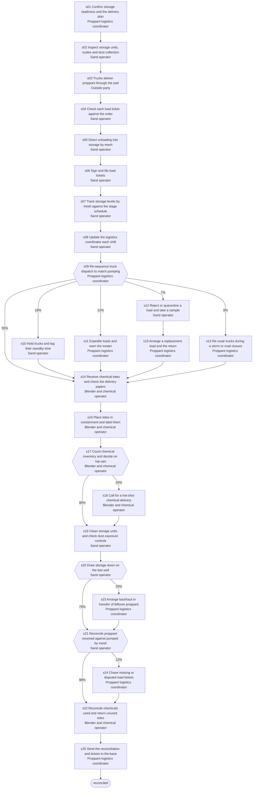

# Manage proppant and chemicals on a frac pad

`ofs-fo-frac-onsite-proppant-and-fluid-management` · oilfield services (pressure pumping) · field operations (fracturing) · part of `oilfield-services-co`

Over the days a pad is fractured, roughly 150 to 200 truckloads of frac sand in two or three mesh sizes arrive at the wellsite and must be checked, unloaded into storage units and fed to the blender in the order the stages need them. Sand operators check load tickets, direct unloading and track storage levels against the stage schedule, a proppant logistics coordinator at the base re-sequences carrier trucks around the clock, and blender operators receive and track chemical totes. If storage runs short pumping stops, if it is full trucks queue at the pad and run up standby charges, and paper load tickets have to be reconciled against what was pumped at the end of the pad.

| | |
|---|---|
| Unit of work | one pad (all proppant and chemicals received and reconciled for one multi-well pad) |
| Starts when | The first proppant truck for the pad is dispatched by the last-mile hauling process, usually a day before the first stage so storage can be pre-loaded. |
| Done when | All proppant and chemicals for the pad are received, pumped or returned, leftovers are dealt with, and the reconciliation and signed load tickets are with the logistics coordinator and the district office. |
| Organisation | A TSX-listed Canadian pressure pumping company with six to eight 24-hour frac crews working for producers in Alberta and northeast BC, run from district bases with a Calgary head office. (1,350 employees, 2019-2022) |
| Volume | 18 cases a month (range 6 to 26) |

## Where it sits

- Starts with **proppant_delivery** from sc-last-mile-sand-hauling (100% of cases)
- Relies on **pad_program** from fo-frac-program-planning (a standing input; it does not start a case)
- Relies on **chemical_delivery** from sc-chemical-procurement-and-blending (a standing input; it does not start a case)
- Relies on **dg_shipping_document** from sc-dangerous-goods-shipping (a standing input; it does not start a case)
- Sends **sand_on_location** to fo-frac-job-execution (outcome: any)
- Sends **load_ticket** to sc-last-mile-sand-hauling (outcome: any)
- Sends **qc_sample** to te-fluid-and-proppant-quality-testing (outcome: any)
- Sends **chemical_order** to sc-chemical-procurement-and-blending (outcome: any)

## Flow

## Roles

| Role | Department | Layer | FTE on this process | Loaded cost per hour | Evidence |
|---|---|---|---:|---:|---|
| Sand operator | Fracturing service line | individual contributor | 9 | 49 CAD | C |
| Blender and chemical operator | Fracturing service line | individual contributor | 1.5 | 52 CAD | C |
| Proppant logistics coordinator | Supply chain and logistics | individual contributor | 1.8 | 52 CAD | C |

## Steps

Hands-on time and the wait before each step show the most common value. Evidence tier A is a sourced number, B a sourced description, C the author's estimate.

| Step | Who | Kind | Hands-on | Wait before | Control | Evidence |
|---|---|---|---:|---:|---|---|
| **s01 Confirm storage readiness and the delivery plan.** The logistics coordinator calls the sand operator on location to confirm the storage units are spotted and empty, then checks the day-by-day delivery plan by mesh against the pad's stage schedule and the carriers booked for the first 24 hours. | Proppant logistics coordinator | coordination | 40 min | 1.0 h |  | B [source_logistics] |
| **s02 Inspect storage units, scales and dust collection.** Before the first load the sand operator checks the storage compartments are empty and dry, the conveyor belts, gates and load cells work, and the dust collectors are running, and assigns compartments to each mesh size. | Sand operator | physical | 2.0 h | 1.0 h | Alberta OHS Code occupational exposure limit for respirable crystalline silica; company dust control procedure | B [sahara] |
| **s03 Trucks deliver proppant through the pad.** Carrier trucks (super B-trains and pneumatic tankers) arrive in waves, first to pre-load storage and then to keep it topped up through the pumping days. Drivers wait in line on the lease road, back up to the storage unit and unload by gravity or air. The wait before this step stands for the delivery period of the pad, over which the receiving steps that follow are spread; drivers' own time is not company labour. | Outside party | external wait | 1.0 h | 5.6 d |  | B [source_logistics], [sahara] |
| **s04 Check each load ticket against the order.** For every truck the sand operator reads the load ticket: supplier, terminal, mesh size, weight and the pad and well it is for, and compares it with the delivery plan before letting the driver unload. A load for the wrong mesh or pad is held. | Sand operator | validation | 8.3 h | 0 min | Company receiving check: load ticket matched to the order before unloading; signed tickets support carrier invoices | C |
| **s05 Direct unloading into storage by mesh.** The sand operator guides each truck to the right unloading point, opens the compartment for that mesh, watches the fill level and stops the unload if the compartment is full, then waves the truck off the lease. | Sand operator | physical | 23.3 h | 0 min |  | C |
| **s06 Sign and file load tickets.** The sand operator signs the paper or electronic load ticket with the time unloaded and any wait time, keeps a copy in the binder for the pad and writes the load on the tally sheet. | Sand operator | data entry | 4.2 h | 0 min |  | C |
| **s07 Track storage levels by mesh against the stage schedule.** Each shift the sand operator reads the compartment levels, subtracts what the next stages need by mesh from the treater's schedule and works out how many hours of each mesh are left. | Sand operator | analysis | 5.0 h | 0 min |  | B [sahara] |
| **s08 Update the logistics coordinator each shift.** The sand operator phones or texts the logistics coordinator with the inventory by mesh, trucks on location and the expected pumping rate, and flags any mesh that will run short or any queue building at the lease. | Sand operator | communication | 3.0 h | 0 min |  | C |
| **s09 Re-sequence truck dispatch to match pumping.** The logistics coordinator compares the updates with trucks loading at the terminal and on the road, then speeds up, holds or reassigns trucks between pads on the dispatch board so storage neither runs dry nor overflows. | Proppant logistics coordinator | coordination | 5.0 h | 0 min |  | B [source_logistics] |
| **s10 Hold trucks and log their standby time.** When storage is full the sand operator holds arriving trucks on the lease road, records arrival and unload times on each ticket for the carrier's standby (demurrage) charge, and tells the coordinator to slow dispatch. | Sand operator | data entry | 1.0 h | 0 min |  | C |
| **s11 Expedite loads and warn the treater.** The coordinator pulls trucks from other pads or calls extra carriers for the short mesh, and the sand operator warns the treater so the stage design can be adjusted or pumping held. If the sand does not arrive in time, pumping stops and the stoppage is logged as non-productive time. | Proppant logistics coordinator | coordination | 1.0 h | 3.0 h |  | C |
| **s12 Reject or quarantine a load and take a sample.** If a load is wet, contaminated, the wrong mesh or the wrong supplier, the sand operator refuses it or puts it in a separate compartment, takes a sample for the lab and photographs the ticket. | Sand operator | validation | 1.0 h | 0 min | Customer and company proppant quality specification by mesh and supplier | C |
| **s15 Arrange a replacement load and the return.** The coordinator books a replacement truck for the right mesh and arranges for the rejected load to go back to the terminal, and notes the claim against the supplier or carrier. | Proppant logistics coordinator | coordination | 45 min | 2.0 h |  | C |
| **s13 Re-route trucks during a storm or road closure.** When snow, rain or a road closure slows trucks, the coordinator re-routes them, warns the field supervisor how long storage will last and may ask for pumping to slow until the roads open. | Proppant logistics coordinator | coordination | 1.0 h | 6.0 h |  | B [step21] |
| **s14 Receive chemical totes and check the delivery papers.** The blender operator receives totes of friction reducer, crosslinker, breaker, biocide and other additives, checks product names, lot numbers and quantities against the delivery and dangerous goods papers, and records them on the chemical sheet. | Blender and chemical operator | validation | 1.0 h | 30 min | Transportation of Dangerous Goods Regulations: shipping documents checked on receipt | C |
| **s16 Place totes in containment and label them.** The blender operator places totes in lined containment near the blender, checks WHMIS labels and safety data sheets are on site, and connects the totes in use to the liquid additive pumps. | Blender and chemical operator | physical | 1.0 h | 0 min | WHMIS 2015 labelling and safety data sheets (Hazardous Products Act and Alberta OHS Code) | C |
| **s17 Count chemical inventory and decide on top-ups.** Each shift the blender operator dips or weighs the totes, compares what is left with the chemical loadings for the remaining stages and decides whether more of any product is needed before the pad ends. | Blender and chemical operator | analysis | 2.0 h | 0 min |  | C |
| **s18 Call for a hot-shot chemical delivery.** The blender operator calls the chemical blending plant or the frac coordinator for extra totes of the short product and tells the treater how many stages are left before it runs out. | Blender and chemical operator | communication | 30 min | 30 min |  | C |
| **s19 Clean storage units and check dust exposure controls.** Between pads and during long pads the sand operator cleans spilled sand around the unloading points and conveyors, checks the dust collector filters and makes sure crew in the sand area wear respirators where required. | Sand operator | physical | 2.0 h | 0 min | Alberta OHS Code respirable crystalline silica exposure limit and respiratory protection requirements | B [sahara] |
| **s20 Draw storage down on the last well.** As the last well nears its final stages the sand operator and coordinator work out how much of each mesh is still needed and stop dispatch so as little sand as possible is left in storage at the end. | Sand operator | judgment | 1.0 h | 0 min |  | C |
| **s23 Arrange backhaul or transfer of leftover proppant.** The coordinator books trucks to move leftover sand to the next pad or back to the terminal and records the quantity so it is not billed to the customer. | Proppant logistics coordinator | coordination | 1.0 h | 8.0 h |  | C |
| **s21 Reconcile proppant received against pumped by mesh.** The sand operator adds up the signed load tickets by mesh, compares them with tonnes pumped from the data van and the leftover in storage, and lists any gap larger than one truckload. | Sand operator | validation | 1.5 h | 2.0 h |  | C |
| **s24 Chase missing or disputed load tickets.** The coordinator asks carriers and the terminal for copies of missing tickets, compares scale weights and sorts out which loads were delivered to this pad. | Proppant logistics coordinator | lookup | 1.0 h | 1.0 d |  | C |
| **s22 Reconcile chemicals used and return unused totes.** The blender operator compares chemicals received with volumes used from the data van and the remaining totes, labels partly used totes for the next pad or return to the plant, and gives the chemical sheet to the treater for the field ticket. | Blender and chemical operator | validation | 1.0 h | 1.0 h |  | C |
| **s25 Send the reconciliation and tickets to the base.** The logistics coordinator reviews the proppant and chemical reconciliations, files the signed load tickets for carrier invoice matching and sends the totals to the district office for the field ticket. | Proppant logistics coordinator | review | 40 min | 4.0 h |  | C |

## Exceptions

| Exception | Share of cases | What happens |
|---|---:|---|
| Trucks queue at a full pad | 18% | Storage is full and trucks wait, running up standby charges. |
| Mesh runs short | 12% | Loads are expedited; some cases stop pumping. |
| Off-spec or wrong load | 7% | A load is rejected and replaced. |
| Weather or road delay | 8% | Trucks are re-routed or slowed by storms or closures. |
| Leftover proppant | 25% | Sand is moved to the next pad or back to the terminal. |
| Ticket gaps | 12% | Missing or disputed tickets are chased with carriers. |

## Benchmarks

| Metric | Value | Unit | Population | Evidence |
|---|---|---|---|---|
| cycle_time_days | p50 9, p90 13 | calendar days from first truck dispatched to reconciliation sent | Three-well WCSB pads, 2019-2022 | C [step21] |
| wellsite_storage_capacity | 1800 | tonnes per storage unit | Source Energy Sahara unit | A [sahara] |
| proppant_per_operating_day | 1036 | tonnes per fracturing operating day | STEP Canada 2021 | A [step21] |

## Pain points

- Storage holds only one to two days of pumping, so truck timing has to track the pumping rate closely; a slow day fills storage and trucks queue, a fast day or a road delay empties it. (steps s09, s10, s11, s13; B [sahara], [step21])
- Paper load tickets are signed at the pad and later matched by hand against tonnes pumped and carrier invoices; missing tickets take days to chase. (steps s06, s21, s24; C)
- Leftover proppant at the end of a pad has to be moved or written off. (steps s20, s23; C)

## Assumptions

- Per-truck work (about 170 loads a pad) is summed into one step per activity. The pad's delivery period is entered as the wait before s03 (trucks arriving in waves over pre-load and pumping days) and the receiving steps s04-s09 are summed totals that in reality are spread over that period; the simulator adds them after it, which overstates elapsed time by roughly one day.
- Feeding proppant from storage to the blender during pumping is counted in the job execution workflow, not here.
- Truck payloads of about 38-40 tonnes are an estimate for super B-trains under Alberta weights; no source was opened for them.
- The process is triggered per pad by the first proppant delivery; the delivery plan itself is made in the last-mile hauling process.
- The logistics coordinator role sits in supply chain (organisation file); some companies keep a sand coordinator in the frac service line instead.
- Loaded costs come from the organisation file (base wage x 1.35).

## Sources

- [step21] [STEP Energy Services Ltd. Reports Fourth Quarter and Year End 2021 Results](https://www.stepenergyservices.com/news-releases/step-energy-services-ltd-reports-fourth-quarter-and-year-end-2021-results) (STEP Energy Services Ltd., 2022). Canadian fracturing 2021: 977 operating days and 1,012,000 tonnes of proppant (about 1,040 tonnes per operating day); 704 days and 776,000 tonnes in 2020; four spreads with 200,000 HP; Q4 2021 work hit by extended delays on a client location from challenging well conditions and by late-December weather; smaller jobs reduce proppant per day; spring break-up restricts equipment moves.
- [sahara] [Well Site Sand Storage (Sahara)](https://www.sourceenergyservices.com/distribution/well-site-sand-storage) (Source Energy Services Ltd., 2026). Wellsite proppant storage unit with 1,800 tonnes of capacity, unloading two trucks at once from any trailer configuration, fully enclosed with dust collection to limit silica exposure, real-time inventory monitoring; record of 6,155 tonnes supplied to the blender in a day.
- [source_logistics] [Last-Mile Logistics](https://www.sourceenergyservices.com/distribution/logistics) (Source Energy Services Ltd., 2026). WCSB last-mile proppant delivery with over 300 third-party trucks dispatched by a 24/7 dispatch team that monitors inventory, loading, unloading and cycle wait times; over 2.0 million tonnes of proppant and other materials delivered a year.

Written by claude-opus on 2026-11-24.
