# Report a fractured well to the customer

`ofs-fo-frac-post-job-reporting` · oilfield services (pressure pumping) · field operations (fracturing) with technical services · part of `oilfield-services-co`

After each well is fractured the company sends the producer a treatment report (stage-by-stage volumes, rates, pressures and proppant placed, with charts and a narrative of events) and the chemical data the producer needs for its fracturing fluid disclosure. The data van technician cleans and exports the stage data, the treater writes the report, and a completions design engineer in Calgary checks it against the design and turns the products pumped into ingredient concentrations for the disclosure. Delays come from treaters on rotation, engineers reviewing in batches and suppliers slow to release confidential ingredient data, and the producer's 30-day disclosure deadline sets the limit.

| | |
|---|---|
| Unit of work | one well report (treatment report and fluid disclosure data for one fractured well) |
| Starts when | Job execution sends the well's treatment data after its last stage is pumped. |
| Done when | The producer has the final treatment report and the chemical disclosure data for the well, has accepted them, and both are filed in the job folder; the data are with technical services for analysis. |
| Organisation | A TSX-listed Canadian pressure pumping company with six to eight 24-hour frac crews working for producers in Alberta and northeast BC, run from district bases with a Calgary head office. (1,350 employees, 2019-2022) |
| Volume | 50 cases a month (range 15 to 70) |

## Where it sits

- Starts with **treatment_data** from fo-frac-job-execution (100% of cases)
- Relies on **frac_design** from te-frac-treatment-design (a standing input; it does not start a case)
- Relies on **npt_report** from fo-frac-screen-out-and-npt-handling (a standing input; it does not start a case)
- Relies on **product_spec** from chemical-supplier (a standing input; it does not start a case)
- Sends **post_job_report** to producer (outcome: any)
- Sends **chemical_disclosure** to producer (outcome: any)
- Sends **post_job_report** to customer-wellsite-supervisor (outcome: any)
- Sends **treatment_data** to te-job-data-analysis-and-customer-reporting (outcome: any)

## Flow

```mermaid
flowchart TD
    s01["s01 Close the well's job file in the data van<br/>Data van technician"]
    s02{{"s02 Check the stage data for gaps and sensor errors<br/>Data van technician"}}
    s04["s04 Rebuild gaps from backup or paper records<br/>Data van technician"]
    s03["s03 Produce stage charts and summary tables<br/>Data van technician"]
    s05["s05 Gather chemical volumes from blender records and tote counts<br/>Data van technician"]
    s06["s06 Write the treatment report and narrative<br/>Frac treater"]
    s07["s07 Send the field copy to the wellsite supervisor<br/>Frac treater"]
    s08["s08 Upload the report and data to the job folder<br/>Data van technician"]
    s09{{"s09 Review the report against the design<br/>Completions design engineer"}}
    s10["s10 Correct the report<br/>Frac treater"]
    s11{{"s11 Map products to ingredients and CAS numbers<br/>Completions design engineer"}}
    s12["s12 Ask the chemical supplier for confidential ingredient data<br/>Completions design engineer"]
    s13["s13 Supplier provides the ingredient data or a confidentiality claim<br/>Outside party"]
    s14["s14 Calculate maximum ingredient concentrations in the fluid<br/>Completions design engineer"]
    s15["s15 Fill in the disclosure template with water volumes and sources<br/>Completions design engineer"]
    s16{{"s16 Second engineer checks the disclosure<br/>Completions design engineer"}}
    s17["s17 Send the disclosure and final report to the producer<br/>Completions design engineer"]
    s18{{"s18 Producer reviews the report and disclosure<br/>Outside party"}}
    s20["s20 Answer the producer's query<br/>Completions design engineer"]
    s21["s21 Prepare the extra analysis the customer asked for<br/>Completions design engineer"]
    s19["s19 File the final report and disclosure in the job folder<br/>Completions design engineer"]
    s01 --> s02
    s02 -->|"90%"| s03
    s02 -->|"10%"| s04
    s04 --> s03
    s03 --> s05
    s05 --> s06
    s06 --> s07
    s07 --> s08
    s08 --> s09
    s09 -->|"85%"| s11
    s09 -->|"15%"| s10
    s10 --> s09
    s11 -->|"85%"| s14
    s11 -->|"15%"| s12
    s12 --> s13
    s13 --> s14
    s14 --> s15
    s15 --> s16
    s16 -->|"90%"| s17
    s16 -->|"10%"| s14
    s17 --> s18
    s18 -->|"78%"| s19
    s18 -->|"14%"| s20
    s18 -->|"8%"| s21
    s20 --> s19
    s21 --> s19
    s19 --> end0
    end0(["report_and_disclosure_delivered"])
```

## Roles

| Role | Department | Layer | FTE on this process | Loaded cost per hour | Evidence |
|---|---|---|---:|---:|---|
| Data van technician | Fracturing service line | individual contributor | 1.3 | 56 CAD | C |
| Frac treater | Fracturing service line | senior specialist | 0.8 | 70 CAD | C |
| Completions design engineer | Technical services and engineering | senior specialist | 2 | 90 CAD | C |

## Steps

Hands-on time and the wait before each step show the most common value. Evidence tier A is a sourced number, B a sourced description, C the author's estimate.

| Step | Who | Kind | Hands-on | Wait before | Control | Evidence |
|---|---|---|---:|---:|---|---|
| **s01 Close the well's job file in the data van.** After the last stage the data van technician closes the well's acquisition file, checks every stage is saved under the right well and stage number, and backs the file up to the server. | Data van technician | data entry | 30 min | 1.0 h |  | C |
| **s02 Check the stage data for gaps and sensor errors.** The technician scrolls through each stage looking for gaps, flat-lined or spiking sensors, wrong densometer readings and unit mix-ups, and compares totals with the stage summaries the wellsite supervisor signed. | Data van technician | validation | 45 min | 30 min |  | C |
| **s04 Rebuild gaps from backup or paper records.** Where acquisition dropped out the technician fills the gap from the backup recorder, the blender's own log or the paper sheets, and flags the reconstructed section in the file. | Data van technician | data entry | 1.0 h | 1.0 h |  | C |
| **s03 Produce stage charts and summary tables.** The technician runs the report template in the acquisition software to produce a pressure, rate and concentration chart for every stage and a table of volumes, average and maximum pressures, breakdown and ISIP by stage. | Data van technician | drafting | 1.0 h | 30 min |  | C |
| **s05 Gather chemical volumes from blender records and tote counts.** The technician pulls the volume of each additive pumped per stage from the blender log and checks the totals against the blender operator's chemical reconciliation and tote counts. | Data van technician | lookup | 40 min | 30 min |  | C |
| **s06 Write the treatment report and narrative.** The treater fills in the report template: well and design details, stage table, proppant and fluid totals against design, chemicals, and a narrative of events such as screen-outs, cut stages and stoppages, with the NPT reports attached. | Frac treater | drafting | 1.5 h | 12.0 h |  | C |
| **s07 Send the field copy to the wellsite supervisor.** The treater emails the draft report and charts to the customer's wellsite supervisor and completion engineer as the field copy, so they can start their own completion records. | Frac treater | communication | 10 min | 0 min |  | C |
| **s08 Upload the report and data to the job folder.** The technician copies the report, charts and raw data to the well's job folder on the document server, where technical services pick them up for analysis and the design engineer for review. | Data van technician | data entry | 20 min | 1.0 h |  | B [step_case] |
| **s09 Review the report against the design.** A completions design engineer in Calgary compares the report with the design: proppant placed by stage, fluid volumes, pressures and chemical loadings, checks the totals against the field ticket and sends back anything that does not add up. | Completions design engineer | review | 1.0 h | 2.0 d |  | C |
| **s10 Correct the report.** The treater fixes the totals or narrative the engineer queried, often after checking with the data technician, and sends the report back. | Frac treater | drafting | 30 min | 2.0 d |  | C |
| **s11 Map products to ingredients and CAS numbers.** The engineer looks up each product pumped on the safety data sheets and the company's product list to get its ingredients, CAS numbers and maximum mass fractions. | Completions design engineer | lookup | 1.0 h | 2.0 h |  | C |
| **s12 Ask the chemical supplier for confidential ingredient data.** For a third-party product with ingredients withheld as trade secrets, the engineer emails the supplier for the ingredient list or a confirmation that it will claim confidentiality with the regulator. | Completions design engineer | communication | 20 min | 0 min |  | C |
| **s13 Supplier provides the ingredient data or a confidentiality claim.** The supplier's regulatory staff send the ingredient breakdown under a confidentiality agreement, or confirm that they will claim trade-secret status with the regulator, so the engineer can finish the disclosure. | Outside party | external wait | 20 min | 3.0 d |  | C |
| **s14 Calculate maximum ingredient concentrations in the fluid.** The engineer uses the volumes of water, proppant and each additive pumped to calculate each ingredient's maximum concentration in the total fluid by mass, in a spreadsheet. | Completions design engineer | analysis | 1.0 h | 1.0 h |  | C |
| **s15 Fill in the disclosure template with water volumes and sources.** The engineer copies the concentrations, total water volume and water source the customer gave into the producer's disclosure template, ready for the producer to submit to the registry and the regulator. | Completions design engineer | drafting | 40 min | 30 min |  | B [fracfocus] |
| **s16 Second engineer checks the disclosure.** Another engineer checks the ingredient list and concentrations against the report and data sheets before anything goes to the producer. | Completions design engineer | review | 30 min | 1.0 d | Company second-check rule for regulatory data supplied to customers | C |
| **s17 Send the disclosure and final report to the producer.** The engineer emails the final treatment report and the disclosure file to the producer's completion engineer and regulatory contact, in time for the producer to submit within 30 days of finishing completion operations. | Completions design engineer | communication | 15 min | 1.0 h | Fracturing fluid disclosure within 30 days of the end of completion operations (FracFocus.ca, AER Directive 059); a licensee duty the service company supplies data for | B [fracfocus], [d059] |
| **s18 Producer reviews the report and disclosure.** The producer's completion engineer and regulatory staff check the report and disclosure against their own records and either accept them, send questions, or ask for extra analysis. | Outside party | review | 30 min | 3.0 d |  | C |
| **s20 Answer the producer's query.** The engineer checks the producer's query against the stage data and data sheets, then corrects and resends the report or disclosure, or replies explaining how the figure was calculated. | Completions design engineer | communication | 45 min | 1.0 d |  | C |
| **s21 Prepare the extra analysis the customer asked for.** For some customers the engineer adds analysis such as net pressure matching, step-down test results or comparisons with offset wells, using the design software and the stage data. | Completions design engineer | analysis | 3.0 h | 3.0 d |  | C |
| **s19 File the final report and disclosure in the job folder.** The engineer saves the accepted versions in the job folder, marks the well's report complete on the tracking sheet and lets technical services know the data are final. | Completions design engineer | data entry | 10 min | 1.0 h |  | C |

## Exceptions

| Exception | Share of cases | What happens |
|---|---:|---|
| Data gaps | 10% | Acquisition dropouts are patched from backups or paper. |
| Report corrections | 15% | The engineer sends the report back to the treater. |
| Supplier ingredient data | 15% | Confidential ingredients must be obtained from a supplier. |
| Producer query | 14% | The producer questions a figure. |

## Benchmarks

| Metric | Value | Unit | Population | Evidence |
|---|---|---|---|---|
| cycle_time_days | p50 11, p90 22 | calendar days from last stage to accepted report and disclosure | WCSB fractured wells, 2019-2022 | C [fracfocus] |
| disclosure_deadline_days | 30 | days after the end of completion operations | Alberta and BC wells | A [fracfocus] |

## Pain points

- Treaters write reports between wells or after their rotation, and engineers review them in batches, so most of the elapsed time is queueing. (steps s06, s09, s10; C)
- Chemical volumes are copied by hand from the blender log into the report and then into the disclosure, and mismatches with tote counts are found late. (steps s05, s14, s15; C)
- Third-party products with confidential ingredients wait on supplier regulatory staff and push against the producer's 30-day window. (steps s12, s13; B [fracfocus])

## Assumptions

- The design engineer prepares the disclosure data; in some companies an HSE or regulatory coordinator does it from the same records.
- The producer, not the service company, submits the disclosure to FracFocus.ca and the AER; this workflow ends when the producer accepts the data.
- The wait before the treater writes the report covers field rotation: a treater who finishes a pad on the last day of a hitch may write it a week later.
- Loaded costs come from the organisation file (base wage x 1.35).

## Sources

- [step_case] [Case Study: Increasing Pumping Hours Through Optimized Operations - STEP Energy Services](https://energynow.ca/2019/12/case-study-increasing-pumping-hours-through-optimized-operations-step-energy-services/) (EnergyNow, 2019). Canadian frac pads: average pumping hours per day rose from 14.03 (Q4 2018, three pads) to 18.93 on a four-well pad for one client, and from 15.47 (February 2019) to 17.95 (August 2019) for another; gains from managing maintenance schedules, bi-weekly meetings with operators and pre- and post-pad reviews; post-job data delivered to clients through an online tool.
- [fracfocus] [FracFocus.ca - Hydraulic Fracturing Chemical Registry](https://fracfocus.ca/) (BC Energy Regulator, 2026). Companies undertaking hydraulic fracturing in British Columbia (wells fractured from 1 January 2012) and Alberta (from 1 January 2013) submit fluid records within 30 days of the end of completion operations; Alberta records include water volumes and sources.
- [d059] [Directive 059: Well Drilling and Completion Data Filing Requirements](https://www.aer.ca/regulating-development/rules-and-directives/directives/directive-059) (Alberta Energy Regulator, 2025). Directive on completing and submitting daily operations records and well data in a timely manner through the Digital Data Submission system, with related guidance on hydraulic fracture fluid data.

Written by claude-opus on 2026-11-24.
