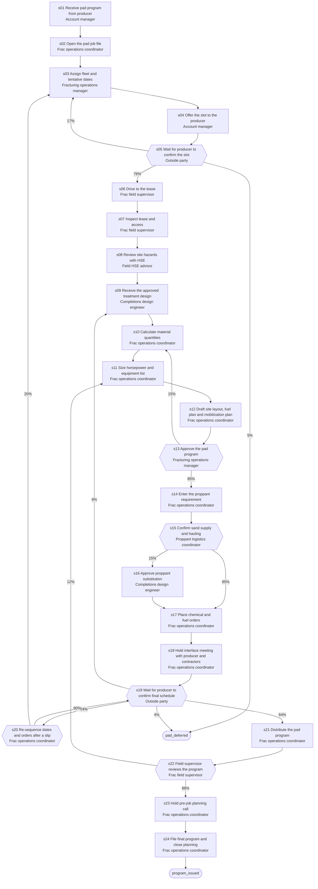

# Plan a pad fracturing program

`ofs-fo-frac-program-planning` · oil and gas services (pressure pumping) · field operations (fracturing) · part of `oilfield-services-co`

When a producer awards a multi-well pad, the fracturing operations group turns the producer's completion program and the approved treatment design into an executable plan: which fleet and crew, on which dates, with how much horsepower, sand, chemicals and fuel, how the equipment will sit on the lease and how the frac crew will hand over with wireline and water contractors. An account manager, an operations manager, operations coordinators, a design engineer, a field supervisor, a logistics coordinator and an HSE advisor all take part. The work is slow because the producer's dates move with drilling progress, weather and budgets, and every move ripples into sand orders, crew rotations and the next pad on the fleet's schedule.

| | |
|---|---|
| Unit of work | one pad program (a multi-well pad of typically two to six horizontal wells) |
| Starts when | A producer's completions engineer sends a pad program under a master service agreement, or a pad is awarded through a tender or pricing agreement. |
| Done when | An issued pad program with fleet, dates, equipment list, site layout, material and fuel orders placed and a mobilization plan handed to dispatch, or the pad deferred by the producer. |
| Organisation | A Canadian pressure pumping company with six to eight crewed frac fleets working multi-well pads in Alberta and northeast BC from district bases, with a Calgary engineering and sales office. (1,350 employees, 2019-2022) |
| Volume | 18 cases a month (range 6 to 26) |

## Where it sits

- Starts with **pad_program** from producer (75% of cases)
- Starts with **contract_award** from cs-msa-and-pricing-agreement (25% of cases)
- Relies on **frac_design** from te-frac-treatment-design (a standing input; it does not start a case)
- Relies on **crew_roster** from fo-dist-crew-scheduling-and-rotation (a standing input; it does not start a case)
- Relies on **fleet_status** from em-preventive-maintenance (a standing input; it does not start a case)
- Relies on **fleet_status** from em-corrective-repair-and-pump-rebuild (a standing input; it does not start a case)
- Relies on **fleet_status** from fo-frac-fleet-reactivation (a standing input; it does not start a case)
- Sends **proppant_order** to sc-proppant-procurement-and-rail-logistics (outcome: program_issued)
- Sends **proppant_order** to sc-last-mile-sand-hauling (outcome: program_issued)
- Sends **chemical_order** to sc-chemical-procurement-and-blending (outcome: program_issued)
- Sends **fuel_order** to sc-fuel-supply (outcome: program_issued)
- Sends **fuel_order** to fo-frac-dual-fuel-management (outcome: program_issued)
- Sends **mobilization_plan** to fo-dist-equipment-mobilization (outcome: program_issued)
- Sends **pad_program** to fo-frac-rig-up-and-pressure-test (outcome: program_issued)
- Sends **pad_program** to fo-dist-crew-scheduling-and-rotation (outcome: program_issued)
- Sends **pad_program** to hs-pre-job-hazard-assessment (outcome: program_issued)

## Flow

## Roles

| Role | Department | Layer | FTE on this process | Loaded cost per hour | Evidence |
|---|---|---|---:|---:|---|
| Account manager | Sales and customer relations | senior specialist | 0.6 | 90 CAD | C |
| Fracturing operations manager | Fracturing service line | manager | 1.2 | 120 CAD | C |
| Frac operations coordinator | Fracturing service line | senior specialist | 4.5 | 62 CAD | C |
| Completions design engineer | Technical services and engineering | senior specialist | 0.6 | 90 CAD | C |
| Frac field supervisor | Fracturing service line | supervisor | 1.5 | 82 CAD | C |
| Proppant logistics coordinator | Supply chain and logistics | individual contributor | 0.6 | 52 CAD | C |
| Field HSE advisor | Health, safety and environment | senior specialist | 0.4 | 68 CAD | C |

## Steps

Hands-on time and the wait before each step show the most common value. Evidence tier A is a sourced number, B a sourced description, C the author's estimate.

| Step | Who | Kind | Hands-on | Wait before | Control | Evidence |
|---|---|---|---:|---:|---|---|
| **s01 Receive pad program from producer.** The account manager receives the producer's pad program by email: surface location, well names, stage counts, target tonnage per stage, preferred fluid system and a target start window. The account manager checks it is under a current price agreement, logs the opportunity and forwards it to the fracturing operations manager. | Account manager | intake | 40 min | 0 min |  | C |
| **s02 Open the pad job file.** An operations coordinator creates the pad job number in the ERP and a job folder on the shared drive, saves the producer's program, well surveys and wellhead details, and adds the pad as a tentative block on the fleet schedule spreadsheet. | Frac operations coordinator | data entry | 45 min | 4.0 h |  | C |
| **s03 Assign fleet and tentative dates.** At the weekly scheduling meeting the operations manager compares the pad's target window with each fleet's current pad end date, planned maintenance and crew rotations, and the horsepower and pressure rating the design will need. The manager slots the pad on a fleet and records tentative rig-up and pumping dates. | Fracturing operations manager | judgment | 1.5 h | 1.0 d |  | C |
| **s04 Offer the slot to the producer.** The account manager phones or emails the producer's completions engineer with the proposed fleet and start date, explains any conflict with the requested window and records the reply or the request for another date. | Account manager | communication | 30 min | 4.0 h |  | C |
| **s05 Wait for producer to confirm the slot.** The producer checks the slot against drilling rig progress, facility tie-in dates and budget approval, and confirms, asks for another date, or defers the pad to a later quarter. | Outside party | external wait | 0 min | 2.0 d |  | C [src2] |
| **s06 Drive to the lease.** The field supervisor assigned to the pad drives from the district base or a nearby pad to the producer's lease, usually on a day off the pumping schedule or between shifts, using lease directions and the LSD location from the pad file. | Frac field supervisor | travel | 3.0 h | 1.0 d |  | C |
| **s07 Inspect lease and access.** On the lease the field supervisor paces out the pad size, checks the access road, ground conditions, overhead lines, wellhead and frac tree positions, water source and tank or pond locations, and where the wireline unit and sand storage can sit. Photos and measurements go into the job file. | Frac field supervisor | physical | 2.0 h | 0 min |  | C |
| **s08 Review site hazards with HSE.** The HSE advisor reviews the producer's site safety requirements, H2S classification, emergency response plan, muster areas and nearest medical facility, often on the same visit, and notes controls the pre-job hazard assessment must carry. | Field HSE advisor | analysis | 1.5 h | 0 min | Alberta OHS Code Part 2 section 7: hazard assessment before work begins at a work site | B [src11] |
| **s09 Receive the approved treatment design.** The design engineer hands over the producer-approved pump schedule for the pad and walks the coordinator through stage totals, maximum expected treating pressure and rate, fluid system and any special products. If the design is not yet approved the coordinator waits for it. | Completions design engineer | review | 1.0 h | 1.0 d |  | B [src1] |
| **s10 Calculate material quantities.** The coordinator multiplies the per-stage design by stage count and wells to get tonnes of each proppant mesh, cubic metres of water and litres of each chemical, adds a contingency of about five to ten percent, and builds the material schedule by pumping day in the pad workbook. | Frac operations coordinator | analysis | 4.0 h | 8.0 h |  | C |
| **s11 Size horsepower and equipment list.** From design rate and treating pressure the coordinator calculates hydraulic horsepower, adds standby pumps, and lists pumps, blender, data van, sand storage, chemical units, treating iron and manifold, matching unit numbers from the fleet roster and maintenance status. | Frac operations coordinator | analysis | 2.0 h | 0 min |  | C |
| **s12 Draft site layout, fuel plan and mobilization plan.** Using the lease notes the coordinator draws the equipment spotting layout, estimates diesel or dual-fuel consumption by pumping day and delivery frequency, and drafts the mobilization plan listing units, origin, target arrival and road restrictions known so far. | Frac operations coordinator | drafting | 3.0 h | 0 min |  | C |
| **s13 Approve the pad program.** The operations manager reviews the equipment list against design pressure and rate, the material schedule against stage counts, the fleet dates against the next pad, and the layout. The manager approves or sends specific corrections back to the coordinator. | Fracturing operations manager | approval | 1.0 h | 1.0 d | Company approval of the job plan before materials are ordered | C |
| **s14 Enter the proppant requirement.** The coordinator enters tonnes by mesh and daily delivery requirement into the proppant planning sheet and ERP requisition, with the pad's location and first pumping date, so supply chain can reserve sand at the transload and book trucks. | Frac operations coordinator | data entry | 45 min | 1.0 h |  | C |
| **s15 Confirm sand supply and hauling.** The proppant logistics coordinator checks transload inventory, railcars in transit and last-mile trucking capacity for the pad's dates and confirms supply, or reports a shortfall of a mesh size and proposes a substitute or split delivery. | Proppant logistics coordinator | coordination | 1.0 h | 12.0 h |  | C |
| **s16 Approve proppant substitution.** The design engineer reviews the proposed substitute mesh or source against the design and conductivity needs, reruns the affected stages if needed, and gets the producer's agreement by email before the change is accepted. | Completions design engineer | judgment | 1.5 h | 1.0 d |  | C |
| **s17 Place chemical and fuel orders.** The coordinator sends the chemical requirement by product and pumping day to the chemical blending plant, and the diesel and natural gas requirement to fuel supply and the dual-fuel group, with site delivery points from the layout. | Frac operations coordinator | data entry | 1.0 h | 1.0 h |  | C |
| **s18 Hold interface meeting with producer and contractors.** The coordinator chairs a call with the producer's completions supervisor, the wireline contractor and the water transfer company to agree rig-up date, zipper sequence, plug and perforating handovers, water supply rates and who supplies cranes, matting and light towers. | Frac operations coordinator | coordination | 1.5 h | 2.0 d |  | C |
| **s19 Wait for producer to confirm final schedule.** The producer confirms the final well list, start date and site readiness date once drilling and wellhead installation are done, or announces a slip, a change to stage counts, or a deferral. | Outside party | external wait | 0 min | 2.0 d |  | C [src2] |
| **s20 Re-sequence dates and orders after a slip.** The coordinator moves the pad on the fleet schedule, tells supply chain to shift sand, chemical and fuel deliveries, checks the knock-on effect on the next pad and crew rotation, and tells the producer the new firm date. | Frac operations coordinator | coordination | 2.0 h | 2.0 h |  | C |
| **s21 Distribute the pad program.** The coordinator issues the pad program package to crew scheduling, HSE for the pre-job hazard assessment, the field supervisor and treater, dispatch for mobilization, and the district for field ticket set-up. | Frac operations coordinator | communication | 40 min | 1.0 h |  | C |
| **s22 Field supervisor reviews the program.** The field supervisor and treater read the program, design, layout and equipment list, and flag gaps such as iron rated below expected pressure, too few standby pumps or a layout that blocks sand trucks. | Frac field supervisor | review | 1.0 h | 1.0 d |  | C |
| **s23 Hold pre-job planning call.** Two to three days before the move the coordinator holds a call with the field supervisor, producer's wellsite supervisor and wireline lead to confirm arrival time, lease readiness, first-well sequence and outstanding deliveries. | Frac operations coordinator | coordination | 45 min | 2.0 d |  | C |
| **s24 File final program and close planning.** The coordinator saves the final revision of the program, layout and orders in the job folder, updates the fleet schedule to firm, and records planned rig-up date for the district and billing set-up. | Frac operations coordinator | data entry | 30 min | 0 min |  | C |

## Exceptions

| Exception | Share of cases | What happens |
|---|---:|---|
| Producer slips the start date | 30% | Drilling delays, wellhead availability or budget holds move the pad; dates, orders and the next pad on the fleet are re-sequenced, sometimes more than once. |
| Fleet reassignment | 20% | The producer's preferred dates clash with another pad and the manager moves the pad to a different fleet. |
| Proppant mesh shortfall | 15% | The transload is short of a mesh size and the design engineer and producer approve a substitute. |
| Design change after planning | 8% | The producer changes stage counts or tonnage; quantities and orders are recalculated from the new design. |
| Pad deferred | 9% | The producer defers the pad to a later quarter or cancels it. |

## Benchmarks

| Metric | Value | Unit | Population | Evidence |
|---|---|---|---|---|
| cycle_time_days | p50 21, p90 42 | days from pad program received to firm program issued | WCSB multi-well pads, 2019-2022 | C |
| fracturing operating days per crew per year | 244 | days | STEP Energy Services Canadian fracturing, 2021 (977 days, 4 crews) | A [src2] |

## Pain points

- Producer date changes ripple into sand, chemical and fuel orders and into the next pad on the fleet; coordinators re-plan by hand in spreadsheets. (steps s19, s20, s03; C [src2])
- Material quantities are re-keyed from the design into the pad workbook and then into ERP requisitions, so a design change can leave an order stale. (steps s10, s14, s17; C)
- Lease visits wait for the drilling rig to leave and the field supervisor to be off pumping duty. (steps s06, s07; C)

## Assumptions

- Loaded hourly costs are taken from the organisation file (wage plus about 30-35 percent benefits and overhead as stated there).
- One case is one pad. Small single-well jobs in the same calendar would follow a shorter path; they are folded into the low end of step times.
- Detailed fracture design is a separate process (te-frac-treatment-design); this workflow starts its material planning once that design is approved and loops back when it changes.
- The logistics coordinator, field supervisor and HSE advisor are organisation file roles that the process_map entry does not list; they take part here.
- Simulated median cycle time of about 25 days against a 21-day estimate comes from repeated slip and re-sequence loops; it is dominated by waiting on the producer and the calendar. Hands-on time is about 35 hours per pad including rework.

## Sources

- [src1] [Trican - Hydraulic fracturing](https://tricanwellservice.com/fracturing/) (Trican Well Service Ltd., 2026). Engineering team works with customers on program design, MiniFrac analysis, pore and closure pressure; fracture design combines fracture models with geological and geophysical data and formation frac databases; slickwater, HVFR, crosslinked, foam and other fluid systems; full-service lab in Calgary; logistical planning for chemicals, proppants, people and equipment; Tier 4 dynamic gas blending pumps.
- [src2] [STEP Energy Services Ltd. Reports Fourth Quarter and Year End 2021 Results](https://www.stepenergyservices.com/news-releases/step-energy-services-ltd-reports-fourth-quarter-and-year-end-2021-results) (STEP Energy Services Ltd., 2022). Canadian fracturing: 977 operating days in 2021 and 704 in 2020 with 4 and 3 crews; 1,012,000 tonnes of proppant in 2021; weather delays in late December 2021 and extreme cold in January 2022; extended delays on a client location from well conditions; work moved between quarters; spring break-up conditions restrict operations; smaller jobs and single-well work less efficient than multi-well pads.
- [src11] [Occupational Health and Safety Code (legislation search)](https://search-ohs-laws.alberta.ca/legislation/occupational-health-and-safety-code/) (Government of Alberta, 2026). OHS Code Part 2 Hazard Assessment, Elimination and Control, section 7 Hazard assessment and section 8 Worker participation.

Written by claude-opus on 2026-11-24.
