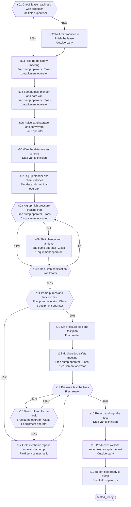

# Rig up the frac fleet and pressure test

`ofs-fo-frac-rig-up-and-pressure-test` · oil and gas services (pressure pumping) · field operations (fracturing) · part of `oilfield-services-co`

When the frac fleet arrives on a producer's pad, a shift crew of twenty or more operators spots about twenty pump trailers, the blender, data van, chemical units and sand storage to the site layout, connects hundreds of high-pressure iron connections from the pumps through the manifold to the wellheads, and wires the data van. The field supervisor checks the lease is ready, the treater checks iron certification and sets pressure trips, and the whole site, including the producer's wellsite supervisor and the wireline crew, holds a pre-job safety meeting before the lines are pressure tested above the highest expected treating pressure. Work is held up by leases that are not ready, high wind or extreme cold, leaks found on the pressure test and pumps that fail priming.

| | |
|---|---|
| Unit of work | one pad rig-up |
| Starts when | The fleet's units arrive on the pad from the previous pad or the base, with the pad program, site layout, pre-job hazard assessment and iron certificates in hand. |
| Done when | Lines pressure tested and the test record signed by the producer's wellsite supervisor, with the fleet ready to pump the first stage. |
| Organisation | A Canadian pressure pumping company with six to eight crewed frac fleets working multi-well pads in Alberta and northeast BC from district bases, with a Calgary engineering and sales office. (1,350 employees, 2019-2022) |
| Volume | 18 cases a month (range 6 to 26) |

## Where it sits

- Starts with **equipment_move** from fo-dist-equipment-mobilization (85% of cases)
- Starts with **pad_program** from fo-frac-program-planning (15% of cases)
- Relies on **hazard_assessment** from hs-pre-job-hazard-assessment (a standing input; it does not start a case)
- Relies on **iron_certificate** from em-pressure-iron-certification (a standing input; it does not start a case)
- Sends **pressure_test_record** to fo-frac-job-execution (outcome: tested_ready)

## Flow

## Roles

| Role | Department | Layer | FTE on this process | Loaded cost per hour | Evidence |
|---|---|---|---:|---:|---|
| Frac field supervisor | Fracturing service line | supervisor | 1 | 82 CAD | C |
| Frac treater | Fracturing service line | senior specialist | 1 | 70 CAD | C |
| Data van technician | Fracturing service line | individual contributor | 1.5 | 56 CAD | C |
| Frac pump operator (Class 1 equipment operator) | Fracturing service line | individual contributor | 26 | 48 CAD | C |
| Blender and chemical operator | Fracturing service line | individual contributor | 2.5 | 52 CAD | C |
| Sand operator | Fracturing service line | individual contributor | 2.5 | 49 CAD | C |
| Field HSE advisor | Health, safety and environment | senior specialist | 0.4 | 68 CAD | C |
| Field service mechanic | Equipment maintenance and manufacturing | individual contributor | 0.5 | 62 CAD | C |

## Steps

Hands-on time and the wait before each step show the most common value. Evidence tier A is a sourced number, B a sourced description, C the author's estimate.

| Step | Who | Kind | Hands-on | Wait before | Control | Evidence |
|---|---|---|---:|---:|---|---|
| **s01 Check lease readiness with producer.** The field supervisor walks the lease with the producer's wellsite supervisor on arrival: pad size and matting, ground firmness, frac trees installed and tested, water tanks or pond filled, wireline on site and the access road clear for sand trucks. The supervisor decides whether units can be spotted. | Frac field supervisor | validation | 45 min | 1.0 h |  | C |
| **s02 Wait for producer to finish the lease.** Units stand by at the lease edge while the producer's contractors add matting or gravel, finish wellhead or frac tree installation, or fill water storage. Standby time is logged for the field ticket. | Outside party | external wait | 0 min | 12.0 h |  | C [src2] |
| **s03 Hold rig-up safety meeting.** Led by the field supervisor, the crew goes through the producer's site orientation, the spotting plan, the field level hazard assessment for rig-up, spotter rules for backing trailers, lifting plan for iron and crane, and the muster point. Each worker signs the hazard assessment. | Frac pump operator (Class 1 equipment operator) | communication | 45 min | 15 min | Alberta OHS Code Part 2 sections 7 and 8: hazard assessment before work with worker participation | B [src11] |
| **s04 Spot pumps, blender and data van.** Operators back each pump trailer, the blender, the data van, chemical units and the manifold trailer into position on the layout with spotters, chock and level them, set ground mats and drop the tractors to the side of the lease or send them back. | Frac pump operator (Class 1 equipment operator) | physical | 5.0 h | 0 min |  | C |
| **s05 Raise sand storage and conveyors.** Sand operators raise the wellsite storage silos or set the container system, position conveyors to the blender hopper, and connect power, while the pumps are still being spotted. | Sand operator | physical | 6.0 h | 0 min |  | C |
| **s06 Wire the data van and sensors.** Data van technicians run cables and wireless links to pump controls, pressure transducers on the manifold and wellheads, densitometers and flow meters, then check each channel reads correctly in the acquisition system. | Data van technician | physical | 4.0 h | 0 min |  | C |
| **s07 Rig up blender and chemical lines.** Blender operators connect suction hoses from the water manifold or tanks to the blender, hook up liquid additive pumps to chemical totes, and calibrate additive pump rates against the job's loadings. | Blender and chemical operator | physical | 4.0 h | 0 min |  | C |
| **s08 Rig up high-pressure treating iron.** Operators connect each pump's discharge to the manifold trailer and run iron and valves to the zipper manifold and the frac trees, tightening hammer unions, installing restraints on every line and using a crane for heavy iron. A pad zipper manifold alone has 200 to 250 hammer union connections. | Frac pump operator (Class 1 equipment operator) | physical | 6.0 h | 0 min |  | B [src7], [src6] |
| **s09 Shift change and handover.** The incoming shift drives from the hotel or camp to the lease, and the outgoing supervisor and operators hand over what is rigged, what is outstanding and any hazards before driving out. | Frac pump operator (Class 1 equipment operator) | travel | 1.0 h | 0 min |  | C |
| **s10 Check iron certification.** The treater compares serial numbers on treating iron, valves and the manifold with the certification list from the maintenance shop and the producer's requirements, and pulls any item past its inspection date for replacement. | Frac treater | validation | 1.0 h | 0 min | Company treating iron inspection and certification program and producer contract requirements | C |
| **s11 Prime pumps and function test.** Operators fill suction lines, prime each pump's fluid end, run engines and transmissions up, and check gauges and controls; a pump that will not prime or shows a power end fault is flagged. | Frac pump operator (Class 1 equipment operator) | physical | 1.5 h | 0 min |  | C |
| **s12 Set pressure trips and test plan.** The treater sets the overpressure kickouts on each pump and in the acquisition system at the maximum allowable treating pressure from the design, sets the test pressure and hold time, and confirms the plan with the data van technician. | Frac treater | validation | 30 min | 0 min | Treater job plan pressure limits from the approved design | C |
| **s13 Hold pre-job safety meeting.** All personnel on site, including the producer's wellsite supervisor, wireline and water transfer crews, meet with the field supervisor and treater to review the hazard assessment, red zone around pressurized iron, emergency response plan, the pressure test sequence and each person's position during pumping. | Frac pump operator (Class 1 equipment operator) | communication | 45 min | 30 min | Alberta OHS Code Part 2 sections 7 and 8 and IRP 24 surface operations hazard management | B [src11], [src10] |
| **s14 Pressure test the lines.** From the data van the treater has one pump bring the lines up in steps, first a low-pressure check and then to the test pressure above the maximum expected treating pressure but below the lowest rated component, holds it for the set time and watches for pressure drop while everyone stays out of the red zone. | Frac treater | physical | 45 min | 0 min | Pressure test above maximum treating pressure and below lowest component rating before pumping; producer procedures | B [src6] |
| **s15 Bleed off and fix the leak.** Operators bleed the lines to zero, lock out the pumps, find the leaking union, valve or seal ring, replace or re-tighten it and report back to the treater for a retest. | Frac pump operator (Class 1 equipment operator) | physical | 1.0 h | 10 min | Lockout and bleed-off before approaching pressurized iron | B [src6] |
| **s16 Record and sign the test.** The data van technician saves the test chart with test pressure, hold time and pressure drop, prints or emails the record, and the treater signs it. | Data van technician | data entry | 20 min | 0 min |  | C |
| **s17 Field mechanic repairs or swaps a pump.** A field mechanic is called out from the district or another pad to replace valves and seats, fix a power end fault or swap in a standby pump; operators re-rig its iron. | Field service mechanic | physical | 3.0 h | 4.0 h |  | C |
| **s18 Producer's wellsite supervisor accepts the test.** The producer's wellsite supervisor reviews the chart and signs the test record, then confirms the first well and stage are ready for the wireline and frac handover. | Outside party | approval | 15 min | 15 min |  | C |
| **s19 Report fleet ready to pump.** The field supervisor records rig-up start and finish times, standby and any equipment issues in the daily job log and field ticket, and tells the coordinator and producer the fleet is ready to pump. | Frac field supervisor | data entry | 30 min | 0 min |  | C |

## Exceptions

| Exception | Share of cases | What happens |
|---|---:|---|
| Lease not ready | 15% | Matting, frac trees or water not in place; fleet stands by and the producer is charged standby. |
| Leak on pressure test | 22% | A union, valve or seal ring leaks; lines are bled off, fixed and retested. |
| Pump fault | 13% | A pump will not prime or a valve fails on test; a field mechanic repairs it or a standby pump is swapped in. |
| Iron out of certification | 8% | An iron item past its inspection date is pulled and replaced before testing. |
| Weather hold | 15% | High wind stops crane lifts or extreme cold slows spotting and priming. |

## Benchmarks

| Metric | Value | Unit | Population | Evidence |
|---|---|---|---|---|
| cycle_time_days | p50 1.0, p90 2.0 | days from first unit on lease to accepted pressure test | WCSB pad frac rig-ups, 2019-2022 | C |
| hammer union connections on a zipper manifold | low 200, high 250 | connections | US shale pad completions, 2020 | B [src7] |

## Pain points

- Leases not ready on arrival leave a full fleet and crew on standby. (steps s01, s02; C [src2])
- Hundreds of hammer union connections mean at least one leak on many first tests, each needing bleed-off, repair and retest. (steps s08, s14, s15; B [src7], [src6])
- Pump faults found at priming wait for a field mechanic to drive out. (steps s11, s17; C)

## Assumptions

- Loaded hourly costs are taken from the organisation file.
- Crew steps use people for the shift crew; the field supervisor leads the safety meetings that are entered under the pump operator role.
- Spotting, sand storage, data van wiring, blender rig-up and iron run largely in parallel and are chained with concurrent_with.
- Resource occupied minutes for the pickup fleet in the shift change step are summed over about eleven crew trucks.
- Sand operators and field mechanics take part although the organisation file's process_map entry does not list them.
- Resource cost in the simulation applies the fleet's running cost per pumping hour to rig-up and standby hours, which overstates cash cost (no fuel or fluid-end wear while idle); fleet hours held, about a day per rig-up, are the useful measure.
- Simulated median of about 1.3 days against a 1-day estimate reflects overnight finishes and standby; within the estimate's range.
- Staffing check uses 130 productive hours a month; field crews on 14-on, 7-off rotations work more hours, so the stated FTE are an upper bound.

## Sources

- [src2] [STEP Energy Services Ltd. Reports Fourth Quarter and Year End 2021 Results](https://www.stepenergyservices.com/news-releases/step-energy-services-ltd-reports-fourth-quarter-and-year-end-2021-results) (STEP Energy Services Ltd., 2022). Canadian fracturing: 977 operating days in 2021 and 704 in 2020 with 4 and 3 crews; 1,012,000 tonnes of proppant in 2021; weather delays in late December 2021 and extreme cold in January 2022; extended delays on a client location from well conditions; work moved between quarters; spring break-up conditions restrict operations; smaller jobs and single-well work less efficient than multi-well pads.
- [src6] [Well site completion and servicing safety, module 2: hydraulic fracturing pressure testing](https://www.oshacademy.com/courses/training/903-well-site-completion-servicing-safety/903-2-4.php) (OSHAcademy, 2026). Before fracturing, well servicers pressure test the system by pumping fluid and raising pressure in steps; final test pressure above the maximum fracturing pressure but below the lowest component failure pressure; hazards from worn hammer unions and line failures; keep non-essential personnel clear and operators at their controls.
- [src7] [Three Money-Saving Ideas To Frac Faster](https://jpt.spe.org/three-money-saving-ideas-frac-faster) (Journal of Petroleum Technology (SPE), 2020). Zipper manifold well transitions of about 10 to 20 minutes, swap-overs of an hour not uncommon; a zipper manifold has 10 to 12 valves and 200 to 250 hammer union connections; greasing manifold valves every two to four stages can stop work for 1 to 1.5 hours.
- [src10] [DACC IRP Volume 24: Fracture Stimulation](https://www.energysafetycanada.com/resource/dacc-irp-volume-24-fracture-stimulation) (Energy Safety Canada, 2026). Industry recommended practice for managing subject well integrity, interwellbore communication and surface operations during fracture stimulation, built on a Fracture Stimulation Hazard Management Process and a shared hazard register (2016 edition in force in 2019-2022).
- [src11] [Occupational Health and Safety Code (legislation search)](https://search-ohs-laws.alberta.ca/legislation/occupational-health-and-safety-code/) (Government of Alberta, 2026). OHS Code Part 2 Hazard Assessment, Elimination and Control, section 7 Hazard assessment and section 8 Worker participation.

Written by claude-opus on 2026-11-24.
