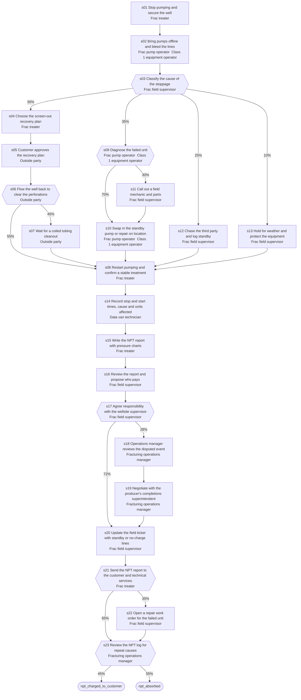

# Handle screen-outs and non-productive time on a frac pad

`ofs-fo-frac-screen-out-and-npt-handling` · oilfield services (pressure pumping) · field operations (fracturing) · part of `oilfield-services-co`

When pumping stops on a frac pad, because a stage screens out, a pump fails, sand, water or wireline are not ready, or weather closes in, the treater and field supervisor have to decide quickly how to recover: flush, flow the well back, call in coiled tubing, swap a pump or wait. While they do, the whole fleet and a crew of about twenty stand by. Afterwards the lost time is recorded and the supervisor and the customer's wellsite supervisor agree who pays for it under the master service agreement; disagreements go to the operations manager and the producer's completions superintendent and can hold up the field ticket for weeks.

| | |
|---|---|
| Unit of work | one non-productive time event (a stoppage of pumping on a pad) |
| Starts when | Pumping stops unplanned during a frac job: a screen-out, an equipment failure, a third-party or supply delay, or weather. The job execution process flags it with a non-productive time report. |
| Done when | Pumping has resumed, the stop and start times and cause are recorded, responsibility is agreed with the customer and reflected on the field ticket, the report is sent to the customer and technical services, any failed unit has a repair request, and the event has been through the operations manager's weekly NPT review. |
| Organisation | A TSX-listed Canadian pressure pumping company with six to eight 24-hour frac crews working for producers in Alberta and northeast BC, run from district bases with a Calgary head office. (1,350 employees, 2019-2022) |
| Volume | 25 cases a month (range 10 to 45) |

## Where it sits

- Starts with **npt_report** from fo-frac-job-execution (100% of cases)
- Relies on **msa** from cs-msa-and-pricing-agreement (a standing input; it does not start a case)
- Relies on **stage_instruction** from customer-wellsite-supervisor (a standing input; it does not start a case)
- Sends **npt_report** to te-job-data-analysis-and-customer-reporting (outcome: any)
- Sends **npt_report** to producer (outcome: any)
- Sends **repair_request** to em-corrective-repair-and-pump-rebuild (outcome: any)
- Sends **repair_request** to em-field-breakdown-support (outcome: any)
- Sends **field_ticket** to fo-dist-field-ticket-preparation (outcome: any)

## Flow

## Roles

| Role | Department | Layer | FTE on this process | Loaded cost per hour | Evidence |
|---|---|---|---:|---:|---|
| Frac treater | Fracturing service line | senior specialist | 0.5 | 70 CAD | C |
| Frac field supervisor | Fracturing service line | supervisor | 0.6 | 82 CAD | C |
| Frac pump operator (Class 1 equipment operator) | Fracturing service line | individual contributor | 0.6 | 48 CAD | B [alis_wseo] |
| Data van technician | Fracturing service line | individual contributor | 0.1 | 56 CAD | C |
| Fracturing operations manager | Fracturing service line | manager | 0.15 | 120 CAD | C |

## Steps

Hands-on time and the wait before each step show the most common value. Evidence tier A is a sourced number, B a sourced description, C the author's estimate.

| Step | Who | Kind | Hands-on | Wait before | Control | Evidence |
|---|---|---|---:|---:|---|---|
| **s01 Stop pumping and secure the well.** The treater sees the stoppage on the data van, calls the pumps down or confirms they have tripped, closes the wellhead valve if pressure is near the limit and tells the field supervisor and the wellsite supervisor what happened. | Frac treater | judgment | 15 min | 0 min | Maximum allowable treating pressure and wellhead rating from the treatment design | C |
| **s02 Bring pumps offline and bleed the lines.** Pump operators take their pumps out of gear, close the plug valves to isolate them and bleed pressure off the treating iron to the flowback tank under the treater's direction, keeping everyone out of the red zone. | Frac pump operator (Class 1 equipment operator) | physical | 20 min | 0 min | Company energy isolation and bleed-off procedure for high-pressure treating iron (Alberta OHS Code hazardous energy control) | B [alis_wseo] |
| **s03 Classify the cause of the stoppage.** The field supervisor and treater look at the pressure chart, the pump alarms and what the crew saw, and decide which kind of stoppage it is: a screen-out, an equipment failure, a third-party or supply delay, or weather. The cause decides who will be asked to pay for the lost time. | Frac field supervisor | judgment | 20 min | 5 min |  | C |
| **s04 Choose the screen-out recovery plan.** The treater looks at how much proppant is in the wellbore and the pressure behaviour and proposes a recovery: overflush with clean fluid, flow the well back to the tank to clear the perforations, or a coiled tubing cleanout if the plug and casing are covered with sand. | Frac treater | judgment | 30 min | 5 min |  | C |
| **s05 Customer approves the recovery plan.** The customer's wellsite supervisor discusses the plan with their completions engineer in town and approves the flowback or orders a coiled tubing unit. The decision is the producer's because the well and the extra cost are theirs. | Outside party | approval | 20 min | 30 min |  | C |
| **s06 Flow the well back to clear the perforations.** The flowback crew opens the well to the flowback tank through the choke so sand in the wellbore is carried out, while the treater watches pressure to see whether the perforations are open again. | Outside party | physical | 3.0 h | 1.5 h |  | C |
| **s07 Wait for a coiled tubing cleanout.** A coiled tubing unit is called out, rigged up on the well and runs in to wash the sand out down to the plug, then rigs off so the frac crew can resume. The frac fleet stands by unless it can keep pumping another well on the pad. | Outside party | external wait | 12.0 h | 12.0 h |  | C |
| **s09 Diagnose the failed unit.** Pump operators open the failed pump or blender component and find the fault: a washed fluid end, a failed valve or seat, an engine or transmission fault, a cracked iron connection. They decide with the supervisor whether it can be fixed on location. | Frac pump operator (Class 1 equipment operator) | analysis | 30 min | 5 min | Company energy isolation and bleed-off procedure for high-pressure treating iron (Alberta OHS Code hazardous energy control) | C |
| **s11 Call out a field mechanic and parts.** The field supervisor phones the maintenance shop for a field mechanic and parts, describes the fault and opens a repair request; the mechanic drives out from the district base. | Frac field supervisor | communication | 20 min | 10 min |  | C |
| **s10 Swap in the standby pump or repair on location.** Operators isolate and disconnect the failed unit, connect the standby pump to the manifold or replace the failed part, then pressure test the connections before the unit goes back on line. | Frac pump operator (Class 1 equipment operator) | physical | 1.2 h | 15 min | Company energy isolation and bleed-off procedure for high-pressure treating iron (Alberta OHS Code hazardous energy control) | C |
| **s12 Chase the third party and log standby.** The supervisor calls whoever is holding up the job (the wireline crew, the water transfer contractor, the sand coordinator or the fuel supplier), gets a time estimate, tells the customer and logs the standby start time. | Frac field supervisor | coordination | 30 min | 4.0 h |  | B [step21] |
| **s13 Hold for weather and protect the equipment.** In extreme cold the crew keeps fluid moving or drains lines so nothing freezes; for lightning or high wind everyone moves away from the iron. The supervisor decides when to restart with the wellsite supervisor. | Frac field supervisor | coordination | 30 min | 8.0 h | Company lightning and cold weather stop-work rules | B [step21] |
| **s08 Restart pumping and confirm a stable treatment.** The treater brings the pumps back to rate, watches pressure until the treatment is stable and decides with the wellsite supervisor whether to finish the interrupted stage as designed or with a reduced proppant ramp. | Frac treater | judgment | 45 min | 10 min |  | C |
| **s14 Record stop and start times, cause and units affected.** The data technician marks the stop and restart times in the acquisition record and copies them, with the cause and units affected, into the non-productive time log spreadsheet for the pad. | Data van technician | data entry | 20 min | 30 min |  | C |
| **s15 Write the NPT report with pressure charts.** The treater writes a short report: what happened, the sequence of events, pressure and rate charts from the data van, actions taken and the hours lost, in the company template. | Frac treater | drafting | 1.0 h | 2.0 h |  | C |
| **s16 Review the report and propose who pays.** The field supervisor checks the report against the log and proposes how the hours are charged under the master service agreement: standby billed to the customer for third-party or well-caused delays, no charge for the company's equipment failures, and shared or negotiated time for screen-outs. | Frac field supervisor | review | 30 min | 1.0 h | Master service agreement standby and non-productive time terms | C |
| **s17 Agree responsibility with the wellsite supervisor.** At the morning meeting or the next quiet moment the supervisor goes through the report with the customer's wellsite supervisor and asks them to accept the proposed charges. | Frac field supervisor | communication | 20 min | 8.0 h |  | C |
| **s18 Operations manager reviews the disputed event.** The frac operations manager reads the report and data, checks the MSA terms and the customer's history of similar events, and decides what the company will accept. | Fracturing operations manager | review | 1.0 h | 2.0 d |  | C |
| **s19 Negotiate with the producer's completions superintendent.** The operations manager calls or meets the producer's completions superintendent, walks through the evidence and agrees a split of the hours, often trading some standby for goodwill on the program. | Fracturing operations manager | communication | 1.0 h | 3.0 d |  | C |
| **s20 Update the field ticket with standby or no-charge lines.** The field supervisor adds the agreed standby hours or marks the lost hours as no charge on the tablet field ticket and notes the agreement reference. | Frac field supervisor | data entry | 20 min | 1.0 h |  | C |
| **s21 Send the NPT report to the customer and technical services.** The treater emails the final report to the producer and saves it in the job folder, where technical services pick it up for job analysis and repeat-failure tracking. | Frac treater | communication | 10 min | 1.0 h |  | C |
| **s22 Open a repair work order for the failed unit.** The supervisor enters a repair request in the maintenance system for the failed pump or component with the fault description and hours, so the shop can rebuild it at the next move. | Frac field supervisor | data entry | 20 min | 2.0 h |  | C |
| **s23 Review the NPT log for repeat causes.** Each week the operations manager reads the NPT log across crews, looks for repeat failures by unit, customer or cause, and raises maintenance or planning changes. Time shown is this event's share. | Fracturing operations manager | analysis | 6 min | 1.0 d |  | C |

## Exceptions

| Exception | Share of cases | What happens |
|---|---:|---|
| Screen-out needing coiled tubing | 14% | Flowback fails and a coiled tubing unit cleans out the well. |
| Mechanic callout | 10% | An equipment failure needs a field mechanic and parts. |
| Disputed NPT | 28% | The customer disputes the charge and managers negotiate. |

## Benchmarks

| Metric | Value | Unit | Population | Evidence |
|---|---|---|---|---|
| cycle_time_days | p50 4, p90 12 | calendar days from stoppage to agreed NPT, report sent and weekly review done | WCSB frac stoppages, 2019-2022 | C |
| pumping_hours_per_day | low 14.0, high 18.9 | hours of pumping per 24-hour day, the rest being between-stage time and NPT | STEP Canada frac pads, 2018-2019 | A [step_case] |

## Pain points

- The whole fleet and crew stand by during every stoppage, at about $3,000 an hour of fleet cost plus crew wages. (steps s06, s07, s10, s12, s13; C)
- A screen-out that needs coiled tubing costs most of a day or more while a unit is found and rigged up. (steps s07; C)
- Who pays for lost time is argued after the fact from loosely kept logs, and disputes hold up the field ticket and the invoice. (steps s14, s16, s17, s18, s19; C)

## Assumptions

- The workflow starts when job execution flags a stoppage; standby fleet time is also shown in the job execution workflow from the well's side, so fleet hours here should not be added to it.
- Cause shares (screen-out 30%, equipment 35%, third party 25%, weather 10%) and the dispute rate (28%) are estimates; no published Canadian figures were found.
- Frac pump operators and data van technicians take part although the organisation file's process map lists only the treater, supervisor and operations manager.
- The weekly NPT review is included as the last step, which adds up to five days of calendar wait to the cycle.
- Loaded costs come from the organisation file (base wage x 1.35).

## Sources

- [step21] [STEP Energy Services Ltd. Reports Fourth Quarter and Year End 2021 Results](https://www.stepenergyservices.com/news-releases/step-energy-services-ltd-reports-fourth-quarter-and-year-end-2021-results) (STEP Energy Services Ltd., 2022). Canadian fracturing 2021: 977 operating days and 1,012,000 tonnes of proppant (about 1,040 tonnes per operating day); 704 days and 776,000 tonnes in 2020; four spreads with 200,000 HP; Q4 2021 work hit by extended delays on a client location from challenging well conditions and by late-December weather; smaller jobs reduce proppant per day; spring break-up restricts equipment moves.
- [step_case] [Case Study: Increasing Pumping Hours Through Optimized Operations - STEP Energy Services](https://energynow.ca/2019/12/case-study-increasing-pumping-hours-through-optimized-operations-step-energy-services/) (EnergyNow, 2019). Canadian frac pads: average pumping hours per day rose from 14.03 (Q4 2018, three pads) to 18.93 on a four-well pad for one client, and from 15.47 (February 2019) to 17.95 (August 2019) for another; gains from managing maintenance schedules, bi-weekly meetings with operators and pre- and post-pad reviews; post-job data delivered to clients through an online tool.
- [alis_wseo] [Occupations in Alberta: Well Service Equipment Operator](https://alis.alberta.ca/occinfo/occupations-in-alberta/occupation-profiles/well-service-equipment-operator) (Government of Alberta (alis), 2024). Pumping services use high-pressure pumping equipment and chemicals, fluids or gases; operators monitor control panels and gauges, may mix materials, assemble and connect equipment, work outdoors in all weather, long hours and much travel; tickets include Energy Safety Canada eGSO, WHMIS, H2S, TDG and first aid; pump operators often need a Class 1 licence.

Written by claude-opus on 2026-11-24.
