# Recruit and hire field staff

`ofs-hr-field-recruitment-and-hiring` · oil and gas services (pressure pumping) · human resources (talent acquisition) · part of `oilfield-services-co`

Field recruiting fills pump operator, equipment operator, bulk driver and supervisor positions for the fracturing, cementing and coiled tubing crews, replacing people who leave and staffing crews that are being added or reactivated. An operations manager raises a requisition, recruiters post the job and run hiring events, screen applicants for Class 1 licences, safety tickets and oilfield experience, and arrange interviews with operations managers who are often in the field. Successful candidates get reference and driver's abstract checks, an offer at the field pay grid and a pre-employment drug and alcohol test before an HR coordinator sets them up and passes them to onboarding. Competition for experienced Class 1 operators, candidates who take other offers and interviewers who are hard to reach make hiring the step that limits how fast crews can be added.

| | |
|---|---|
| Unit of work | one hire (one field employee recruited and cleared to start) |
| Starts when | An operations manager raises a requisition for one or more field positions, from crew scheduling or a fleet reactivation, or a strong unsolicited applicant arrives for an evergreen posting. |
| Done when | The candidate has accepted the offer, passed the pre-employment checks and is set up in the HRIS with a start date and rotation, or the search for this position is stopped. |
| Organisation | A listed Canadian pressure pumper of about 1,350 people, roughly 880 of them field staff on rotation or on call at nine district bases, with a Calgary head office for finance, HR, HSE and engineering. (1,350 employees, 2019-2022) |
| Volume | 30 cases a month (range 10 to 60) |

## Where it sits

- Starts with **job_requisition** from fo-dist-crew-scheduling-and-rotation (65% of cases)
- Starts with **job_requisition** from fo-frac-fleet-reactivation (25% of cases)
- Starts with **application** from job-applicant (10% of cases)
- Relies on **pay_rates** from hr-compensation-and-benefits (a standing input; it does not start a case)
- Sends **offer_letter** to job-applicant (outcome: any)
- Sends **new_hire** to hr-onboarding (outcome: hired)
- Sends **training_need** to hs-training-and-competency (outcome: hired)

## Flow

```mermaid
flowchart TD
    s01["s01 Raise requisition<br/>Fracturing operations manager"]
    s02{{"s02 Approve requisition against headcount plan<br/>HR business partner"}}
    s03{{"s03 Post the job<br/>Field recruiter"}}
    s04["s04 Travel to and run a hiring event<br/>Field recruiter"]
    s05["s05 Wait for applications<br/>Outside party"]
    s06["s06 Screen applications<br/>Field recruiter"]
    s07{{"s07 Phone screen candidates<br/>Field recruiter"}}
    s08["s08 Schedule interviews with the hiring manager<br/>Field recruiter"]
    s09["s09 Interview candidate<br/>Fracturing operations manager"]
    s10["s10 Supervisor assesses practical knowledge<br/>Frac field supervisor"]
    s11{{"s11 Decide whether to make an offer<br/>Fracturing operations manager"}}
    s12{{"s12 Check references and driver's abstract<br/>HR coordinator  onboarding and rotations"}}
    s13{{"s13 Prepare offer at the pay grid<br/>Field recruiter"}}
    s14["s14 Approve pay exception<br/>HR business partner"]
    s15["s15 Extend the offer<br/>Field recruiter"]
    s16{{"s16 Candidate decides<br/>Outside party"}}
    s17["s17 Book pre-employment drug and alcohol test<br/>HR coordinator  onboarding and rotations"]
    s18{{"s18 Wait for test results<br/>Outside party"}}
    s19["s19 Check tickets and plan missing training<br/>HR coordinator  onboarding and rotations"]
    s20["s20 Set up new hire and hand to onboarding<br/>HR coordinator  onboarding and rotations"]
    s21["s21 Confirm start date and rotation with dispatch<br/>Field recruiter"]
    s01 --> s02
    s02 -->|"95%"| s03
    s02 -->|"5%"| end0
    s03 -->|"75%"| s05
    s03 -->|"25%"| s04
    s04 --> s06
    s05 --> s06
    s06 --> s07
    s07 -->|"85%"| s08
    s07 -->|"15%"| s05
    s08 --> s09
    s09 --> s10
    s10 --> s11
    s11 -->|"70%"| s12
    s11 -->|"30%"| s06
    s12 -->|"90%"| s13
    s12 -->|"10%"| s06
    s13 -->|"80%"| s15
    s13 -->|"20%"| s14
    s14 --> s15
    s15 --> s16
    s16 -->|"82%"| s17
    s16 -->|"18%"| s06
    s17 --> s18
    s18 -->|"95%"| s19
    s18 -->|"5%"| end1
    s19 --> s20
    s20 --> s21
    s21 --> end2
    end0(["not filled"])
    end1(["offer withdrawn"])
    end2(["hired"])
```

## Roles

| Role | Department | Layer | FTE on this process | Loaded cost per hour | Evidence |
|---|---|---|---:|---:|---|
| Field recruiter | Human resources | individual contributor | 4 | 52 CAD | C |
| HR business partner | Human resources | senior specialist | 0.3 | 70 CAD | C |
| Fracturing operations manager | Fracturing service line | manager | 0.6 | 120 CAD | C |
| Frac field supervisor | Fracturing service line | supervisor | 0.3 | 82 CAD | C |
| HR coordinator (onboarding and rotations) | Human resources | individual contributor | 1 | 41 CAD | C |

## Steps

Hands-on time and the wait before each step show the most common value. Evidence tier A is a sourced number, B a sourced description, C the author's estimate.

| Step | Who | Kind | Hands-on | Wait before | Control | Evidence |
|---|---|---|---:|---:|---|---|
| **s01 Raise requisition.** The operations manager fills the requisition form with position, district, rotation, number of openings, start date and reason (replacement, new crew or reactivation) and sends it to HR. | Fracturing operations manager | drafting | 20 min | 0 min |  | C |
| **s02 Approve requisition against headcount plan.** The HR business partner checks the requisition against the approved headcount and budget for the service line and district and approves it or asks the director to confirm. | HR business partner | approval | 15 min | 12.0 h | Headcount control: hiring only against approved positions | C |
| **s03 Post the job.** The recruiter writes or reuses the posting with licence, ticket and rotation requirements and pay range, posts it on the careers page and job boards, and shares it with the field through referral bonuses. | Field recruiter | drafting | 40 min | 4.0 h |  | C |
| **s04 Travel to and run a hiring event.** For reactivations and pre-season hiring two recruiters drive to a district base or town, hold a walk-in hiring event with short on-the-spot screens, and come back with a list of candidates. | Field recruiter | travel | 10.0 h | 5.0 d |  | B [src4] |
| **s05 Wait for applications.** Applications arrive from job boards, the careers page and referrals; for scarce roles such as Class 1 operators with frac experience it can take weeks to get enough suitable applicants. | Outside party | external wait | 0 min | 4.0 d |  | C |
| **s06 Screen applications.** The recruiter reads résumés in the applicant tracking tool and keeps those with the right licence class, air brake endorsement, valid H2S Alive and first aid, oilfield experience and willingness to work the rotation, about one in five of those received. | Field recruiter | validation | 2.0 h | 1.0 d |  | C |
| **s07 Phone screen candidates.** The recruiter calls shortlisted candidates to confirm experience, licence, availability, rotation and pay expectations, and explains the job and the drug and alcohol policy. | Field recruiter | communication | 1.5 h | 1.0 d |  | C |
| **s08 Schedule interviews with the hiring manager.** The recruiter finds a time when the operations manager or a field supervisor on days off can interview at the base, books the room and confirms with the candidates. | Field recruiter | coordination | 30 min | 3.0 d |  | C |
| **s09 Interview candidate.** The operations manager interviews the candidate at the base with a supervisor, asks about past jobs, equipment and safety behaviour, tours the shop and rates the candidate on the interview guide. | Fracturing operations manager | judgment | 1.0 h | 0 min |  | C |
| **s10 Supervisor assesses practical knowledge.** A field supervisor sitting in on the interview walks the candidate around a pump or bulk unit and asks practical questions on pre-trip checks, pressure safety and the equipment they claim to have run. | Frac field supervisor | judgment | 45 min | 0 min |  | C |
| **s11 Decide whether to make an offer.** The manager and recruiter compare ratings for the candidates interviewed and decide who gets an offer, who goes on hold and who is declined. | Fracturing operations manager | judgment | 15 min | 12.0 h |  | C |
| **s12 Check references and driver's abstract.** The HR coordinator calls two references and orders the candidate's driver's abstract and commercial vehicle record to confirm licence class, endorsements and convictions. | HR coordinator (onboarding and rotations) | lookup | 1.0 h | 1.0 d | Fleet safety programme under the National Safety Code carrier rules: driver abstracts reviewed before a driver is assigned | C |
| **s13 Prepare offer at the pay grid.** The recruiter places the candidate on the field pay grid by position and experience, adds rotation and living-out terms and drafts the offer letter. | Field recruiter | drafting | 30 min | 4.0 h |  | C |
| **s14 Approve pay exception.** The HR business partner reviews the requested rate or signing bonus against market information and internal equity and approves or changes it. | HR business partner | approval | 20 min | 8.0 h | Compensation policy: rates above the grid need HR approval | C |
| **s15 Extend the offer.** The recruiter phones the candidate with the offer, sends the letter and answers questions about rotation, pay and start date. | Field recruiter | communication | 30 min | 2.0 h |  | C |
| **s16 Candidate decides.** The candidate weighs the offer against others from competing service companies and accepts, negotiates or declines; in 2021-2022 many good candidates held several offers. | Outside party | external wait | 0 min | 2.0 d |  | B [src4] |
| **s17 Book pre-employment drug and alcohol test.** The HR coordinator books the candidate at a collection site near their home for a pre-employment drug and alcohol test, and a fit-for-work assessment where the role needs one. | HR coordinator (onboarding and rotations) | coordination | 25 min | 4.0 h | Company alcohol and drug policy for safety-sensitive positions following the Canadian Model for Providing a Safe Workplace, and customer site access rules | C |
| **s18 Wait for test results.** The candidate attends the collection site and the laboratory or medical review officer returns the result; the candidate cannot start until a negative result is received. | Outside party | external wait | 0 min | 2.0 d |  | C |
| **s19 Check tickets and plan missing training.** The HR coordinator copies the new hire's licence and safety certificates, checks dates and the industry training record, and lists the tickets the person still needs before going to location. | HR coordinator (onboarding and rotations) | validation | 30 min | 4.0 h |  | C |
| **s20 Set up new hire and hand to onboarding.** The HR coordinator creates the employee record with position, district, rotation and pay rate, files the signed offer and test result and sends the new hire to onboarding and training with the start date. | HR coordinator (onboarding and rotations) | data entry | 45 min | 4.0 h |  | C |
| **s21 Confirm start date and rotation with dispatch.** The recruiter tells the operations manager and the district dispatcher which crew and rotation the new hire joins and when they finish orientation, and closes the opening in the requisition. | Field recruiter | communication | 15 min | 2.0 h |  | C |

## Exceptions

| Exception | Share of cases | What happens |
|---|---:|---|
| Candidate declines the offer | 18% | The candidate takes another company's offer and the recruiter goes back to the shortlist. |
| No suitable applicants | 15% | Phone screens find no one with the right licence and experience and sourcing continues. |
| Failed checks | 15% | References, driver's abstract or the drug and alcohol test rule the candidate out. |
| Hiring event | 25% | For a reactivation or pre-season push recruiters run walk-in hiring events at district bases. |

## Benchmarks

| Metric | Value | Unit | Population | Evidence |
|---|---|---|---|---|
| cycle_time_days | p50 35, p90 60 | calendar days from requisition to cleared hire | Field operator hires at a WCSB pressure pumper, 2019-2022 | C [src11] |
| class1_entry_training_hours | 113 | hours of mandatory training for a new Class 1 licence in Alberta (MELT) | New Class 1 drivers in Alberta | B [src10] |

## Pain points

- Experienced Class 1 operators are scarce and new licences need long, costly entry training, so postings sit for weeks. (steps s05, s06; B [src4], [src10])
- Interviews wait for operations managers and supervisors who are on location or on rotation. (steps s08, s11; C)
- Good candidates accept other offers while references and drug tests are pending. (steps s12, s16, s18; B [src4])

## Assumptions

- Loaded costs are the organisation file's (base wage x 1.35).
- The fracturing operations manager stands for the hiring managers of all three service lines; cementing and coiled tubing operations managers do the same steps for their crews.
- The HR coordinator and field supervisors take part although the process map lists only recruiter, HR business partner and fracturing operations manager.
- A hired candidate also sends a training need to hs-training-and-competency, a link the process map lacks (it routes new hires to training only through onboarding).
- Requisitions for several identical positions are split into one case per hire; the posting and approval steps are counted once per hire for simplicity, which overstates their effort slightly.
- No external party exists in the organisation file for drug testing laboratories; the wait is recorded with role 'external'.

## Sources

- [src4] [Trican Well Service Ltd. Management's Discussion and Analysis for the year ended December 31, 2022](https://tricanwellservice.com/app/uploads/2023/02/TCW-Q4-2022-MDA-2023.02.22.pdf) (Trican Well Service Ltd., 2023). Three Tier 4 DGB fleets (126,000 HHP) operating at end 2022; fourth fleet (42,000 HHP) field ready by end Q1 2023 and fifth approved for early 2024; upgrades include 3,000 HHP continuous duty pumps and idle reduction packages; fully electric sand, blending and chemical equipment developed; capital spending $103.6 million in 2022 mainly Tier 4 upgrades; supply chain challenges such as long lead times on key parts; record inflation; difficulty adding field crews and attracting and retaining qualified personnel; recruiting events; CEWS credited against personnel expenses in 2021 ($10.2 million in cost of sales); the company has safety and training programs; MD&A dated February 22, 2023.
- [src10] [Alberta's new Class 1 training: More in-cab training hours, Red Seal certification](https://www.trucknews.com/transportation/albertas-new-class-1-training-more-hours-red-seal-certification/1003183738) (Trucknews.com, 2024). Alberta's Class 1 Mandatory Entry Level Training (MELT) requires 113 hours of training including 57 hours in-cab; a replacement pathway follows from 2025.
- [src11] [2025 Recruiting Benchmarking](https://www.shrm.org/topics-tools/research/2025-recruiting-benchmarking) (Society for Human Resource Management, 2025). Median time to fill nonexecutive positions of 39 calendar days (US, 2025 survey).

Written by claude-opus on 2026-11-24.
