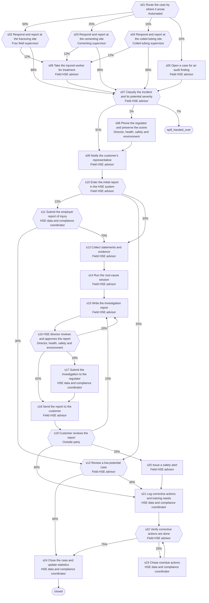

# Report and investigate incidents

`ofs-hs-incident-reporting-and-investigation` · oil and gas services · health, safety and environment · part of `oilfield-services-co`

When someone is hurt, nearly hurt, a vehicle is damaged or a line fails on a fracturing, cementing or coiled tubing job, the field supervisor makes the site safe, gives first aid and reports it; a field HSE advisor classifies it, tells the customer, and starts either a short review or a full investigation with witness statements and a root-cause session. The HSE director approves the report, corrective actions are assigned and followed up, and the law sets deadlines: serious incidents phoned to Alberta OHS at once, injury reports to the Workers' Compensation Board within 72 hours, BC investigations within 30 days. Investigations stall because the crew rotates off before statements are taken, approvals wait in the director's queue, and corrective actions sit open for weeks.

| | |
|---|---|
| Unit of work | one incident or near miss (or one audit finding handled as a case) |
| Starts when | A worker reports an injury, near miss, vehicle or equipment damage incident or spill to the field supervisor, or an audit raises a finding. |
| Done when | The case is classified, reported to the customer and any regulator or board as required, investigated to the level its severity needs, its corrective actions verified and the case closed; spills are handed to spill response. |
| Organisation | A Canadian pressure pumping company with about 880 field staff on customer leases in Alberta and northeast BC and a small HSE group of field advisors, a director and coordinators. (1,350 employees, 2019-2022) |
| Volume | 60 cases a month (range 30 to 100) |

## Where it sits

- Starts with **incident_report** from fo-frac-job-execution (50% of cases)
- Starts with **incident_report** from fo-cem-job-execution (25% of cases)
- Starts with **incident_report** from fo-ct-job-execution (15% of cases)
- Starts with **audit_finding** from hs-safety-audit-and-inspection (10% of cases)
- Sends **incident_report** to producer (outcome: any)
- Sends **regulatory_notification** to ohs-regulator (outcome: closed)
- Sends **injury_claim** to workers-comp-board (outcome: closed)
- Sends **training_need** to hs-training-and-competency (outcome: closed)
- Sends **safety_stats** to exec-enterprise-risk-management (outcome: closed)
- Sends **safety_stats** to hs-customer-safety-prequalification (outcome: closed)
- Sends **incident_report** to lg-insurance-and-claims (outcome: closed)
- Sends **spill_report** to hs-environmental-spill-response (outcome: spill_handed_over)

## Flow

## Roles

| Role | Department | Layer | FTE on this process | Loaded cost per hour | Evidence |
|---|---|---|---:|---:|---|
| Frac field supervisor | Fracturing service line | supervisor | 0.15 | 82 CAD | C |
| Cementing supervisor | Cementing service line | supervisor | 0.1 | 78 CAD | C |
| Coiled tubing supervisor | Coiled tubing and nitrogen service line | supervisor | 0.05 | 80 CAD | C |
| Field HSE advisor | Health, safety and environment | senior specialist | 2.7 | 68 CAD | C |
| Director, health, safety and environment | Health, safety and environment | director | 0.25 | 148 CAD | C |
| HSE data and compliance coordinator | Health, safety and environment | individual contributor | 0.4 | 47 CAD | C |

## Steps

Hands-on time and the wait before each step show the most common value. Evidence tier A is a sourced number, B a sourced description, C the author's estimate.

| Step | Who | Kind | Hands-on | Wait before | Control | Evidence |
|---|---|---|---:|---:|---|---|
| **s01 Route the case by where it arose.** Not a work step: the case starts with the supervisor of the fracturing, cementing or coiled tubing crew where it happened, or with the HSE advisor when it comes from an audit or inspection finding. | Automated | system auto | 0 min | 0 min |  | C |
| **s02 Respond and report at the fracturing site.** The fracturing supervisor stops the work, makes the area safe, gives or arranges first aid, keeps the scene as it is for a serious case, takes names of witnesses, and phones the field HSE advisor and the operations manager with what happened. | Frac field supervisor | communication | 45 min | 0 min | Alberta OHS Act s.33 duty to report and preserve the scene of serious incidents; company incident reporting standard | A [ab-serious] |
| **s03 Respond and report at the cementing site.** The cementing supervisor stops the work, makes the area safe, gives or arranges first aid, keeps the scene as it is for a serious case, takes names of witnesses, and phones the field HSE advisor and the operations manager with what happened. | Cementing supervisor | communication | 45 min | 0 min | Alberta OHS Act s.33 duty to report and preserve the scene of serious incidents; company incident reporting standard | A [ab-serious] |
| **s04 Respond and report at the coiled tubing site.** The coiled tubing supervisor stops the work, makes the area safe, gives or arranges first aid, keeps the scene as it is for a serious case, takes names of witnesses, and phones the field HSE advisor and the operations manager with what happened. | Coiled tubing supervisor | communication | 45 min | 0 min | Alberta OHS Act s.33 duty to report and preserve the scene of serious incidents; company incident reporting standard | A [ab-serious] |
| **s05 Open a case for an audit finding.** The HSE advisor opens a case in the HSE system for a serious or repeated audit or inspection finding, such as missing hazard assessments or an uncertified line, so it gets the same classification and corrective action tracking as an incident. | Field HSE advisor | intake | 20 min | 1.0 d |  | C |
| **s06 Take the injured worker for treatment.** The HSE advisor or a designated driver takes the worker to the nearest clinic or hospital, stays with them, explains modified work options to the doctor, and reports the diagnosis back to the operations manager. | Field HSE advisor | travel | 4.0 h | 1.0 h |  | C |
| **s07 Classify the incident and its potential severity.** The HSE advisor decides the type (near miss, first aid, medical aid, lost time, vehicle, property damage, spill), rates the actual and potential severity on the company matrix, decides whether it is reportable to OHS, WorkSafeBC or the board, and sets the investigation level. | Field HSE advisor | judgment | 30 min | 1.0 h |  | B [wsbc-inv], [ab-serious], [ab-psi] |
| **s08 Phone the regulator and preserve the scene.** The HSE director phones the Alberta OHS Contact Centre or WorkSafeBC, confirms with the customer as prime contractor who reports, keeps the scene undisturbed until an officer releases it, and calls the executive team and insurer. | Director, health, safety and environment | communication | 1.0 h | 30 min | Alberta OHS Act s.33 serious incident reporting and scene preservation; BC Workers Compensation Act immediate notice | A [ab-serious] |
| **s09 Notify the customer's representative.** The HSE advisor calls the customer's wellsite supervisor or HSE contact with the facts known so far, as most master service agreements require within hours, and agrees who investigates when the customer is prime contractor on the lease. | Field HSE advisor | communication | 20 min | 30 min | Customer master service agreement incident notification terms | C |
| **s10 Enter the initial report in the HSE system.** The HSE advisor types the initial report from the supervisor's notes and form: date, site, crew, people involved, description, immediate actions, classification and photos, and emails the flash report to operations management. | Field HSE advisor | data entry | 40 min | 4.0 h |  | C |
| **s11 Submit the employer report of injury.** The HSE coordinator completes the employer report of injury in myWCB or the WorkSafeBC employer report with the worker's details, hours and treatment, arranges modified duties with the operations manager, and records the claim number. | HSE data and compliance coordinator | data entry | 1.0 h | 12.0 h | Alberta Workers' Compensation Act: employer report within 72 hours (Form 7 in BC) | A [wcb-ab] |
| **s12 Review a low-potential case.** For near misses and first aid cases with low potential, the advisor talks to the supervisor, records the immediate cause and the fix, such as a toolbox talk or a guard replaced, and decides whether any action needs tracking. | Field HSE advisor | analysis | 45 min | 1.0 d |  | C |
| **s13 Collect statements and evidence.** The advisor gets written statements from the people involved and witnesses, photos, gas monitor and data van records, maintenance history and the day's hazard assessment; when the crew has rotated off, statements wait for their next shift or are taken by phone. | Field HSE advisor | lookup | 4.0 h | 2.0 d |  | B [wsbc-inv], [ab-serious], [ab-psi] |
| **s14 Run the root-cause session.** The advisor leads a causal analysis with the supervisor, a worker representative and the operations manager, building the timeline and finding the immediate and underlying causes such as a missing procedure, training gap or worn equipment. | Field HSE advisor | analysis | 2.0 h | 1.0 d | Worker representative or committee participation in investigations (Alberta OHS Act; BC Workers Compensation Act) | B [wsbc-inv], [ab-serious], [ab-psi] |
| **s15 Write the investigation report.** The advisor writes the report in the company template: description, timeline, causes, and corrective actions with owners and due dates, with photos and statements attached. | Field HSE advisor | drafting | 3.0 h | 1.0 d |  | B [wsbc-inv], [ab-serious], [ab-psi] |
| **s16 HSE director reviews and approves the report.** The HSE director reads the report, checks the causes support the actions and that the severity rating is right, sends it back for gaps, and signs it off for the customer and, where required, the regulator. | Director, health, safety and environment | approval | 40 min | 3.0 d | Company incident management standard: director approval of investigations | C |
| **s17 Submit the investigation to the regulator.** The HSE coordinator submits the report through the Alberta OHS online service for potentially serious or serious incidents, or the employer incident investigation report to WorkSafeBC within 30 days, and files the confirmation. | HSE data and compliance coordinator | data entry | 1.0 h | 1.0 d | Alberta OHS Act s.33(6) potentially serious incident report; BC Workers Compensation Act 30-day full investigation report | A [ab-psi], [wsbc-inv] |
| **s18 Send the report to the customer.** The advisor emails the approved report to the customer's HSE contact, often in the customer's own format or portal, and books a call to walk through causes and actions. | Field HSE advisor | communication | 30 min | 4.0 h |  | C |
| **s19 Customer reviews the report.** The customer's HSE group reviews the report against its contractor management standard, asks questions or more actions, and may raise it at the next contractor performance review. | Outside party | external wait | 0 min | 3.0 d |  | C |
| **s20 Issue a safety alert.** The advisor writes a one-page alert with what happened and what to do differently, gets it approved, and sends it to all districts for the next safety meetings. | Field HSE advisor | drafting | 1.0 h | 1.0 d |  | C |
| **s21 Log corrective actions and training needs.** The HSE coordinator enters each corrective action with owner and due date in the HSE system and sends training needs, such as a refresher course for a crew, to the training group. | HSE data and compliance coordinator | data entry | 30 min | 1.0 d | BC corrective action report with owners and dates; Alberta investigation report with corrective actions | B [wsbc-inv], [ab-serious], [ab-psi] |
| **s22 Verify corrective actions are done.** When owners report actions done, the advisor checks evidence on site or in records, such as a new procedure issued, equipment repaired or training completed, and closes each action; overdue actions are flagged. | Field HSE advisor | validation | 30 min | 4.0 d |  | C |
| **s23 Chase overdue actions.** The HSE coordinator sends the overdue action list to owners and their managers and raises long-overdue items at the monthly operations meeting. | HSE data and compliance coordinator | communication | 20 min | 5.0 d |  | C |
| **s24 Close the case and update statistics.** The HSE coordinator closes the case, checks the classification used for recordable injury and vehicle incident rates, and includes it in the monthly safety statistics for management, customers and prequalification portals. | HSE data and compliance coordinator | data entry | 10 min | 1.0 d |  | C |

## Exceptions

| Exception | Share of cases | What happens |
|---|---:|---|
| Serious incident | 2% | A hospital admission, fire or line failure that must be phoned to the regulator, with the scene held until released. |
| Witnesses rotated off | 15% | The crew finishes its rotation before statements are taken; the investigation waits a week or more. |
| Report sent back | 8% | The director or the customer finds weak causes or vague actions and the report is rewritten. |
| Overdue corrective actions | 10% | Owners miss due dates and the coordinator chases them through monthly meetings. |

## Benchmarks

| Metric | Value | Unit | Population | Evidence |
|---|---|---|---|---|
| cycle_time_days | p50 14, p90 50 | calendar days from report to case closed | Incidents and near misses at a Canadian oilfield service company, 2019-2022 | C |
| full investigation deadline (BC) | 30 | days from incident | BC employers | A [wsbc-inv] |
| employer injury report deadline (Alberta) | 3 | days (72 hours) | Alberta employers | A [wcb-ab] |
| fleet kilometres without a severe vehicle accident | 25200000 | kilometres in 2021 | Trican fleet | A [trican-esg-2021] |

## Pain points

- Crews rotate off before statements are taken, so investigations stall for a week or more. (steps s13; C)
- Reports wait for the director's approval and the customer's review, pushing full investigations past a month. (steps s16, s19; C)
- Corrective actions are vague or have no owner, and many stay open past their due dates. (steps s15, s22, s23; B [wsbc-inv])
- Potential severity is rated low to avoid a full investigation or a reportable classification. (steps s07; C)

## Assumptions

- Loaded cost per hour comes from the organisation file (base wage x 1.35).
- Step s01 is a routing step with no work, so that the first responder of each service line is shown.
- Alberta rules changed in the period: the OHS Act of 2017 and its 2020 replacement (in force September 2021) changed how potentially serious incidents are reported; the file follows the current published guidance of reporting after investigation. Serious incident calls, scene preservation and the 72-hour board report applied throughout.
- On customer leases the producer is often the prime contractor and leads or co-leads serious investigations; the company still investigates its own incidents.
- Spills are classified here and handed to hs-environmental-spill-response, which is not in the process map's links for this process.
- Cementing and coiled tubing supervisors respond to incidents on their jobs but are not in the process map's role list.

## Sources

- [trican-esg-2021] [Trican Well Service Ltd. Issues 2021 ESG Report (news release)](https://www.finanznachrichten.de/nachrichten-2022-10/57423683-trican-well-service-ltd-issues-2021-esg-report-296.htm) (finanznachrichten.de (Trican news release), 2022). In 2021 the fleet travelled 25.2 million kilometres with no severe vehicle accidents; over $475,000 spent on employee training.
- [ab-serious] [Report serious injuries, illnesses or incidents](https://www.alberta.ca/report-serious-injuries-incident) (Government of Alberta, 2026). Call the OHS Contact Centre as soon as possible for a death, a worker admitted to hospital, an unplanned explosion, fire or flood that could cause serious injury, crane or derrick collapse, or structural failure; do not disturb the scene (OHS Act s.33(2)) except to help the injured or prevent further harm; the prime contractor, or the employer if none, investigates with the joint health and safety committee or representative, prepares a written report on the circumstances and prevention, gives it to OHS, and keeps it for at least 2 years.
- [ab-psi] [Report potentially serious incidents](https://www.alberta.ca/report-potentially-serious-incidents) (Government of Alberta, 2026). A potentially serious incident (one with a likelihood of causing serious injury or illness) must be investigated by the employer or prime contractor, with a report describing the investigation and corrective actions; the report is submitted online after the investigation is complete (OHS Act s.33(6)), given to the health and safety committee or representative, and kept for at least 2 years.
- [wcb-ab] [Report an injury - for employers](https://www.wcb.ab.ca/claims/report-an-injury/for-employers.html) (Workers' Compensation Board - Alberta, 2026). Employers must submit the employer report of injury within 72 hours of becoming aware of an injury that causes lost time, modified work beyond the day of injury, treatment beyond first aid or medical aid expenses; reported through myWCB online, the employer app, a one-time online form or the faxed C040 form.
- [wsbc-inv] [Conducting an employer investigation](https://worksafebc.com/en/health-safety/create-manage/incident-investigations/conducting-employer-investigation) (WorkSafeBC, 2026). BC employers must investigate serious injuries, injuries needing medical treatment, and incidents with potential for serious injury; preliminary investigation and report within 48 hours; interim corrective actions; full investigation and report within 30 days submitted to WorkSafeBC; corrective action report naming the actions, owners and completion dates; an employer and a worker representative take part; copies to the joint committee or worker representative.

Written by claude-opus on 2026-11-24.
