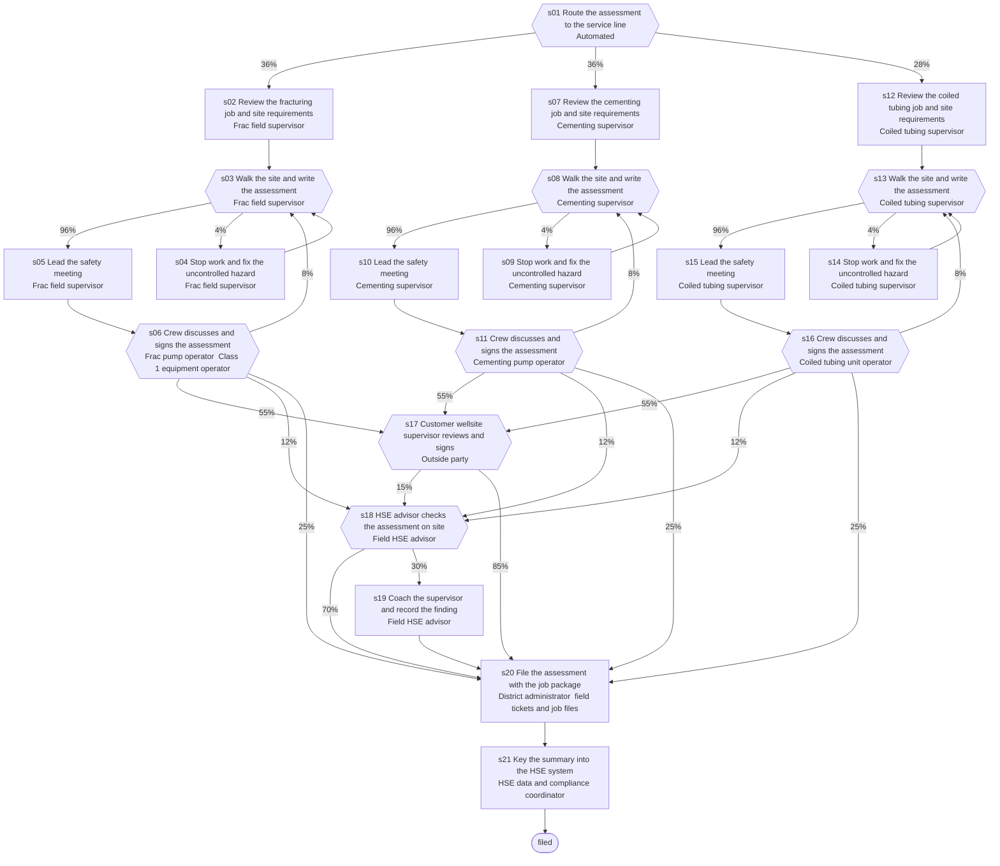

# Assess hazards before each job

`ofs-hs-pre-job-hazard-assessment` · oil and gas services · health, safety and environment · part of `oilfield-services-co`

Before every cementing or coiled tubing job, and at the start of every shift on a fracturing pad, the field supervisor walks the site, writes a field level hazard assessment (high pressure lines, H2S, overhead lifts, traffic and sand haul, simultaneous operations, weather) with the controls for each hazard, and runs a safety meeting where the crew discusses and signs it, often with the customer's wellsite supervisor. Alberta law requires a dated written assessment before work begins and again when the work changes, with the workers involved. The paper forms travel back to the base with the job package, are filed with the job and summarised for the HSE group, and field HSE advisors check a sample. The common failures are copied or generic assessments, missed reassessment when conditions change, and forms that are filed late or lost.

| | |
|---|---|
| Unit of work | one field level hazard assessment (one job, or one shift on a fracturing pad) |
| Starts when | A crew is about to start a job or a shift: a cementing or coiled tubing job from a dispatch order, or a shift on a fracturing pad program. |
| Done when | The signed assessment is used at the site, filed with the job and summarised in the HSE system. |
| Organisation | A Canadian pressure pumping company with about 880 field staff in fracturing, cementing and coiled tubing crews working on customer leases in Alberta and northeast BC. (1,350 employees, 2019-2022) |
| Volume | 1,100 cases a month (range 700 to 1,400) |

## Where it sits

- Starts with **pad_program** from fo-frac-program-planning (36% of cases)
- Starts with **dispatch_order** from fo-dist-job-call-intake-and-dispatch (64% of cases)
- Relies on **site_safety_requirements** from producer (a standing input; it does not start a case)
- Relies on **ct_program** from fo-ct-job-planning (a standing input; it does not start a case)
- Relies on **training_standard** from hs-training-and-competency (a standing input; it does not start a case)
- Sends **hazard_assessment** to fo-frac-rig-up-and-pressure-test (outcome: filed)
- Sends **hazard_assessment** to fo-frac-job-execution (outcome: filed)
- Sends **hazard_assessment** to fo-cem-job-execution (outcome: filed)
- Sends **hazard_assessment** to fo-ct-job-execution (outcome: filed)
- Sends **hazard_assessment** to hs-safety-audit-and-inspection (outcome: filed)
- Sends **hazard_assessment** to producer (outcome: filed)
- Sends **audit_finding** to hs-incident-reporting-and-investigation (outcome: any)

## Flow

## Roles

| Role | Department | Layer | FTE on this process | Loaded cost per hour | Evidence |
|---|---|---|---:|---:|---|
| Frac field supervisor | Fracturing service line | supervisor | 2.5 | 82 CAD | C |
| Frac pump operator (Class 1 equipment operator) | Fracturing service line | individual contributor | 10.8 | 48 CAD | C |
| Cementing supervisor | Cementing service line | supervisor | 3.2 | 78 CAD | C |
| Cementing pump operator | Cementing service line | individual contributor | 2.9 | 48 CAD | C |
| Coiled tubing supervisor | Coiled tubing and nitrogen service line | supervisor | 1.5 | 80 CAD | C |
| Coiled tubing unit operator | Coiled tubing and nitrogen service line | individual contributor | 1.8 | 50 CAD | C |
| Field HSE advisor | Health, safety and environment | senior specialist | 0.9 | 68 CAD | B [trican-esg] |
| District administrator (field tickets and job files) | District operations and dispatch | individual contributor | 0.75 | 40 CAD | C |
| HSE data and compliance coordinator | Health, safety and environment | individual contributor | 0.6 | 47 CAD | C |

## Steps

Hands-on time and the wait before each step show the most common value. Evidence tier A is a sourced number, B a sourced description, C the author's estimate.

| Step | Who | Kind | Hands-on | Wait before | Control | Evidence |
|---|---|---|---:|---:|---|---|
| **s01 Route the assessment to the service line.** Not a work step: the dispatch order or the pad program's shift schedule decides which supervisor and crew carry out the assessment, using that service line's field level hazard assessment form. | Automated | system auto | 0 min | 0 min |  | C |
| **s02 Review the fracturing job and site requirements.** The fracturing supervisor reads the program or dispatch order, the customer's site safety requirements and emergency response plan, the previous shift's assessment and any hazard alerts, and notes pressure zones around the treating iron, sand haul traffic, wireline and other crews on the pad. | Frac field supervisor | lookup | 15 min | 0 min |  | B [trican-esg], [ab-ohs-code-p2] |
| **s03 Walk the site and write the assessment.** The supervisor walks the lease and the work area, checks wind direction, gas monitors, muster point, exclusion zones around pressurised lines and traffic routes, and writes each task, its hazards, risk and controls on the dated field level hazard assessment form. | Frac field supervisor | analysis | 25 min | 0 min | Alberta OHS Code s.7 hazard assessment before work begins (BC OHS Regulation in BC) | A [ab-ohs-code-p2] |
| **s04 Stop work and fix the uncontrolled hazard.** The supervisor uses stop-work authority, calls the customer's wellsite supervisor and, where needed, the operations manager or HSE advisor, and agrees a fix such as moving equipment, waiting for wind or daylight, more gas monitoring or isolating the other operation, before reassessing. | Frac field supervisor | judgment | 45 min | 0 min | Company refuse-unsafe-work commitment and OHS Act right to refuse dangerous work | B [trican-esg] |
| **s05 Lead the safety meeting.** The supervisor gathers the crew on shift, reads through the tasks, hazards and controls, assigns roles such as spotter and gas tester, reviews the emergency plan and asks each person for hazards they see, adding them to the form. | Frac field supervisor | communication | 20 min | 0 min | Alberta OHS Code s.8 worker participation in hazard assessment | A [ab-ohs-code-p2] |
| **s06 Crew discusses and signs the assessment.** Crew members on shift listen, raise hazards for their own tasks, and sign the form; late arrivals and relief crews are briefed and sign later. When conditions change during the job the supervisor reassesses with the crew. | Frac pump operator (Class 1 equipment operator) | communication | 20 min | 0 min | Alberta OHS Code s.7(4) reassessment when a work process or operation changes; s.8 worker participation | A [ab-ohs-code-p2] |
| **s07 Review the cementing job and site requirements.** The cementing supervisor reads the program or dispatch order, the customer's site safety requirements and emergency response plan, the previous shift's assessment and any hazard alerts, and notes the rig's activities and crew, pressure lines to the rig floor, bulk truck spotting and H2S. | Cementing supervisor | lookup | 10 min | 0 min |  | B [trican-esg], [ab-ohs-code-p2] |
| **s08 Walk the site and write the assessment.** The supervisor walks the lease and the work area, checks wind direction, gas monitors, muster point, exclusion zones around pressurised lines and traffic routes, and writes each task, its hazards, risk and controls on the dated field level hazard assessment form. | Cementing supervisor | analysis | 20 min | 0 min | Alberta OHS Code s.7 hazard assessment before work begins (BC OHS Regulation in BC) | A [ab-ohs-code-p2] |
| **s09 Stop work and fix the uncontrolled hazard.** The supervisor uses stop-work authority, calls the customer's wellsite supervisor and, where needed, the operations manager or HSE advisor, and agrees a fix such as moving equipment, waiting for wind or daylight, more gas monitoring or isolating the other operation, before reassessing. | Cementing supervisor | judgment | 45 min | 0 min | Company refuse-unsafe-work commitment and OHS Act right to refuse dangerous work | B [trican-esg] |
| **s10 Lead the safety meeting.** The supervisor gathers the crew on shift, reads through the tasks, hazards and controls, assigns roles such as spotter and gas tester, reviews the emergency plan and asks each person for hazards they see, adding them to the form. | Cementing supervisor | communication | 15 min | 0 min | Alberta OHS Code s.8 worker participation in hazard assessment | A [ab-ohs-code-p2] |
| **s11 Crew discusses and signs the assessment.** Crew members on shift listen, raise hazards for their own tasks, and sign the form; late arrivals and relief crews are briefed and sign later. When conditions change during the job the supervisor reassesses with the crew. | Cementing pump operator | communication | 15 min | 0 min | Alberta OHS Code s.7(4) reassessment when a work process or operation changes; s.8 worker participation | A [ab-ohs-code-p2] |
| **s12 Review the coiled tubing job and site requirements.** The coiled tubing supervisor reads the program or dispatch order, the customer's site safety requirements and emergency response plan, the previous shift's assessment and any hazard alerts, and notes crane lifts of the injector, wellhead pressure, cryogenic nitrogen and simultaneous operations on the pad. | Coiled tubing supervisor | lookup | 10 min | 0 min |  | B [trican-esg], [ab-ohs-code-p2] |
| **s13 Walk the site and write the assessment.** The supervisor walks the lease and the work area, checks wind direction, gas monitors, muster point, exclusion zones around pressurised lines and traffic routes, and writes each task, its hazards, risk and controls on the dated field level hazard assessment form. | Coiled tubing supervisor | analysis | 20 min | 0 min | Alberta OHS Code s.7 hazard assessment before work begins (BC OHS Regulation in BC) | A [ab-ohs-code-p2] |
| **s14 Stop work and fix the uncontrolled hazard.** The supervisor uses stop-work authority, calls the customer's wellsite supervisor and, where needed, the operations manager or HSE advisor, and agrees a fix such as moving equipment, waiting for wind or daylight, more gas monitoring or isolating the other operation, before reassessing. | Coiled tubing supervisor | judgment | 45 min | 0 min | Company refuse-unsafe-work commitment and OHS Act right to refuse dangerous work | B [trican-esg] |
| **s15 Lead the safety meeting.** The supervisor gathers the crew on shift, reads through the tasks, hazards and controls, assigns roles such as spotter and gas tester, reviews the emergency plan and asks each person for hazards they see, adding them to the form. | Coiled tubing supervisor | communication | 15 min | 0 min | Alberta OHS Code s.8 worker participation in hazard assessment | A [ab-ohs-code-p2] |
| **s16 Crew discusses and signs the assessment.** Crew members on shift listen, raise hazards for their own tasks, and sign the form; late arrivals and relief crews are briefed and sign later. When conditions change during the job the supervisor reassesses with the crew. | Coiled tubing unit operator | communication | 15 min | 0 min | Alberta OHS Code s.7(4) reassessment when a work process or operation changes; s.8 worker participation | A [ab-ohs-code-p2] |
| **s17 Customer wellsite supervisor reviews and signs.** The customer's wellsite supervisor attends or reads the assessment, checks it covers the customer's site rules and the other contractors on the lease, and signs or initials it; some customers keep a copy. | Outside party | review | 10 min | 0 min | Customer contractor safety requirements on its leases (prime contractor) | C |
| **s18 HSE advisor checks the assessment on site.** On a site visit the field HSE advisor reads the day's assessment against the work going on, checks that hazards are specific and controls are in place, talks to crew members about it, and records the check and any findings. | Field HSE advisor | review | 30 min | 4.0 h | Company safety management system field inspections (COR audit evidence) | B [trican-esg] |
| **s19 Coach the supervisor and record the finding.** The advisor goes through the weak assessment with the supervisor, shows what a site-specific entry looks like, has it corrected for the rest of the job, and logs an audit finding when the gap is serious or repeated. | Field HSE advisor | communication | 20 min | 0 min |  | C |
| **s20 File the assessment with the job package.** When the job paperwork comes back to the base with the crew or the field ticket, the district administrator checks the form is signed and dated, scans it to the job folder or attaches it to the ticket for customers who require it, and files the paper copy. | District administrator (field tickets and job files) | data entry | 4 min | 2.0 d |  | C |
| **s21 Key the summary into the HSE system.** The HSE coordinator enters each filed assessment's site, date, crew, hazard categories and stop-work events into the HSE system for monthly leading-indicator reports and audit sampling, and lists missing forms by crew. | HSE data and compliance coordinator | data entry | 3 min | 3.0 d |  | C |

## Exceptions

| Exception | Share of cases | What happens |
|---|---:|---|
| Uncontrolled hazard stops work | 4% | A hazard such as wind direction for H2S, an overhead line or another crew's operation cannot be controlled as planned; work stops until a fix is agreed. |
| Reassessment when work changes | 8% | The job changes (new task, weather, simultaneous operation) and the supervisor rewrites the assessment with the crew. |
| Weak assessment found | 4% | An HSE advisor finds a copied or generic assessment and coaches the supervisor; repeated gaps become audit findings. |

## Benchmarks

| Metric | Value | Unit | Population | Evidence |
|---|---|---|---|---|
| cycle_time_days | p50 7, p90 14 | calendar days from start of the assessment to its summary in the HSE system | Field level hazard assessments on paper forms, Canadian oilfield service crews, 2019-2022 | C |
| minutes from start of assessment to start of work | 45 | minutes | One job or shift | C |

## Pain points

- Assessments are copied from the previous shift or written generically, so site-specific hazards are missed; this is a common audit finding. (steps s02, s03, s18; C)
- Reassessment when conditions change during a long job is often skipped or not written down. (steps s06, s16; A [ab-ohs-code-p2])
- Paper forms take days to come back to the base and some are lost, so the HSE group sees hazards and stop-work events late. (steps s20, s21; C)

## Assumptions

- Loaded cost per hour comes from the organisation file (base wage x 1.35).
- Step s01 is a routing step with no work, so that each service line's supervisor and crew are shown separately.
- The crew step stands for everyone on shift in that service line; frac-pump-operator stands for the whole frac crew.
- The crew's meeting time is counted here, not in the job execution workflows.
- Crew roles, district administrator and HSE coordinator take part but are not in the process map's role list.
- BC jobs follow the BC OHS Regulation, which also requires hazard identification and worker involvement; the Alberta rule is cited because most work is in Alberta.

## Sources

- [trican-esg] [Trican - ESG](https://tricanwellservice.com/esg/) (Trican Well Service Ltd., 2026). Employees trained in the TRACK hazard management program (understand the task, recognise hazards, assess risks, control risks, know when to continue); commitment to refuse unsafe work; Safety Management System with training and mentoring until workers are competent; Target Zero incident goal and tracking of hazard identification.
- [ab-ohs-code-p2] [Occupational Health and Safety Code, Part 2: Hazard Assessment, Elimination and Control](https://search-ohs-laws.alberta.ca/legislation/occupational-health-and-safety-code/part-2-hazard-assessment-elimination-and-control/) (Government of Alberta, 2026). Section 7: employer assesses the work site and identifies existing and potential hazards before work begins, prepares a dated report of the assessment and the control methods, and repeats it at reasonably practicable intervals, when a new work process is introduced, when a work process or operation changes, and before significant site alterations. Section 8: affected workers must be involved in the hazard assessment and in controlling the hazards.

Written by claude-opus on 2026-11-24.
