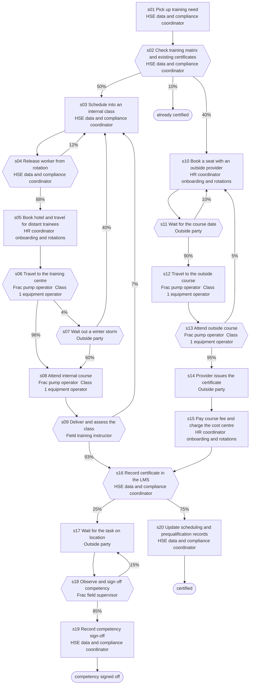

# Train and certify field staff

`ofs-hs-training-and-competency` · oil and gas services (pressure pumping) · health, safety and environment (training) · part of `oilfield-services-co`

Field staff cannot go to a customer's location without current safety tickets such as the industry safety orientation, H2S Alive, standard first aid, WHMIS and dangerous goods, and they need service-line courses and supervisor sign-offs before they run equipment on their own. The HSE coordinator finds the need from the training matrix and the ticket expiry report, books seats in the company's training centre or with outside providers, and works with dispatch to free the worker from the rotation. The worker travels to the course, trainers deliver and assess the internal courses, certificates are entered in the learning management system, and for competency modules a field supervisor observes the task on location and signs it off. Seats, rotations and travel decide how fast a ticket is done, and hiring waves in 2021-2022 left new hires waiting for courses before they could work.

| | |
|---|---|
| Unit of work | one training enrolment (one worker completing one course or competency module) |
| Starts when | A training need arrives: a new hire's missing tickets, a ticket expiring within 60 days on the expiry report, a crew scheduling request, a role change or an incident corrective action. |
| Done when | The worker's certificate or competency sign-off is recorded in the learning management system and visible to crew scheduling and on customer prequalification portals, or the enrolment is cancelled. |
| Organisation | A listed Canadian pressure pumper of about 1,350 people, roughly 880 of them field staff on rotation or on call at nine district bases, with a Calgary head office for finance, HR, HSE and engineering. (1,350 employees, 2019-2022) |
| Volume | 300 cases a month (range 150 to 500) |

## Where it sits

- Starts with **new_hire** from hr-onboarding (35% of cases)
- Starts with **training_enrolment** from fo-dist-crew-scheduling-and-rotation (45% of cases)
- Starts with **training_need** from hr-field-recruitment-and-hiring (10% of cases)
- Starts with **training_need** from hs-incident-reporting-and-investigation (10% of cases)
- Relies on **training_standard** from energy-safety-canada (a standing input; it does not start a case)
- Relies on **regulatory_update** from lg-regulatory-compliance-monitoring (a standing input; it does not start a case)
- Sends **training_enrolment** to energy-safety-canada (outcome: any)
- Sends **training_record** to fo-dist-crew-scheduling-and-rotation (outcome: certified)
- Sends **training_record** to hs-customer-safety-prequalification (outcome: certified)
- Sends **training_record** to fo-dist-crew-scheduling-and-rotation (outcome: competency signed off)
- Sends **competency_signoff** to hr-performance-and-progression (outcome: competency signed off)

## Flow

## Roles

| Role | Department | Layer | FTE on this process | Loaded cost per hour | Evidence |
|---|---|---|---:|---:|---|
| HSE data and compliance coordinator | Health, safety and environment | individual contributor | 2 | 47 CAD | C |
| HR coordinator (onboarding and rotations) | Human resources | individual contributor | 0.8 | 41 CAD | C |
| Field training instructor | Health, safety and environment | individual contributor | 5 | 58 CAD | C |
| Frac pump operator (Class 1 equipment operator) | Fracturing service line | individual contributor | 16 | 48 CAD | C |
| Frac field supervisor | Fracturing service line | supervisor | 0.6 | 82 CAD | C |

## Steps

Hands-on time and the wait before each step show the most common value. Evidence tier A is a sourced number, B a sourced description, C the author's estimate.

| Step | Who | Kind | Hands-on | Wait before | Control | Evidence |
|---|---|---|---:|---:|---|---|
| **s01 Pick up training need.** The HSE coordinator receives the new hire list, crew scheduling requests, incident actions and the weekly LMS report of tickets expiring within 60 days, and opens a training request for each person and course. | HSE data and compliance coordinator | intake | 8 min | 1.0 d |  | C |
| **s02 Check training matrix and existing certificates.** The coordinator looks up the position in the training matrix, checks the worker's LMS record and any certificate already held from a previous employer, and decides which course is needed and whether it runs in-house or with an outside provider. | HSE data and compliance coordinator | lookup | 10 min | 4.0 h |  | C |
| **s03 Schedule into an internal class.** The coordinator adds the worker to the next internal class with a free seat (service-line orientation, pressure safety, equipment courses, WHMIS or driving), and waits when classes are full. | HSE data and compliance coordinator | coordination | 10 min | 5.0 d |  | C |
| **s04 Release worker from rotation.** The coordinator asks the district dispatcher to keep the worker off the board for the class day and to arrange travel, and rebooks when the worker is called out to a job instead. | HSE data and compliance coordinator | coordination | 10 min | 1.0 d |  | C |
| **s05 Book hotel and travel for distant trainees.** For workers from Grande Prairie, Fort St. John or other distant bases the HR coordinator books a hotel near the training centre, arranges a shared pickup and tells the worker where and when to report. | HR coordinator (onboarding and rotations) | coordination | 10 min | 1.0 h |  | C |
| **s06 Travel to the training centre.** The worker drives from the home base or home to the training centre, often the evening before, in a company pickup with other trainees. | Frac pump operator (Class 1 equipment operator) | travel | 2.0 h | 12.0 h |  | C |
| **s07 Wait out a winter storm.** When a blizzard or icy highways make the drive unsafe the worker stays at the base under the journey management rules, and the class is attended late or the seat goes to the next session. | Outside party | external wait | 0 min | 1.0 d |  | C |
| **s08 Attend internal course.** The worker attends the classroom and hands-on parts of the course at the training centre, practises on equipment in the yard and writes the test. | Frac pump operator (Class 1 equipment operator) | physical | 8.0 h | 0 min | Alberta OHS Act: employer ensures workers are properly trained and that hazardous work is done by competent workers | B [src9] |
| **s09 Deliver and assess the class.** The trainer teaches the class of about ten to fifteen, runs the practical exercises, marks tests and records pass or fail; the minutes here are one trainee's share of the class plus marking. | Field training instructor | communication | 50 min | 0 min |  | C |
| **s10 Book a seat with an outside provider.** The HR coordinator books a seat with an authorised provider for H2S Alive, first aid, ground disturbance or dangerous goods courses, sends the worker's details and pays or commits the fee. | HR coordinator (onboarding and rotations) | data entry | 20 min | 8.0 h |  | C |
| **s11 Wait for the course date.** The outside course runs on its own calendar; in busy months the nearest seats are one to three weeks out and the worker must also be off rotation that day. | Outside party | external wait | 0 min | 6.0 d |  | B [src6] |
| **s12 Travel to the outside course.** The worker drives in a company pickup to the provider's training site in Calgary, Nisku, Grande Prairie or another town, sometimes the evening before with an overnight hotel stay. | Frac pump operator (Class 1 equipment operator) | travel | 2.0 h | 0 min |  | C |
| **s13 Attend outside course.** The worker completes the course and its practical tests, for example a one-day H2S Alive class with breathing apparatus drills or a two-day standard first aid course. | Frac pump operator (Class 1 equipment operator) | physical | 8.0 h | 0 min |  | A [src6], [src8] |
| **s14 Provider issues the certificate.** The provider records the result and issues the certificate or wallet card, by email the same week or through the industry training record. | Outside party | external wait | 0 min | 1.0 d |  | C |
| **s15 Pay course fee and charge the cost centre.** When the certificate arrives the HR coordinator matches the provider invoice to the booking and attendance, codes it to the trainee's district and service line and sends it for payment. | HR coordinator (onboarding and rotations) | data entry | 10 min | 1.0 h |  | C |
| **s16 Record certificate in the LMS.** The HSE coordinator checks the certificate's name, course and dates, scans it to the employee file and enters the completion and expiry date in the LMS. | HSE data and compliance coordinator | data entry | 8 min | 1.0 d | Customer and certifying-body audits of training records (COR audits and prequalification reviews) | A [src6], [src8] |
| **s17 Wait for the task on location.** The worker returns to the crew; a competency such as running a pump from the control van or rigging up treating iron can only be observed when the crew does that task on a job. | Outside party | external wait | 0 min | 7.0 d |  | C |
| **s18 Observe and sign off competency.** The field supervisor watches the worker do the task on location, asks the checklist questions, coaches on gaps and signs the checklist, or records that more practice is needed. | Frac field supervisor | judgment | 1.0 h | 1.0 d | Alberta OHS Act: work that may endanger a worker is done by a competent worker or under direct supervision of one | B [src9] |
| **s19 Record competency sign-off.** The HSE coordinator receives the signed checklist from the base, checks every item is initialled, files it, marks the competency complete in the LMS and refreshes the ticket report that dispatchers and the progression review use. | HSE data and compliance coordinator | data entry | 10 min | 3.0 d |  | C |
| **s20 Update scheduling and prequalification records.** The coordinator refreshes the ticket report used by dispatchers and uploads training records to the customer prequalification portals that ask for them. | HSE data and compliance coordinator | data entry | 5 min | 1.0 d |  | C |

## Exceptions

| Exception | Share of cases | What happens |
|---|---:|---|
| Worker called out to a job | 12% | The worker is dispatched on the class day and the course is rebooked. |
| Failed course | 6% | The worker fails or does not finish and is rebooked into a later class. |
| Competency not yet shown | 4% | The supervisor records that more practice is needed and observes again on a later job. |

## Benchmarks

| Metric | Value | Unit | Population | Evidence |
|---|---|---|---|---|
| cycle_time_days | p50 18, p90 40 | calendar days from training need to record in the LMS | Field safety tickets and competency modules at a WCSB service company, 2019-2022 | C |
| h2s_alive_certificate_validity | 3 | years | Energy Safety Canada H2S Alive | A [src6] |
| standard_first_aid_course_hours | 14 | classroom hours (CPR C, in-class version) | Canadian Red Cross Standard First Aid | A [src8] |
| industry_orientation_length | 1 | day | Energy Safety Canada general orientation for new workers | B [src7] |

## Pain points

- New hires cannot go to location until their tickets are done, and in hiring waves internal classes filled up weeks ahead. (steps s03, s11; C)
- Training competes with the rotation: workers are pulled for jobs and classes are rebooked. (steps s04; C)
- Competency checklists travel on paper from the field and are filed weeks after the sign-off. (steps s17, s19; C)
- Expiry tracking depends on manual entry of certificates from many providers into the LMS and then the customer portals. (steps s16, s20; C)

## Assumptions

- Loaded costs are the organisation file's (base wage x 1.35).
- The frac pump operator role stands for all field trainees; trainee time (travel and course) is most of the labour in this process.
- Trainer minutes per enrolment are one trainee's share of a class of about ten to fifteen; the trainer step runs alongside the trainee's attendance and adds no elapsed time.
- Field supervisors and the trainees take part although the process map lists only trainer, HSE coordinator and HR coordinator.
- Crew scheduling requests (training_enrolment) and new hires from recruitment (training_need) are added as triggers; the process map has only onboarding and incidents.
- About half of enrolments are internal courses and four in ten outside courses; one in ten finds a valid certificate already held.

## Sources

- [src4] [Trican Well Service Ltd. Management's Discussion and Analysis for the year ended December 31, 2022](https://tricanwellservice.com/app/uploads/2023/02/TCW-Q4-2022-MDA-2023.02.22.pdf) (Trican Well Service Ltd., 2023). Three Tier 4 DGB fleets (126,000 HHP) operating at end 2022; fourth fleet (42,000 HHP) field ready by end Q1 2023 and fifth approved for early 2024; upgrades include 3,000 HHP continuous duty pumps and idle reduction packages; fully electric sand, blending and chemical equipment developed; capital spending $103.6 million in 2022 mainly Tier 4 upgrades; supply chain challenges such as long lead times on key parts; record inflation; difficulty adding field crews and attracting and retaining qualified personnel; recruiting events; CEWS credited against personnel expenses in 2021 ($10.2 million in cost of sales); the company has safety and training programs; MD&A dated February 22, 2023.
- [src6] [H2S Alive course](https://energysafetycanada.com/course/10490) (Energy Safety Canada, 2026). One-day classroom course with a three-year certificate; practical SCBA donning and rescue drag components; 70% exam pass mark; sessions of 20 seats.
- [src7] [Common Safety Orientation (CSO)](https://energysafetycanada.com/Course/12364) (Energy Safety Canada, 2026). One-day general safety orientation for workers new to the energy industry, online or classroom, certificate does not expire. Current successor of the orientation courses used in 2019-2022.
- [src8] [Standard First Aid & CPR fact sheet](https://cdn.redcross.ca/prodmedia/crc/documents/FactSheet_CRC_SFA_EN-PDF_1.pdf) (Canadian Red Cross, 2026). Two-day course, CPR C 14 hours in class or blended; 3-year certification; recertification 7.5 hours in class for CPR C.
- [src9] [Obligations of work site parties](https://www.alberta.ca/obligations-work-site-parties) (Government of Alberta (Occupational Health and Safety), 2026). Employers must ensure workers are properly trained, supervised by competent supervisors, and that work that may endanger a worker is done by a competent worker or under the direct supervision of one.

Written by claude-opus on 2026-11-24.
