# Buy, blend and deliver chemicals

`ofs-sc-chemical-procurement-and-blending` · oil and gas services · supply chain · part of `oilfield-services-co`

Each frac pad needs friction reducer, surfactants, biocide and other additives mixed into the water, mostly in blends the company makes at its own plant. A buyer nets each pad's chemical requirement against stock and orders raw additives from suppliers, plant operators blend, test and package the product, and warehouse staff prepare dangerous goods paperwork and send the totes to the pad, where the blender operator receives them. Long supplier lead times (worst after the February 2021 Gulf Coast freeze), late design changes and a single blending plant make shortages and urgent hot-shot deliveries a regular event.

| | |
|---|---|
| Unit of work | one chemical order (the additives for one pad, or a base stock top-up) |
| Starts when | A frac program issues a chemical requirement for a pad, or a district base asks to top up stock. |
| Done when | The blended chemicals are on location or at the base, signed for and moved to the job in the ERP. |
| Organisation | A TSX-listed Canadian pressure pumper with about 1,350 employees, six to eight 24-hour frac crews, a 70-person supply chain department in Calgary and at district bases, an ERP with procurement and inventory, and spreadsheets, email and phone for day-to-day logistics. (1,350 employees, 2019-2022) |
| Volume | 60 cases a month (range 30 to 90) |

## Where it sits

- Starts with **chemical_order** from fo-frac-program-planning (80% of cases)
- Starts with **replenishment_request** from sc-warehouse-and-inventory-management (20% of cases)
- Relies on **product_spec** from te-product-development (a standing input; it does not start a case)
- Relies on **supply_agreement** from sc-supplier-management-and-contracts (a standing input; it does not start a case)
- Relies on **goods_shipment** from chemical-supplier (a standing input; it does not start a case)
- Relies on **qc_result** from te-fluid-and-proppant-quality-testing (a standing input; it does not start a case)
- Relies on **frac_design** from te-frac-treatment-design (a standing input; it does not start a case)
- Sends **chemical_delivery** to fo-frac-job-execution (outcome: delivered)
- Sends **purchase_order** to chemical-supplier (outcome: any)
- Sends **shipment_request** to sc-dangerous-goods-shipping (outcome: delivered)
- Sends **qc_sample** to te-fluid-and-proppant-quality-testing (outcome: delivered)
- Sends **goods_receipt** to fin-accounts-payable (outcome: delivered)

## Flow

```mermaid
flowchart TD
    s01["s01 Receive pad chemical requirement<br/>Procurement specialist  buyer"]
    s02{{"s02 Check finished and raw stock<br/>Procurement specialist  buyer"}}
    s03["s03 Create purchase order for additives<br/>Procurement specialist  buyer"]
    s04{{"s04 Supplier confirms order and ship date<br/>Outside party"}}
    s05["s05 Find a substitute or alternative source<br/>Procurement specialist  buyer"]
    s06{{"s06 Approve substitute additive<br/>Completions design engineer"}}
    s07["s07 Additives in transit<br/>Outside party"]
    s08{{"s08 Receive additives at the plant<br/>Warehouse and parts attendant"}}
    s09{{"s09 Resolve receiving discrepancy<br/>Procurement specialist  buyer"}}
    s10{{"s10 Schedule the blend batch<br/>Chemical blending plant operator"}}
    s11{{"s11 Revise chemical schedule after a design change<br/>Completions design engineer"}}
    s12["s12 Blend and package the batch<br/>Chemical blending plant operator"]
    s13["s13 Test batch and send QC sample<br/>Chemical blending plant operator"]
    s14{{"s14 Review lab result and release batch<br/>Chemical blending plant operator"}}
    s15["s15 Label totes and post production<br/>Chemical blending plant operator"]
    s16["s16 Book delivery and raise shipment request<br/>Warehouse and parts attendant"]
    s17["s17 Prepare TDG shipping document<br/>Warehouse and parts attendant"]
    s18{{"s18 Load totes onto the truck<br/>Warehouse and parts attendant"}}
    s19["s19 Carrier delivers to pad or base<br/>Outside party"]
    s20["s20 Drive an urgent top-up to the pad<br/>Warehouse and parts attendant"]
    s21["s21 Receive totes on location<br/>Blender and chemical operator"]
    s22["s22 Transfer stock to the job location<br/>Warehouse and parts attendant"]
    s01 --> s02
    s02 -->|"55%"| s10
    s02 -->|"45%"| s03
    s03 --> s04
    s04 -->|"80%"| s07
    s04 -->|"20%"| s05
    s05 --> s06
    s06 -->|"80%"| s07
    s06 -->|"20%"| s03
    s07 --> s08
    s08 -->|"95%"| s10
    s08 -->|"5%"| s09
    s09 -->|"50%"| s07
    s09 -->|"50%"| s10
    s10 -->|"87%"| s12
    s10 -->|"13%"| s11
    s11 -->|"40%"| s02
    s11 -->|"60%"| s12
    s12 --> s13
    s13 --> s14
    s14 -->|"96%"| s15
    s14 -->|"4%"| s12
    s15 --> s16
    s16 --> s17
    s17 --> s18
    s18 -->|"88%"| s19
    s18 -->|"12%"| s20
    s19 --> s21
    s20 --> s21
    s21 --> s22
    s22 --> end0
    end0(["delivered"])
```

## Roles

| Role | Department | Layer | FTE on this process | Loaded cost per hour | Evidence |
|---|---|---|---:|---:|---|
| Procurement specialist (buyer) | Supply chain and logistics | individual contributor | 0.6 | 54 CAD | C |
| Chemical blending plant operator | Supply chain and logistics | individual contributor | 4 | 43 CAD | C |
| Warehouse and parts attendant | Supply chain and logistics | individual contributor | 1 | 38 CAD | C |
| Completions design engineer | Technical services and engineering | senior specialist | 0.1 | 90 CAD | C |
| Blender and chemical operator | Fracturing service line | individual contributor | 0.3 | 52 CAD | C |

## Steps

Hands-on time and the wait before each step show the most common value. Evidence tier A is a sourced number, B a sourced description, C the author's estimate.

| Step | Who | Kind | Hands-on | Wait before | Control | Evidence |
|---|---|---|---:|---:|---|---|
| **s01 Receive pad chemical requirement.** The procurement specialist who buys chemicals opens the chemical requirement from the frac program: litres or kilograms of each additive (friction reducer, surfactant, biocide, scale inhibitor, breaker, crosslinker) by pad, the start date and the delivery point. They log it in the chemical demand workbook. | Procurement specialist (buyer) | intake | 20 min | 4.0 h |  | B [trican_frac] |
| **s02 Check finished and raw stock.** The buyer checks ERP stock of blended products and raw additives at the blending plant and the district bases, then phones the plant to confirm what is physically on the floor because counts drift. They net the requirement against stock already promised to other pads. | Procurement specialist (buyer) | lookup | 30 min | 1.0 h |  | C |
| **s03 Create purchase order for additives.** The buyer raises a purchase order in the ERP to the contracted chemical supplier for the missing additives, by product code, quantity in totes or drums, and required date, and emails it to the supplier. | Procurement specialist (buyer) | data entry | 25 min | 2.0 h | Delegation of authority and approved supplier list for chemical purchases | C |
| **s04 Supplier confirms order and ship date.** The chemical supplier's order desk checks its stock and production schedule and confirms quantity and ship date by email, or reports that the product is on allocation or back-ordered. | Outside party | external wait | 0 min | 1.0 d |  | B [dallasfed_2021], [step_2021] |
| **s05 Find a substitute or alternative source.** The buyer calls other suppliers for the same product or an equivalent, gathers technical data sheets and safety data sheets, and proposes a substitute to engineering if the original cannot arrive before the pad starts. | Procurement specialist (buyer) | judgment | 1.0 h | 4.0 h |  | C |
| **s06 Approve substitute additive.** The completions design engineer compares the substitute's chemistry and loading with the fluid design, asks the lab for a compatibility check if needed, and approves it, changes the loading or rejects it. | Completions design engineer | approval | 1.0 h | 1.0 d | Fluid system changes need engineering approval and lab compatibility testing | B [trican_frac] |
| **s07 Additives in transit.** The supplier ships totes, drums or bulk liquid by truck from Alberta distribution warehouses or from US Gulf Coast plants, with customs clearance on cross-border loads. | Outside party | external wait | 0 min | 3.0 d |  | C |
| **s08 Receive additives at the plant.** A warehouse attendant unloads the shipment with a forklift, checks product codes and quantities against the purchase order, checks the supplier labels, safety data sheets and certificates of analysis, and posts the goods receipt in the ERP. | Warehouse and parts attendant | physical | 35 min | 4.0 h | WHMIS supplier labels and safety data sheets (Hazardous Products Act and Regulations) | C |
| **s09 Resolve receiving discrepancy.** The buyer contacts the supplier about the wrong product, damaged totes or missing certificate, arranges a return or replacement, and decides whether the product can be used meanwhile. | Procurement specialist (buyer) | communication | 40 min | 1.0 d |  | C |
| **s10 Schedule the blend batch.** The plant operator adds the blend to the plant schedule, slotting it by pad start date against other batches, and pulls the recipe sheet for the product. | Chemical blending plant operator | coordination | 15 min | 12.0 h |  | C |
| **s11 Revise chemical schedule after a design change.** When the customer or engineer changes the fluid system or loadings, the design engineer issues a revised chemical schedule and blend ratios, and the buyer re-nets the requirement. | Completions design engineer | judgment | 1.0 h | 8.0 h |  | C |
| **s12 Blend and package the batch.** Two plant operators charge the mixing tank, meter each component by weight or flow meter, mix for the set time and fill totes or drums. They wear chemical PPE and work under the plant's hazard assessment and spill containment rules. | Chemical blending plant operator | physical | 3.0 h | 2.0 h | Plant hazard assessment, chemical PPE and spill containment (Alberta OHS Code Part 2 and Part 4 chemical hazards) | C |
| **s13 Test batch and send QC sample.** The plant operator measures specific gravity, pH and viscosity on a retained sample, records them on the batch sheet and sends a sample to the lab for a batch performance check. | Chemical blending plant operator | validation | 25 min | 30 min |  | B [trican_frac] |
| **s14 Review lab result and release batch.** When the lab posts its result, the plant operator compares it with the product specification and releases the batch for shipping, or holds it for adjustment. | Chemical blending plant operator | review | 10 min | 1.0 d | Product specification: batch released only after a passing QC result | C |
| **s15 Label totes and post production.** The plant operator applies product labels and dangerous goods safety marks to each tote, then posts the production order in the ERP to consume raw additives and add the finished product to stock. | Chemical blending plant operator | data entry | 25 min | 1.0 h | TDG Regulations Part 4 safety marks and WHMIS workplace labels | C |
| **s16 Book delivery and raise shipment request.** A warehouse attendant agrees the delivery time with the frac operations coordinator, books a carrier and raises the dangerous goods shipment request listing products, UN numbers and quantities. | Warehouse and parts attendant | communication | 15 min | 4.0 h |  | C |
| **s17 Prepare TDG shipping document.** The attendant completes the shipping document: consignor, date, UN number, shipping name, class and packing group for each product, quantities, number of totes and the 24-hour number. They check the driver's TDG training certificate and that the trailer is placarded. | Warehouse and parts attendant | drafting | 15 min | 30 min | Transportation of Dangerous Goods Regulations Part 3 (sections 3.1, 3.5, 3.7) and Part 6 training | B [tdg_part3] |
| **s18 Load totes onto the truck.** The attendant loads the totes with a forklift, secures them and confirms the count against the shipping document with the driver. | Warehouse and parts attendant | physical | 30 min | 1.0 h |  | C |
| **s19 Carrier delivers to pad or base.** The carrier drives the load to the pad or district base, waiting at the lease gate if the site is not ready to receive. | Outside party | external wait | 0 min | 5.0 h |  | C |
| **s20 Drive an urgent top-up to the pad.** When a pad is about to run short because of a design change or faster pumping, a warehouse attendant drives a pickup and trailer with a few totes to the pad, carrying the shipping document, and returns the same day. | Warehouse and parts attendant | travel | 5.0 h | 1.0 h |  | C |
| **s21 Receive totes on location.** The blender operator checks the totes against the shipping document, sets them in secondary containment by the chemical unit and signs the delivery receipt. | Blender and chemical operator | physical | 20 min | 1.0 h | Customer site rules for chemical storage in secondary containment | C |
| **s22 Transfer stock to the job location.** The warehouse attendant enters the signed receipt in the ERP, moving the product from plant stock to the pad's job location so it can be billed, and logs the returnable totes for pick-up. | Warehouse and parts attendant | data entry | 10 min | 12.0 h |  | C |

## Exceptions

| Exception | Share of cases | What happens |
|---|---:|---|
| Long lead time or supplier allocation | 9% | An additive cannot arrive before the pad; a substitute is found and approved by engineering. |
| Design change before blending | 13% | The fluid system or loadings change; the chemical schedule is revised and stock re-checked. |
| Batch fails QC | 4% | Lab result outside specification; the batch is adjusted or re-blended. |
| Urgent hot-shot | 12% | A pad about to run short gets totes driven out by company staff. |

## Benchmarks

| Metric | Value | Unit | Population | Evidence |
|---|---|---|---|---|
| cycle_time_days | p50 6, p90 14 | calendar days from chemical requirement to stock transferred to the job | Frac chemical orders at a Canadian pressure pumper, 2019-2022 | C |
| US basic organic chemicals capacity offline after the February 2021 freeze | peak 0.8, mid_march 0.6 | share of capacity | US chemical industry, February-March 2021 | A [dallasfed_2021] |

## Pain points

- Additive lead times stretched after the 2021 Gulf Coast freeze and with 2021-2022 inflation, so buyers spent time finding substitutes and engineers approving them. (steps s04, s05, s06; B [dallasfed_2021], [step_2021])
- Late changes to fluid designs arrive after blending has been scheduled, causing re-netting and urgent deliveries. (steps s10, s11, s20; C)
- A single blending plant is a bottleneck in the winter peak, and ERP stock counts that drift from the floor hide shortages until blending day. (steps s02, s10, s12; C)
- Dangerous goods paperwork is filled by hand for each load and errors can stop a truck at a roadside check. (steps s17; B [tdg_part3])

## Assumptions

- The company blends most friction reducer and surfactant packages itself and buys some ready-to-use products; ready-to-use orders skip blending in practice but are not modelled separately.
- Classifying products and preparing shipping documents also appear in the dangerous goods shipping process; here the document step is included because it sits in the path of every chemical order.
- Lab testing itself belongs to the quality testing process; only sampling and the review of the result appear here.
- Blending is done by two operators together (people = 2); the plant is held a little longer than the labour time for set-up and clean-up.
- All step times, branch shares and waits are the author's estimates except where a source is cited; no published blending cycle time benchmark was found.
- Loaded costs are taken from the organisation file (wage x 1.35).

## Sources

- [trican_frac] [Hydraulic Fracturing](https://tricanwellservice.com/fracturing/) (Trican Well Service Ltd., 2026). Service covers engineering design through procurement and coordination of chemicals, proppants, people and equipment; secure supply of proppants; ceramic proppants sourced on request; full suite of friction reducers and a full line of chemical and fluid systems; high-concentration slickwater products to streamline logistics; full-service lab in Calgary.
- [tdg_part3] [Transportation of Dangerous Goods Regulations (SOR/2001-286), Part 3 Documentation](https://laws-lois.justice.gc.ca/eng/regulations/SOR-2001-286/page-17.html) (Justice Laws Website, Government of Canada, 2026). Section 3.1: consignor prepares and gives the carrier a shipping document before the carrier takes the goods; section 3.5: consignor name and address, date, UN number, shipping name, class, packing group, quantity, number of containers, 24-hour number; section 3.7: driver keeps the shipping document within reach or in the door pocket. Current consolidation; the same Part 3 duties applied in 2019-2022.
- [dallasfed_2021] [Texas winter deep freeze broke refining, petrochemical supply chains (J. Thompson, Southwest Economy, Q2 2021)](https://www.dallasfed.org/research/swe/2021/swe2102/swe2102c) (Federal Reserve Bank of Dallas, 2021). February 2021 freeze took up to 80% of US basic organic chemicals capacity offline, up to 60% still offline in mid-March; producers outside Texas declared force majeure for lack of intermediate inputs; restocking expected to stay difficult through much of 2021.
- [step_2021] [STEP Energy Services Ltd. Reports Fourth Quarter and Year End 2021 Results](https://www.stepenergyservices.com/news-releases/step-energy-services-ltd-reports-fourth-quarter-and-year-end-2021-results) (STEP Energy Services Ltd., 2022). Canadian fracturing: 1,012,000 tonnes of proppant in 2021 (776,000 in 2020), 977 operating days, proppant per stage 54 tonnes (Q4 2021) to 83 tonnes (2021); product and hauling costs rose with company-supplied proppant; costs rose late in 2021 with supply chain disruptions; weather delays in late December 2021 and extreme cold in January 2022; spring break-up restricts equipment moves; US segment cites inflation on chemicals, proppant and spare parts.

Written by claude-opus on 2026-11-24.
