# Schedule sand hauling to pads

`ofs-sc-last-mile-sand-hauling` · oil and gas services · supply chain · part of `oilfield-services-co`

Every tonne of frac sand reaches the pad by truck from an in-basin terminal, about 3,000 loads a month in an ordinary month. Logistics coordinators turn each day's stage schedule into hourly load slots, send haul orders to contract carriers and track trucks and storage levels; sand operators on the pad check each load ticket and watch the trailer blow its sand into wellsite storage; the coordinator then matches tickets to orders before carriers are paid. A full pad leaves trucks on paid stand-by and an empty one stops a fleet worth thousands of dollars an hour, so road bans, storms, screen-outs and carrier shortages all turn into re-planning by phone.

| | |
|---|---|
| Unit of work | one truckload of frac sand (about 38 tonnes on a B-train pneumatic trailer) |
| Starts when | A pad's stage schedule for the next day sets the sand needed by mesh and hour. |
| Done when | The load is in wellsite storage, its ticket is matched and approved for payment; or the load is sent elsewhere. |
| Organisation | A TSX-listed Canadian pressure pumper with about 1,350 employees, six to eight 24-hour frac crews, a 70-person supply chain department in Calgary and at district bases, an ERP with procurement and inventory, and spreadsheets, email and phone for day-to-day logistics. (1,350 employees, 2019-2022) |
| Volume | 3,000 cases a month (range 900 to 4,200) |

## Where it sits

- Starts with **proppant_order** from fo-frac-program-planning (70% of cases)
- Starts with **railcar_shipment** from sc-proppant-procurement-and-rail-logistics (30% of cases)
- Relies on **road_ban_order** from transport-regulator (a standing input; it does not start a case)
- Relies on **load_ticket** from trucking-carrier (a standing input; it does not start a case)
- Sends **haul_order** to trucking-carrier (outcome: any)
- Sends **proppant_delivery** to fo-frac-onsite-proppant-and-fluid-management (outcome: delivered)
- Sends **load_ticket** to fin-accounts-payable (outcome: delivered)

## Flow

```mermaid
flowchart TD
    s01["s01 Receive daily stage and sand schedule<br/>Proppant logistics coordinator"]
    s02["s02 Build hourly haul schedule<br/>Proppant logistics coordinator"]
    s03{{"s03 Check road bans and route<br/>Proppant logistics coordinator"}}
    s04["s04 Adjust loads for a road ban<br/>Proppant logistics coordinator"]
    s05["s05 Send haul order to carrier<br/>Proppant logistics coordinator"]
    s06{{"s06 Carrier accepts and assigns a truck<br/>Outside party"}}
    s07["s07 Find an alternative carrier<br/>Proppant logistics coordinator"]
    s08["s08 Truck goes to the terminal and loads<br/>Outside party"]
    s09["s09 Haul to the pad<br/>Outside party"]
    s10{{"s10 Track truck and storage levels<br/>Proppant logistics coordinator"}}
    s11["s11 Truck held by weather<br/>Outside party"]
    s12{{"s12 Decide whether to hold or divert a truck<br/>Proppant logistics coordinator"}}
    s13["s13 Check in truck at the pad<br/>Sand operator"]
    s14{{"s14 Check load ticket against the order<br/>Sand operator"}}
    s15{{"s15 Resolve a wrong or undocumented load<br/>Proppant logistics coordinator"}}
    s16["s16 Unload sand into wellsite storage<br/>Sand operator"]
    s17["s17 Sign ticket and record tonnes on location<br/>Sand operator"]
    s18["s18 Update the sand tracker<br/>Proppant logistics coordinator"]
    s19["s19 Carrier submits daily ticket batch<br/>Outside party"]
    s20{{"s20 Reconcile tickets with haul orders<br/>Proppant logistics coordinator"}}
    s21["s21 Query carrier on a ticket difference<br/>Proppant logistics coordinator"]
    s22["s22 Approve tickets for accounts payable<br/>Proppant logistics coordinator"]
    s01 --> s02
    s02 --> s03
    s03 -->|"90%"| s05
    s03 -->|"10%"| s04
    s04 --> s05
    s05 --> s06
    s06 -->|"93%"| s08
    s06 -->|"7%"| s07
    s07 --> s08
    s08 --> s09
    s09 --> s10
    s10 -->|"88%"| s13
    s10 -->|"6%"| s11
    s10 -->|"6%"| s12
    s11 --> s13
    s12 -->|"85%"| s13
    s12 -->|"15%"| s05
    s13 --> s14
    s14 -->|"97%"| s16
    s14 -->|"3%"| s15
    s15 -->|"60%"| s16
    s15 -->|"40%"| end0
    s16 --> s17
    s17 --> s18
    s18 --> s19
    s19 --> s20
    s20 -->|"90%"| s22
    s20 -->|"10%"| s21
    s21 --> s22
    s22 --> end1
    end0(["load_rejected"])
    end1(["delivered"])
```

## Roles

| Role | Department | Layer | FTE on this process | Loaded cost per hour | Evidence |
|---|---|---|---:|---:|---|
| Proppant logistics coordinator | Supply chain and logistics | individual contributor | 6.5 | 52 CAD | B [source_logistics] |
| Sand operator | Fracturing service line | individual contributor | 9.5 | 49 CAD | C |

## Steps

Hands-on time and the wait before each step show the most common value. Evidence tier A is a sourced number, B a sourced description, C the author's estimate.

| Step | Who | Kind | Hands-on | Wait before | Control | Evidence |
|---|---|---|---:|---:|---|---|
| **s01 Receive daily stage and sand schedule.** The logistics coordinator receives the next day's stage schedule for the pad from the frac operations coordinator and the field supervisor: stages planned, tonnes per stage by mesh and expected pump hours. Minutes are this load's share of handling the whole schedule. | Proppant logistics coordinator | intake | 1 min | 1.0 h |  | B [step_2021] |
| **s02 Build hourly haul schedule.** The coordinator turns the stage plan into hourly load slots by mesh and terminal on the dispatch board, so that wellsite storage never runs dry and never overflows. They allow for the round trip from the terminal and the unloading time at the pad. | Proppant logistics coordinator | analysis | 2 min | 30 min |  | B [aogr_last_mile] |
| **s03 Check road bans and route.** The coordinator checks the provincial and municipal road ban lists, lease road conditions reported by the customer and any weight restrictions on the route from the terminal to the pad. | Proppant logistics coordinator | lookup | 0.5 min | 0 min |  | B [ab_road_bans] |
| **s04 Adjust loads for a road ban.** The coordinator lowers the payload to the banned percentage, which adds trucks, or reroutes through roads without bans, or asks the carrier to apply to the Central Permit Office for a road ban exemption permit. They update the haul schedule with the extra loads. | Proppant logistics coordinator | coordination | 15 min | 12.0 h | Alberta Commercial Vehicle Dimension and Weight Regulation and municipal road ban orders | B [ab_road_bans] |
| **s05 Send haul order to carrier.** The coordinator sends the carrier's dispatcher the load slot, terminal, mesh, tonnes, pad location, lease directions and site contact by email, text or a shared dispatch sheet. | Proppant logistics coordinator | communication | 2 min | 1.0 h |  | B [source_logistics] |
| **s06 Carrier accepts and assigns a truck.** The carrier's dispatcher confirms the load and assigns a driver and pneumatic trailer, or says no truck is free for that slot. | Outside party | external wait | 0 min | 2.0 h |  | C |
| **s07 Find an alternative carrier.** The coordinator phones other approved carriers on the list to cover the slot, checks that the new carrier is set up for the customer's site, and moves the order. | Proppant logistics coordinator | coordination | 20 min | 1.0 h |  | C |
| **s08 Truck goes to the terminal and loads.** At the slot time the driver goes to the terminal, queues for the loading spout, is loaded and weighed, and receives a load ticket showing terminal, mesh, lot and net tonnes. | Outside party | external wait | 0 min | 8.0 h |  | B [source_logistics] |
| **s09 Haul to the pad.** The truck drives from the terminal to the pad on highways and lease roads, typically one to four hours each way in northern Alberta and northeast BC. | Outside party | external wait | 0 min | 2.5 h |  | B [source_q4_2022] |
| **s10 Track truck and storage levels.** While trucks are on the road the coordinator watches carrier ETAs by phone and app and the sand operator's storage levels, and moves slots earlier or later when pumping speeds up or stops. | Proppant logistics coordinator | coordination | 2 min | 0 min |  | B [aogr_last_mile], [source_logistics] |
| **s11 Truck held by weather.** The truck pulls over or waits at the lease entrance until a storm, fog or icy lease road clears and the customer reopens the road. | Outside party | external wait | 0 min | 6.0 h |  | B [step_2021] |
| **s12 Decide whether to hold or divert a truck.** When the pad cannot take sand because storage is full or pumping has stopped for a screen-out, wireline delay or breakdown, the coordinator decides with the field supervisor whether the truck waits on stand-by or goes to another pad or back to the terminal. Stand-by hours become demurrage on the carrier's invoice. | Proppant logistics coordinator | judgment | 10 min | 4.0 h |  | B [aogr_last_mile] |
| **s13 Check in truck at the pad.** The sand operator meets the driver at the sand area, confirms the driver has the customer's site orientation and required tickets and PPE, and guides the truck into an unloading position away from the pumping area. | Sand operator | physical | 5 min | 30 min | Customer site safety orientation and hazard assessment (Alberta OHS Code Part 2) before entering an active frac location | B [aogr_last_mile] |
| **s14 Check load ticket against the order.** The sand operator reads the load ticket and compares mesh, supplier lot and tonnes with the haul order and the bin that has room. A wrong mesh or missing ticket is stopped here. | Sand operator | validation | 3 min | 0 min |  | C |
| **s15 Resolve a wrong or undocumented load.** The coordinator and sand operator decide whether the load can go into another bin, must go to another pad that uses that mesh, or goes back to the terminal, and they inform the carrier and the terminal. | Proppant logistics coordinator | judgment | 20 min | 1.0 h |  | C |
| **s16 Unload sand into wellsite storage.** The driver connects the trailer and blows the sand into the storage unit for that mesh while the sand operator watches bin levels, dust and hose connections and stops the transfer when the bin is full. | Sand operator | physical | 15 min | 10 min | Respirable silica dust and pressurised hose controls under the company's code of practice (Alberta OHS Code) | B [aogr_last_mile] |
| **s17 Sign ticket and record tonnes on location.** The sand operator signs the driver's load ticket, keeps a copy, and adds the tonnes by mesh to the on-site sand inventory sheet used to compare sand on location with stages left. | Sand operator | data entry | 3 min | 10 min |  | C |
| **s18 Update the sand tracker.** The coordinator updates the pad's sand tracker with the delivered load and storage levels, and adds or cancels later slots to match the stages left. | Proppant logistics coordinator | coordination | 2 min | 30 min |  | C |
| **s19 Carrier submits daily ticket batch.** At the end of the day or shift the carrier sends scans or photos of signed load tickets and any stand-by hours claimed. | Outside party | external wait | 0 min | 12.0 h |  | C |
| **s20 Reconcile tickets with haul orders.** The coordinator matches each ticket to its haul order and the sand operator's receipt: tonnes, terminal, pad, and stand-by hours against the hold decision. Matched tickets are marked for payment. | Proppant logistics coordinator | validation | 3 min | 12.0 h | Load tickets matched to haul orders and site receipts before carrier invoices are paid | B [aogr_last_mile] |
| **s21 Query carrier on a ticket difference.** The coordinator emails or phones the carrier about the missing ticket, weight difference or stand-by claim, and agrees a correction or a reduced charge. | Proppant logistics coordinator | communication | 10 min | 1.0 d |  | C |
| **s22 Approve tickets for accounts payable.** The coordinator approves the matched tickets and stand-by charges in the ERP against the carrier's blanket order, charges the haul to the customer's job, and passes the batch to accounts payable. | Proppant logistics coordinator | data entry | 2 min | 4.0 h |  | C |

## Exceptions

| Exception | Share of cases | What happens |
|---|---:|---|
| Road ban restriction | 10% | Spring or wet-weather bans cut payloads or close lease roads; more trucks or a permit are needed. |
| No truck available | 7% | The carrier cannot cover the slot and the coordinator finds another carrier. |
| Pad cannot receive | 6% | Storage full or pumping stopped; the truck waits on paid stand-by or is diverted. |
| Weather hold | 6% | Storm, fog or icy lease road holds the truck before the pad. |
| Ticket dispute | 10% | Missing ticket, weight difference or stand-by claim queried with the carrier before payment. |

## Benchmarks

| Metric | Value | Unit | Population | Evidence |
|---|---|---|---|---|
| cycle_time_days | p50 2.5, p90 3.8 | calendar days from haul order to ticket approved for payment | Sand truckloads to WCSB frac pads, 2019-2022 | C |
| pneumatic unload time | low 40, mode 45, high 70 | minutes per truck | US pneumatic sand trucks, 2017 | B [aogr_last_mile] |
| proppant per stage | low 54, high 83 | tonnes per stage | STEP Energy Services Canadian fracturing, 2021 | A [step_2021] |

## Pain points

- Pneumatic unloading of 40-70 minutes per truck means trucks queue at busy pads and run up stand-by charges. (steps s12, s13, s16; B [aogr_last_mile])
- Schedules are rebuilt by phone and spreadsheet every time pumping speeds up or stops, so coordinators spend their shifts moving slots. (steps s02, s10, s18; C)
- Matching thousands of paper or photographed load tickets to orders and stand-by claims is slow and error-prone. (steps s19, s20, s21; C)
- Customer job and permitting delays and longer haul distances cut truck productivity. (steps s09, s12; B [source_q4_2022])

## Assumptions

- Unit of work is one truckload; planning and scheduling minutes are this load's share of work done for a whole pad-day.
- All trucks belong to contract carriers; carrier steps carry no company touch time, and their drive and queue time is shown as waits.
- Payload of about 38 tonnes per B-train pneumatic load is the author's estimate; no Canadian payload figure was opened.
- Branch shares (road bans 10%, weather 6%, pad not ready 6%) are averages across the year; they are higher in winter and at break-up.
- Wellsite storage is tied up only during unloading here; holding sand for pumping belongs to the on-site proppant process.
- Loaded costs are taken from the organisation file (wage x 1.35).

## Sources

- [aogr_last_mile] ['Last Mile' Solutions Enhance Efficiency, Reliability Of Proppant Supply Chain (K. Fisher)](https://www.aogr.com/magazine/cover-story/last-mile-solutions-enhance-efficiency-reliability-of-proppant-supply-chain) (The American Oil & Gas Reporter, 2017). Pneumatic truck about 46,000 lb; pneumatic unloading 40-70 minutes, about 45 minutes on average; about a dozen trucks typically queued at the pad; one pad can need more than 130 truckloads a day; carriers bill stand-by or demurrage when trucks wait; shipment tracking through phone apps instead of calls between dispatchers, carriers and terminals; last mile up to a third of delivered sand cost; rail cars of 200,000-220,000 lb and unit trains of 110-120 cars. US conditions in 2017.
- [source_logistics] [Last-Mile Logistics](https://sourceenergyservices.com/distribution/logistics) (Source Energy Services Ltd., 2026). 24/7 dispatch team using real-time technology to monitor inventory and wait times at loading and unloading; own trucks plus a network of more than 300 third-party trucks; more than 2.0 million tonnes of proppant and other materials delivered a year; side-binder hopper and other trailer types; carriers with provincial, prorate, IFTA or oilfield exemption permit licensing.
- [source_q4_2022] [Source Energy Services Reports Q4 2022 and Year End Results](https://www.sourceenergyservices.com/news-releases/source-energy-services-reports-q4-2022-and-year-end-results) (Source Energy Services Ltd., 2023). 2,845,600 tonnes of sand sold in 2022, up 15% on 2021; last-mile trucking volumes fell in Q4 2022 because of customer job and permitting delays while longer terminal-to-wellsite trips raised revenue; higher repairs on the railcar fleet; supply contracts renewed with pricing reflecting the 2022 environment; risks of rail line interruptions and reduced railcar availability.
- [ab_road_bans] [Road bans](https://www.alberta.ca/road-bans) (Government of Alberta, 2026). Road bans reduce maximum allowed weights on roads during weak or thawing conditions; provincial bans on highways and municipal bans on local roads; spring heavy-haul period triggered by thaw depth of at least 25 cm, post-thaw from about June 16; one-window notification service for ban orders; Road Ban Exemption Permit Request to the Central Permit Office.
- [step_2021] [STEP Energy Services Ltd. Reports Fourth Quarter and Year End 2021 Results](https://www.stepenergyservices.com/news-releases/step-energy-services-ltd-reports-fourth-quarter-and-year-end-2021-results) (STEP Energy Services Ltd., 2022). Canadian fracturing: 1,012,000 tonnes of proppant in 2021 (776,000 in 2020), 977 operating days, proppant per stage 54 tonnes (Q4 2021) to 83 tonnes (2021); product and hauling costs rose with company-supplied proppant; costs rose late in 2021 with supply chain disruptions; weather delays in late December 2021 and extreme cold in January 2022; spring break-up restricts equipment moves; US segment cites inflation on chemicals, proppant and spare parts.

Written by claude-opus on 2026-11-24.
