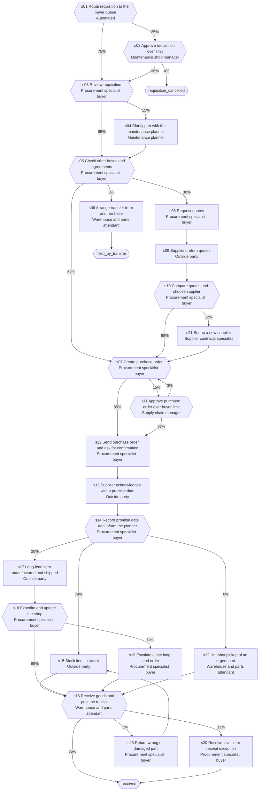

# Buy parts and materials

`ofs-sc-parts-procurement` · oil and gas services · supply chain · part of `oilfield-services-co`

Frac pumps, blenders and coiled tubing units wear out valves, seats, packing and fluid ends in hours of pumping, so the maintenance shops raise a steady stream of parts requisitions, and stock reorder points add more. Buyers check each requisition, look for stock at other bases, place purchase orders against supply agreements or after quotes, get promise dates and chase long-lead items, and warehouse staff receive the goods. Most orders are routine distributor items that arrive within days, but fluid ends, engines, transmissions and tubing strings can take months in an upturn such as 2021-2022, and units sit in the shop waiting for them.

| | |
|---|---|
| Unit of work | one purchase order (or requisition filled by transfer) |
| Starts when | A maintenance work order needs a part, a stock item falls below its reorder point, or a coiled tubing string or upgrade project needs material. |
| Done when | The part is received and the receipt matched for payment, or the requisition is filled from another base or cancelled. |
| Organisation | A TSX-listed Canadian pressure pumper with about 1,350 employees, six to eight 24-hour frac crews, a 70-person supply chain department in Calgary and at district bases, an ERP with procurement and inventory, and spreadsheets, email and phone for day-to-day logistics. (1,350 employees, 2019-2022) |
| Volume | 1,200 cases a month (range 800 to 1,800) |

## Where it sits

- Starts with **parts_requisition** from em-preventive-maintenance (30% of cases)
- Starts with **parts_requisition** from em-corrective-repair-and-pump-rebuild (30% of cases)
- Starts with **parts_requisition** from fo-ct-string-management (3% of cases)
- Starts with **parts_requisition** from em-equipment-manufacturing-and-upgrade (5% of cases)
- Starts with **replenishment_request** from sc-warehouse-and-inventory-management (32% of cases)
- Relies on **supply_agreement** from sc-supplier-management-and-contracts (a standing input; it does not start a case)
- Sends **purchase_order** to oem-supplier (outcome: any)
- Sends **purchase_order** to ct-string-mill (outcome: any)
- Sends **purchase_order** to sc-warehouse-and-inventory-management (outcome: received)
- Sends **purchase_order** to fin-accounts-payable (outcome: received)
- Sends **parts_issue** to em-corrective-repair-and-pump-rebuild (outcome: filled_by_transfer)

## Flow

## Roles

| Role | Department | Layer | FTE on this process | Loaded cost per hour | Evidence |
|---|---|---|---:|---:|---|
| Procurement specialist (buyer) | Supply chain and logistics | individual contributor | 6.5 | 54 CAD | C |
| Maintenance planner | Equipment maintenance and manufacturing | senior specialist | 0.5 | 62 CAD | C |
| Supplier contracts specialist | Supply chain and logistics | senior specialist | 0.3 | 75 CAD | C |
| Supply chain manager | Supply chain and logistics | manager | 0.2 | 112 CAD | C |
| Maintenance shop manager | Equipment maintenance and manufacturing | manager | 0.2 | 110 CAD | C |
| Warehouse and parts attendant | Supply chain and logistics | individual contributor | 3 | 38 CAD | C |

## Steps

Hands-on time and the wait before each step show the most common value. Evidence tier A is a sourced number, B a sourced description, C the author's estimate.

| Step | Who | Kind | Hands-on | Wait before | Control | Evidence |
|---|---|---|---:|---:|---|---|
| **s01 Route requisition to the buyer queue.** A parts requisition created from a maintenance work order in the maintenance module, or a reorder suggestion when stock falls below its minimum, lands in the ERP purchasing queue with the part number, quantity, need date and cost object. | Automated | system auto | 0 min | 0 min |  | C |
| **s02 Approve requisition over limit.** The maintenance shop manager reviews the requisition against the work order and the shop's budget and approves it, or cancels it when the unit will be parked instead of repaired. | Maintenance shop manager | approval | 5 min | 8.0 h | Delegation of authority for maintenance spending | C |
| **s03 Review requisition.** The buyer opens the requisition, checks that part number, quantity, need date and work order make sense, and looks at past purchase orders for the same part to see the usual supplier and price. | Procurement specialist (buyer) | validation | 5 min | 8.0 h |  | C |
| **s04 Clarify part with the maintenance planner.** The buyer emails the maintenance planner, who looks up the OEM manual, equipment history and serial numbers in the maintenance module and replies with the correct part number or specification. | Maintenance planner | communication | 20 min | 12.0 h |  | C |
| **s05 Check other bases and agreements.** The buyer checks ERP stock at other bases and the central warehouse, in case a transfer can fill the need, and looks for a supply agreement or catalogue price for the part. | Procurement specialist (buyer) | lookup | 6 min | 30 min |  | C |
| **s06 Arrange transfer from another base.** A warehouse attendant at the base holding the stock picks the part, posts a stock transfer and sends it on the next company truck or courier to the requesting shop. | Warehouse and parts attendant | coordination | 20 min | 8.0 h |  | C |
| **s07 Create purchase order.** The buyer converts the requisition into a purchase order in the ERP against the supplier's agreement or catalogue price, adds delivery address and need date, and saves it for release. | Procurement specialist (buyer) | data entry | 7 min | 30 min |  | C |
| **s08 Request quotes.** For parts without an agreement, the buyer emails two or three suppliers (OEM dealers, machine shops, distributors in Edmonton, Nisku or Calgary) with the part number, quantity and need date. | Procurement specialist (buyer) | communication | 20 min | 1.0 h | Competitive quotes required above a spending threshold | C |
| **s09 Suppliers return quotes.** Each supplier checks its branch stock or asks the factory for a lead time, then replies by email with unit price, availability, ship date and freight cost. | Outside party | external wait | 0 min | 2.0 d |  | C |
| **s10 Compare quotes and choose supplier.** The buyer compares price, lead time and freight across quotes, weighs how badly the shop needs the part, and picks a supplier. A supplier not yet in the vendor master is sent for set-up. | Procurement specialist (buyer) | analysis | 15 min | 2.0 h |  | C |
| **s11 Approve purchase order over buyer limit.** The supply chain manager reviews the purchase order, the quotes and the work order and approves it in the ERP, or sends it back. | Supply chain manager | approval | 5 min | 8.0 h | Delegation of authority for purchase commitments | C |
| **s12 Send purchase order and ask for confirmation.** The buyer releases the purchase order, which the ERP emails to the supplier as a PDF, and asks for an order acknowledgement with a ship date. | Procurement specialist (buyer) | communication | 4 min | 30 min |  | C |
| **s13 Supplier acknowledges with a promise date.** The supplier confirms the order and gives a ship date, often only after a reminder from the buyer when the order is not urgent. | Outside party | external wait | 0 min | 8.0 h |  | C |
| **s14 Record promise date and inform the planner.** The buyer types the promise date into the purchase order line and tells the maintenance planner, who uses it to plan when the unit can be repaired. | Procurement specialist (buyer) | data entry | 3 min | 4.0 h |  | C |
| **s15 Stock item in transit.** The distributor picks the part from its branch or regional warehouse and ships it by courier or less-than-truckload freight to the requesting base. | Outside party | external wait | 0 min | 2.0 d |  | C |
| **s16 Receive goods and post the receipt.** A warehouse attendant unpacks the delivery, compares part numbers and quantities with the packing slip and the purchase order, posts the goods receipt in the ERP and tags the part for its work order. | Warehouse and parts attendant | physical | 12 min | 4.0 h | Receiving done by warehouse staff independent of the buyer; three-way match before payment | C |
| **s17 Long-lead item manufactured and shipped.** The OEM or machine shop builds or allocates the item, often weeks or months out when the industry is adding capacity, then ships it. | Outside party | external wait | 0 min | 28.0 d |  | B [jpt_2018], [step_2021] |
| **s18 Expedite and update the shop.** The buyer phones and emails the supplier every week or two for status, chases ship dates that slip, and updates the planner and shop manager so they can decide whether to park the unit. | Procurement specialist (buyer) | coordination | 25 min | 0 min |  | B [jpt_2018] |
| **s19 Escalate a late long-lead order.** The buyer and supply chain manager look for another source, a used or rebuilt part, a partial shipment or air freight, and agree the extra cost with the shop manager. | Procurement specialist (buyer) | judgment | 1.0 h | 5.0 d |  | C |
| **s20 Resolve invoice or receipt exception.** The buyer works with accounts payable on invoices that do not match the purchase order price or the receipt quantity, checks with the supplier and the warehouse, and corrects the order or asks for a credit. | Procurement specialist (buyer) | validation | 20 min | 3.0 d |  | C |
| **s21 Set up a new supplier.** The supplier contracts specialist collects the supplier's banking, GST number, insurance certificate and safety prequalification, checks them and creates the vendor record so a purchase order can be issued. | Supplier contracts specialist | validation | 1.5 h | 2.0 d | Vendor master maintained outside the buying role | C |
| **s22 Hot-shot pickup of an urgent part.** When a pump or unit is down and a crew is waiting, a warehouse attendant drives a pickup to the supplier's counter in Edmonton, Nisku, Red Deer or Grande Prairie, collects the part and drives it straight to the shop or location. | Warehouse and parts attendant | travel | 3.0 h | 1.0 h |  | C |
| **s23 Return wrong or damaged part.** The buyer gets a return authorisation from the supplier, arranges pick-up and a replacement, and keeps the purchase order open. | Procurement specialist (buyer) | communication | 40 min | 1.0 d |  | C |

## Exceptions

| Exception | Share of cases | What happens |
|---|---:|---|
| Unclear part number | 15% | The buyer has to ask the planner for the right part or specification. |
| Long-lead item slips | 3% | A fluid end, engine or transmission misses its promise date; the buyer escalates and looks for another source. |
| Unit-down hot-shot | 6% | A crew is waiting, so staff drive to the supplier's counter. |
| Invoice or receipt mismatch | 12% | Price or quantity differences are sorted out with accounts payable. |

## Benchmarks

| Metric | Value | Unit | Population | Evidence |
|---|---|---|---|---|
| cycle_time_days | p50 7, p90 40 | calendar days from requisition to goods received | Maintenance parts purchase orders at a Canadian pressure pumper, 2019-2022 | C |
| newbuild frac pump lead time in an upturn | low 7, high 8 | months | US pressure pumpers, 2018 | B [jpt_2018] |

## Pain points

- Long and slipping lead times on fluid ends, engines and transmissions in upturns leave pumps waiting in the shop and buyers chasing suppliers. (steps s17, s18, s19; B [jpt_2018], [step_2021])
- Requisitions with generic or wrong part numbers need back-and-forth with planners before a purchase order can be placed. (steps s03, s04; C)
- Urgent unit-down parts are collected by staff driving to supplier counters, taking warehouse people away for half a day. (steps s22; C)
- Price and quantity mismatches between purchase orders, receipts and invoices take days to clear. (steps s16, s20; C)

## Assumptions

- About a third of purchase orders come from stock reorder points rather than shop requisitions; the organisation file lists only shop and project triggers.
- Long-lead items are about 20% of orders; their lead time range (one week to three months) is the author's estimate for 2019-2022, with the high end in 2021-2022.
- Receiving is shown here because it ends the purchase order; it is also counted in the warehouse process.
- No benchmark for requisition-to-receipt time in oilfield services was opened; general procurement benchmarks found in search could not be opened and are not cited.
- Staffing check: hands-on time times 1,200 orders implies about 14 FTE against 10.7 stated. Buyer touch alone implies about 8 FTE, so the organisation file's ten buyers for all sand, chemical, cement, fuel and parts buying look thin at this volume; either the volume is high or district warehouse staff place many local orders themselves.
- Loaded costs are taken from the organisation file (wage x 1.35).

## Sources

- [jpt_2018] [US Onshore Pressure Pumpers Adjusting to New Market Demands (M. Zborowski)](https://jpt.spe.org/us-onshore-pressure-pumpers-adjusting-new-market-demands) (Journal of Petroleum Technology (SPE), 2018). In 2018 transmissions and fluid ends had longer backlogs than the year before and pump deliveries had bottlenecks; Tier 4 engines faced delivery delays; newbuild pump lead time of about 7 to 8 months; equipment makers at capacity on refurbishments; pumpers placing larger orders for fluid ends and power ends.
- [step_2021] [STEP Energy Services Ltd. Reports Fourth Quarter and Year End 2021 Results](https://www.stepenergyservices.com/news-releases/step-energy-services-ltd-reports-fourth-quarter-and-year-end-2021-results) (STEP Energy Services Ltd., 2022). Canadian fracturing: 1,012,000 tonnes of proppant in 2021 (776,000 in 2020), 977 operating days, proppant per stage 54 tonnes (Q4 2021) to 83 tonnes (2021); product and hauling costs rose with company-supplied proppant; costs rose late in 2021 with supply chain disruptions; weather delays in late December 2021 and extreme cold in January 2022; spring break-up restricts equipment moves; US segment cites inflation on chemicals, proppant and spare parts.

Written by claude-opus on 2026-11-24.
