# Buy proppant and manage rail supply

`ofs-sc-proppant-procurement-and-rail-logistics` · oil and gas services · supply chain · part of `oilfield-services-co`

Frac sand is the largest material the company pumps, about 1.3 million tonnes a year, and most of it comes by rail from Wisconsin or northern mines to in-basin terminals near the pads. For each planned pad the logistics coordinator decides which terminal will feed it and how much must be released from a term supply agreement, the procurement specialist places the release, and the coordinator tracks the railcars for two to three weeks until the sand is in the terminal silos and allocated to the pad. Rail delays in cold weather, supplier allocation cuts and customer schedule changes leave one terminal short and another full, and every sand plan is kept in spreadsheets fed by portals and emailed reports.

| | |
|---|---|
| Unit of work | one proppant release (sand for one pad or terminal top-up, typically 2,000 to 3,500 tonnes) |
| Starts when | A new or revised pad program needs sand, or a supplier ships scheduled cars under a take-or-pay agreement. |
| Done when | The sand is in an in-basin terminal, accepted, allocated to a pad and handed to sand hauling, and the supplier and freight invoices are cleared; or the sand is held in the terminal for a later pad. |
| Organisation | A TSX-listed Canadian pressure pumper with about 1,350 employees, six to eight 24-hour frac crews, a 70-person supply chain department in Calgary and at district bases, an ERP with procurement and inventory, and spreadsheets, email and phone for day-to-day logistics. (1,350 employees, 2019-2022) |
| Volume | 40 cases a month (range 15 to 60) |

## Where it sits

- Starts with **proppant_order** from fo-frac-program-planning (80% of cases)
- Starts with **railcar_shipment** from sand-supplier (20% of cases)
- Relies on **qc_result** from te-fluid-and-proppant-quality-testing (a standing input; it does not start a case)
- Relies on **supply_agreement** from sc-supplier-management-and-contracts (a standing input; it does not start a case)
- Relies on **railcar_shipment** from rail-carrier (a standing input; it does not start a case)
- Sends **railcar_shipment** to sc-last-mile-sand-hauling (outcome: released_to_last_mile)
- Sends **purchase_order** to sand-supplier (outcome: any)
- Sends **qc_sample** to te-fluid-and-proppant-quality-testing (outcome: any)
- Sends **goods_receipt** to fin-accounts-payable (outcome: released_to_last_mile)

## Flow

```mermaid
flowchart TD
    s01["s01 Receive pad proppant requirement<br/>Proppant logistics coordinator"]
    s02["s02 Check terminal stock and railcars in transit<br/>Proppant logistics coordinator"]
    s03{{"s03 Build sourcing plan for the pad<br/>Proppant logistics coordinator"}}
    s04["s04 Check supply agreement position<br/>Procurement specialist  buyer"]
    s05{{"s05 Create release purchase order<br/>Procurement specialist  buyer"}}
    s06{{"s06 Approve release over buyer limit<br/>Supply chain manager"}}
    s07["s07 Send release to sand supplier<br/>Procurement specialist  buyer"]
    s08{{"s08 Supplier confirms allocation and ship date<br/>Outside party"}}
    s09{{"s09 Resolve supplier shortfall<br/>Procurement specialist  buyer"}}
    s10["s10 Supplier loads railcars and issues bills of lading<br/>Outside party"]
    s11["s11 Railcars travel to the in-basin terminal<br/>Outside party"]
    s12{{"s12 Track railcars and chase the railway<br/>Proppant logistics coordinator"}}
    s13["s13 Manage rail delay or bunching<br/>Proppant logistics coordinator"]
    s14["s14 Terminal spots and unloads railcars<br/>Outside party"]
    s15{{"s15 Post railcar receipt to terminal inventory<br/>Inventory controller"}}
    s16{{"s16 Allocate terminal stock to the pad<br/>Proppant logistics coordinator"}}
    s17["s17 Arrange receiving sample<br/>Proppant logistics coordinator"]
    s18{{"s18 Review sieve and crush result<br/>Procurement specialist  buyer"}}
    s19["s19 Rebalance stock after a program change<br/>Proppant logistics coordinator"]
    s20["s20 Release empty railcars and check demurrage<br/>Proppant logistics coordinator"]
    s21{{"s21 Raise quality claim and quarantine lot<br/>Procurement specialist  buyer"}}
    s22{{"s22 Decide on transfer or storage<br/>Supply chain manager"}}
    s23["s23 Confirm quantities for sand and freight invoices<br/>Procurement specialist  buyer"]
    s01 --> s02
    s02 --> s03
    s03 -->|"62%"| s04
    s03 -->|"38%"| s16
    s04 --> s05
    s05 -->|"30%"| s06
    s05 -->|"70%"| s07
    s06 -->|"95%"| s07
    s06 -->|"5%"| s05
    s07 --> s08
    s08 -->|"86%"| s10
    s08 -->|"14%"| s09
    s09 -->|"70%"| s05
    s09 -->|"30%"| s10
    s10 --> s11
    s11 --> s12
    s12 -->|"75%"| s14
    s12 -->|"25%"| s13
    s13 --> s14
    s14 --> s15
    s15 -->|"50%"| s17
    s15 -->|"50%"| s16
    s16 -->|"80%"| s20
    s16 -->|"20%"| s19
    s17 --> s18
    s18 -->|"95%"| s16
    s18 -->|"5%"| s21
    s19 --> s22
    s20 --> s23
    s21 -->|"60%"| s05
    s21 -->|"40%"| s16
    s22 -->|"70%"| s20
    s22 -->|"30%"| end0
    s23 --> end1
    end0(["held_in_terminal"])
    end1(["released_to_last_mile"])
```

## Roles

| Role | Department | Layer | FTE on this process | Loaded cost per hour | Evidence |
|---|---|---|---:|---:|---|
| Proppant logistics coordinator | Supply chain and logistics | individual contributor | 2 | 52 CAD | C |
| Procurement specialist (buyer) | Supply chain and logistics | individual contributor | 1 | 54 CAD | C |
| Supply chain manager | Supply chain and logistics | manager | 0.2 | 112 CAD | C |
| Inventory controller | Supply chain and logistics | individual contributor | 0.2 | 45 CAD | C |

## Steps

Hands-on time and the wait before each step show the most common value. Evidence tier A is a sourced number, B a sourced description, C the author's estimate.

| Step | Who | Kind | Hands-on | Wait before | Control | Evidence |
|---|---|---|---:|---:|---|---|
| **s01 Receive pad proppant requirement.** The logistics coordinator opens the proppant requirement sent by the frac operations coordinator for a newly planned or revised pad: tonnes by mesh size (for example 100 mesh and 40/70), pad location, planned start date and pumping days. They log it as a new line in the sand plan workbook. | Proppant logistics coordinator | intake | 25 min | 2.0 h |  | B [trican_frac] |
| **s02 Check terminal stock and railcars in transit.** The coordinator looks up current silo inventory by mesh at each in-basin terminal from the terminal operators' daily reports and the railcars already loaded or rolling in the rail tracking portals. They compare what is free against tonnes already promised to other pads. | Proppant logistics coordinator | lookup | 35 min | 30 min |  | B [source_q4_2018], [source_home] |
| **s03 Build sourcing plan for the pad.** The coordinator decides which terminal will feed the pad, how many tonnes come from stock already in basin and how much must be released from a supply agreement, and when it must ship from the mine to arrive two to three weeks later. The decision balances truck haul distance from each terminal against the stock left for other pads. | Proppant logistics coordinator | judgment | 1.0 h | 1.0 h |  | C |
| **s04 Check supply agreement position.** The procurement specialist opens the term supply agreement tracker for the chosen supplier and checks committed tonnes left this year, any take-or-pay shortfall, the current price and fuel or rail surcharges, and the supplier's monthly allocation by mesh. | Procurement specialist (buyer) | lookup | 25 min | 8.0 h |  | B [source_q4_2018], [source_q4_2022] |
| **s05 Create release purchase order.** The procurement specialist creates a release against the blanket purchase order in the ERP: tonnes, mesh, origin, destination terminal, ship window and price. They attach the sourcing plan and note the pad and customer so freight and sand costs can be charged to the job. | Procurement specialist (buyer) | data entry | 20 min | 30 min |  | C |
| **s06 Approve release over buyer limit.** The supply chain manager reviews the release in the ERP approval queue, checks it against the pad's planned tonnes and the supply agreement, and approves it or sends it back with a question. | Supply chain manager | approval | 10 min | 10.0 h | Delegation of authority for purchase commitments | C |
| **s07 Send release to sand supplier.** The procurement specialist emails or uploads the release to the supplier's order desk and phones to agree the load window at the mine or origin transload. They record the agreed ship week in the sand plan. | Procurement specialist (buyer) | communication | 15 min | 30 min |  | C |
| **s08 Supplier confirms allocation and ship date.** The sand supplier's order desk checks mine production and its own allocation commitments by mesh and confirms tonnes and a ship date, or offers less sand or a later week. | Outside party | external wait | 0 min | 1.0 d |  | C |
| **s09 Resolve supplier shortfall.** The procurement specialist calls other contracted suppliers for the missing mesh, asks the design engineer whether an alternative mesh is acceptable, or accepts a later ship date if the pad timing allows. They update the sand plan with the choice. | Procurement specialist (buyer) | judgment | 1.0 h | 4.0 h |  | C |
| **s10 Supplier loads railcars and issues bills of lading.** The supplier loads covered hopper cars at the mine or origin transload, weighs them and sends the car numbers and bills of lading. A unit train or block of cars then waits for the railway to lift it. | Outside party | external wait | 0 min | 2.0 d |  | B [pr_cn_2014], [aogr_last_mile] |
| **s11 Railcars travel to the in-basin terminal.** The railway moves the cars from Wisconsin or other origins about 2,700 km to the terminal in northwest Alberta or northeast BC, with interchanges and yard holds along the way. | Outside party | external wait | 0 min | 9.0 d |  | B [pr_cn_2014] |
| **s12 Track railcars and chase the railway.** Each day the coordinator downloads car positions from the railway and supplier portals into the sand plan, flags cars that have not moved for two days and phones the railway or supplier about them. They warn the last-mile desk when arrival dates slip. | Proppant logistics coordinator | coordination | 1.5 h | 0 min |  | B [source_q4_2018], [source_q4_2022] |
| **s13 Manage rail delay or bunching.** When cars stall in a cold snap or a yard, or arrive in a bunch the terminal cannot unload, the coordinator arranges sand from another terminal or the supplier's in-basin stock for the pad and asks the supply chain manager to approve the extra trucking or storage charges. They re-plan the pad's sand by day. | Proppant logistics coordinator | coordination | 2.0 h | 2.0 d |  | B [source_q4_2018], [step_2021] |
| **s14 Terminal spots and unloads railcars.** The terminal operator places the cars on its unloading tracks, empties them into silos by mesh and reports tonnes unloaded. Cars wait in the yard when the tracks or silos are full. | Outside party | external wait | 0 min | 1.0 d |  | B [fw_dicorp_2013] |
| **s15 Post railcar receipt to terminal inventory.** The inventory controller keys the terminal's unload report into the ERP as a goods receipt against the release, by car and tonnes, so the sand shows as company stock at that terminal. They compare car tonnes with the bills of lading and flag shortfalls. | Inventory controller | data entry | 25 min | 1.0 d | Internal control over financial reporting: goods receipt before supplier invoice is paid | C |
| **s16 Allocate terminal stock to the pad.** The coordinator reserves the tonnes by mesh for the pad in the sand plan, sends the last-mile desk the terminal, tonnes and pick-up authority, and tells the terminal which carrier will collect. This hands the sand to the hauling process. | Proppant logistics coordinator | coordination | 30 min | 4.0 h |  | C |
| **s17 Arrange receiving sample.** The coordinator asks the terminal to pull a composite sample from the new lot and ship it to the company laboratory in Calgary with the car numbers, and logs the request. | Proppant logistics coordinator | communication | 15 min | 2.0 h |  | C |
| **s18 Review sieve and crush result.** When the lab posts the result, the procurement specialist compares sieve distribution, crush resistance and turbidity with the supply agreement specification and decides whether the lot can be used. | Procurement specialist (buyer) | review | 15 min | 2.0 d | Supply agreement quality specification for frac sand (sieve and crush testing to ISO 13503-2 / API RP 19C) | C |
| **s19 Rebalance stock after a program change.** When the customer delays, cancels or re-designs the pad, the coordinator works out where the reserved sand can go instead: another pad fed from the same terminal, a rail or truck transfer to another terminal, or storage until the pad restarts. They price each option. | Proppant logistics coordinator | analysis | 1.5 h | 12.0 h |  | C |
| **s20 Release empty railcars and check demurrage.** The coordinator confirms with the terminal that the emptied cars have been released back to the railway or lessor and checks the railway's storage and demurrage notices for cars held too long, disputing charges caused by the railway. | Proppant logistics coordinator | lookup | 20 min | 12.0 h |  | B [source_q4_2018] |
| **s21 Raise quality claim and quarantine lot.** The procurement specialist asks the terminal to quarantine the silo, sends the lab result to the supplier with a claim, and agrees either replacement sand or a price concession that the design engineer accepts. | Procurement specialist (buyer) | judgment | 2.0 h | 4.0 h |  | C |
| **s22 Decide on transfer or storage.** The supply chain manager reviews the options, the terminal storage charges and the take-or-pay position, and decides whether to re-allocate, transfer or hold the sand. | Supply chain manager | judgment | 30 min | 8.0 h | Delegation of authority for unbudgeted freight and storage costs | C |
| **s23 Confirm quantities for sand and freight invoices.** When the supplier's sand, rail freight and terminal invoices reach accounts payable, the procurement specialist confirms tonnes, price and surcharges against the release and the goods receipt, and explains any differences so the invoice can be paid. | Procurement specialist (buyer) | validation | 40 min | 3.0 d | Three-way match: buyer confirms, accounts payable pays | C |

## Exceptions

| Exception | Share of cases | What happens |
|---|---:|---|
| Supplier allocation cut | 9% | The supplier cannot ship a mesh in the week asked, so the buyer re-sources or accepts a later date. |
| Rail delay or bunching | 15% | Cars stall in cold weather or arrive together; sand is borrowed from another terminal and trucking costs rise. |
| Out-of-specification lot | 2% | Lab testing finds the sand outside the sieve or crush specification; the silo is quarantined and replaced or discounted. |
| Program change | 20% | The customer delays or cancels the pad and the reserved sand is re-allocated, transferred or stored. |

## Benchmarks

| Metric | Value | Unit | Population | Evidence |
|---|---|---|---|---|
| cycle_time_days | p50 22, p90 34 | calendar days from pad requirement to invoice cleared | Releases of WCSB frac sand railed from Wisconsin or northern mines, 2019-2022 | C |
| proppant per stage | low 54, high 83 | tonnes per stage | STEP Energy Services Canadian fracturing, Q4 2021 and full year 2021 | A [step_2021] |
| unit train size | low 110, high 120 | railcars of 200,000-220,000 lb | US frac sand unit trains, 2017 | B [aogr_last_mile] |

## Pain points

- Sand plans live in spreadsheets fed by portals and emailed terminal reports, so stock figures are a day old and differ between coordinators. (steps s02, s12, s15; C)
- Rail transit of two to three weeks means releases are committed before the customer's pad dates are firm; program changes then leave sand stranded at the wrong terminal. (steps s03, s19, s22; B [pr_cn_2014], [source_q4_2018])
- Cold weather and railcar shortages delay cars in winter, the busiest season, forcing costly truck transfers between terminals. (steps s12, s13; B [source_q4_2018], [step_2021])

## Assumptions

- The company buys most sand under term agreements priced FOB the in-basin terminal or at the mine with rail freight passed through; customer-supplied sand is outside this process.
- A release covers one pad or terminal top-up of 2,000 to 3,500 tonnes; about 38% of pad requirements are met from stock already in basin with no new release.
- Rail transit times, terminal waits and touch times are the author's estimates; no published Canadian frac sand transit benchmark was found.
- Laboratory testing itself belongs to the quality testing process; here only the request and the review of the result appear.
- Loaded costs are taken from the organisation file (wage x 1.35).
- Invoice clearing is included because buyers confirm sand and freight quantities for accounts payable; the payment run itself belongs to accounts payable.

## Sources

- [source_q4_2018] [Source Energy Services Reports Q4 2018 and Year End Results, Amendment to Normal Course Issuer Bid and Other Matters](https://www.newswire.ca/news-releases/source-energy-services-reports-q4-2018-and-year-end-results-amendment-to-normal-course-issuer-bid-and-other-matters-814033337.html) (Source Energy Services Ltd. (Cision newswire), 2019). In-basin frac sand transload terminal network; Fox Creek first unit-train-capable terminal in the Duvernay; Wembley expanded to dual-unit-train capability; 2,560,855 tonnes sold in 2018, 90% into the WCSB; last-mile trucking and Sahara wellsite storage; contracts directly with five producers; fixed railcar lease costs; risks of rail line interruptions, reduced railcar availability and weather; demand affected by the timing of spring break-up.
- [source_q4_2022] [Source Energy Services Reports Q4 2022 and Year End Results](https://www.sourceenergyservices.com/news-releases/source-energy-services-reports-q4-2022-and-year-end-results) (Source Energy Services Ltd., 2023). 2,845,600 tonnes of sand sold in 2022, up 15% on 2021; last-mile trucking volumes fell in Q4 2022 because of customer job and permitting delays while longer terminal-to-wellsite trips raised revenue; higher repairs on the railcar fleet; supply contracts renewed with pricing reflecting the 2022 environment; risks of rail line interruptions and reduced railcar availability.
- [source_home] [Source Energy Services - home page](https://www.sourceenergyservices.com/) (Source Energy Services Ltd., 2026). Frac sand supply and well completion chemicals in the WCSB through in-basin terminals; first company in Canada to offer unit-train-capable terminals; last-mile logistics; Sahara wellsite sand storage.
- [pr_cn_2014] [Frac sand: CN begins to serve another Wisconsin plant; Claim Post touts Manitoba reserves](https://progressiverailroading.com/canadian_national/news/Frac-sand-CN-begins-to-serve-another-Wisconsin-plant-Claim-Post-touts-Manitoba-reserves--42024) (Progressive Railroading, 2014). CN launched unit-train frac sand service between Wisconsin production facilities and distribution centres in northwestern Alberta and northeastern BC; CN expected 82,000 frac sand carloads in 2014, up from 55,000 in 2013.
- [fw_dicorp_2013] [CN to haul frac sand to Alberta transload facility](https://www.freightwaves.com/?p=208202) (FreightWaves, 2013). Di-Corp transload terminal at Grande Prairie served by CN: 20 acres, annual capacity 550,000 tons of frac sand, three unloading tracks of 44 rail cars each; sand from the US Midwest and Manitoba; terminal adds offloading and storage capacity at destination.
- [aogr_last_mile] ['Last Mile' Solutions Enhance Efficiency, Reliability Of Proppant Supply Chain (K. Fisher)](https://www.aogr.com/magazine/cover-story/last-mile-solutions-enhance-efficiency-reliability-of-proppant-supply-chain) (The American Oil & Gas Reporter, 2017). Pneumatic truck about 46,000 lb; pneumatic unloading 40-70 minutes, about 45 minutes on average; about a dozen trucks typically queued at the pad; one pad can need more than 130 truckloads a day; carriers bill stand-by or demurrage when trucks wait; shipment tracking through phone apps instead of calls between dispatchers, carriers and terminals; last mile up to a third of delivered sand cost; rail cars of 200,000-220,000 lb and unit trains of 110-120 cars. US conditions in 2017.
- [step_2021] [STEP Energy Services Ltd. Reports Fourth Quarter and Year End 2021 Results](https://www.stepenergyservices.com/news-releases/step-energy-services-ltd-reports-fourth-quarter-and-year-end-2021-results) (STEP Energy Services Ltd., 2022). Canadian fracturing: 1,012,000 tonnes of proppant in 2021 (776,000 in 2020), 977 operating days, proppant per stage 54 tonnes (Q4 2021) to 83 tonnes (2021); product and hauling costs rose with company-supplied proppant; costs rose late in 2021 with supply chain disruptions; weather delays in late December 2021 and extreme cold in January 2022; spring break-up restricts equipment moves; US segment cites inflation on chemicals, proppant and spare parts.
- [trican_frac] [Hydraulic Fracturing](https://tricanwellservice.com/fracturing/) (Trican Well Service Ltd., 2026). Service covers engineering design through procurement and coordination of chemicals, proppants, people and equipment; secure supply of proppants; ceramic proppants sourced on request; full suite of friction reducers and a full line of chemical and fluid systems; high-concentration slickwater products to streamline logistics; full-service lab in Calgary.

Written by claude-opus on 2026-11-24.
