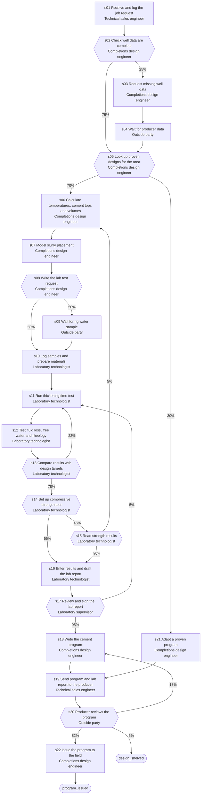

# Design cement slurries and run lab tests

`ofs-te-cement-slurry-design-and-lab-testing` · oil and gas services (pressure pumping) · technical services (engineering and laboratory) · part of `oilfield-services-co`

Each casing string needs a cement slurry that stays pumpable long enough to be placed at the well's temperature and pressure, then sets hard enough to seal the well and meet the AER's strength rule. A technical sales engineer takes the producer's request, a cement engineer works out temperatures, cement tops and volumes and models placement, and laboratory technologists mix the proposed blend with the rig's water and test thickening time, fluid loss, free water, rheology and compressive strength before a lab supervisor signs the report and the engineer issues the cement program. The work is rushed because rigs give one to three days' notice, well data such as the caliper log arrive late, tests run overnight on a limited number of consistometers, and about one design in five needs its retarder adjusted and the test rerun.

| | |
|---|---|
| Unit of work | one cement design (one casing string for one well or a repeat design for a pad) |
| Starts when | A producer or the district sends a job request with well data for an upcoming intermediate, production or liner cement job, or a surface job in a new area. |
| Done when | A lab-approved cement program and slurry design issued to the field and bulk plant and the lab report sent to the producer; or the design shelved because the job was cancelled or lost. |
| Organisation | A Canadian pressure pumping company running about 16 cementing units from Alberta and northeast BC district bases with bulk blending plants, plus a Calgary cement and fluids laboratory and engineering office. (1,350 employees, 2019-2022) |
| Volume | 250 cases a month (range 150 to 340) |

## Where it sits

- Starts with **job_request** from fo-dist-job-call-intake-and-dispatch (75% of cases)
- Starts with **technical_request** from producer (25% of cases)
- Relies on **product_spec** from te-product-development (a standing input; it does not start a case)
- Sends **slurry_design** to fo-cem-bulk-blending-and-delivery (outcome: program_issued)
- Sends **cement_program** to fo-cem-job-execution (outcome: program_issued)
- Sends **lab_report** to producer (outcome: program_issued)

## Flow

## Roles

| Role | Department | Layer | FTE on this process | Loaded cost per hour | Evidence |
|---|---|---|---:|---:|---|
| Technical sales engineer | Technical services and engineering | senior specialist | 1.2 | 95 CAD | C |
| Completions design engineer | Technical services and engineering | senior specialist | 7 | 90 CAD | C |
| Laboratory technologist | Technical services and engineering | individual contributor | 11 | 48 CAD | B [src5] |
| Laboratory supervisor | Technical services and engineering | supervisor | 1 | 74 CAD | C |

## Steps

Hands-on time and the wait before each step show the most common value. Evidence tier A is a sourced number, B a sourced description, C the author's estimate.

| Step | Who | Kind | Hands-on | Wait before | Control | Evidence |
|---|---|---|---:|---:|---|---|
| **s01 Receive and log the job request.** The technical sales engineer receives the request by email or phone from the producer's drilling engineer or the district, enters the well, casing string, expected job date and rig in the design tracker, and forwards it to the cement engineer for the area. | Technical sales engineer | intake | 20 min | 1.0 h |  | C |
| **s02 Check well data are complete.** The cement engineer checks the request for depths, hole and casing sizes, bottom-hole temperature, mud type and weight, required cement top, water source and any lost-circulation history, and lists what is missing. | Completions design engineer | validation | 15 min | 2.0 h |  | C |
| **s03 Request missing well data.** The engineer emails or phones the producer's drilling engineer for the missing items, most often the bottom-hole temperature, the expected caliper or the water source. | Completions design engineer | communication | 15 min | 30 min |  | C |
| **s04 Wait for producer data.** The producer gathers the data from its drilling team or the rig and sends them back; the caliper log only exists once the hole is logged, often a day before the job. | Outside party | external wait | 0 min | 12.0 h |  | C |
| **s05 Look up proven designs for the area.** The engineer searches the lab database and past programs for slurries already tested at similar depth and temperature for the same producer and formation, and decides whether one can be reused with only a field blend check. | Completions design engineer | lookup | 20 min | 30 min |  | C |
| **s06 Calculate temperatures, cement tops and volumes.** The engineer works out circulating and static temperatures, takes the required cement top from the AER township figure or the licence, calculates slurry volumes from hole size with the required excess, and sets the strength target at the uppermost hydrocarbon zone. | Completions design engineer | analysis | 1.2 h | 2.0 h | AER Directive 009 items 9-12 and 24: required cement top, caliper volume plus at least 20% excess, 3,500 kPa in 48 hours at the uppermost hydrocarbon zone temperature (4.4 C surface, 2.7 C/100 m when unknown) | A [src1] |
| **s07 Model slurry placement.** The engineer runs the placement simulator with the proposed spacer, lead and tail slurries and pump rates to check equivalent circulating density against fracture pressure, mud removal and the job time the slurry must cover. | Completions design engineer | analysis | 1.0 h | 0 min |  | B [src2] |
| **s08 Write the lab test request.** The engineer enters the recipe, test temperature and pressure schedule, thickening time window, fluid loss and strength targets in the lab database, and says whether a water sample from the rig is needed. | Completions design engineer | data entry | 20 min | 0 min |  | C |
| **s09 Wait for rig water sample.** The rig or a district truck sends a jug of the mix water to the lab by courier or hot-shot; samples from remote leases can take a day or more to arrive. | Outside party | external wait | 0 min | 12.0 h |  | C |
| **s10 Log samples and prepare materials.** A laboratory technologist logs the request and samples, draws cement of the right class and lot and the additives from lab stock, weighs them for the test batch and analyses the water if it is new. | Laboratory technologist | intake | 30 min | 4.0 h |  | C |
| **s11 Run thickening time test.** The technologist mixes the slurry in the lab blender, loads it in the high-pressure consistometer, runs the temperature and pressure schedule and watches until the slurry reaches the end point, usually 70 Bearden units. | Laboratory technologist | physical | 1.2 h | 2.0 h |  | B [src5] |
| **s12 Test fluid loss, free water and rheology.** While the consistometer runs, the technologist conditions further batches and runs the fluid loss test for 30 minutes, sets up the two-hour free water test in a cylinder and reads rheology on the viscometer. | Laboratory technologist | physical | 1.5 h | 0 min |  | B [src5] |
| **s13 Compare results with design targets.** The technologist compares thickening time with the job time plus safety margin and checks fluid loss, free water and rheology against the targets; if thickening time is off, they adjust retarder or accelerator and rerun. | Laboratory technologist | analysis | 20 min | 0 min |  | C |
| **s14 Set up compressive strength test.** The technologist pours cubes for a crush test or loads the ultrasonic cement analyser at the strength-test temperature; when a tested system already covers the condition or the rig is calling, strength results from the library are used. | Laboratory technologist | physical | 20 min | 0 min |  | B [src5] |
| **s15 Read strength results.** After the cure the technologist reads the strength curve or crushes the cubes and checks the slurry reaches the 3,500 kPa requirement within 48 hours at the zone temperature and the producer's own wait-on-cement target. | Laboratory technologist | validation | 20 min | 18.0 h | AER Directive 009 item 11: at least 3,500 kPa after 48 hours at the temperature of the uppermost hydrocarbon-bearing zone when fillers are used | A [src1], [src5] |
| **s16 Enter results and draft the lab report.** The technologist enters all results in the lab database, attaches the consistometer chart and strength curve, and generates the lab report with the final recipe and test conditions. | Laboratory technologist | drafting | 25 min | 30 min |  | C |
| **s17 Review and sign the lab report.** The lab supervisor checks the test schedule matches the well, the charts support the reported values and the recipe matches what was tested, then signs the report or sends it back for a retest. | Laboratory supervisor | review | 20 min | 2.0 h | Company laboratory quality procedure: second-person review and sign-off of every cement lab report | C |
| **s18 Write the cement program.** The engineer writes the cement program: pump schedule, spacer and slurry volumes and densities, displacement, expected pressures, cement tops and the blend sheet for the bulk plant, using the signed lab results. | Completions design engineer | drafting | 1.0 h | 1.0 h |  | B [src2] |
| **s19 Send program and lab report to the producer.** The technical sales engineer emails the program, lab report and price estimate to the producer's drilling engineer and follows up by phone when the job is close. | Technical sales engineer | communication | 15 min | 30 min |  | C |
| **s20 Producer reviews the program.** The producer's drilling engineer reviews volumes, cement tops and slurry choice against its own well plan and approves, asks for changes, or cancels when the well is deferred or awarded elsewhere. | Outside party | external wait | 0 min | 6.0 h |  | C |
| **s21 Adapt a proven program.** For a reusable design the engineer copies the earlier program, updates depths, volumes, temperatures and cement tops for this well, and checks the tested thickening time still covers the job time. | Completions design engineer | drafting | 45 min | 1.0 h |  | C |
| **s22 Issue the program to the field.** The engineer issues the approved program to the district cementing supervisor and dispatch and the slurry design and blend sheet to the bulk plant, and files them with the lab report. | Completions design engineer | communication | 15 min | 0 min |  | C |

## Exceptions

| Exception | Share of cases | What happens |
|---|---:|---|
| Well data missing | 25% | Temperature, caliper or water source missing and requested from the producer. |
| Proven design reused | 30% | A design already tested for the area is adapted without new pilot tests; the field blend check in the bulk plant process still applies. |
| Thickening time off target | 22% | Retarder or accelerator adjusted and the thickening time test rerun, often overnight. |
| Strength too low | 2% | The slurry misses the strength requirement and is redesigned. |
| Producer changes | 13% | The producer asks for different volumes, cement tops or slurry and the program is rewritten. |

## Benchmarks

| Metric | Value | Unit | Population | Evidence |
|---|---|---|---|---|
| cycle_time_days | p50 2.5, p90 5.0 | calendar days from job request to program issued | WCSB intermediate and production cement designs, 2019-2022 | C |
| thickening_time_test_duration | low 4, mode 6, high 10 | hours of consistometer time per test | Lab pilot tests | C [src5] |
| minimum_compressive_strength | 3500 | kPa after 48 hours at uppermost hydrocarbon zone temperature | Alberta production and intermediate casing slurries with fillers | A [src1] |

## Pain points

- Short notice from rigs pushes tests into overnight runs and leaves little time for a retest when thickening time misses. (steps s11, s13; C)
- Lab-mixed slurries behave differently from field-mixed slurries, so pilot results do not always predict the job. (steps s11, s12; B [src4])
- Well data and rig water samples arrive late, delaying the start of testing. (steps s04, s09; C)
- Recipes are typed into the lab database, the program and the blend sheet separately. (steps s08, s16, s18; C)

## Assumptions

- Loaded hourly costs and headcounts are taken from the organisation file (wage x 1.35).
- The organisation file has no cement engineer role; the design-engineer role (completions design engineer) is used for the cement engineers who design slurries and write programs, about 7 of the 16.
- A quarter of requests come directly from the producer's drilling engineer rather than through dispatch; this producer link is not in the organisation file.
- Compressive strength results take about a day; when the rig is ready the program is issued on library strength data and the fresh result follows, so only 45% of designs wait for a fresh strength result.
- The field blend confirmation test is counted in the bulk blending and delivery process, not here.
- The share of thickening time retests (22%) is an estimate; a figure of about 25% repeat testing appears in industry literature that was not opened, so it is not cited.
- The organisation file models the laboratory as three facilities; a single test ties up an instrument, not a lab, so consistometers (count 10) and strength analysers (count 8) are added as resources the organisation file lacks; counts are estimates.
- The simulated median is compared with a tier C benchmark only.

## Sources

- [src1] [Directive 009: Casing Cementing Minimum Requirements (edition of May 14, 2025)](https://static.aer.ca/prd/documents/directives/Directive009.pdf) (Alberta Energy Regulator, 2025). Licensee is responsible for satisfactory cementing. Surface casing cemented full length; if returns are not obtained or the annular level drops, the cement top must be determined and the AER contacted about remedial action (items 4-5). Surface casing centralized top, bottom and every 50 m (item 7). Production and intermediate cement volume from caliper log plus at least 20% excess (item 10). Fillers allowed only if compressive strength is at least 3,500 kPa after 48 hours at the temperature of the uppermost hydrocarbon zone, using 4.4 C surface and 2.7 C/100 m where unknown (items 11-12). Flow returns visually monitored during cementing; cement-top log and remedial program to the AER within 60 days of rig release when returns are missing (item 15). Full details recorded on tour reports or a casing cement report (item 16). Required cement tops by township from figure 1 (items 9, 24). The 2025 edition only adds brine-hosted minerals to the 2022 edition; the same requirements applied in 2019-2022.
- [src2] [Cementing](https://tricanwellservice.com/cementing/) (Trican Well Service Ltd., None). Cement programs prepared by engineers using simulation software for slurry placement, sheath integrity, wellbore properties and temperature; pre-flushes and spacers; surface, intermediate, production, liner, horizontal, plug, remedial and squeeze cementing; lost-circulation blends for the WCSB; R&D facilities and operational support laboratories with lab technicians.
- [src3] [Management's Discussion and Analysis for the year ended December 31, 2022](https://tricanwellservice.com/app/uploads/2023/02/TCW-Q4-2022-MDA-2023.02.22.pdf) (Trican Well Service Ltd., 2023). Cementing activity tracks the WCSB rig count (201 rigs in Q4 2022, 176 in Q4 2021); 17 cementing units operated in Q4 2022; annual average of 16 cementing units in the field in 2021 and 2022; cementing about 16-19% of revenue; 1,335,000 tonnes of proppant pumped in 2022 and 1,364,000 in 2021; oilfield cement and proppant sourced from suppliers in Canada and the United States.
- [src4] [Shear rate has greater influence on cement slurry properties than total mixing energy](https://www.ogj.com/home/article/17234341/shear-rate-has-greater-influence-on-cement-slurry-properties-than-total-mixing-energy) (Oil & Gas Journal (Paul Padgett, Halliburton Energy Services), 1996). Bulk-blend samples taken from the conveying line during blending and mixed in the lab with the actual mixing water under the API procedure; field mixing equipment runs at lower shear than lab blenders, so field slurry properties (free water especially) often differ from lab values; thickening time and fluid loss changed only slightly with mixing energy.
- [src5] [Oil Well Cement Testing Simple Guide](https://www.drillingmanual.com/oil-well-cement-testing-simple-guide/) (Drilling Manual, None). Thickening time in an HPHT consistometer (70 Bc end point, some operators 50 Bc); crush tests on moulded cubes after 8, 16 or 24 hours; ultrasonic cement analyser runs usually about 24 hours; fluid loss collected for 30 minutes at circulating temperature; free water test stands about two hours; rheology on a Fann viscometer for displacement and ECD modelling.

Written by claude-opus on 2026-11-24.
