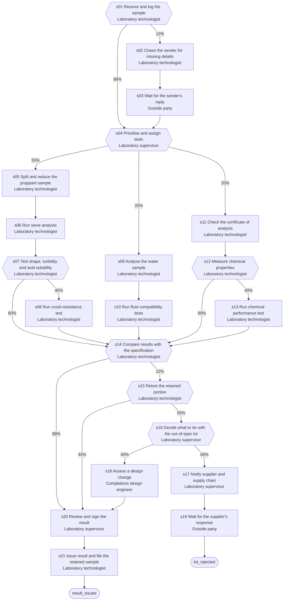

# Test fluids, chemicals and proppant

`ofs-te-fluid-and-proppant-quality-testing` · oil and gas services (pressure pumping) · technical services (laboratory) · part of `oilfield-services-co`

A fracturing job depends on sand of the right size and strength, chemicals that perform as specified, and water that does not break down the fluid system. The laboratory receives samples of frac sand from transload terminals and suppliers, batches of friction reducer, gel and other chemicals from suppliers or the company's blending plant, and water samples from producers, and tests them against specifications: sieve analysis, shape, turbidity and crush tests for sand, certificate checks and property and performance tests for chemicals, and analysis and compatibility tests for water. Results go back to supply chain and the frac design engineers. The work is slowed by samples that arrive without lot or railcar details, by a queue behind urgent cement tests, and by out-of-spec results that need a retest, a supervisor's decision and a conversation with the supplier or a change to the fluid design.

| | |
|---|---|
| Unit of work | one quality sample (a sand lot or railcar sample, a chemical batch or a water sample) |
| Starts when | A sample arrives at the lab from a sand supplier or transload terminal, the chemical blending plant or a supplier, or a producer's water source, with a request for quality testing. |
| Done when | Test results are issued to the requester and the retained sample filed; or an out-of-spec lot is rejected and the supplier and supply chain are notified, or the frac design is changed. |
| Organisation | A Canadian pressure pumping company running about 16 cementing units from Alberta and northeast BC district bases with bulk blending plants, plus a Calgary cement and fluids laboratory and engineering office. (1,350 employees, 2019-2022) |
| Volume | 150 cases a month (range 80 to 220) |

## Where it sits

- Starts with **qc_sample** from sc-proppant-procurement-and-rail-logistics (55% of cases)
- Starts with **qc_sample** from producer (25% of cases)
- Starts with **qc_sample** from sc-chemical-procurement-and-blending (20% of cases)
- Sends **qc_result** to te-frac-treatment-design (outcome: any)
- Sends **qc_result** to sc-proppant-procurement-and-rail-logistics (outcome: any)
- Sends **qc_result** to sand-supplier (outcome: lot_rejected)
- Sends **qc_result** to sc-chemical-procurement-and-blending (outcome: lot_rejected)

## Flow

## Roles

| Role | Department | Layer | FTE on this process | Loaded cost per hour | Evidence |
|---|---|---|---:|---:|---|
| Laboratory technologist | Technical services and engineering | individual contributor | 3.5 | 48 CAD | B [src6] |
| Laboratory supervisor | Technical services and engineering | supervisor | 0.6 | 74 CAD | C |
| Completions design engineer | Technical services and engineering | senior specialist | 0.2 | 90 CAD | C |

## Steps

Hands-on time and the wait before each step show the most common value. Evidence tier A is a sourced number, B a sourced description, C the author's estimate.

| Step | Who | Kind | Hands-on | Wait before | Control | Evidence |
|---|---|---|---:|---:|---|---|
| **s01 Receive and log the sample.** A laboratory technologist unpacks the sample, checks the label against the request (supplier, lot or railcar number, product, mesh size or water source), photographs it and logs it in the lab database with a sample number. | Laboratory technologist | intake | 15 min | 2.0 h |  | C |
| **s02 Chase the sender for missing details.** The technologist emails or phones the logistics coordinator, terminal or producer for the missing lot or railcar number, certificate of analysis or water source location. | Laboratory technologist | communication | 15 min | 30 min |  | C |
| **s03 Wait for the sender's reply.** The sender looks up the shipment in the railcar tracking portal, the supplier's paperwork or its field records and replies, sometimes only after a reminder. | Outside party | external wait | 0 min | 8.0 h |  | C |
| **s04 Prioritise and assign tests.** The lab supervisor sets the priority against urgent cement and frac design work, chooses the test set for the sample type and specification, and assigns it to a technologist in the work list. | Laboratory supervisor | judgment | 10 min | 4.0 h |  | C |
| **s05 Split and reduce the proppant sample.** The technologist reduces the bulk sample with a sample reducer and splitter to test portions, and seals a retained portion with the sample number for storage. | Laboratory technologist | physical | 20 min | 1.0 h |  | B [src6] |
| **s06 Run sieve analysis.** The technologist weighs a test portion onto a stack of calibrated sieves, shakes it on the sieve shaker, weighs what is retained on each sieve and calculates the share within the designated mesh range. | Laboratory technologist | physical | 45 min | 0 min | ISO 13503-2 test procedures agreed between the company and its sand suppliers | B [src6] |
| **s07 Test shape, turbidity and acid solubility.** The technologist estimates sphericity and roundness under the microscope against the standard chart, measures turbidity of a washed portion, and runs acid solubility when the specification calls for it. | Laboratory technologist | physical | 1.0 h | 0 min |  | B [src6] |
| **s08 Run crush-resistance test.** The technologist loads a sieved portion into the crush cell, applies the stress level for the product class in the load frame, then sieves out and weighs the fines generated. | Laboratory technologist | physical | 1.0 h | 1.0 h |  | B [src6] |
| **s09 Analyse the water sample.** The technologist measures pH, specific gravity, chlorides, hardness, iron, sulphate and bacteria on the producer's water sample, comparing it with the limits for the planned fluid system. | Laboratory technologist | physical | 1.0 h | 1.0 h |  | C |
| **s10 Run fluid compatibility tests.** The technologist mixes the water with the planned friction reducer or gel and crosslinker at field loadings, runs the friction loop or rheometer test and checks for scale or precipitates. | Laboratory technologist | physical | 1.5 h | 1.0 h |  | C |
| **s11 Check the certificate of analysis.** The technologist compares the supplier's or blending plant's certificate of analysis for the chemical batch with the product specification: active content, specific gravity, pH and appearance. | Laboratory technologist | validation | 15 min | 30 min |  | C |
| **s12 Measure chemical properties.** The technologist measures specific gravity, pH and viscosity of the batch and compares them with the certificate and the previous batches. | Laboratory technologist | physical | 30 min | 0 min |  | C |
| **s13 Run chemical performance test.** For a new product, a new supplier or a periodic check, the technologist tests performance in a standard water, for example friction reduction in the flow loop or crosslink and break time for a gel. | Laboratory technologist | physical | 1.2 h | 1.0 h |  | C |
| **s14 Compare results with the specification.** The technologist enters all results in the lab database, compares them with the specification and with the supplier's certificate, and flags any value outside limits. | Laboratory technologist | analysis | 20 min | 0 min |  | C |
| **s15 Retest the retained portion.** The technologist repeats the failed test on a fresh split from the retained portion to rule out a sampling or test error before the result is reported. | Laboratory technologist | physical | 1.0 h | 2.0 h |  | B [src6] |
| **s16 Decide what to do with the out-of-spec lot.** The lab supervisor reviews the confirmed result with supply chain and decides whether to reject the lot, accept it with a deviation for less critical stages, or ask frac engineering whether the design can use it. | Laboratory supervisor | judgment | 30 min | 2.0 h |  | C |
| **s17 Notify supplier and supply chain.** The lab supervisor sends the results to the supplier and the logistics or procurement coordinator, asks for the lot to be held or replaced, and records the non-conformance. | Laboratory supervisor | communication | 30 min | 30 min |  | C |
| **s18 Assess a design change.** A frac design engineer reviews the out-of-spec water or chemical result, decides whether chemical loadings, friction reducer type or proppant mesh can change, and records the decision for the affected pads. | Completions design engineer | analysis | 1.0 h | 4.0 h |  | C |
| **s19 Wait for the supplier's response.** The supplier reviews its own test records and retained sample for the lot and agrees to replace it, credits it or disputes the result. | Outside party | external wait | 0 min | 2.0 d |  | B [src6] |
| **s20 Review and sign the result.** The lab supervisor checks that the right tests were run, the values match the instrument records and the pass or fail call is right, then signs the result in the lab database. | Laboratory supervisor | review | 10 min | 2.0 h | Company laboratory quality procedure: supervisor sign-off of quality results | C |
| **s21 Issue result and file the retained sample.** The technologist emails the signed result to the requester and the frac design engineers, updates the supplier quality tracker and stores the retained sample with its number. | Laboratory technologist | communication | 15 min | 30 min |  | C |

## Exceptions

| Exception | Share of cases | What happens |
|---|---:|---|
| Sample details missing | 12% | No lot, railcar or product details, so the lab chases the sender. |
| Out of specification confirmed, lot rejected | 4% | The retest confirms the failure and the supplier is asked to replace or credit the lot. |
| Out of specification, design change | 3% | Frac engineering changes the fluid design or accepts a deviation. |
| Passes on retest | 5% | The first result was a sampling or test error. |

## Benchmarks

| Metric | Value | Unit | Population | Evidence |
|---|---|---|---|---|
| cycle_time_days | p50 1.5, p90 3.0 | calendar days from sample received to result issued | Oilfield service company quality samples, 2019-2022 | C |
| supplier_sampling_frequency | 9000 | kg of frac proppant per sample, at least | Proppant suppliers following ISO 13503-2 | A [src6] |

## Pain points

- Quality samples queue behind urgent cement tests for rigs, so sand and chemical results come back days after the material has been used. (steps s04; C)
- Samples arrive without lot or railcar details, so results cannot be tied to a shipment until the sender replies. (steps s01, s02, s03; C)
- Field sampling rarely matches the supplier's continuous sampling, so out-of-spec results are disputed. (steps s15, s16, s19; B [src6])

## Assumptions

- Loaded hourly costs and headcounts are taken from the organisation file (wage x 1.35).
- Sample mix is 55% proppant, 25% producer water and 20% chemical batches; the split is an estimate.
- Lab instruments that a test ties up (crush press, friction loop) are added as resources the organisation file lacks; counts are estimates.
- Results for rejected chemical lots go back to chemical procurement and blending; this link is not in the organisation file's process_map entry.
- The design engineer takes part for out-of-spec results but is not listed among the process_map roles.
- Water compatibility tests ordered for a specific pad design are counted in the frac treatment design workflow; samples here are routine or producer-submitted checks.

## Sources

- [src3] [Management's Discussion and Analysis for the year ended December 31, 2022](https://tricanwellservice.com/app/uploads/2023/02/TCW-Q4-2022-MDA-2023.02.22.pdf) (Trican Well Service Ltd., 2023). Cementing activity tracks the WCSB rig count (201 rigs in Q4 2022, 176 in Q4 2021); 17 cementing units operated in Q4 2022; annual average of 16 cementing units in the field in 2021 and 2022; cementing about 16-19% of revenue; 1,335,000 tonnes of proppant pumped in 2022 and 1,364,000 in 2021; oilfield cement and proppant sourced from suppliers in Canada and the United States.
- [src6] [ISO 13503-2:2006 Petroleum and natural gas industries - Completion fluids and materials - Part 2: Measurement of properties of proppants used in hydraulic fracturing and gravel-packing operations (preview pages)](https://cdn.standards.iteh.ai/samples/36976/5da26fdc25b84e18b96a7f1d627b3bf8/ISO-13503-2-2006.pdf) (International Organization for Standardization (preview hosted by iTeh Standards), 2006). Standard procedures for sampling and testing proppants: sieve analysis, sphericity and roundness, acid solubility, turbidity, bulk and apparent density, crush resistance, loss on ignition of resin-coated proppant. Samples taken from a flowing stream, never a static pile; for frac proppant at least one sample per 9,000 kg, at most 10 samples per bulk container combined; reduction with a sample reducer and splitter; supplier keeps test records at least one year and retained samples of at least 0.25 kg for six months; supplier and customer agree sampling methods.

Written by claude-opus on 2026-11-24.
