# Design fracturing treatments

`ofs-te-frac-treatment-design` · oil and gas services (pressure pumping) · technical services (engineering) · part of `oilfield-services-co`

Completions design engineers turn a producer's completion program for a pad into a stage-by-stage pump schedule: how much water, which fluid system and chemical loadings, how much sand of which mesh at which concentrations, at what rate and with what expected surface pressure. A technical sales engineer manages the request and the producer, a data analyst pulls offset well results, and the laboratory tests the producer's water against the chemical package. The work is slow because well data arrive incomplete, lab samples take days to reach Calgary, and producers send designs back for changes to tonnage, stage spacing or fluid choice, sometimes after the pad is already scheduled.

| | |
|---|---|
| Unit of work | one pad design (pump schedules for all wells on a pad) |
| Starts when | A producer sends a completion program for a pad, either for an awarded pad under a master service agreement or as part of a tender. |
| Done when | A producer-approved design issued to frac operations, the treater and supply chain, or a tender design returned that the producer did not award. |
| Organisation | A Canadian pressure pumping company with six to eight crewed frac fleets working multi-well pads in Alberta and northeast BC from district bases, with a Calgary engineering and sales office. (1,350 employees, 2019-2022) |
| Volume | 25 cases a month (range 12 to 40) |

## Where it sits

- Starts with **pad_program** from producer (100% of cases)
- Relies on **qc_result** from te-fluid-and-proppant-quality-testing (a standing input; it does not start a case)
- Relies on **technical_report** from te-job-data-analysis-and-customer-reporting (a standing input; it does not start a case)
- Relies on **product_spec** from te-product-development (a standing input; it does not start a case)
- Relies on **regulatory_update** from lg-regulatory-compliance-monitoring (a standing input; it does not start a case)
- Sends **frac_design** to cs-tender-response (outcome: any)
- Sends **frac_design** to fo-frac-program-planning (outcome: design_issued)
- Sends **frac_design** to fo-frac-job-execution (outcome: design_issued)

## Flow

```mermaid
flowchart TD
    s01{{"s01 Receive completion program<br/>Technical sales engineer"}}
    s02["s02 Request missing well data<br/>Technical sales engineer"]
    s03["s03 Wait for producer data<br/>Outside party"]
    s04["s04 Assign engineer and set design basis<br/>Completions design engineer"]
    s05["s05 Pull offset well results<br/>Completions data analyst"]
    s06{{"s06 Request water sample and lab tests<br/>Completions design engineer"}}
    s07["s07 Run water compatibility tests<br/>Laboratory technologist"]
    s08["s08 Build the model and pump schedule<br/>Completions design engineer"]
    s09["s09 Select chemicals and loadings<br/>Completions design engineer"]
    s10["s10 Check pressure limits and offset risk<br/>Completions design engineer"]
    s11{{"s11 Peer review the design<br/>Completions design engineer"}}
    s12["s12 Estimate job cost<br/>Technical sales engineer"]
    s13["s13 Draft the design proposal<br/>Completions design engineer"]
    s14["s14 Send design to producer<br/>Technical sales engineer"]
    s15{{"s15 Wait for producer review<br/>Outside party"}}
    s16{{"s16 Revise design for producer comments<br/>Completions design engineer"}}
    s17["s17 Finalize and issue approved design<br/>Completions design engineer"]
    s18["s18 Prepare treater job plan and acquisition file<br/>Completions design engineer"]
    s19{{"s19 Hold technical handover with treater<br/>Completions design engineer"}}
    s20["s20 Wait for producer's late change<br/>Outside party"]
    s21["s21 Revise for the late change<br/>Completions design engineer"]
    s22["s22 Reissue revised design<br/>Completions design engineer"]
    s01 -->|"65%"| s04
    s01 -->|"35%"| s02
    s02 --> s03
    s03 --> s04
    s04 --> s05
    s05 --> s06
    s06 -->|"45%"| s07
    s06 -->|"55%"| s08
    s07 --> s08
    s08 --> s09
    s09 --> s10
    s10 --> s11
    s11 -->|"82%"| s12
    s11 -->|"18%"| s08
    s12 --> s13
    s13 --> s14
    s14 --> s15
    s15 -->|"55%"| s17
    s15 -->|"33%"| s16
    s15 -->|"12%"| end0
    s16 -->|"80%"| s14
    s16 -->|"20%"| s08
    s17 --> s18
    s18 --> s19
    s19 -->|"75%"| end1
    s19 -->|"25%"| s20
    s20 --> s21
    s21 --> s22
    s22 --> end1
    end0(["not_used"])
    end1(["design_issued"])
```

## Roles

| Role | Department | Layer | FTE on this process | Loaded cost per hour | Evidence |
|---|---|---|---:|---:|---|
| Technical sales engineer | Technical services and engineering | senior specialist | 2.5 | 95 CAD | C |
| Completions design engineer | Technical services and engineering | senior specialist | 6.5 | 90 CAD | C |
| Completions data analyst | Technical services and engineering | individual contributor | 1 | 62 CAD | C |
| Laboratory technologist | Technical services and engineering | individual contributor | 1.2 | 48 CAD | C |

## Steps

Hands-on time and the wait before each step show the most common value. Evidence tier A is a sourced number, B a sourced description, C the author's estimate.

| Step | Who | Kind | Hands-on | Wait before | Control | Evidence |
|---|---|---|---:|---:|---|---|
| **s01 Receive completion program.** The technical sales engineer receives the producer's completion program: well surveys, casing and wellhead ratings, completion type (plug and perf or sleeves), stage count and spacing, target tonnage per stage and fluid preference. The engineer logs it in the design tracker and checks whether anything needed for design is missing. | Technical sales engineer | intake | 1.0 h | 0 min |  | C |
| **s02 Request missing well data.** The technical sales engineer emails the producer's completions engineer for the missing items, typically casing grade and weight, wellhead pressure rating, log data or the water source for the pad. | Technical sales engineer | communication | 20 min | 1.0 h |  | C |
| **s03 Wait for producer data.** The producer gathers the requested surveys, casing tallies or log files from its drilling and geology teams and sends them back. | Outside party | external wait | 0 min | 2.0 d |  | C |
| **s04 Assign engineer and set design basis.** The lead design engineer assigns the pad to an engineer by area and workload and sets the design basis with them: the formation, the producer's previous designs, which offsets to study and the target treatment size. | Completions design engineer | judgment | 30 min | 1.0 d |  | C |
| **s05 Pull offset well results.** The completions data analyst queries the company's job database and public well data for offset wells in the same formation and area, extracts treating pressures, rates, tonnage per stage, screen-outs and public chemical disclosures, and builds an offset table for the engineer. | Completions data analyst | lookup | 3.0 h | 12.0 h |  | B [src1] |
| **s06 Request water sample and lab tests.** If the pad uses a new water source or recycled produced water, the design engineer asks the producer to ship a water sample and writes a lab request for friction reducer performance, crosslink or viscosity tests and scale tendency with the proposed chemical package. | Completions design engineer | coordination | 30 min | 1.0 h |  | C |
| **s07 Run water compatibility tests.** When the sample arrives a laboratory technologist runs water analysis, friction loop or viscosity tests with candidate friction reducers or gels at the planned loadings, checks for scale and bacteria issues, and records results in the lab database. | Laboratory technologist | physical | 5.0 h | 2.0 d |  | B [src1] |
| **s08 Build the model and pump schedule.** The engineer enters well geometry, rock properties from logs and offsets, perforation clusters and fluid properties into fracture modelling software, runs stage designs and settles water volume, pumping rate, proppant ramp by concentration, pad and flush volumes and predicted surface pressure for each stage. | Completions design engineer | analysis | 8.0 h | 4.0 h |  | B [src1] |
| **s09 Select chemicals and loadings.** Using lab results or past jobs on the same water, the engineer picks the friction reducer or gel system, breaker, biocide, scale inhibitor, surfactant and clay control, sets loadings per cubic metre and checks products for compatibility and the producer's approved product list. | Completions design engineer | judgment | 2.0 h | 0 min |  | B [src1] |
| **s10 Check pressure limits and offset risk.** The engineer compares the maximum predicted treating pressure with casing burst, wellhead and frac tree ratings using the company safety factor, and lists offset wells the producer has flagged for interwellbore communication risk so the producer can plan monitoring or shut-ins. | Completions design engineer | validation | 1.5 h | 0 min | AER Directive 083 (licensee duty to manage wellbore integrity and offset well risk, with service company input) and IRP 24 fracture stimulation hazard management | B [src9], [src10] |
| **s11 Peer review the design.** A senior design engineer checks the model inputs, pump schedule totals, chemical loadings and pressure check against offsets and the producer's past results, and either signs off or returns specific corrections. | Completions design engineer | review | 1.5 h | 12.0 h | Company engineering peer review before a design leaves the office | C |
| **s12 Estimate job cost.** The technical sales engineer prices the design from the customer's price book: pumping charges by stage or hour, horsepower, proppant by tonne, chemicals by litre, fuel and mobilization, and checks the total against the producer's budget expectations. | Technical sales engineer | analysis | 2.0 h | 4.0 h |  | C |
| **s13 Draft the design proposal.** The engineer assembles the proposal: pump schedule tables per stage, fluid and chemical program, predicted pressures and horsepower requirement, material totals per well and pad, and the offset comparison, in the standard Word and Excel template. | Completions design engineer | drafting | 2.0 h | 2.0 h |  | C |
| **s14 Send design to producer.** The technical sales engineer reviews the package for commercial wording, sends it to the producer's completions engineer and sets up a review call if the design departs from the producer's program. | Technical sales engineer | communication | 40 min | 2.0 h |  | C |
| **s15 Wait for producer review.** The producer's completions team reviews the design, often comparing it with other pumpers' proposals, and accepts it, asks for changes to tonnage, stage spacing, fluid or rate, or, for tender designs, awards the work elsewhere. | Outside party | external wait | 0 min | 3.0 d |  | C |
| **s16 Revise design for producer comments.** The engineer reruns the affected stages with the requested changes, updates totals, pressures and the chemical program, and returns the revision with a short note of what changed. | Completions design engineer | analysis | 4.0 h | 12.0 h |  | C |
| **s17 Finalize and issue approved design.** The engineer locks the approved revision in the document store, records the version, and issues it to frac operations planning, the field supervisor and treater, and supply chain for material totals. | Completions design engineer | data entry | 30 min | 2.0 h |  | C |
| **s18 Prepare treater job plan and acquisition file.** The engineer exports the pump schedule into the data van's job template and writes the treater's job plan: stage sequence, rate and concentration steps, pressure limits and kickout settings, and what to do on a pressure spike or screen-out. | Completions design engineer | drafting | 1.5 h | 4.0 h |  | C |
| **s19 Hold technical handover with treater.** The engineer walks the treater and field supervisor through the design and job plan by phone or video call, answers questions about expected pressures and diversion, and notes any field concerns. | Completions design engineer | communication | 45 min | 12.0 h |  | C |
| **s20 Wait for producer's late change.** Close to or during the job the producer changes stage count, tonnage or fluid after reviewing new drilling results or offset performance, and sends the change by email. | Outside party | external wait | 0 min | 12.0 h |  | C [src2] |
| **s21 Revise for the late change.** The engineer reruns the affected stages in the modelling software, checks the new maximum pressure against casing and wellhead limits again, and updates material totals and the treater job plan. | Completions design engineer | analysis | 2.0 h | 2.0 h |  | C |
| **s22 Reissue revised design.** The engineer issues the new revision with a change note to operations, the treater and supply chain, and asks the coordinator to adjust material orders. | Completions design engineer | communication | 30 min | 0 min |  | C |

## Exceptions

| Exception | Share of cases | What happens |
|---|---:|---|
| Incomplete well data | 35% | Casing, wellhead or survey data missing from the program and requested from the producer. |
| New water source | 45% | Lab compatibility testing on a shipped water sample before chemicals are chosen. |
| Producer changes | 33% | Producer asks for different tonnage, spacing or fluid; one or more revision rounds. |
| Late change near the job | 19% | Producer changes the design after it was issued, sometimes after rig-up. |
| Tender design not used | 12% | Design prepared for a tender that the company did not win, or a pad the producer dropped. |

## Benchmarks

| Metric | Value | Unit | Population | Evidence |
|---|---|---|---|---|
| cycle_time_days | p50 14, p90 30 | days from completion program received to approved design issued and handed over to the treater | WCSB multi-well pad designs, 2019-2022 | C |

## Pain points

- Producer review cycles and late changes force reruns and reissues, and the change must then be chased into material orders and the treater's plan. (steps s15, s16, s20, s21, s22; C [src2])
- Water samples travel by courier to the Calgary lab, adding days before chemicals can be confirmed. (steps s06, s07; B [src1])
- Offset data are pulled by hand from several databases into spreadsheets for each design. (steps s05; C)

## Assumptions

- Loaded hourly costs are taken from the organisation file.
- All cases start from a producer's completion program; about 30 percent are tender designs that pass through the tender response team, which the organisation file does not link to this process.
- Offset well identification for Directive 083 is the licensee's duty; the service company's step is to check pressure limits and flag offsets the producer lists.
- The completions data analyst and laboratory technologist are organisation file roles that the process_map entry does not list.
- Lab tests are counted here only when a new water source needs them; routine proppant and chemical quality testing is a separate process.

## Sources

- [src1] [Trican - Hydraulic fracturing](https://tricanwellservice.com/fracturing/) (Trican Well Service Ltd., 2026). Engineering team works with customers on program design, MiniFrac analysis, pore and closure pressure; fracture design combines fracture models with geological and geophysical data and formation frac databases; slickwater, HVFR, crosslinked, foam and other fluid systems; full-service lab in Calgary; logistical planning for chemicals, proppants, people and equipment; Tier 4 dynamic gas blending pumps.
- [src2] [STEP Energy Services Ltd. Reports Fourth Quarter and Year End 2021 Results](https://www.stepenergyservices.com/news-releases/step-energy-services-ltd-reports-fourth-quarter-and-year-end-2021-results) (STEP Energy Services Ltd., 2022). Canadian fracturing: 977 operating days in 2021 and 704 in 2020 with 4 and 3 crews; 1,012,000 tonnes of proppant in 2021; weather delays in late December 2021 and extreme cold in January 2022; extended delays on a client location from well conditions; work moved between quarters; spring break-up conditions restrict operations; smaller jobs and single-well work less efficient than multi-well pads.
- [src9] [Directive 083: Hydraulic Fracturing - Subsurface Integrity](https://www.aer.ca/regulating-development/rules-and-directives/directives/directive-083) (Alberta Energy Regulator, 2026). Requirements for managing subsurface integrity during fracturing: wellbore integrity, well control at offset wells, protection of nonsaline aquifers and water wells; notification through OneStop; communication events with offset wells reported to the AER. Page describes the current edition; earlier editions applied in 2019-2022.
- [src10] [DACC IRP Volume 24: Fracture Stimulation](https://www.energysafetycanada.com/resource/dacc-irp-volume-24-fracture-stimulation) (Energy Safety Canada, 2026). Industry recommended practice for managing subject well integrity, interwellbore communication and surface operations during fracture stimulation, built on a Fracture Stimulation Hazard Management Process and a shared hazard register (2016 edition in force in 2019-2022).

Written by claude-opus on 2026-11-24.
