# Prepare the annual cost budget

`pam-annual-cost-budget` · public-sector asset management · finance (financial planning) · part of `public-asset-manager`

Because the organisation charges its clients exactly what it costs to run, each autumn finance builds next year's operating budget and each client's expected share. The planning team sets the timetable and assumptions, the CFO and CEO set a cost envelope tied to the savings promised to clients, divisions submit headcount, technology and other requests, and executive sessions cut them back to the envelope over one or more rounds. Clients review their share before the Finance and Audit Committee and the Board approve, and the budget is loaded for monthly cost allocation. Late submissions, repeated revision rounds and the fixed dates of client and board meetings make up most of the elapsed time.

| | |
|---|---|
| Unit of work | one annual operating budget |
| Starts when | The updated strategic and business plan sets the priorities for the coming year and the planning team starts the budget cycle. |
| Done when | The Board has approved the operating and capital budget and staffing plan, it is loaded in the ERP and allocation model, and divisions and clients have their figures. |
| Organisation | A provincial not-for-profit asset manager of about $79 billion with about 242 staff and operating expenses that grew from about $117 million in 2020 to $157 million in 2021, all recovered from four client institutions. (242 employees, 2019-2022) |
| Volume | 0.083 cases a month (range 0.083 to 0.083) |

## Where it sits

- Starts with **strategic_plan** from strategic-business-plan (100% of cases)
- Sends **annual_budget** to cost-allocation-billing (outcome: approved)
- Sends **annual_budget** to board-committee-meetings (outcome: approved)
- Sends **annual_budget** to recruit-onboard-staff (outcome: approved)
- Sends **annual_budget** to vendor-procurement-onboarding (outcome: approved)
- Sends **annual_budget** to technology-project-delivery (outcome: approved)
- Sends **annual_budget** to client_pension_plan (outcome: approved)
- Sends **annual_budget** to client_insurance_board (outcome: approved)

## Flow

```mermaid
flowchart TD
    s01["s01 Draft the budget calendar, guidance and templates<br/>Analyst, budgeting, cost allocation and billing"]
    s02["s02 CFO sets the cost envelope with the CEO<br/>Chief financial officer"]
    s03["s03 Preload templates with run-rate costs and headcount<br/>Analyst, budgeting, cost allocation and billing"]
    s04["s04 Investment office compiles the investments division requests<br/>Manager, investment office and committee secretariat"]
    s05["s05 CIO reviews and ranks the investments requests<br/>Chief investment officer"]
    s06["s06 Technology and data prepares its budget<br/>Vice president, technology and data"]
    s07["s07 HR prices the compensation plan<br/>Manager, total rewards and HR operations"]
    s08["s08 COO reviews the operations and technology submissions<br/>Chief operating officer"]
    s09{{"s09 Consolidate submissions and check completeness<br/>Analyst, budgeting, cost allocation and billing"}}
    s10["s10 Chase late or incomplete submissions<br/>Analyst, budgeting, cost allocation and billing"]
    s11["s11 Build the consolidated budget and client share forecast<br/>Analyst, budgeting, cost allocation and billing"]
    s12["s12 Director reviews the draft against the envelope<br/>Director, financial planning, cost allocation and client billing"]
    s13{{"s13 Executive challenge sessions<br/>Chief financial officer"}}
    s14["s14 Revise requests and rebuild the model<br/>Analyst, budgeting, cost allocation and billing"]
    s15{{"s15 CEO approves the draft budget and headcount plan<br/>President and chief executive officer"}}
    s16["s16 Prepare the client consultation package<br/>Director, financial planning, cost allocation and client billing"]
    s17{{"s17 Clients review the draft budget<br/>Outside party"}}
    s18["s18 Address client feedback<br/>Director, financial planning, cost allocation and client billing"]
    s19["s19 Draft the board paper<br/>Director, financial planning, cost allocation and client billing"]
    s20{{"s20 CFO finalises the board paper<br/>Chief financial officer"}}
    s21{{"s21 Finance and Audit Committee reviews the budget<br/>Chief financial officer"}}
    s22{{"s22 Board approves the budget<br/>President and chief executive officer"}}
    s23["s23 Load the approved budget into the ERP and allocation model<br/>Analyst, budgeting, cost allocation and billing"]
    s24["s24 Communicate approved budgets and client estimates<br/>Director, financial planning, cost allocation and client billing"]
    s01 --> s02
    s02 --> s03
    s03 --> s04
    s04 --> s05
    s05 --> s06
    s06 --> s07
    s07 --> s08
    s08 --> s09
    s09 -->|"60%"| s11
    s09 -->|"40%"| s10
    s10 --> s11
    s11 --> s12
    s12 --> s13
    s13 -->|"45%"| s15
    s13 -->|"55%"| s14
    s14 --> s13
    s15 -->|"90%"| s16
    s15 -->|"10%"| s14
    s16 --> s17
    s17 -->|"75%"| s19
    s17 -->|"25%"| s18
    s18 --> s19
    s19 --> s20
    s20 -->|"95%"| s21
    s20 -->|"5%"| s19
    s21 -->|"92%"| s22
    s21 -->|"8%"| s14
    s22 -->|"95%"| s23
    s22 -->|"5%"| s14
    s23 --> s24
    s24 --> end0
    end0(["approved"])
```

## Roles

| Role | Department | Layer | FTE on this process | Loaded cost per hour | Evidence |
|---|---|---|---:|---:|---|
| Analyst, budgeting, cost allocation and billing | Financial planning, cost allocation and client billing | individual contributor | 0.08 | 56 CAD | B [jb_11100] |
| Director, financial planning, cost allocation and client billing | Financial planning, cost allocation and client billing | director | 0.02 | 240 CAD | B [jb_10010] |
| Chief financial officer | Finance | executive | 0.01 | 750 CAD | C |
| President and chief executive officer | Executive office and board secretariat | executive | 0.002 | 1800 CAD | C |
| Chief investment officer | Investments | executive | 0.002 | 1800 CAD | C |
| Chief operating officer | Operations, technology and data | executive | 0.002 | 750 CAD | C |
| Manager, investment office and committee secretariat | Investments | manager | 0.01 | 130 CAD | C |
| Vice president, technology and data | Technology and data | director | 0.01 | 240 CAD | C |
| Manager, total rewards and HR operations | Total rewards and HR operations | manager | 0.01 | 100 CAD | C |

## Steps

Hands-on time and the wait before each step show the most common value. Evidence tier A is a sourced number, B a sourced description, C the author's estimate.

| Step | Who | Kind | Hands-on | Wait before | Control | Evidence |
|---|---|---|---:|---:|---|---|
| **s01 Draft the budget calendar, guidance and templates.** After the strategic and business plan is updated, the budgeting analyst drafts the timetable, the planning assumptions (salary increase, incentive targets, inflation, exchange rates, headcount rules) and the templates each division will complete. | Analyst, budgeting, cost allocation and billing | drafting | 15.0 h | 10.0 d |  | B [acctools_planning], [mgr_ar20] |
| **s02 CFO sets the cost envelope with the CEO.** The CFO agrees with the CEO a top-down operating cost target that keeps the model manager's costs within what was promised to clients, including the year's savings target and the comparison with reference fees, and approves the guidance. | Chief financial officer | judgment | 3.0 h | 3.0 d | The model manager cost governance: the business plan carries a yearly cost savings target and costs are tracked against reference fees agreed with clients | B [mgr_ar20] |
| **s03 Preload templates with run-rate costs and headcount.** The analyst fills each division's template with year-to-date actuals and the forecast to year end, current and approved headcount from the HR system, signed contracts for technology and data, and lease costs, so managers only have to explain changes. | Analyst, budgeting, cost allocation and billing | data entry | 1.0 d | 1.0 d |  | B [acctools_planning] |
| **s04 Investment office compiles the investments division requests.** The investment office manager collects each asset class team's requests for new positions, research and data, travel, deal pursuit and systems, and puts them in the template with justification for each increase. | Manager, investment office and committee secretariat | drafting | 15.0 h | 10.0 d |  | C |
| **s05 CIO reviews and ranks the investments requests.** The chief investment officer reviews the division's request with the managing directors, cuts or ranks additions against the investment plan, and signs off the division submission. | Chief investment officer | judgment | 2.0 h | 2.0 d |  | C |
| **s06 Technology and data prepares its budget.** The vice president of technology and data prices software subscriptions, data licences, infrastructure, consultants and the year's projects, separating run costs from project and capital spending. | Vice president, technology and data | drafting | 15.0 h | 0 min |  | B [mgr_ar21] |
| **s07 HR prices the compensation plan.** The total rewards manager costs salaries with the planned increase, the incentive pool, benefits, the pension contribution and payroll taxes for current staff and every requested new position with its start month. | Manager, total rewards and HR operations | analysis | 15.0 h | 0 min |  | B [mgr_ar21] |
| **s08 COO reviews the operations and technology submissions.** The chief operating officer reviews investment operations and technology requests, challenges new positions and projects, and approves the submission for the operations, technology and data division. | Chief operating officer | judgment | 2.0 h | 2.0 d |  | C |
| **s09 Consolidate submissions and check completeness.** The analyst loads every division's submission into the budget model, checks headcount against the HR plan and contract costs against procurement, and lists missing or inconsistent items. | Analyst, budgeting, cost allocation and billing | validation | 12.0 h | 1.0 d |  | C |
| **s10 Chase late or incomplete submissions.** The analyst follows up with the divisions that missed the deadline or left gaps, and updates the model as revised templates come back. | Analyst, budgeting, cost allocation and billing | communication | 2.0 h | 3.0 d |  | C |
| **s11 Build the consolidated budget and client share forecast.** The analyst completes the model: operating costs by category, capital spending, the external manager fee estimate from forecast assets and fee schedules, and each client's expected share using the cost allocation keys and forecast assets by client. | Analyst, budgeting, cost allocation and billing | analysis | 1.0 d | 1.0 d |  | B [mgr_ar21], [pclient_ar21] |
| **s12 Director reviews the draft against the envelope.** The director of financial planning reviews the draft against the cost envelope, the prior year, the savings target and cost per $100 of assets, checks the model's integrity, and prepares the issues for the executive sessions. | Director, financial planning, cost allocation and client billing | review | 4.0 h | 2.0 d |  | B [mgr_ar21] |
| **s13 Executive challenge sessions.** The CFO runs sessions with each division head and the executive team to go through requests above the envelope, deciding which positions, projects and spending to defer, cut or fund. | Chief financial officer | judgment | 6.0 h | 5.0 d |  | B [cfo_budget] |
| **s14 Revise requests and rebuild the model.** Division heads send revised requests and the analyst updates the model, the headcount plan and the client shares and keeps a version log for the next session. | Analyst, budgeting, cost allocation and billing | data entry | 10.0 h | 3.0 d |  | C |
| **s15 CEO approves the draft budget and headcount plan.** The chief executive reviews the final draft, the headcount plan and the savings delivered, and approves it for consultation with clients. | President and chief executive officer | approval | 1.0 h | 3.0 d | The model manager cost governance and tiered approval authorities: the CEO recommends the budget to the Board | C [mgr_ar20] |
| **s16 Prepare the client consultation package.** The director prepares each client's view: its expected share of operating costs and external fees in dollars and basis points, the change from last year, the main initiatives and the savings against reference fees. | Director, financial planning, cost allocation and client billing | drafting | 8.0 h | 1.0 d |  | B [mgr_ar22], [pclient_ar21] |
| **s17 Clients review the draft budget.** Client finance and investment staff review their share, ask questions in meetings with the model manager finance and relationship managers, and some take it to their own committees before giving comments. | Outside party | external wait | 0 min | 14.0 d |  | B [pclient_ar21] |
| **s18 Address client feedback.** The director prepares answers and, where agreed with the CFO, adjusts the timing of positions or projects or the allocation, and updates the model and client packages. | Director, financial planning, cost allocation and client billing | analysis | 4.0 h | 1.0 d |  | C |
| **s19 Draft the board paper.** The director writes the budget paper: operating and capital budget, headcount plan, cost per $100 of assets, savings, client shares, risks and the recommendation, with the model summary as appendices. | Director, financial planning, cost allocation and client billing | drafting | 6.0 h | 1.0 d |  | C |
| **s20 CFO finalises the board paper.** The CFO reviews the paper, checks it against the executive decisions and client feedback, and submits it to the board portal for the Finance and Audit Committee. | Chief financial officer | review | 1.5 h | 2.0 d |  | C |
| **s21 Finance and Audit Committee reviews the budget.** At its scheduled meeting the committee reviews the budget, capital spending and staffing with the CFO and recommends it to the Board or asks for changes. | Chief financial officer | approval | 1.0 h | 7.0 d | Finance and Audit Committee mandate: review of the model manager's annual budget, including capital expenditures and staffing | A [mgr_ar20], [mgr_ar21] |
| **s22 Board approves the budget.** The CEO and CFO present the recommended budget to the Board, which approves the operating and capital budget and staffing plan for the coming year. | President and chief executive officer | approval | 30 min | 5.0 d | The model manager Act and by-laws: approval of the budget, including capital expenditures and staffing, is reserved to the Board and cannot be delegated | A [osc_mgr_2017], [bci_car22] |
| **s23 Load the approved budget into the ERP and allocation model.** The analyst phases the approved budget by month and cost centre, loads it into the ERP for budget-versus-actual reporting and into the cost allocation model for monthly accruals and client forecasts. | Analyst, budgeting, cost allocation and billing | data entry | 8.0 h | 3.0 d |  | B [acctools_planning] |
| **s24 Communicate approved budgets and client estimates.** The director sends cost centre owners their budgets, HR the approved headcount plan, procurement and technology their spending and project lists, and each client its approved cost estimate for the year. | Director, financial planning, cost allocation and client billing | communication | 2.0 h | 1.0 d |  | C |

## Exceptions

| Exception | Share of cases | What happens |
|---|---:|---|
| Late or incomplete division submissions | 40% | One or more divisions miss the deadline or leave gaps that the analyst must chase. |
| Draft above the cost envelope | 55% | Executive sessions send requests back for cuts and the model is rebuilt, often more than once. |
| Client asks for changes | 25% | A client questions its share or particular increases and the model manager adjusts timing or justifies the cost. |
| Committee or Board asks for changes | 13% | The Finance and Audit Committee or the Board returns the budget for revision, which goes back through the executive session. |

## Benchmarks

| Metric | Value | Unit | Population | Evidence |
|---|---|---|---|---|
| cycle_time_days | p50 110, p90 155 | calendar days from receipt of the updated strategic plan to the approved budget being loaded and communicated | Annual operating budget of a Canadian cost-recovery public-sector asset manager, 2019 to 2022 | C [cfo_budget] |
| budget_versions_median | 5 | versions | APQC, nearly 6,000 organisations | A [cfo_budget] |
| operating_expenses | 2020 116700000, 2021 156500000 | CAD per year | The model manager | A [mgr_ar20], [mgr_ar21] |
| total_costs_per_100_dollars_of_assets | 2020 55.3, 2021 63.1 | cents | The model manager | A [mgr_ar20], [mgr_ar21] |

## Pain points

- Division submissions arrive late or incomplete and in many spreadsheet versions, so consolidation is repeated and errors creep into the model. (steps s09, s10, s14; B [cfo_budget])
- Fast headcount growth means first drafts exceed the cost envelope, and cutting back takes several executive sessions. (steps s13, s14; B [mgr_ar21])
- Client review and committee and Board dates are fixed, so a slipped executive decision compresses client consultation. (steps s17, s21, s22; B [pclient_ar21], [mgr_ar21])
- The external manager fee estimate and client shares depend on asset forecasts that change before the year starts, so the budget shared with clients is soon out of date. (steps s11, s16; C)

## Assumptions

- One case is the whole annual operating budget. Division heads' submissions are represented by the investment office manager and CIO for the investments division, and the head of technology, HR total rewards and COO for operations, technology and data; other divisions' smaller submissions are folded into these steps.
- Hands-on time for groups (division teams, executive sessions) is the total for the people named in the step; other attendees' time is not modelled.
- The submission window is modelled as the wait before s04; technology and compensation work (s06, s07) runs in parallel, but the simulator still adds their hands-on time to elapsed time.
- Revision rounds follow a fixed probability on each pass, so their number is geometric; on average there are about two executive rounds.
- Client consultation is assumed to happen before Board approval because the client agreement covers budgeting and cost management; how formal it was is not public.
- Stated FTE is averaged over twelve months; budget work is concentrated in about four months.
- Web search capacity ran out while researching this file; budget practice beyond the sources listed is the author's estimate.
- Loaded costs per hour are taken unchanged from the organisation file (Job Bank Toronto wages deflated to 2021, plus variable pay, times a 1.35 loading).

## Sources

- [osc_mgr_2017] The model manager, Commission and Director decisions (exemptions for the model manager and its investment pools) (link withheld) (Ontario Securities Commission, 2017). The model manager Board may not delegate approval of the model manager's budget, including its budget for capital expenditures and staffing, or approval of the business plan and financial statements; after the initial funding agreement the model manager is funded through cost allocation and recovery from its members.
- [mgr_ar20] The model manager 2020 Annual Report (link withheld) (The model manager, 2021). Cost governance includes a rigorous business planning and budgeting process, procurement, cost allocation and expense policies with tiered approval authorities; the business plan includes a yearly cost savings target; actual and forecast expenses are monitored against budget and reported to senior management, the Finance and Audit Committee and clients; the committee reviews the annual budget including capital expenditures and staffing; costs are compared with reference fees agreed with clients; 2020 operating expenses $116.7 million.
- [mgr_ar21] The model manager 2021 Annual Report (link withheld) (The model manager, 2022). 2021 operating expenses $156.5 million, up $39.8 million mainly from added personnel; total costs $473.7 million (63.1 cents per $100 of assets); external management fees $291.0 million; the Finance and Audit Committee reviews and monitors the annual budget to support the business plan; six committee and ten Board meetings in 2021.
- [mgr_ar22] The model manager 2022 Annual Report (link withheld) (The model manager, 2023). The model manager operates on a cost-recovery model, its budgets are developed with clients in mind, and benchmarking data is used in long-term financial planning.
- [pclient_ar21] The pension client 2021 Annual Report (link withheld) (The pension client, 2022). An Implementation and Support Agreement between the pension client and the model manager covers the model manager corporate policies, asset pool development, budgeting and cost management; the model manager's share of operating costs is charged to the pension client on a cost-recovery basis.
- [bci_car22] [BCI 2021-2022 Corporate Annual Report](https://www.bci.ca/wp-content/uploads/2023/07/2021-2022-Corporate-Annual-Report.pdf) (British Columbia Investment Management Corporation, 2023). At a peer cost-recovery public-sector asset manager the CEO/CIO prepares the annual business plan and budget, the board approves the business plan and annual budget and meets quarterly, and finance streamlined its budget process.
- [cfo_budget] [4 tips for a faster and more effective budgeting process: Metric of the Month](https://www.cfo.com/news/budgeting-process-collaboration-metric-perry-wiggins-apqc/692752/) (CFO.com (Perry D. Wiggins, citing APQC), 2023). APQC data from nearly 6,000 organisations: annual budget cycle time from setting objectives to a ready-to-use budget is 28 days or less in the top quarter, nearly twice as fast as the 75th percentile; median of five budget versions.
- [acctools_planning] [Budgetary planning](https://www.accountingtools.com/articles/budgetary-planning.html) (AccountingTools, 2024). Typical sequence: board strategic direction, milestone calendar, written procedures, preloaded model from past results, managers adjust their parts, aggregation and senior management review with several revisions, board approval, load into accounting software.
- [jb_11100] [Wages: Accountant (NOC 11100), Toronto region](https://www.jobbank.gc.ca/marketreport/wages-occupation/113/geo9219) (Government of Canada, Job Bank, 2025). Toronto hourly wages low 25.00, median 41.34, high 74.36 (2023-2024), the base of the organisation file's analyst costs.
- [jb_10010] [Wages: Finance Director (NOC 10010), Toronto region](https://www.jobbank.gc.ca/marketreport/wages-occupation/1225/22437) (Government of Canada, Job Bank, 2025). Toronto hourly wages low 41.21, median 62.37, high 96.15 (2023-2024), the base of the organisation file's director costs.

Written by claude-opus on 2026-11-17.
