# Prepare and audit annual financial statements

`pam-annual-financial-statements-audit` · public-sector asset management · finance (financial reporting) · part of `public-asset-manager`

Each year the finance division prepares audited financial statements for the organisation itself and for each of its investment pools. The work starts in the autumn when the external auditor's plan is agreed and controls are tested, then after 31 December the accountants draft the statements from the closed books, supply schedules and answer the auditor's questions, while valuations defends private and fund values. The CFO signs the representation letter, the Finance and Audit Committee and Board approve, and the auditor signs the same day. Most elapsed time is waiting for year end, the December close, the auditor's fieldwork slot and committee meetings; the corporate statements are approved in late February and the pool statements later.

| | |
|---|---|
| Unit of work | one set of audited annual statements |
| Starts when | The autumn audit planning meeting opens the year-end cycle; the year-end work starts when fund accounting and the corporate ledger release the December close. |
| Done when | The statements are approved, the auditor's report is signed and the final statements are issued to clients, the annual report, tax and the members' meeting. |
| Organisation | A provincial not-for-profit asset manager of about $79 billion that reports under IFRS, is audited by a national firm, and in 2021 ran four investment pools. (242 employees, 2019-2022) |
| Volume | 0.42 cases a month (range 0.33 to 0.5) |

## Where it sits

- Starts with **pool_nav_package** from fund-accounting-close (100% of cases)
- Relies on **audit_opinion** from external_auditor (a standing input; it does not start a case)
- Sends **financial_statements** to external_auditor (outcome: issued)
- Sends **financial_statements** to board-committee-meetings (outcome: issued)
- Sends **financial_statements** to annual-report-public-results (outcome: issued)
- Sends **financial_statements** to client-year-end-audit-support (outcome: issued)
- Sends **financial_statements** to pool-income-allocation-tax (outcome: issued)

## Flow

```mermaid
flowchart TD
    s01["s01 Agree the audit plan, timetable and request list with the auditor<br/>Manager, financial reporting and corporate accounting"]
    s02["s02 Finance and Audit Committee reviews the audit plan<br/>Chief financial officer"]
    s03["s03 Support the auditor's interim controls testing<br/>Accountant, corporate accounting and reporting"]
    s04["s04 Wait for year end<br/>Automated"]
    s05{{"s05 Receive the December close and open the statements file<br/>Manager, financial reporting and corporate accounting"}}
    s06{{"s06 Draft the pool financial statements and notes<br/>Senior accountant, investment accounting"}}
    s07["s07 Draft the model manager's corporate financial statements and notes<br/>Accountant, corporate accounting and reporting"]
    s08["s08 Obtain year-end valuations and fair value support<br/>Manager, valuations"]
    s09["s09 Prepare lead schedules and the auditor's request list items<br/>Accountant, corporate accounting and reporting"]
    s10["s10 External auditor performs year-end fieldwork<br/>Outside party"]
    s11["s11 Answer auditor queries on investments and pool balances<br/>Senior accountant, investment accounting"]
    s12{{"s12 Answer auditor queries on corporate balances and disclosures<br/>Accountant, corporate accounting and reporting"}}
    s13["s13 Respond to the auditor's challenge of valuations<br/>Manager, valuations"]
    s14{{"s14 Agree audit adjustments and disclosure changes<br/>Manager, financial reporting and corporate accounting"}}
    s15["s15 Book adjustments and revise the draft statements<br/>Accountant, corporate accounting and reporting"]
    s16{{"s16 Manager reviews the statements and disclosure checklist<br/>Manager, financial reporting and corporate accounting"}}
    s17{{"s17 Director of investment accounting reviews the pool statements<br/>Director, investment accounting"}}
    s18{{"s18 CFO reviews and signs the management representation letter<br/>Chief financial officer"}}
    s19["s19 Prepare the Finance and Audit Committee package<br/>Manager, financial reporting and corporate accounting"]
    s20["s20 Wait for the Finance and Audit Committee meeting<br/>Outside party"]
    s21{{"s21 Committee and Board approve the statements<br/>Chief financial officer"}}
    s22["s22 Auditor dates and signs the opinion<br/>Outside party"]
    s23["s23 Issue the final statements<br/>Manager, financial reporting and corporate accounting"]
    s01 --> s02
    s02 --> s03
    s03 --> s04
    s04 --> s05
    s05 -->|"80%"| s06
    s05 -->|"20%"| s07
    s06 -->|"30%"| s08
    s06 -->|"70%"| s09
    s07 --> s09
    s08 --> s09
    s09 --> s10
    s10 --> s11
    s11 --> s12
    s12 -->|"75%"| s14
    s12 -->|"25%"| s13
    s13 --> s14
    s14 -->|"70%"| s16
    s14 -->|"30%"| s15
    s15 --> s16
    s16 -->|"78%"| s17
    s16 -->|"17%"| s18
    s16 -->|"5%"| s15
    s17 -->|"93%"| s18
    s17 -->|"7%"| s15
    s18 -->|"92%"| s19
    s18 -->|"8%"| s15
    s19 --> s20
    s20 --> s21
    s21 -->|"95%"| s22
    s21 -->|"5%"| s15
    s22 --> s23
    s23 --> end0
    end0(["issued"])
```

## Roles

| Role | Department | Layer | FTE on this process | Loaded cost per hour | Evidence |
|---|---|---|---:|---:|---|
| Manager, financial reporting and corporate accounting | Financial reporting and corporate accounting | manager | 0.07 | 90 CAD | B [jb_10010] |
| Accountant, corporate accounting and reporting | Financial reporting and corporate accounting | individual contributor | 0.15 | 56 CAD | B [jb_11100] |
| Senior accountant, investment accounting | Investment accounting (pools and client portfolios) | individual contributor | 0.1 | 56 CAD | B [jb_11100] |
| Director, investment accounting | Investment accounting (pools and client portfolios) | director | 0.01 | 240 CAD | C |
| Chief financial officer | Finance | executive | 0.01 | 750 CAD | C |
| Manager, valuations | Valuations | manager | 0.02 | 120 CAD | C |

## Steps

Hands-on time and the wait before each step show the most common value. Evidence tier A is a sourced number, B a sourced description, C the author's estimate.

| Step | Who | Kind | Hands-on | Wait before | Control | Evidence |
|---|---|---|---:|---:|---|---|
| **s01 Agree the audit plan, timetable and request list with the auditor.** In the autumn the manager of financial reporting meets the external audit team to agree the year-end timetable for the model manager and each pool, the list of schedules and documents the model manager will provide, materiality, new accounting matters and which controls and service organisation reports the auditor will rely on. | Manager, financial reporting and corporate accounting | coordination | 1.5 h | 0 min |  | B [mgr_ar21] |
| **s02 Finance and Audit Committee reviews the audit plan.** The CFO brings the auditor's plan, fees and independence confirmation to the next Finance and Audit Committee meeting, where the committee approves the plan and meets the auditor without management present. | Chief financial officer | approval | 30 min | 10.0 d | Finance and Audit Committee mandate (oversight of the external auditor) and auditing standards on communication with those charged with governance | A [mgr_ar21], [mgr_ar20] |
| **s03 Support the auditor's interim controls testing.** During the auditor's interim visit the corporate accountant arranges walkthroughs, pulls samples of journals, payments, access reviews and reconciliations, and provides the model manager's and the custodian's SOC 1 reports with bridge letters. | Accountant, corporate accounting and reporting | coordination | 4.0 h | 7.0 d |  | B [sifma_soc1], [mgr_ar21] |
| **s04 Wait for year end.** Nothing more can be done on the year-end balances until 31 December passes; meanwhile the team works on the monthly closes, the budget and accounting policy papers. | Automated | external wait | 0 min | 30.0 d |  | C |
| **s05 Receive the December close and open the statements file.** Once fund accounting releases the December month-end package for the pools and the corporate ledger is closed, the manager rolls forward last year's statement templates, links the trial balances and assigns drafting work. | Manager, financial reporting and corporate accounting | intake | 30 min | 10.0 d |  | C |
| **s06 Draft the pool financial statements and notes.** A senior accountant in investment accounting prepares the pool's statements of financial position, comprehensive income and changes in net assets, the schedule of investments, the fair value hierarchy, financial risk notes and unitholder transactions from the custodian's records and the book of record. | Senior accountant, investment accounting | drafting | 1.0 d | 5.0 d |  | B [bci_fs21] |
| **s07 Draft the model manager's corporate financial statements and notes.** The corporate accountant prepares the model manager's own statements: cost recoveries from clients, compensation and incentive accruals, leases, capital assets, pension, commitments and the agency fees administered for clients as related party transactions. | Accountant, corporate accounting and reporting | drafting | 1.7 d | 3.0 d |  | B [mgr_ar21] |
| **s08 Obtain year-end valuations and fair value support.** For pools holding hedge funds or private assets, the valuations manager supplies the approved year-end values, the valuation methods and inputs, and the Level 3 roll-forward and sensitivity tables needed for the notes. | Manager, valuations | lookup | 4.0 h | 5.0 d |  | B [ca2006] |
| **s09 Prepare lead schedules and the auditor's request list items.** The corporate accountant assembles lead schedules tied to the trial balance, reconciliations, custodian and bank statements, agreements and policies on the request list, and uploads them to the auditor's portal. | Accountant, corporate accounting and reporting | drafting | 8.0 h | 1.0 d |  | C |
| **s10 External auditor performs year-end fieldwork.** The audit team confirms holdings and cash with the custodian and banks, tests valuations and income, examines unitholder or cost recovery balances and reads the draft statements, fitting the work around its other December year-end clients. | Outside party | external wait | 0 min | 21.0 d |  | B [ca2006], [mgr_ar21] |
| **s11 Answer auditor queries on investments and pool balances.** A senior accountant in investment accounting answers the auditor's questions on positions, prices, income, unitholder transactions and fees, pulls custodian evidence and explains reconciling items. | Senior accountant, investment accounting | coordination | 6.0 h | 3.0 d |  | C |
| **s12 Answer auditor queries on corporate balances and disclosures.** The corporate accountant handles the remaining queries on accruals, cost recoveries, leases and disclosures, tracks open items on the auditor's list and chases colleagues for documents. | Accountant, corporate accounting and reporting | coordination | 5.0 h | 2.0 d |  | C |
| **s13 Respond to the auditor's challenge of valuations.** The valuations manager explains methods and inputs for the selected holdings, provides general partner audited statements and back-testing of prior estimates against later reported values, and agrees any adjustment. | Manager, valuations | communication | 5.0 h | 3.0 d |  | B [ca2006] |
| **s14 Agree audit adjustments and disclosure changes.** The manager reviews the auditor's list of proposed adjustments and disclosure points with the corporate accountant, decides which to book and which to leave as unadjusted differences below materiality, and records the reasons. | Manager, financial reporting and corporate accounting | judgment | 2.0 h | 1.0 d |  | C |
| **s15 Book adjustments and revise the draft statements.** The corporate accountant posts agreed adjustments, updates the statements and notes, re-ties every number to the trial balance and sends the revised draft back to the auditor. | Accountant, corporate accounting and reporting | data entry | 3.0 h | 12.0 h |  | C |
| **s16 Manager reviews the statements and disclosure checklist.** The manager of financial reporting reads the full statements, checks the casting and cross-referencing, completes the IFRS disclosure checklist and compares the year with the prior year and the year-end close. | Manager, financial reporting and corporate accounting | review | 4.0 h | 1.0 d | Financial reporting procedure: independent review and IFRS disclosure checklist before statements go to the CFO | B [mgr_ar21] |
| **s17 Director of investment accounting reviews the pool statements.** The director reviews the pool statements against the closed books, the fair value levels and the risk notes, and signs off that they agree with the pool's records. | Director, investment accounting | review | 2.0 h | 2.0 d |  | C |
| **s18 CFO reviews and signs the management representation letter.** The chief financial officer reviews the statements and the auditor's draft findings and, with the chief executive, signs the representation letter confirming management's responsibility and the completeness of information given. | Chief financial officer | approval | 1.5 h | 2.0 d | Canadian auditing standards: written representations from management are required before the auditor's report is dated | B [mgr_ar21] |
| **s19 Prepare the Finance and Audit Committee package.** The manager assembles the statements, a summary of results and judgments, the auditor's findings report and the management letter responses, and loads them to the board portal a week before the meeting. | Manager, financial reporting and corporate accounting | drafting | 2.0 h | 12.0 h |  | C |
| **s20 Wait for the Finance and Audit Committee meeting.** The package waits for the scheduled committee meeting, set months ahead to meet the reporting deadline; the corporate statements then also need the Board. | Outside party | external wait | 0 min | 7.0 d |  | A [mgr_ar21] |
| **s21 Committee and Board approve the statements.** The CFO presents the statements; the committee questions management and the auditor and recommends them, and the Board approves the model manager's corporate statements, which the Board chair and committee chair sign on its behalf. | Chief financial officer | approval | 1.0 h | 0 min | The model manager Act ss. 22 and 23 and the by-laws: audited annual statements approved by the Board (approval cannot be delegated) and delivered to the Minister within 120 days | A [osc_mgr_2017], [mgr_ar21] |
| **s22 Auditor dates and signs the opinion.** Once approval is given and subsequent events are updated to that date, the audit partner releases the signed auditor's report, usually the same day. | Outside party | external wait | 0 min | 4.0 h |  | A [mgr_ar21], [mgr_ar20], [mgr_ar22] |
| **s23 Issue the final statements.** The manager sends the signed statements to clients for their own audits, to communications for the annual report, to tax for the pool trust returns and to the members' meeting file, and archives the final version. | Manager, financial reporting and corporate accounting | communication | 1.0 h | 1.0 d |  | B [osc_mgr_2017] |

## Exceptions

| Exception | Share of cases | What happens |
|---|---:|---|
| Valuation support for fund or private holdings | 24% | A pool holding hedge funds or private assets needs year-end valuations and Level 3 tables from the valuations team. |
| Auditor challenges valuations | 25% | The auditor selects holdings for deeper testing and the valuations manager must defend or adjust them. |
| Audit adjustments or disclosure changes | 30% | The auditor proposes adjustments or note changes that are booked and the draft revised. |
| Reviewer or approver asks for changes | 15% | The manager, director, CFO or committee sends the draft back for correction. |

## Benchmarks

| Metric | Value | Unit | Population | Evidence |
|---|---|---|---|---|
| cycle_time_days | p50 135, p90 160 | calendar days from the autumn audit planning meeting to issue of the signed statements | Five annual statement sets (corporate and pools) of a Canadian public-sector asset manager, 2019 to 2022 | C [mgr_ar21], [bci_fs21] |
| days_from_year_end_to_corporate_statements_authorised | 2020 56, 2021 55, 2022 61 | calendar days | The model manager corporate financial statements | A [mgr_ar20], [mgr_ar21], [mgr_ar22] |
| days_from_year_end_to_peer_pooled_fund_statements_authorised | 101 | calendar days | BCI public equity pooled funds, December 2021 | A [bci_fs21] |
| statutory_deadline_annual_report_to_minister | 120 | days after fiscal year end | The model manager | A [osc_mgr_2017] |
| finance_and_audit_committee_meetings | 6 | meetings in 2021 | The model manager | A [mgr_ar21] |

## Pain points

- Year-end work cannot start until the December close is released, and the auditor's fieldwork slot is fixed around its other December clients, so a few weeks of waiting sit in the middle of a tight timetable. (steps s05, s10; C)
- Private and fund valuations are the main audit judgment; support must be assembled from general partner reports that arrive late and the auditor may challenge them. (steps s08, s13; B [ca2006])
- Statements, notes and lead schedules are built in spreadsheets and re-tied by hand after each adjustment, so revisions consume review time. (steps s06, s07, s15, s16; C)
- Committee meetings are fixed months ahead, so a late query or change pushes approval to a special meeting or close to the statutory deadline. (steps s20, s21; A [mgr_ar21], [osc_mgr_2017])

## Assumptions

- One case is one set of statements: The model manager's corporate statements (one in five cases) or one pool's statements (four in five). Planning, interim testing and lead schedule work shared by all sets are shown at a share of their total time per case.
- The organisation file lists the external auditor's audit opinion as a trigger. The opinion is the result of this process, so it is placed in interfaces.inputs as the prior year's opinion and management letter carried into planning, and the case is started by the year-end cycle and the December close package.
- The OSC order exempts the model manager's pools from the securities-law financial statement requirements (NI 81-106 Part 2), so audited pool statements are assumed to be required by the pool documents and by clients' own auditors rather than by securities law; the organisation file's assumption of four pool sets is kept.
- The case starts at the autumn planning meeting, so the cycle time includes waiting for year end; measured from year end, the simulated median is about 60 days, a little longer than the model manager's 55 to 61 days for its corporate statements and shorter than the 101 days of the peer's pooled funds.
- Pool statements are approved by the Finance and Audit Committee and the corporate statements also by the Board; the exact approval body for pool statements is not public (a peer's pooled fund statements are authorised by its CEO/CIO).
- Hands-on time of about 90 hours of the model manager staff time per set is the author's estimate; auditor hours are outside the organisation and shown as external waits.
- Web search capacity ran out while researching this file, so auditing standard texts were not opened; rules named in controls come from the model manager's own reports and the OSC order.
- Loaded costs per hour are taken unchanged from the organisation file (Job Bank Toronto wages deflated to 2021, plus variable pay, times a 1.35 loading).

## Sources

- [mgr_ar21] The model manager 2021 Annual Report (link withheld) (The model manager, 2022). IFRS statements audited under Canadian GAAS; auditor's report dated 24 February 2022 and statements authorised by the Board the same day, approved on behalf of the Board by the Board chair and the Finance and Audit Committee chair; auditor obtained the MD&A and annual report before its report date and communicates planned scope, timing and significant findings with those charged with governance; Finance and Audit Committee oversees financial statements and the external auditor; ten Board and six Finance and Audit Committee meetings in 2021; SOC 1 Type I report at 30 September 2021.
- [mgr_ar20] The model manager 2020 Annual Report (link withheld) (The model manager, 2021). Auditor's report dated 25 February 2021 and statements authorised for issuance by the Board on 25 February 2021; Finance and Audit Committee responsibilities including oversight of financial statements, internal controls and the external auditor.
- [mgr_ar22] The model manager 2022 Annual Report (link withheld) (The model manager, 2023). Auditor's report dated 2 March 2023 and statements authorised for issuance by the Board on 2 March 2023; SOC 1 Type 2 report on controls operating from 1 October 2021 to 30 September 2022; infrastructure pool launched in 2022.
- [osc_mgr_2017] The model manager, Commission and Director decisions (exemptions for the model manager and its investment pools) (link withheld) (Ontario Securities Commission, 2017). The model manager Act s.10(1), 22 and 23 require audited annual financial statements, an annual report and an annual members' meeting; the Board must submit the annual report with audited statements to the Minister within 120 days of year end; the Board cannot delegate approval of the financial statements or the budget; members' meeting considers the audited statements and confirms the auditor; investment pools are exempt from the NI 81-106 Part 2 financial statement requirements, subject to conditions.
- [bci_fs21] [Public Equity Pooled Fund Financial Statements, December 2021](https://www.bci.ca/wp-content/uploads/2023/05/PublicEquities-PooledFundFinancialStmts-Dec2021.pdf) (British Columbia Investment Management Corporation, 2022). A peer public-sector pool manager's December 2021 pooled fund statements were authorised for issue by its CEO/CIO on 11 April 2022 with an auditor's report from a national audit firm; notes cover the fair value hierarchy and the documentation of third-party pricing evidence.
- [ca2006] [Auditing Alternative Investments: An Endowment Investment Perspective](https://publishedresearch.cambridgeassociates.com/wp-content/uploads/2006/09/Auditing-Alternative-Investments-Sept-2006.pdf) (Cambridge Associates, 2006). A general partner's confirmation alone is not adequate audit evidence for valuation; higher quality evidence includes audited fund statements, a comprehensive management valuation process and investment-level confirmation; roll-forward of fund valuations and discussion with auditors about valuation testing.
- [sifma_soc1] [Asset Manager's Guide to SOC 1 (June 2017)](https://www.sifma.org/wp-content/uploads/2017/08/SIFMA_AMG_asset-managers-guide-soc-2017.pdf) (SIFMA Asset Management Group and Grant Thornton, 2017). SOC 1 reports give user auditors assurance over a service organisation's controls relevant to financial statement assertions such as valuation, completeness and cutoff.
- [jb_11100] [Wages: Accountant (NOC 11100), Toronto region](https://www.jobbank.gc.ca/marketreport/wages-occupation/113/geo9219) (Government of Canada, Job Bank, 2025). Toronto hourly wages low 25.00, median 41.34, high 74.36 (2023-2024), the base of the organisation file's accountant costs.
- [jb_10010] [Wages: Finance Director (NOC 10010), Toronto region](https://www.jobbank.gc.ca/marketreport/wages-occupation/1225/22437) (Government of Canada, Job Bank, 2025). Toronto hourly wages low 41.21, median 62.37, high 96.15 (2023-2024), the base of the organisation file's manager and director costs.

Written by claude-opus on 2026-11-17.
