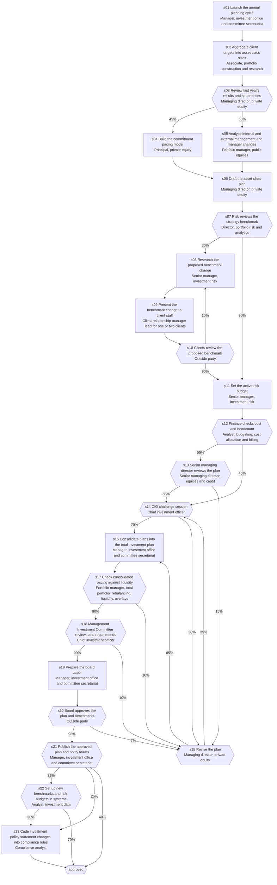

# Set the annual investment plan and strategy benchmarks

`pam-annual-investment-plan-benchmarks` · public-sector asset management · investments (planning and governance) · part of `public-asset-manager`

Each autumn every asset class team writes a plan for the next year: target size from the clients' asset mixes, pacing of private commitments, the split between internal teams and external managers, manager changes and the benchmark and active risk budget for its strategy. Risk researches any benchmark change, finance checks cost, the CIO challenges each plan, the plans are consolidated and checked for liquidity, and the Management Investment Committee recommends the plan and benchmarks to the board for approval. The work is slow because it runs to fixed committee and board dates, waits for the last plan before consolidation, and benchmark changes are contested because they drive measured value added and incentive pay.

| | |
|---|---|
| Unit of work | one asset class strategy plan |
| Starts when | The investment office launches the annual planning cycle after the new capital market assumptions are published, using the board's strategic direction and the latest manager reviews. |
| Done when | The board has approved the plan and its benchmark and risk budget, teams are notified, and any new benchmark and compliance rule is set up in systems. |
| Organisation | A provincial not-for-profit asset manager of about 240 staff that invests about $79 billion for a few public pension plans and an insurance board through pooled funds and segregated accounts, on a cost recovery basis. (242 employees, 2019-2022) |
| Volume | 0.75 cases a month (range 0.6 to 0.9) |

## Where it sits

- Starts with **capital_market_assumptions** from capital-market-assumptions (60% of cases)
- Starts with **board_resolution** from board-committee-meetings (25% of cases)
- Starts with **manager_review** from ext-manager-monitoring (15% of cases)
- Sends **investment_plan** to internal-equity-decisions (outcome: approved)
- Sends **investment_plan** to internal-fixed-income-credit-decisions (outcome: approved)
- Sends **investment_plan** to ext-manager-search-selection (outcome: approved)
- Sends **investment_plan** to pe-coinvest-screening-dd (outcome: approved)
- Sends **investment_plan** to real-asset-direct-investment-dd (outcome: approved)
- Sends **investment_plan** to private-credit-underwriting (outcome: approved)
- Sends **investment_plan** to fund-commitment (outcome: approved)
- Sends **investment_plan** to pool-launch (outcome: approved)
- Sends **investment_plan** to daily-risk-limit-monitoring (outcome: approved)
- Sends **investment_plan** to board-committee-meetings (outcome: any)

## Flow

## Roles

| Role | Department | Layer | FTE on this process | Loaded cost per hour | Evidence |
|---|---|---|---:|---:|---|
| Chief investment officer | Investments | executive | 0.01 | 1800 CAD | C |
| Manager, investment office and committee secretariat | Investments | manager | 0.07 | 130 CAD | C |
| Senior managing director, equities and credit | Equities and credit | director | 0.01 | 700 CAD | C |
| Managing director, private equity | Private equity | director | 0.015 | 420 CAD | C |
| Managing director, real estate | Real estate | director | 0.015 | 420 CAD | C |
| Managing director, infrastructure | Infrastructure | director | 0.015 | 420 CAD | C |
| Managing director, global credit | Global credit (public and private credit) | director | 0.015 | 420 CAD | C |
| Managing director, public equities | Public equities | director | 0.015 | 420 CAD | C |
| Managing director, fixed income | Fixed income and money markets | director | 0.015 | 420 CAD | C |
| Managing director, public market alternatives | Public market alternatives | director | 0.015 | 420 CAD | C |
| Principal, private equity | Private equity | senior specialist | 0.08 | 195 CAD | B [jobbank_11101] |
| Portfolio manager, public equities | Public equities | senior specialist | 0.05 | 195 CAD | B [jobbank_11101] |
| Associate, portfolio construction and research | Portfolio construction and asset mix advice | individual contributor | 0.03 | 85 CAD | B [jobbank_11101] |
| Director, portfolio risk and analytics | Portfolio risk and analytics | director | 0.01 | 240 CAD | B [jobbank_11101] |
| Senior manager, investment risk | Portfolio risk and analytics | senior specialist | 0.06 | 120 CAD | B [jobbank_11101] |
| Analyst, budgeting, cost allocation and billing | Financial planning, cost allocation and client billing | individual contributor | 0.01 | 56 CAD | B [jobbank_11101] |
| Portfolio manager, total portfolio (rebalancing, liquidity, overlays) | Total portfolio management and rebalancing | senior specialist | 0.01 | 195 CAD | B [jobbank_11101] |
| Client relationship manager (lead for one or two clients) | Client relationship management | senior specialist | 0.005 | 160 CAD | B [jobbank_11101] |
| Analyst, investment data | Investment data management | individual contributor | 0.01 | 56 CAD | B [jobbank_11101] |
| Compliance analyst | Compliance | individual contributor | 0.005 | 65 CAD | B [jobbank_11101] |

## Steps

Hands-on time and the wait before each step show the most common value. Evidence tier A is a sourced number, B a sourced description, C the author's estimate.

| Step | Who | Kind | Hands-on | Wait before | Control | Evidence |
|---|---|---|---:|---:|---|---|
| **s01 Launch the annual planning cycle.** The investment office sends each asset class head the plan template and calendar (plans due in September, CIO challenge in October, Management Investment Committee in November, board in December) with the common inputs: the new capital market assumptions, last year's results, the cost budget envelope and changes to client asset mixes. | Manager, investment office and committee secretariat | intake | 2.0 h | 2.0 d |  | B [mgr_ar21], [mgr_ar22] |
| **s02 Aggregate client targets into asset class sizes.** A portfolio construction associate takes each client's approved asset mix and transition path, projected assets and cash flows and converts them into the dollar target for each asset class at the end of next year and over three years, showing how far each class is from target. | Associate, portfolio construction and research | analysis | 4.0 h | 3.0 d |  | B [pclient_ar21], [mgr_ar22] |
| **s03 Review last year's results and set priorities.** The asset class head reviews the strategy's net value added against its benchmark, risk used, manager reviews and watch list, deal pipeline and team capacity, and drafts the priorities for next year. | Managing director, private equity | analysis | 8.0 h | 5.0 d |  | B [mgr_ar21] |
| **s04 Build the commitment pacing model.** For private equity, real estate, infrastructure and private credit, a principal projects calls, distributions and values of existing commitments with a Takahashi-Alexander style model and solves for next year's commitment budget, number and size of fund commitments and co-investments, split by client account. | Principal, private equity | analysis | 15.0 h | 2.0 d |  | B [chronograph24], [allvue24], [pipelineroad] |
| **s05 Analyse internal and external management and manager changes.** For public equities, fixed income, public market alternatives and public credit, a portfolio manager reviews which mandates to bring in house or hand to external managers, which managers to cut or resize on the evidence of manager reviews, fee savings and capacity, and which manager searches the plan needs. | Portfolio manager, public equities | analysis | 10.0 h | 2.0 d |  | B [ppulse_2020], [mgr_nr22] |
| **s06 Draft the asset class plan.** The asset class head writes the plan: target size, deployment or pacing, internal and external split, manager changes, new pools, headcount and cost, responsible investing items and the proposed benchmark and active risk target, in slides with supporting numbers. | Managing director, private equity | drafting | 20.0 h | 3.0 d |  | B [mgr_ar21], [mgr_nr22] |
| **s07 Risk reviews the strategy benchmark.** The director of portfolio risk checks whether the existing benchmark still fits the strategy (investable, matches what the team may buy, set before the period) or whether the team's proposed change deserves full research. | Director, portfolio risk and analytics | review | 2.0 h | 3.0 d | The model manager benchmark policy: the Risk function researches, analyses and reviews strategy benchmarks | A [mgr_ar21], [mgr_ar22] |
| **s08 Research the proposed benchmark change.** A senior risk manager back-tests candidate indices, compares tracking error, investability, hedged and unhedged versions and licence costs, shows the effect on past net value added and on incentive pay, and writes a benchmark change memo. | Senior manager, investment risk | analysis | 20.0 h | 2.0 d |  | A [mgr_ar21], [mgr_ar22] |
| **s09 Present the benchmark change to client staff.** The client relationship manager explains the proposed benchmark change to each affected client's investment staff, because client policies list asset class benchmarks and clients judge results against them. | Client relationship manager (lead for one or two clients) | communication | 1.0 h | 2.0 d |  | B [pclient_sipp], [iclient_if] |
| **s10 Clients review the proposed benchmark.** Client staff, and sometimes their consultant, review the change and reply with questions or agreement, which can take until their own committee meets. | Outside party | external wait | 0 min | 10.0 d |  | C |
| **s11 Set the active risk budget.** The risk manager turns the plan's tracking error target into an active risk budget, adds up the budgets across plans against the total active risk appetite and checks leverage and liquidity effects of the plan. | Senior manager, investment risk | analysis | 4.0 h | 2.0 d |  | A [iclient_if] |
| **s12 Finance checks cost and headcount.** A finance analyst compares the plan's headcount, external manager fees, data and systems costs with the cost budget envelope and flags overruns to the asset class head and the CIO. | Analyst, budgeting, cost allocation and billing | validation | 2.0 h | 2.0 d |  | C |
| **s13 Senior managing director reviews the plan.** The senior managing director for equities and credit reviews the plans of the teams reporting to him for consistency, capacity and cost before they go to the CIO. | Senior managing director, equities and credit | review | 2.0 h | 3.0 d |  | C |
| **s14 CIO challenge session.** The chief investment officer, with the heads of total portfolio, risk and finance, challenges each plan in a one to two hour session: size, pacing, internal and external split, risk budget, cost and benchmark. | Chief investment officer | review | 1.5 h | 5.0 d | CIO accountability for the investment plan before Management Investment Committee review | C |
| **s15 Revise the plan.** The asset class head and team rework the plan for the points raised: smaller or slower deployment, a different manager change, a lower cost or a revised risk budget. | Managing director, private equity | drafting | 6.0 h | 3.0 d |  | C |
| **s16 Consolidate plans into the total investment plan.** The investment office combines the plans, checks that asset class sizes add up to the clients' targets, totals commitments, cost and active risk, and builds the consolidated deck. It waits until the last plan is in. | Manager, investment office and committee secretariat | analysis | 4.0 h | 3.0 d |  | C |
| **s17 Check consolidated pacing against liquidity.** A total portfolio manager runs the consolidated commitments and expected calls through each client's liquidity forecast and coverage ratio, and checks overlay and leverage capacity, to make sure no client becomes a forced seller. | Portfolio manager, total portfolio (rebalancing, liquidity, overlays) | validation | 2.0 h | 2.0 d | Liquidity risk framework: coverage ratio includes capital calls on private market commitments | A [mgr_ar21] |
| **s18 Management Investment Committee reviews and recommends.** The Management Investment Committee, co-chaired by the CIO and chief risk officer with the general counsel, reviews the plan and any benchmark changes and recommends them to the board, or asks for changes. | Chief investment officer | approval | 1.5 h | 5.0 d | The model manager benchmark policy and Investment Approval Policy: the Management Investment Committee recommends benchmarks and benchmark changes to the board | A [mgr_ar21], [mgr_ar22] |
| **s19 Prepare the board paper.** The investment office turns the recommended plan and benchmark changes into a board paper with an executive summary and resolution, gets the CIO's sign-off and submits it to the board secretariat by the paper deadline. | Manager, investment office and committee secretariat | drafting | 4.0 h | 2.0 d |  | C |
| **s20 Board approves the plan and benchmarks.** The board, through its investment committee of all directors from late 2021, reviews the plan and benchmark changes at its scheduled meeting and approves them or asks for changes. | Outside party | approval | 0 min | 14.0 d | The model manager benchmark policy: the board approves strategy benchmarks | A [mgr_ar21], [mgr_ar22] |
| **s21 Publish the approved plan and notify teams.** The investment office files the approved plan and investment policy statement updates and tells risk, performance, compliance, data management, total portfolio and client relationship teams which benchmarks and risk budgets change and from when. | Manager, investment office and committee secretariat | communication | 2.0 h | 2.0 d |  | C |
| **s22 Set up new benchmarks and risk budgets in systems.** An investment data analyst sets up the new index or custom blend in the security master and index feeds, and the performance and risk systems, effective from the start of the year, and checks the first calculated values. | Analyst, investment data | data entry | 2.0 h | 5.0 d |  | C |
| **s23 Code investment policy statement changes into compliance rules.** A compliance analyst updates pre-trade and post-trade rules in the order management system for changed permitted investments, limits or ranges in the asset class investment policy statement and tests them. | Compliance analyst | data entry | 3.0 h | 3.0 d | OSC order on the model manager: compliance system must prevent investments that contravene restrictions in each investment management agreement | B [osc_mgr_2017] |

## Exceptions

| Exception | Share of cases | What happens |
|---|---:|---|
| Benchmark change proposed | 30% | The team or Risk proposes a new benchmark; Risk researches it and client staff are consulted before the Management Investment Committee recommends it. |
| Client objects to a benchmark change | 3% | A client asks for a different benchmark, sending the research back for another option. |
| Plan revised after CIO challenge | 35% | The CIO, senior managing director or Management Investment Committee asks for a smaller, slower or cheaper plan. |
| Pacing cut for liquidity | 5% | Consolidated commitments would leave a client short of liquid assets under stress, so pacing is reduced. |
| Board asks for changes | 7% | Directors ask for changes to a plan or benchmark, delaying approval to a later meeting. |

## Benchmarks

| Metric | Value | Unit | Population | Evidence |
|---|---|---|---|---|
| cycle_time_days | p50 100, p90 140 | calendar days from launch of the planning cycle to board approval and set-up | Asset class plans at a Canadian public-sector asset manager | C |
| benchmarks_per_asset_class_policy | 1 | market-based or custom benchmark per asset class investment policy statement | The model manager asset class strategies | A [mgr_ar21], [mgr_ar22] |
| leverage_target_insurance_fund | target 0.1, min 0.05, max 0.15 | share of fund | The insurance client insurance fund policy asset mix (current) | A [iclient_if] |

## Pain points

- Benchmark changes are contested because they change measured value added and incentive pay, and they need research, client consultation and two committee approvals. (steps s07, s08, s09, s10, s18, s20; B [mgr_ar21], [ca_gov20])
- Commitment pacing depends on uncertain call and distribution rates, so plans overshoot or undershoot private targets. (steps s04, s17; B [allvue24], [chronograph24])
- Consolidation waits for the slowest plan, and the whole cycle is set by fixed committee and board dates. (steps s16, s18, s20; C)

## Assumptions

- Unit of work is one asset class strategy plan (about nine a year); consolidation, committee and board steps are shared by all plans and their time is counted per plan.
- Plan-owner steps are shown under md_private_equity as the representative asset class head; the heads of public equities, fixed income, public market alternatives, global credit, real estate and infrastructure do the same steps for their own plans with the same cost range. principal_private_equity and pm_public_equities likewise stand for the private and public markets staff who build pacing and manager analyses; both are organisation file roles not listed on this process_map entry.
- Client consultation on benchmark changes and the compliance coding step are author assumptions; client policies list benchmarks set by the model manager, so changes are explained before approval.
- The board approves benchmarks per the model manager's benchmark policy; from September 2021 investment matters went to the Board Investment Committee, which comprises all directors.
- No public source gives the model manager's planning calendar or review times; times are author estimates.
- Loaded costs are the organisation file's ranges.

## Sources

- [mgr_ar21] The model manager 2021 Annual Report (link withheld) (The model manager, 2022). 10 board, 6 finance and audit, 6 human resources and compensation, 4 nominating and governance meetings and 2 Board Investment Committee meetings in 2021; nine directors; Board Investment Committee of all directors created 23 September 2021 to approve investment decisions and review asset allocation advice; four board committees and their mandates; annual board evaluation; Management Investment Committee co-chaired by the CIO and chief risk officer with the general counsel and other senior managers, which must first recommend every investment decision needing board approval; three Investment Department Committees (Total Portfolio, Equities and Credit, Real Assets) set up in 2021 that approve up to thresholds; Investment Approval Policy; one benchmark per asset class investment policy statement; benchmark policy (Risk researches and reviews, Management Investment Committee recommends, board approves); liquidity coverage ratio of high-quality liquid assets to stressed net outflows including client outflows, rebalancing, capital calls and foreign exchange hedging, under past stresses and a one-in-20-year event; counterparty exposure measured daily with ISDA netting and collateral; clean SOC 1 Type I report on control design. Read from a text copy saved under scratch/.
- [mgr_ar22] The model manager 2022 Annual Report (link withheld) (The model manager, 2023). 5 board, 7 Board Investment Committee, 6 finance and audit, 4 human resources and compensation and 5 nominating and governance meetings in 2022; board meets at least quarterly; Management Investment Committee composition and delegation to Investment Department Committees; benchmark policy; leverage used for the first time in 2022 at the total portfolio level and a leverage framework and guideline setting client targets and pool-level limits; new risk and total portfolio management system partly live December 2022; systematic rebalancing; currency hedging named as a useful tool; liquidity coverage ratio definition; expanded liquidity analysis in 2022. Read from a text copy saved under scratch/.
- [mgr_nr22] The model manager posts a -8.1% return in 2022, outperforms benchmark (news release) (link withheld) (The model manager via Cision Newswire, 2023). Leverage of ($2.7) billion applied at the total portfolio level at the end of 2022 on $69.1 billion of net investments; systematic rebalancing and liquidity management; 12 private equity direct and co-investments; board approved a five-year strategic plan for 2023 to 2027.
- [ppulse_2020] The model manager Gains 5.4% in 2020 (link withheld) (Pension Pulse (blog), 2021). Managing total portfolio liquidity to avoid being a forced seller; clients had sufficient liquidity in 2020; leverage not yet used but under discussion with clients and the board; board met more often by video in spring 2020 to review liquidity and risk; external managers cut from 200 to 124.
- [iclient_if] Insurance fund (The insurance client web page with the statement of investment policies and procedures) (link withheld) (The insurance client, 2025). The model manager is sole investment manager; the model manager establishes benchmarks and relative return and risk targets for each strategy; liquidity coverage monitored at least monthly; derivatives may be used to manage allocations including rebalancing; leverage target 10% within 5% to 15%; currency exposure handled under the insurance client or the model manager policies; performance, risk and compliance reviewed at least quarterly; SIPP reviewed every fiscal year.
- [pclient_sipp] Statement of Investment Policies and Procedures for the Public Service Pension Plan (approved 3 December 2025) (link withheld) (The pension client, 2025). Leverage may be used as defined in the model manager's Leverage Policy; portfolio leverage line in the strategic asset allocation; derivatives (futures, forwards, options, swaps) permitted for risk management and efficiency; asset class benchmarks listed, several hedged to Canadian dollars; total portfolio leverage such as repos outside the 10% debt limit. Read from a text copy saved under scratch/ (current policy, after the reference period).
- [pclient_ar21] The pension client 2021 Annual Report (link withheld) (The pension client, 2022). New strategic asset allocation approved April 2021 and implemented by the model manager over four years, adding portfolio leverage; futures subject to daily cash margining; foreign exchange forwards used for passive and active hedging; currency forwards notional of about $6.5 billion at end 2021, all maturing within one year. Read from a text copy saved under scratch/.
- [chronograph24] [The Evolution of the Yale Model for Institutional Investing](https://chronograph.pe/the-evolution-of-the-yale-model-for-institutional-investing) (Chronograph, 2024). Takahashi-Alexander model projects contributions, distributions and NAV per quarter from rate of contribution, commitment, fund life, bow factor, growth and yield; widely used by limited partners; deterministic, so Monte Carlo is suggested.
- [allvue24] [The Private Equity Pacing Model: 3 Key Challenges Investors Face](https://www.allvuesystems.com/resources/the-private-equity-pacing-model-3-key-challenges-investors-face/) (Allvue Systems, 2024). Pacing models plan cash flows to and from private fund stakes, commonly with the Takahashi-Alexander model; investors must reach targets without overshooting because selling stakes is costly; scaling to target takes years.
- [pipelineroad] [Commitment Pacing (glossary)](https://pipelineroad.com/glossary/commitment-pacing) (Pipeline Road, 2025). A pacing model projects calls, distributions and NAV for every existing commitment and outputs an annual commitment budget split across strategies; run annually or quarterly; built with consultants or internal quantitative teams.
- [ca_gov20] [Endowment Governance Part 3: Process and Engagement](https://www.cambridgeassociates.com/insight/endowment-governance-part-3-process-and-engagement/) (Cambridge Associates, 2020). Chair owns the agenda with staff; materials at least a week before the meeting; regular meetings of two to four hours; record attendance, votes by name and recusals; circulate minutes promptly to confirm decisions; members should vote on asset allocation, benchmark and risk parameter changes.
- [osc_mgr_2017] The model manager, Commission and Director decisions (exemptions for the model manager and its investment pools) (link withheld) (Ontario Securities Commission, 2017). Compliance system must prevent investments that contravene restrictions set out in each investment management agreement; fairness in allocating investment opportunities among members and pools; commodity futures advising rules. Read from a text copy saved under scratch/.
- [jobbank_11101] [Wages: Financial Analyst (NOC 11101) in the Toronto Region](https://www.jobbank.gc.ca/marketreport/wages-occupation/12417/22437) (Job Bank, Government of Canada, 2025). Toronto hourly wages low $27.97, median $41.60, high $73.57 (reference period 2023-2024), used by the organisation file for analyst costs.

Written by claude-opus on 2026-11-17.
