# Publish the annual report and results

`pam-annual-report-public-results` · public sector asset management · corporate communications · part of `public-asset-manager`

Each year the model manager must give the Minister of Finance an annual report with audited financial statements within 120 days of year end, and publishes it with a results release in April. Corporate communications plans the report in the autumn, interviews leaders and drafts the narrative, while finance, performance, responsible investing, governance and HR write their sections once results, audited statements and pay decisions are final. The full draft is fact-checked, reviewed by legal and the executive, designed, read by the auditor, approved by the board and made accessible before publication. The fixed late-February audit date, many contributors and late changes after design make the last six weeks tight and error-prone.

| | |
|---|---|
| Unit of work | one annual report |
| Starts when | The annual planning cycle starts in the autumn; year-end performance results, the stewardship report and the audited financial statements feed the report as they become final. |
| Done when | The annual report has been approved by the board, submitted to the Minister of Finance, published on the website and sent to clients, and the results release has been issued. |
| Organisation | A provincial not-for-profit asset manager of about $79 billion with a four-person corporate communications team and an outside design agency. (242 employees, 2019-2022) |
| Volume | 0.083 cases a month (range 0.083 to 0.083) |

## Where it sits

- Starts with **financial_statements** from annual-financial-statements-audit (40% of cases)
- Starts with **performance_results** from performance-attribution (40% of cases)
- Starts with **stewardship_report** from proxy-voting-engagement (20% of cases)
- Sends **annual_report** to ministry-relations-reporting (outcome: published)
- Sends **media_release** to media-stakeholder-relations (outcome: published)
- Sends **annual_report** to public_media (outcome: published)
- Sends **annual_report** to client_pension_plan (outcome: published)
- Sends **annual_report** to client_insurance_board (outcome: published)

## Flow

```mermaid
flowchart TD
    s01["s01 Plan the report and its timetable<br/>Vice president, corporate communications"]
    s02["s02 Chief executive approves the theme and key messages<br/>President and chief executive officer"]
    s03["s03 Brief the design agency<br/>Communications advisor"]
    s04["s04 Send content requests to section owners<br/>Communications advisor"]
    s05["s05 Interview leaders and draft the narrative sections<br/>Communications advisor"]
    s06["s06 Draft the responsible investing section<br/>Vice president, head of responsible investing"]
    s07["s07 Draft the governance section<br/>Manager, board secretariat and governance"]
    s08["s08 Draft wait for year-end results and audited statements<br/>Automated"]
    s09["s09 Draft the financial and cost sections<br/>Manager, financial reporting and corporate accounting"]
    s10["s10 Supply and verify the performance figures<br/>Manager, performance measurement and attribution"]
    s11["s11 Draft the compensation discussion and analysis<br/>Manager, total rewards and HR operations"]
    s12{{"s12 Chief financial officer reviews the financial content<br/>Chief financial officer"}}
    s13["s13 Assemble and edit the full draft<br/>Vice president, corporate communications"]
    s14{{"s14 Fact-check and tie out every number<br/>Communications advisor"}}
    s15["s15 Legal review of the disclosures<br/>General counsel and corporate secretary"]
    s16{{"s16 Executive review of the full draft<br/>President and chief executive officer"}}
    s17["s17 Design agency lays out the proof<br/>Outside party"]
    s18{{"s18 Proofread the designed report<br/>Communications advisor"}}
    s19{{"s19 External auditor reads the report for consistency<br/>Outside party"}}
    s20{{"s20 Board approves the annual report<br/>Outside party"}}
    s21["s21 Make the final PDF accessible<br/>Communications advisor"]
    s22["s22 Draft the results release and media materials<br/>Vice president, corporate communications"]
    s23["s23 Chief executive approves the release<br/>President and chief executive officer"]
    s24["s24 Submit the report to the Minister of Finance<br/>Manager, board secretariat and governance"]
    s25["s25 Publish the report and issue the release<br/>Communications advisor"]
    s01 --> s02
    s02 --> s03
    s03 --> s04
    s04 --> s05
    s05 --> s06
    s06 --> s07
    s07 --> s08
    s08 --> s09
    s09 --> s10
    s10 --> s11
    s11 --> s12
    s12 -->|"75%"| s13
    s12 -->|"25%"| s09
    s13 --> s14
    s14 -->|"80%"| s15
    s14 -->|"20%"| s13
    s15 --> s16
    s16 -->|"75%"| s17
    s16 -->|"25%"| s13
    s17 --> s18
    s18 -->|"55%"| s19
    s18 -->|"45%"| s17
    s19 -->|"92%"| s20
    s19 -->|"8%"| s18
    s20 -->|"95%"| s21
    s20 -->|"5%"| s18
    s21 --> s22
    s22 --> s23
    s23 --> s24
    s24 --> s25
    s25 --> end0
    end0(["published"])
```

## Roles

| Role | Department | Layer | FTE on this process | Loaded cost per hour | Evidence |
|---|---|---|---:|---:|---|
| Vice president, corporate communications | Corporate communications | director | 0.03 | 240 CAD | B [icaew_ar] |
| Communications advisor | Corporate communications | individual contributor | 0.1 | 58 CAD | B [icaew_ar] |
| Chief financial officer | Finance | executive | 0.003 | 750 CAD | B [mgr_ar21] |
| President and chief executive officer | Executive office and board secretariat | executive | 0.003 | 1800 CAD | C |
| Vice president, head of responsible investing | Responsible investing | director | 0.008 | 240 CAD | B [mgr_ar21] |
| Manager, financial reporting and corporate accounting | Financial reporting and corporate accounting | manager | 0.02 | 90 CAD | B [mgr_ar21] |
| Manager, performance measurement and attribution | Performance measurement and attribution | manager | 0.004 | 90 CAD | C |
| Manager, total rewards and HR operations | Total rewards and HR operations | manager | 0.01 | 100 CAD | B [mgr_ar21] |
| Manager, board secretariat and governance | Board secretariat | manager | 0.008 | 115 CAD | B [mgr_ar21], [osc_mgr_2017] |
| General counsel and corporate secretary | Legal and compliance | executive | 0.004 | 750 CAD | C |

## Steps

Hands-on time and the wait before each step show the most common value. Evidence tier A is a sourced number, B a sourced description, C the author's estimate.

| Step | Who | Kind | Hands-on | Wait before | Control | Evidence |
|---|---|---|---:|---:|---|---|
| **s01 Plan the report and its timetable.** In the autumn the vice president of communications drafts the theme, page plan, section owners and timetable back from the April release, reviews last year's lessons and books design and print capacity, and presents the plan to the executive team. | Vice president, corporate communications | coordination | 8.0 h | 0 min |  | B [icaew_ar] |
| **s02 Chief executive approves the theme and key messages.** The chief executive reviews the proposed theme, key messages, page plan and timetable with the executive team and approves them or asks for changes in emphasis. | President and chief executive officer | approval | 1.0 h | 3.0 d |  | B [icaew_ar] |
| **s03 Brief the design agency.** A communications advisor briefs the design agency on the theme, page count, charts, photography and accessible PDF requirements, agrees the quote and production schedule under the procurement rules and sets proof dates. | Communications advisor | coordination | 4.0 h | 1.0 d | Procurement policy for creative services | B [icaew_ar] |
| **s04 Send content requests to section owners.** The advisor sends each section owner (investment departments, risk, finance, human resources, governance, responsible investing) a template, word count, style guide, list of figures needed and deadlines, and sets up the shared folder for drafts and backup. | Communications advisor | communication | 3.0 h | 0 min |  | B [icaew_ar] |
| **s05 Interview leaders and draft the narrative sections.** The advisors interview the chair, CEO, CIO and department heads and draft the chair and CEO reports, investment department pages, operations and people sections, then circulate each draft to its owner for corrections. | Communications advisor | drafting | 2.5 d | 20.0 d |  | B [icaew_ar], [mgr_ar21] |
| **s06 Draft the responsible investing section.** The head of responsible investing drafts the ESG and stewardship pages: voting and engagement statistics from the stewardship report, climate action plan progress and portfolio climate metrics, and examples from the asset classes. | Vice president, head of responsible investing | drafting | 12.0 h | 1.0 d |  | B [mgr_ar21], [mgr_ar22] |
| **s07 Draft the governance section.** The board secretariat drafts the governance pages: board composition and appointments, committee mandates and work, attendance, director biographies and director remuneration, and confirms them with the chair of the governance committee. | Manager, board secretariat and governance | drafting | 10.0 h | 1.0 d |  | B [mgr_ar21] |
| **s08 Draft wait for year-end results and audited statements.** The draft report waits while the year is closed: performance results by client, pool and asset class are approved in February and the board authorises the audited financial statements in late February or early March. | Automated | system auto | 0 min | 30.0 d |  | A [mgr_ar20], [mgr_ar21], [mgr_ar22] |
| **s09 Draft the financial and cost sections.** The manager of financial reporting drafts the management's discussion and analysis on costs, cost recovery and financial position, inserts the audited financial statements and notes, and lists the backup for every figure. | Manager, financial reporting and corporate accounting | drafting | 1.0 d | 1.0 d |  | B [mgr_ar21] |
| **s10 Supply and verify the performance figures.** The manager of performance provides the approved weighted average client return, client range, benchmark and value added, asset class results and multi-year returns, and checks the charts the writers built from them. | Manager, performance measurement and attribution | validation | 6.0 h | 12.0 h |  | B [mgr_nr21] |
| **s11 Draft the compensation discussion and analysis.** The total rewards manager drafts the compensation discussion and analysis and executive pay tables once incentive awards are approved, and the head of HR takes it to the Human Resources and Compensation Committee chair for review. | Manager, total rewards and HR operations | drafting | 15.0 h | 1.0 d | Board Human Resources and Compensation Committee review of compensation disclosure | B [mgr_ar21] |
| **s12 Chief financial officer reviews the financial content.** The chief financial officer reviews the financial and cost sections, the performance tables and the way results are described, and returns comments or approves them. | Chief financial officer | review | 3.0 h | 2.0 d |  | C |
| **s13 Assemble and edit the full draft.** The vice president of communications combines all sections, edits for a consistent voice and balanced messages, removes repetition, checks the theme carries through and sends the complete draft for fact checking. | Vice president, corporate communications | drafting | 1.2 d | 2.0 d |  | B [icaew_ar] |
| **s14 Fact-check and tie out every number.** An advisor checks every figure, date and claim in the draft against the audited statements, approved performance results, transaction lists and the backup folder, logs mismatches and gets owners to correct them. | Communications advisor | validation | 1.2 d | 1.0 d | Disclosure practice: every published figure traced to approved source schedules | B [dfin_tieout], [icaew_ar] |
| **s15 Legal review of the disclosures.** The general counsel reviews the draft for confidential deal or client information, forward-looking statements, compensation disclosure and statements about clients, the Minister and regulators, and marks required changes. | General counsel and corporate secretary | review | 6.0 h | 2.0 d |  | C |
| **s16 Executive review of the full draft.** The chief executive, with the CIO and executive team, reads the full draft and approves it for design or asks for changes to messages, emphasis or the treatment of the year's results. | President and chief executive officer | approval | 3.0 h | 3.0 d |  | C |
| **s17 Design agency lays out the proof.** The design agency flows the approved text, charts and photographs into the layout and returns a proof, or a revised proof after the last round of corrections. | Outside party | external wait | 0 min | 5.0 d |  | C |
| **s18 Proofread the designed report.** Advisors and a reviewer not involved in drafting check the proof for typography, page numbers, cross-references, chart labels and figures that moved in layout, and send consolidated corrections to the agency. | Communications advisor | review | 15.0 h | 12.0 h |  | B [icaew_ar] |
| **s19 External auditor reads the report for consistency.** The external auditor reads the designed report alongside the audited financial statements and confirms that the other information is consistent with them, raising any material inconsistency before release. | Outside party | external wait | 0 min | 4.0 d | Canadian Auditing Standard 720: auditor's responsibilities for other information | C |
| **s20 Board approves the annual report.** The board, usually on the recommendation of the Finance and Audit Committee, approves the annual report for submission to the Minister and publication, at a scheduled meeting or by written resolution. | Outside party | approval | 0 min | 7.0 d | The model manager Act, 2015, section 23: Board submits the annual report | A [osc_mgr_2017] |
| **s21 Make the final PDF accessible.** The agency or an accessibility specialist tags the final PDF for reading order, headings and tables, adds alternative text to charts and images and checks contrast; the advisor tests it with a checker and screen reader before release. | Communications advisor | validation | 8.0 h | 3.0 d | Accessibility for Ontarians with Disabilities Act, Integrated Accessibility Standards: web content to WCAG 2.0 Level AA | B [wcag20], [mgr_ar21] |
| **s22 Draft the results release and media materials.** The vice president of communications drafts the results news release, key messages and questions and answers for media and stakeholders, aligned with the report's figures, and plans the release date and distribution. | Vice president, corporate communications | drafting | 6.0 h | 12.0 h |  | A [mgr_nr20], [mgr_nr21], [mgr_nr22] |
| **s23 Chief executive approves the release.** The chief executive and chief financial officer approve the release wording and figures and the spokesperson messages, after the CFO checks every number against the report. | President and chief executive officer | approval | 30 min | 2.0 d | Disclosure policy: CEO approval of public results releases | C |
| **s24 Submit the report to the Minister of Finance.** The board secretariat prepares the chair's covering letter and delivers the annual report with the audited financial statements to the Minister of Finance before the 120-day deadline, and confirms receipt with the ministry. | Manager, board secretariat and governance | communication | 1.0 h | 1.0 d | The model manager Act, 2015, section 23: annual report to the Minister within 120 days of year end | A [osc_mgr_2017] |
| **s25 Publish the report and issue the release.** On release day the advisor posts the report on the website, issues the news release through the wire service, sends the report to clients and stakeholders, posts on social media and hands media enquiries to the spokespeople. | Communications advisor | communication | 4.0 h | 1.0 d |  | A [mgr_nr20], [mgr_nr22], [mgr_ar_page] |

## Exceptions

| Exception | Share of cases | What happens |
|---|---:|---|
| Financial content rework | 25% | The CFO sends the financial and cost sections back for changes before the full draft is assembled. |
| Messages changed at executive review | 25% | The executive asks for changes to messages or the treatment of the year's results, sending the draft back through editing, fact checking and legal review. |
| Extra proof rounds | 45% | Late text or figure changes need another designed proof. |
| Auditor or board finds an inconsistency | 12% | The auditor's reading or the board raises a point that must be corrected in the proof. |

## Benchmarks

| Metric | Value | Unit | Population | Evidence |
|---|---|---|---|---|
| cycle_time_days | p50 145, p90 165 | calendar days from planning kick-off to publication | This organisation, 2020 to 2022 reports | B [mgr_nr20], [mgr_nr21], [mgr_nr22], [osc_mgr_2017] |
| statutory_deadline_after_year_end | 120 | days | The model manager Act, section 23 | A [osc_mgr_2017] |
| financial_statements_authorised | 2020 2021-02-25, 2021 2022-02-24, 2022 2023-03-02 | date of board authorisation | This organisation | A [mgr_ar20], [mgr_ar21], [mgr_ar22] |
| results_release_dates | 2020 2021-04-13, 2021 2022-04-25, 2022 2023-04-13 | date | This organisation | A [mgr_nr20], [mgr_nr21], [mgr_nr22] |

## Pain points

- Most financial content cannot be finished until the audited statements are authorised in late February, leaving about six weeks for financial drafting, review, design, auditor reading, board approval and accessibility work. (steps s08, s09, s17, s19, s20, s21; A [mgr_ar21], [mgr_nr21])
- Many contributors write in different styles and late changes ripple through text, charts and the designed proof, so figures are re-checked several times. (steps s13, s14, s18; B [icaew_ar])
- Review by CFO, legal, CEO, auditor and board happens one after another, each waiting for availability. (steps s12, s15, s16, s19, s20; C)

## Assumptions

- The case runs from the autumn kick-off to publication; the upstream objects (financial statements, performance results, stewardship report) arrive during the case, so the trigger shares describe which input most often sets the pace rather than separate cases.
- From the 2022 report onward the model manager also published a separate climate action plan; a separate responsible investing report is mentioned in the organisation file but not modelled here, where the responsible investing section is drafted inside the annual report.
- Section drafting by finance, performance and HR after year end runs in parallel and is marked concurrent; the simulator adds those hands-on hours in sequence, which overstates elapsed time by a few days.
- The board (an external party in the organisation file) approves the report; its members' time is not costed. The external auditor's reading is shown as a wait; its fee sits in the audit process.
- The auditor's reading of other information (Canadian Auditing Standard 720) and Ontario's accessibility standard are named from general knowledge because their texts could not be opened.
- Design agency, printing and wire service fees are external costs not modelled as labour.
- mgr_financial_reporting, mgr_performance, hr_rewards_manager, board_secretary and general_counsel are organisation file roles that the process map does not list for this process; they write or review sections.
- Loaded costs come from the organisation file (Job Bank Toronto wages deflated to 2021, variable pay and a 1.35 loading). Hands-on time of about 330 hours across in-house roles is the author's estimate.
- Web searching ran out while this workflow was researched, so sources were limited to pages fetched by address and saved copies of the model manager's annual reports.

## Sources

- [osc_mgr_2017] The model manager, Commission and Director decisions (exemptions for the model manager and its investment pools) (link withheld) (Ontario Securities Commission, 2017). Sections 10, 22 and 23 of the manager's governing act require audited annual financial statements, an annual report and an annual meeting of members; section 23 requires the Board to submit an annual report on the model manager's activities and affairs to the Minister within 120 days after the end of each fiscal year, including the audited financial statements; the Board may not delegate approval of the financial statements.
- [mgr_ar20] The model manager 2020 Annual Report (link withheld) (The model manager, 2021). Financial statements authorised for issuance by the Board on 25 February 2021; report contains chair and CEO reports, investment results, risk, governance, compensation discussion and analysis and financial statements.
- [mgr_ar21] The model manager 2021 Annual Report (link withheld) (The model manager, 2022). Contents: about the model manager with chair and CEO reports, management's discussion and analysis with cost management, investments and results by asset class, responsible investing, risk management, corporate governance, compensation discussion and analysis and financial statements; the report covers activities to 31 December 2021 and cites positions as of 1 March 2022; financial statements authorised by the Board on 24 February 2022; statements approved on behalf of the Board by the Chair and the Finance and Audit Committee chair.
- [mgr_ar22] The model manager 2022 Annual Report (link withheld) (The model manager, 2023). Financial statements authorised for issuance by the Board on 2 March 2023; Climate Action Plan with interim targets published in November 2022 and summarised in the report.
- [mgr_nr20] The model manager posts solid 2020 return, meets benchmark index (news release, 13 April 2021) (link withheld) (The model manager via Cision Newswire, 2021). Results release issued 13 April 2021: weighted average net client return 5.4%, client returns 0.2% to 7.1%, assets $73.3 billion; refers readers to the 2020 Annual Report on the model manager's website.
- [mgr_nr21] The model manager posts 2021 net return of 9.6%, outperforms benchmark (news release, 25 April 2022) (link withheld) (The model manager via Cision Newswire, 2022). Results release issued 25 April 2022 with returns, $79 billion of assets, 35 direct and co-investment transactions, pools and $20 million of cost savings.
- [mgr_nr22] The model manager posts a -8.1% return in 2022, outperforms benchmark (news release, 13 April 2023) (link withheld) (The model manager via Cision Newswire, 2023). Results release issued 13 April 2023 with weighted average net return of -8.1% against -8.4%, three-year returns, $73.3 billion of assets and a link to the 2022 Annual Report.
- [mgr_ar_page] Annual Report (The model manager web page) (link withheld) (The model manager, 2026). Annual reports listed for every year from 2017 to 2025.
- [icaew_ar] [Overcoming the challenges faced when preparing the annual report (By All Accounts, January 2022)](https://icaew.com/technical/corporate-reporting/corporate-reporting-resources/by-all-accounts/by-all-accounts-archives/jan-2022-issue/overcoming-the-challenges-faced-when-preparing-the-annual-report) (ICAEW, 2022). Run the report as a project with an executive sponsor, project manager and section owners tracked to a timetable; draft narrative early, before financials; many authors make the report disjointed; numerous versions and late changes make errors almost inevitable, so keep a central store of statistics and backup shared with auditors; cold reviews of grammar, page numbers and cross-references; check printer proofs.
- [dfin_tieout] [Financial statement tie-out](https://www.dfinsolutions.com/knowledge-hub/thought-leadership/knowledge-resources/financial-statement-tie-out) (DFIN, undated). Tie-out confirms that reported numbers agree with the audited figures and reconciles differences; steps are gathering data, comparing line items, investigating mismatches, correcting errors and sign-off; transposed numbers are a typical error; the work is time-intensive.
- [wcag20] [Web Content Accessibility Guidelines (WCAG) 2.0](https://www.w3.org/TR/WCAG20/) (World Wide Web Consortium, 2008). W3C Recommendation of 11 December 2008; Level AA requires all Level A and AA success criteria, including text alternatives for non-text content (1.1.1) and a contrast ratio of at least 4.5:1 for text (1.4.3).

Written by claude-opus on 2026-11-17.
