# Prepare and run board and committee meetings

`pam-board-committee-meetings` · public-sector asset management · corporate governance (board secretariat) · part of `public-asset-manager`

The board secretariat prepares and runs about 27 board and committee meetings a year: the board, finance and audit, human resources and compensation, nominating and governance and, from September 2021, a board investment committee of all directors. For each meeting the secretary agrees the agenda with the chief executive, general counsel and chair, collects papers from executive sponsors, checks them, publishes a book in the board portal at least a week ahead, records decisions and conflicts at the meeting, and turns notes into minutes that the chair reviews and the next meeting approves. Most elapsed time is waiting: on executives' and the chair's calendars, on paper drafting that depends on other processes closing, and on directors' reading time. Late, long papers and rework after review are the common problems.

| | |
|---|---|
| Unit of work | one board or committee meeting |
| Starts when | A meeting falls due in the annual board and committee work plan, or the chair or chief executive calls a special meeting for an urgent decision. |
| Done when | The meeting has been held, draft minutes have been reviewed by the chair, decisions and actions have been sent to their owners and the records are filed; formal approval of the minutes happens at the next meeting. |
| Organisation | A provincial not-for-profit asset manager of about 240 staff that invests about $79 billion for a few public pension plans and an insurance board through pooled funds and segregated accounts, on a cost recovery basis. (242 employees, 2019-2022) |
| Volume | 2.3 cases a month (range 1 to 4) |

## Where it sits

- Starts with **board_resolution** from board (8% of cases)
- Starts with **investment_plan** from annual-investment-plan-benchmarks (4% of cases)
- Starts with **ic_decision** from investment-committee-approval (10% of cases)
- Starts with **risk_report** from risk-reporting-stress-testing (12% of cases)
- Starts with **risk_incident_report** from enterprise-operational-risk (4% of cases)
- Starts with **compliance_report** from code-of-conduct-attestations (6% of cases)
- Starts with **performance_results** from performance-attribution (10% of cases)
- Starts with **financial_statements** from annual-financial-statements-audit (6% of cases)
- Starts with **annual_budget** from annual-cost-budget (5% of cases)
- Starts with **audit_report** from internal-audit-engagement (9% of cases)
- Starts with **compensation_decisions** from performance-compensation-cycle (12% of cases)
- Starts with **strategic_plan** from strategic-business-plan (6% of cases)
- Starts with **director_election_results** from members-meeting-director-elections (8% of cases)
- Sends **board_paper** to board (outcome: held_and_minuted)
- Sends **board_resolution** to pool-launch (outcome: held_and_minuted)
- Sends **board_resolution** to annual-investment-plan-benchmarks (outcome: held_and_minuted)
- Sends **board_resolution** to internal-audit-engagement (outcome: held_and_minuted)
- Sends **board_resolution** to performance-compensation-cycle (outcome: held_and_minuted)
- Sends **board_resolution** to strategic-business-plan (outcome: held_and_minuted)

## Flow

```mermaid
flowchart TD
    s01{{"s01 Open the meeting file from the annual work plan<br/>Governance coordinator"}}
    s02["s02 Draft the agenda<br/>Manager, board secretariat and governance"]
    s03{{"s03 CEO and general counsel review the agenda<br/>President and chief executive officer"}}
    s04{{"s04 Chair approves the agenda<br/>Outside party"}}
    s05["s05 Issue the call for papers<br/>Governance coordinator"]
    s06{{"s06 Executive sponsors prepare and approve their papers<br/>Chief financial officer"}}
    s07["s07 Chase late and missing papers<br/>Governance coordinator"]
    s08{{"s08 Secretary reviews the papers<br/>Manager, board secretariat and governance"}}
    s09{{"s09 General counsel reviews resolutions and legal items<br/>General counsel and corporate secretary"}}
    s10{{"s10 Chief risk officer adds risk commentary to decision papers<br/>Chief risk officer"}}
    s11{{"s11 CEO signs off the pack<br/>President and chief executive officer"}}
    s12["s12 Assemble the board book in the portal<br/>Governance coordinator"]
    s13{{"s13 Proof and publish the book<br/>Manager, board secretariat and governance"}}
    s14["s14 Add late papers and republish<br/>Governance coordinator"]
    s15["s15 Directors read the pack<br/>Outside party"]
    s16{{"s16 Arrange logistics and confirm quorum<br/>Executive assistant"}}
    s17["s17 Prepare answers to directors' questions<br/>Chief financial officer"]
    s18["s18 Brief the chair before the meeting<br/>President and chief executive officer"]
    s19["s19 Hold the meeting and take notes<br/>Manager, board secretariat and governance"]
    s20["s20 Directors meet in camera without management<br/>Outside party"]
    s21["s21 Draft the minutes and resolutions<br/>Manager, board secretariat and governance"]
    s22{{"s22 General counsel reviews the draft minutes<br/>General counsel and corporate secretary"}}
    s23{{"s23 Chair reviews the draft minutes<br/>Outside party"}}
    s24["s24 Update the action log and send decisions to owners<br/>Manager, board secretariat and governance"]
    s25["s25 File records and update governance registers<br/>Governance coordinator"]
    s26["s26 Call a special meeting at short notice<br/>Manager, board secretariat and governance"]
    s27["s27 Circulate the short-notice paper and confirm attendance<br/>Governance coordinator"]
    s01 -->|"88%"| s02
    s01 -->|"12%"| s26
    s02 --> s03
    s03 -->|"90%"| s04
    s03 -->|"10%"| s02
    s04 -->|"92%"| s05
    s04 -->|"8%"| s02
    s05 --> s06
    s06 -->|"45%"| s07
    s06 -->|"55%"| s08
    s07 --> s08
    s08 -->|"75%"| s09
    s08 -->|"25%"| s06
    s09 -->|"45%"| s10
    s09 -->|"47%"| s11
    s09 -->|"8%"| s06
    s10 -->|"95%"| s11
    s10 -->|"5%"| s06
    s11 -->|"88%"| s12
    s11 -->|"12%"| s06
    s12 --> s13
    s13 -->|"62%"| s15
    s13 -->|"38%"| s14
    s14 --> s15
    s15 --> s16
    s16 -->|"40%"| s17
    s16 -->|"60%"| s18
    s17 --> s18
    s18 --> s19
    s19 --> s20
    s20 --> s21
    s21 --> s22
    s22 -->|"90%"| s23
    s22 -->|"10%"| s21
    s23 -->|"85%"| s24
    s23 -->|"15%"| s21
    s24 --> s25
    s25 --> end0
    s26 --> s27
    s27 --> s19
    end0(["held_and_minuted"])
```

## Roles

| Role | Department | Layer | FTE on this process | Loaded cost per hour | Evidence |
|---|---|---|---:|---:|---|
| Manager, board secretariat and governance | Board secretariat | manager | 0.45 | 115 CAD | C |
| Governance coordinator | Board secretariat | individual contributor | 0.5 | 45 CAD | C |
| General counsel and corporate secretary | Legal and compliance | executive | 0.06 | 750 CAD | B [mgr_ar21] |
| President and chief executive officer | Executive office and board secretariat | executive | 0.04 | 1800 CAD | C |
| Executive assistant | Office of the CEO and strategy | individual contributor | 0.12 | 42 CAD | C |
| Chief financial officer | Finance | executive | 0.04 | 750 CAD | C |
| Chief risk officer | Investment risk | executive | 0.02 | 850 CAD | B [mgr_ar21] |

## Steps

Hands-on time and the wait before each step show the most common value. Evidence tier A is a sourced number, B a sourced description, C the author's estimate.

| Step | Who | Kind | Hands-on | Wait before | Control | Evidence |
|---|---|---|---:|---:|---|---|
| **s01 Open the meeting file from the annual work plan.** The governance coordinator opens the board or committee annual work plan, lists the items the mandate requires at this meeting (standing reports, annual approvals, prior minutes, the action log), creates the meeting folder in the document system and an empty book in the board portal, and confirms the date with directors. A short-notice special meeting called for a large investment or an urgent matter goes down a shorter path. | Governance coordinator | intake | 1.0 h | 5.0 d |  | A [mgr_ar20], [mgr_ar21], [mgr_ar22] |
| **s02 Draft the agenda.** The board secretary drafts the agenda: standing items, decisions management wants, items carried forward from the action log and the work plan, with time allotted to each and a split between items for decision and items for information. Prior minutes for approval go on the agenda. | Manager, board secretariat and governance | drafting | 2.0 h | 1.0 d |  | B [ca_gov20], [aba25] |
| **s03 CEO and general counsel review the agenda.** In a short agenda meeting the chief executive and the general counsel, who is also corporate secretary, go through the draft agenda with the secretary, add or drop management items and agree who presents each paper. | President and chief executive officer | review | 30 min | 3.0 d | Board and committee mandates: agenda prepared by the corporate secretary with the CEO for the chair | C |
| **s04 Chair approves the agenda.** The secretary sends the agenda to the board or committee chair, often with a call, and the chair approves it or adds items. The approved agenda fixes which papers are needed. | Outside party | approval | 0 min | 2.0 d | Committee mandates: the chair is responsible for the agenda | B [ca_gov20] |
| **s05 Issue the call for papers.** The coordinator emails the executive sponsors and authors the approved agenda, the paper template (purpose, decision sought, recommendation, risks, executive summary), the paper deadline about two weeks before the meeting and the list of standing reports due from risk, finance, audit and compliance, and starts a paper tracker. | Governance coordinator | communication | 45 min | 4.0 h |  | B [aba25] |
| **s06 Executive sponsors prepare and approve their papers.** The sponsoring executives (chief financial officer, chief risk officer, chief investment officer, head of HR) and their teams turn the outputs of other processes, such as financial statements, risk reports, performance results, the budget, audit reports and investment decisions, into board papers with cover memos and recommendations, and approve them. Papers often run long or arrive late because source data closes late. | Chief financial officer | drafting | 5.0 h | 10.0 d |  | B [kornferry24], [aba25] |
| **s07 Chase late and missing papers.** After the deadline the coordinator checks the tracker, emails and phones the authors of late papers, agrees new times and warns the secretary which items may have to be tabled late or deferred. | Governance coordinator | coordination | 45 min | 2.0 d |  | B [kornferry24] |
| **s08 Secretary reviews the papers.** The secretary reads every paper against the template: is the decision sought clear, is there an executive summary, is it a reasonable length, is it consistent with earlier minutes and resolutions, and is the draft resolution worded correctly. Papers that fall short go back to the sponsor with comments. | Manager, board secretariat and governance | review | 3.0 h | 12.0 h | Board paper guidelines (template, length, decision request) | B [aba25], [kornferry24] |
| **s09 General counsel reviews resolutions and legal items.** The general counsel reviews draft resolutions, delegations of authority and any paper with legal or regulatory effect, such as pool trust amendments, by-law changes or policy approvals, and flags items where a director may have a conflict of interest. | General counsel and corporate secretary | review | 1.0 h | 1.0 d | Corporate secretary review of resolutions under the by-laws and delegation of authority | C |
| **s10 Chief risk officer adds risk commentary to decision papers.** For board and investment committee meetings with decisions on investments, policies, plans or benchmarks, the chief risk officer reviews the papers and adds or confirms the independent risk view that directors expect beside management's recommendation. | Chief risk officer | review | 1.0 h | 1.0 d | Risk management framework: independent risk view on decision papers | B [mgr_ar21] |
| **s11 CEO signs off the pack.** The chief executive reads the near-final papers, checks that key messages are consistent and that management's recommendation is clear, and signs off or asks for changes to particular papers. | President and chief executive officer | approval | 1.5 h | 1.0 d | Management accountability for board papers: CEO sign-off | C |
| **s12 Assemble the board book in the portal.** The coordinator converts the final papers to PDF, builds the book in the portal in agenda order with the draft prior minutes and action log, adds bookmarks and a reading room for background material, and sets permissions so in-camera and committee-only items are visible only to the right people. | Governance coordinator | data entry | 3.0 h | 4.0 h |  | B [diligent_publish] |
| **s13 Proof and publish the book.** The secretary previews the book as a director would see it, checks versions, page order and permissions, publishes it and emails directors that it is available, aiming for at least a week before the meeting. | Manager, board secretariat and governance | approval | 1.0 h | 3.0 h | Paper distribution standard: materials at least one week before the meeting | B [diligent_publish], [aba25], [ca_gov20] |
| **s14 Add late papers and republish.** When a late paper or an addendum arrives, the coordinator loads it, has the secretary check it, republishes the book and emails directors a note on what changed. Directors then have less time to read it. | Governance coordinator | data entry | 40 min | 2.0 d |  | B [diligent_publish], [kornferry24] |
| **s15 Directors read the pack.** Directors read the book in the portal, annotate it and send questions to the secretary or chair. The meeting date is fixed by the calendar, so this wait does not shrink if the pack is early. | Outside party | external wait | 0 min | 5.0 d |  | B [aba25], [ca_gov20] |
| **s16 Arrange logistics and confirm quorum.** The executive assistant books the room and video link, confirms attendance against quorum, schedules presenters' time slots, arranges directors' travel and meals and processes their expense claims and meeting fee records. | Executive assistant | coordination | 2.0 h | 0 min | Quorum requirement in the by-laws and committee mandates | C |
| **s17 Prepare answers to directors' questions.** The sponsoring executive's team prepares short written answers or an extra slide for questions sent in advance, which the secretary posts to the portal or the presenter covers at the meeting. | Chief financial officer | drafting | 1.5 h | 1.0 d |  | C |
| **s18 Brief the chair before the meeting.** The chief executive and the secretary hold a short call with the chair to walk through the agenda, sensitive items, expected decisions and any director concerns raised in advance. | President and chief executive officer | coordination | 45 min | 12.0 h |  | C |
| **s19 Hold the meeting and take notes.** The secretary confirms quorum, records conflicts of interest declared by directors, and notes the discussion, motions, votes, decisions, conditions and actions while management presents. Regular meetings run about two to four hours. | Manager, board secretariat and governance | coordination | 3.0 h | 1.0 h | The model manager Act, 2015 s. 6(2) applying Business Corporations Act s. 132: directors disclose material interests in writing or have them entered in the minutes | A [legal500_obca], [vlex_mgr_act], [ca_gov20] |
| **s20 Directors meet in camera without management.** At the end of the meeting directors meet without management, and sometimes without the secretary; the chair later tells the chief executive of any resulting actions. | Outside party | external wait | 0 min | 30 min |  | B [plan_ar21] |
| **s21 Draft the minutes and resolutions.** The secretary writes the minutes from the notes in the house style: attendance and quorum, conflicts declared, decisions with resolution text, and actions with owners and dates. | Manager, board secretariat and governance | drafting | 5.0 h | 3.0 d |  | B [penningtons22], [ca_gov20] |
| **s22 General counsel reviews the draft minutes.** The general counsel checks the draft minutes for legal accuracy, especially the wording of resolutions, delegations of authority and conflict of interest entries, and returns comments to the secretary. | General counsel and corporate secretary | review | 45 min | 2.0 d | Corporate secretary review of minutes | C |
| **s23 Chair reviews the draft minutes.** The draft goes to the chair, who reads it and sends changes. The minutes are then circulated to directors and approved formally at the next meeting. | Outside party | review | 0 min | 3.0 d | Minutes reviewed by the chair and approved at the next meeting | B [penningtons22] |
| **s24 Update the action log and send decisions to owners.** The secretary records each action with owner and due date, sends resolution extracts to the teams whose work they start (pool launches, plans, audits, compensation, strategy) and adds approval of these minutes to the next meeting's agenda. | Manager, board secretariat and governance | communication | 1.5 h | 12.0 h |  | B [ca_gov20] |
| **s25 File records and update governance registers.** The coordinator files the draft minutes and certified resolutions, archives the book in the portal, updates the attendance register used in the annual report and sends certified copies to counterparties or the custodian when a resolution is needed for their records. | Governance coordinator | data entry | 1.0 h | 1.0 d | Corporate records kept under the by-laws; director attendance disclosed in the annual report | A [mgr_ar21] |
| **s26 Call a special meeting at short notice.** For an urgent decision, such as a large investment with a seller deadline or a market crisis, the secretary agrees the need with the chief executive and chair, polls directors for a slot within days, issues notice and asks the sponsor for a single focused paper. | Manager, board secretariat and governance | coordination | 2.0 h | 4.0 h |  | B [mgr_ar20], [plan_ar21] |
| **s27 Circulate the short-notice paper and confirm attendance.** The coordinator loads the single paper to the portal as soon as the sponsor and chief executive approve it, confirms quorum and sets up the video call. Directors get one to three days to read. | Governance coordinator | communication | 1.0 h | 2.0 d |  | C |

## Exceptions

| Exception | Share of cases | What happens |
|---|---:|---|
| Papers returned for rework | 35% | The secretary, general counsel, chief risk officer or chief executive sends one or more papers back to the sponsor for a clearer decision request, shorter length or corrected numbers. |
| Late paper or addendum after publication | 38% | A paper arrives after the book is published, usually because source data closed late or a deal moved, and the book is republished with less reading time. |
| Special meeting at short notice | 12% | An urgent investment approval or a market event needs a decision before the next scheduled meeting; one paper is circulated with one to three days' notice. |
| Chair or counsel changes the minutes | 24% | The general counsel or chair changes the wording of a resolution or action, sending the draft back to the secretary. |
| Decision deferred | 8% | Directors ask for more analysis and defer a decision to the next meeting; the item is carried forward on the action log and the paper comes back in the next cycle. |

## Benchmarks

| Metric | Value | Unit | Population | Evidence |
|---|---|---|---|---|
| cycle_time_days | p50 50, p90 75 | calendar days from opening the meeting file to filing the chair-reviewed minutes | Regular and special board and committee meetings at a Canadian public-sector asset manager | C |
| board_and_committee_meetings_per_year | 2020 27, 2021 28, 2022 27 | meetings | The model manager board and its committees | A [mgr_ar20], [mgr_ar21], [mgr_ar22] |
| paper_distribution_lead_time | 7 | calendar days before the meeting (recommended minimum) | Corporate and investment committee boards | B [aba25], [ca_gov20] |
| board_pack_length | low 200, high 954 | pages | Corporate directors interviewed by Korn Ferry | B [kornferry24] |

## Pain points

- Papers arrive late or long because they depend on other processes closing (audits, performance, valuations), leaving directors little reading time and forcing republication. (steps s06, s07, s14; B [kornferry24])
- Agenda setting and sign-off wait on the chief executive's and the chair's calendars, which sets the pace more than the work itself. (steps s03, s04, s11; C)
- Several reviewers (secretary, general counsel, chief risk officer, chief executive) each send papers back, so a paper can be rewritten two or three times. (steps s08, s09, s10, s11; C)
- Minutes take weeks to clear the general counsel and the chair, so actions reach owners late. (steps s21, s22, s23; B [penningtons22])

## Assumptions

- Unit of work is one meeting of the board or one of its committees; each case runs from opening the file about six to seven weeks ahead to filing the chair-reviewed minutes. Formal approval of the minutes is an agenda item of the next meeting.
- The organisation file lists audit, investment, risk, human resources and governance committees; the annual reports show four committees in 2021 (finance and audit, human resources and compensation, nominating and governance, and a Board Investment Committee of all directors from 23 September 2021) and no separate risk committee. Volume follows the annual reports (about 2.3 a month).
- Executive sponsors' paper work is represented by the cfo role at the sponsor-review level only; the analysis inside each paper belongs to the upstream processes that trigger this one. Attendance of executives at meetings is not counted as hands-on time.
- The in-camera session is assumed at every meeting, following peer practice; the share of special meetings (12%) reflects the extra meetings of 2020 and short-notice investment approvals.
- No public source gives the model manager's paper deadlines, portal or review rules; steps, times and rework shares are author estimates checked against published guidance on board materials and minutes.
- Loaded costs are the organisation file's ranges. Roles with no wage source opened (board secretariat, executive assistant, executives) carry tier C evidence.

## Sources

- [mgr_ar20] The model manager 2020 Annual Report (link withheld) (The model manager, 2021). 11 board, 6 finance and audit, 5 human resources and compensation and 5 nominating and governance meetings in 2020; the board meets at least once each quarter and met more often in 2020; investment strategies, benchmarks and investment policy statements formalised in 2019 and used from January 2020; money market line includes active asset allocation and dynamic foreign exchange; 2021 focus on client access to liquidity and total portfolio leverage; aim to balance liquidity against idle capital. Read from a text copy saved under scratch/.
- [mgr_ar21] The model manager 2021 Annual Report (link withheld) (The model manager, 2022). 10 board, 6 finance and audit, 6 human resources and compensation, 4 nominating and governance meetings and 2 Board Investment Committee meetings in 2021; nine directors; Board Investment Committee of all directors created 23 September 2021 to approve investment decisions and review asset allocation advice; four board committees and their mandates; annual board evaluation; Management Investment Committee co-chaired by the CIO and chief risk officer with the general counsel and other senior managers, which must first recommend every investment decision needing board approval; three Investment Department Committees (Total Portfolio, Equities and Credit, Real Assets) set up in 2021 that approve up to thresholds; Investment Approval Policy; one benchmark per asset class investment policy statement; benchmark policy (Risk researches and reviews, Management Investment Committee recommends, board approves); liquidity coverage ratio of high-quality liquid assets to stressed net outflows including client outflows, rebalancing, capital calls and foreign exchange hedging, under past stresses and a one-in-20-year event; counterparty exposure measured daily with ISDA netting and collateral; clean SOC 1 Type I report on control design. Read from a text copy saved under scratch/.
- [mgr_ar22] The model manager 2022 Annual Report (link withheld) (The model manager, 2023). 5 board, 7 Board Investment Committee, 6 finance and audit, 4 human resources and compensation and 5 nominating and governance meetings in 2022; board meets at least quarterly; Management Investment Committee composition and delegation to Investment Department Committees; benchmark policy; leverage used for the first time in 2022 at the total portfolio level and a leverage framework and guideline setting client targets and pool-level limits; new risk and total portfolio management system partly live December 2022; systematic rebalancing; currency hedging named as a useful tool; liquidity coverage ratio definition; expanded liquidity analysis in 2022. Read from a text copy saved under scratch/.
- [ca_gov20] [Endowment Governance Part 3: Process and Engagement](https://www.cambridgeassociates.com/insight/endowment-governance-part-3-process-and-engagement/) (Cambridge Associates, 2020). Chair owns the agenda with staff; materials at least a week before the meeting; regular meetings of two to four hours; record attendance, votes by name and recusals; circulate minutes promptly to confirm decisions; members should vote on asset allocation, benchmark and risk parameter changes.
- [aba25] [10 Tips for Corporate Board Materials: The Year in Governance](https://businesslawtoday.org/?p=31083) (American Bar Association, Business Law Today, 2025). Distributing board materials at least one week before meetings is consistent with best practice; use executive summaries; avoid excessive or repetitive material; management confirms accuracy.
- [kornferry24] [Board materials due for a makeover](https://kornferry.com/insights/briefings-for-the-boardroom/board-materials-due-for-a-makeover) (Korn Ferry, 2024). Directors report pre-meeting packages of about 200 to more than 950 pages, typically received a few days before the meeting; 36% of surveyed directors raised concerns about the quality and quantity of materials.
- [penningtons22] [Why board minutes matter](https://www.penningtonslaw.com/insights/why-board-minutes-matter/) (Penningtons Manches Cooper LLP, 2022). Draft minutes go to the chair as soon as practicable, the chair reviews and circulates them, directors respond promptly, and the board approves them at the next meeting; signed minutes are not amended.
- [diligent_publish] [Publishing a book (Boards help, Diligent One Platform)](https://help.diligentoneplatform.com/helpdocs/d1p/es/Content/boards/administrators/publishing-a-book/publishing-a-book.htm) (Diligent Corporation, 2025). Administrators build the book, review it as a director would see it, publish it, keep editing after publication and republish so late additions appear; unapproved documents do not show.
- [legal500_obca] [The Directors' Briefing: Conflicts of Interest by Officers](https://www.legal500.com/intelligence/canada/corporate-commercial-law/the-directors%27-briefing-conflicts-of-interest-by-officers) (Minden Gross LLP via Legal 500, 2018). Ontario Business Corporations Act s. 132(1): a director or officer with a material interest in a material contract or transaction shall disclose it in writing or request to have it entered in the minutes of directors' meetings.
- [vlex_mgr_act] The model manager Act, 2015, S.O. 2015, c. 20, Sched. 19 (sections 1 to 12) (link withheld) (vLex Canada (statute text), 2016). s. 6(2) applies Business Corporations Act s. 132 (conflict of interest) and s. 136 (indemnification) to the model manager; s. 9 members sign an investment management agreement; s. 10 annual meeting within 15 months of the previous one; s. 12 board of seven to 11 directors, six to eight elected and one to three appointed by the Minister, all independent.
- [plan_ar21] The national pension fund manager F2021 Annual Report (fiscal year ended March 31, 2021) (link withheld) (The national pension fund manager, 2021). Peer practice: nine regular board meetings plus five committees meeting six to eight times and special meetings; audit committee meets auditors without management; CEO sets Investment Management Authorities with transaction approval limits for an Investment Decision Committee and department committees, and the board's investment committee approves transactions above set amounts. Read from a text copy saved under scratch/.

Written by claude-opus on 2026-11-17.
