# Process capital calls

`pam-capital-call-processing` · Public sector institutional asset management · Investment operations: private markets operations · part of `public-asset-manager`

General partners of the funds the organisation has committed to send capital call notices, usually about ten business days before the money is due, by email or through their investor portals. A private markets operations analyst retrieves each notice, checks it against the commitment record and the partnership agreement, verifies the wire instructions, splits the call across the client accounts that own the interest and keys it into the private markets system. A second person checks it, the payment is approved in the custodian portal and released on the due date, and the analyst confirms and settles it. Notices come in many formats, so checking and keying are manual, and changed bank details are a known fraud risk.

| | |
|---|---|
| Unit of work | one capital call notice |
| Starts when | A general partner posts or emails a capital call notice for a fund in which the organisation's clients hold an interest. |
| Done when | The call is paid on its due date, confirmed and recorded as settled, or a duplicate is filed, or a suspected fraudulent change stops the payment. |
| Organisation | A provincial not-for-profit asset manager of about $79 billion with roughly 190 fund interests held mainly in segregated client accounts and a single global custodian. (242 employees, 2019-2022) |
| Volume | 60 cases a month (range 40 to 95) |

## Where it sits

- Starts with **capital_call_notice** from general_partners (95% of cases)
- Starts with **commitment_record** from private-deal-closing-funding (5% of cases)
- Sends **funding_wire** to daily-cash-management (outcome: paid)
- Sends **ledger_postings** to fund-accounting-close (outcome: paid)
- Sends **cash_forecast** to liquidity-forecasting (outcome: paid)

## Flow

```mermaid
flowchart TD
    s01{{"s01 Retrieve notice from portal or mailbox<br/>Analyst, private markets operations"}}
    s02["s02 Log notice in capital activity tracker<br/>Analyst, private markets operations"]
    s03{{"s03 Check call against commitment record<br/>Analyst, private markets operations"}}
    s04{{"s04 Check purpose and fee calculation against partnership agreement<br/>Analyst, private markets operations"}}
    s05["s05 Query general partner on discrepancy<br/>Analyst, private markets operations"]
    s06["s06 Wait for general partner reply<br/>Outside party"]
    s07{{"s07 Compare wire instructions with verified instructions<br/>Analyst, private markets operations"}}
    s08{{"s08 Verify changed bank details by call-back<br/>Manager, private markets operations"}}
    s09["s09 Split call across owning accounts<br/>Analyst, private markets operations"]
    s10["s10 Enter pending call in private markets system<br/>Analyst, private markets operations"]
    s11{{"s11 Independent check of call record<br/>Manager, private markets operations"}}
    s12["s12 Update cash forecast<br/>Analyst, private markets operations"]
    s13{{"s13 Create payment instruction at custodian<br/>Analyst, private markets operations"}}
    s14["s14 Arrange foreign exchange for the payment<br/>Analyst, cash and collateral"]
    s15{{"s15 Approve payment instruction<br/>Manager, private markets operations"}}
    s16["s16 Senior approval of large payment<br/>Vice president, investment operations"]
    s17["s17 Hold payment until value date<br/>Automated"]
    s18{{"s18 Confirm cash available on value date<br/>Analyst, cash and collateral"}}
    s19["s19 Arrange funding for shortfall<br/>Analyst, cash and collateral"]
    s20["s20 Custodian sends the wire<br/>Automated"]
    s21{{"s21 Confirm payment and notify general partner<br/>Analyst, private markets operations"}}
    s22["s22 Trace missing or returned payment<br/>Analyst, private markets operations"]
    s23["s23 Mark call settled and post<br/>Analyst, private markets operations"]
    s01 -->|"97%"| s02
    s01 -->|"3%"| end0
    s02 --> s03
    s03 -->|"95%"| s04
    s03 -->|"5%"| s05
    s04 -->|"88%"| s07
    s04 -->|"12%"| s05
    s05 --> s06
    s06 --> s03
    s07 -->|"95%"| s09
    s07 -->|"5%"| s08
    s08 -->|"96%"| s09
    s08 -->|"4%"| end1
    s09 --> s10
    s10 --> s11
    s11 -->|"94%"| s12
    s11 -->|"6%"| s09
    s12 --> s13
    s13 -->|"50%"| s14
    s13 -->|"50%"| s15
    s14 --> s15
    s15 -->|"15%"| s16
    s15 -->|"85%"| s17
    s16 --> s17
    s17 --> s18
    s18 -->|"92%"| s20
    s18 -->|"8%"| s19
    s19 --> s20
    s20 --> s21
    s21 -->|"97%"| s23
    s21 -->|"3%"| s22
    s22 --> s23
    s23 --> end2
    end0(["duplicate_filed"])
    end1(["fraud_stopped"])
    end2(["paid"])
```

## Roles

| Role | Department | Layer | FTE on this process | Loaded cost per hour | Evidence |
|---|---|---|---:|---:|---|
| Analyst, private markets operations | Private markets operations | individual contributor | 1.3 | 56 CAD | B [jb_11101] |
| Manager, private markets operations | Private markets operations | manager | 0.25 | 90 CAD | B [jb_10010] |
| Analyst, cash and collateral | Cash, collateral and treasury operations | individual contributor | 0.2 | 56 CAD | B [jb_11101] |
| Vice president, investment operations | Investment operations | director | 0.02 | 240 CAD | C |

## Steps

Hands-on time and the wait before each step show the most common value. Evidence tier A is a sourced number, B a sourced description, C the author's estimate.

| Step | Who | Kind | Hands-on | Wait before | Control | Evidence |
|---|---|---|---:|---:|---|---|
| **s01 Retrieve notice from portal or mailbox.** Each morning the analyst sweeps the shared mailbox and the general partners' investor portals, each with its own login, downloads new capital call notices, saves them to the document system and checks whether the same call already arrived through another channel or replaces an earlier notice. | Analyst, private markets operations | intake | 8 min | 12.0 h |  | B [workwise] |
| **s02 Log notice in capital activity tracker.** The analyst types the fund, limited partner entity, notice date, due date, currency and amount into the capital activity tracker so the call is visible to the team and the cash forecast. | Analyst, private markets operations | data entry | 8 min | 1.0 h |  | B [workwise] |
| **s03 Check call against commitment record.** The analyst opens the commitment record in the private markets system and checks the limited partner entity, commitment, contributions to date, unfunded balance and the share of the total call stated on the notice, and that the call does not exceed the unfunded commitment or any recallable amount. | Analyst, private markets operations | validation | 15 min | 4.0 h | Private markets operations procedure: every call validated against the commitment and unfunded balance before payment | B [workwise], [ilpa_p3] |
| **s04 Check purpose and fee calculation against partnership agreement.** The analyst checks the breakdown into investments, management fee, fund expenses and equalisation interest against the partnership agreement and side letter: recalculates the management fee for the period from the fee rate, fee base and offsets and checks that expense types are permitted. Notices in the ILPA template are quicker to check. | Analyst, private markets operations | validation | 20 min | 1.0 h |  | B [ilpa_cct], [ilpa_p3], [ml_cc] |
| **s05 Query general partner on discrepancy.** The analyst emails the general partner's investor relations team or fund administrator with the discrepancy (wrong entity, percentage, fee calculation or missing breakdown) and asks for an explanation or a revised notice. | Analyst, private markets operations | communication | 20 min | 4.0 h |  | C |
| **s06 Wait for general partner reply.** The general partner or its administrator explains the figure or issues a revised notice, which the analyst then checks again from the commitment record. | Outside party | external wait | 0 min | 2.0 d |  | C |
| **s07 Compare wire instructions with verified instructions.** The analyst compares the bank, account number and beneficiary on the notice with the standing instructions verified at closing and stored for the fund. Any difference stops the payment until it is verified by phone. | Analyst, private markets operations | validation | 8 min | 30 min | Payment fraud control: wire details on a notice must match verified standing instructions | B [fc_fraud], [workwise] |
| **s08 Verify changed bank details by call-back.** The manager calls the general partner's chief financial officer or administrator on a number already on file, never one in the notice or email, confirms the new details, obtains a signed confirmation and updates the standing instructions with a second approver. Unconfirmed changes are treated as attempted fraud. | Manager, private markets operations | validation | 40 min | 1.0 d | Call-back on a previously verified number and two-person approval of any change to standing payment instructions | B [fc_fraud], [workwise] |
| **s09 Split call across owning accounts.** The analyst splits the limited partner's call across the client accounts or pool that own the interest, using the allocation percentages in the commitment record, resolves rounding, and notes which accounts need foreign currency. | Analyst, private markets operations | analysis | 12 min | 1.0 h |  | C |
| **s10 Enter pending call in private markets system.** The analyst enters the call for each owning account in the private markets system as a pending contribution split into investment, fee and expense components, and attaches the notice. | Analyst, private markets operations | data entry | 12 min | 1.0 h |  | C |
| **s11 Independent check of call record.** The manager, or a second analyst, checks the notice, the validation checklist, the split and the system entries before anything is paid, and sends errors back to the preparer. | Manager, private markets operations | review | 12 min | 12.0 h | Maker-checker: the person who records a capital call does not approve it alone | B [fc_fraud], [workwise] |
| **s12 Update cash forecast.** The analyst adds the payment to the cash forecast by account and value date and notifies the cash team and the total portfolio team, whose weekly liquidity forecast tracks calls against unfunded commitments. | Analyst, private markets operations | data entry | 8 min | 1.0 h |  | B [ilpa_p3] |
| **s13 Create payment instruction at custodian.** The analyst keys a wire instruction for each paying account in the custodian portal: beneficiary from the verified instructions, amount, currency, value date and the fund's reference, and attaches the notice. | Analyst, private markets operations | data entry | 15 min | 4.0 h |  | C |
| **s14 Arrange foreign exchange for the payment.** The cash analyst books a spot foreign exchange trade for the value date with the custodian's desk or through the FX platform, sized from the call, and records it in the cash projection. | Analyst, cash and collateral | data entry | 15 min | 1.0 d |  | C |
| **s15 Approve payment instruction.** The manager reviews each instruction against the notice and verified instructions and releases it as second authoriser in the custodian portal under the signing authority matrix. Payments above the senior threshold need a further approver. | Manager, private markets operations | approval | 8 min | 12.0 h | Payment authorisation matrix: dual authorisation in the custodian portal, preparer cannot approve | B [fc_fraud] |
| **s16 Senior approval of large payment.** The vice president of investment operations checks the notice and approval trail and adds the third authorisation required for large payments. | Vice president, investment operations | approval | 10 min | 12.0 h | Signing authority policy: third authoriser above the senior payment threshold | C |
| **s17 Hold payment until value date.** The approved wire waits in the custodian's system until its value date, which is the due date on the notice; most notices give about ten business days, so the wait depends on how fast the earlier steps ran. | Automated | system auto | 0 min | 6.0 d |  | A [ilpa_p3], [ml_cc], [ilpa_ddq] |
| **s18 Confirm cash available on value date.** In the morning cash projection the cash analyst confirms each paying account has the cash, including any FX proceeds, before the custodian's payment cut-off. | Analyst, cash and collateral | validation | 8 min | 1.0 h |  | C |
| **s19 Arrange funding for shortfall.** The cash analyst asks the total portfolio team to raise cash, sells money market holdings or arranges a transfer between the client's accounts so the call can be paid on time. | Analyst, cash and collateral | coordination | 40 min | 4.0 h |  | C |
| **s20 Custodian sends the wire.** The custodian's payment system releases the wire to the general partner's bank on the value date and returns a payment reference. | Automated | system auto | 0 min | 1.0 h |  | C |
| **s21 Confirm payment and notify general partner.** Next morning the analyst checks the debit on the custodian cash statement, records the payment reference, sends or uploads a payment confirmation where the general partner asks for one and marks the call paid in the tracker. | Analyst, private markets operations | validation | 8 min | 1.0 d |  | C |
| **s22 Trace missing or returned payment.** The analyst asks the custodian to trace the wire, gives the general partner the payment reference, and if the wire was returned arranges a resend with fresh approvals. | Analyst, private markets operations | communication | 1.0 h | 2.0 d |  | C |
| **s23 Mark call settled and post.** The analyst marks the transactions settled in the private markets system, which updates contributions and the unfunded commitment and produces the accounting entries for the monthly close, and files the evidence. | Analyst, private markets operations | data entry | 8 min | 4.0 h |  | B [workwise] |

## Exceptions

| Exception | Share of cases | What happens |
|---|---:|---|
| Notice discrepancy | 17% | The entity, percentage, management fee or expense breakdown does not agree with the commitment record or partnership agreement; the general partner explains or reissues the notice. |
| Changed bank details | 5% | The notice shows new wire instructions; payment waits for a call-back on a known number, and about one in 25 such cases is an attempted fraud that is stopped and reported. |
| Foreign currency call | 50% | The fund calls in US dollars or euros and the cash team books FX for the value date. |
| Funding shortfall on value date | 8% | The paying account lacks cash on the due date, usually after a late or unexpected call, and the cash team raises or moves cash. |
| Duplicate notice | 3% | The same call arrives by email and portal, or a revised notice replaces an earlier one, and is filed without payment. |

## Benchmarks

| Metric | Value | Unit | Population | Evidence |
|---|---|---|---|---|
| cycle_time_days | p50 13, p90 17 | calendar days from notice receipt to payment confirmed and settled | Capital calls on private equity, infrastructure, real estate and credit funds | B [ilpa_p3], [ml_cc] |
| capital_call_notice_period | 10 | business days (minimum recommended) | ILPA Principles 3.0 | A [ilpa_p3], [ml_cc] |
| capital_calls_per_fund_per_year | 2019 2.1, 2020 2.3, 2021 1.9 | calls | 45 private capital funds | A [investec2022] |

## Pain points

- Notices arrive through many portals and email in different layouts, so retrieving and re-keying them is manual and duplicates slip through. (steps s01, s02, s10; B [workwise], [ilpa_cct])
- Recalculating management fees and offsets from the partnership agreement is slow and the main source of queries. (steps s04, s05, s06; B [ilpa_p3])
- Changed wire instructions in emailed notices are a fraud vector and every change needs a call-back that can delay payment. (steps s07, s08; B [fc_fraud])
- Calls with short or unexpected notice cause funding shortfalls and same-day scrambles in cash management. (steps s18, s19; C)

## Assumptions

- One case is one notice for one fund interest; the analyst splits it across the client accounts that own the interest. If a general partner sends one notice per limited partner entity, the case count rises but time per notice falls.
- About half of calls are in a foreign currency and need FX booked by the cash team; this share is an estimate.
- Payment is released on the due date, so the elapsed time is set by the notice period more than by the work; the hold step absorbs whatever time is left after checks and approvals.
- 15% of payments exceed a senior approval threshold and need the vice president of investment operations; the threshold is not public. head_investment_operations is not in the process map roles.
- Distribution notices, which some general partners net against calls, are handled in distribution-processing; netted notices are treated here as calls.
- The daily cash management process also sees these wires; here the cash analyst's FX, value-date check and shortfall funding are shown as steps of the call because they are triggered by it.
- Hands-on time of about 3.5 hours per notice across roles (about 2.8 for the analyst) is the author's estimate; about 1.75 FTE at 60 notices a month, within the six-person private markets operations team that also handles distributions, closings and valuations support.
- Loaded costs come from the organisation file.

## Sources

- [ilpa_p3] [ILPA Principles 3.0](https://ilpa.org/wp-content/uploads/2019/06/ILPA-Principles-3.0_2019.pdf) (Institutional Limited Partners Association, 2019). Capital calls should follow the ILPA standardised format with fee and carry detail and the LP's percentage, with quarterly projections of calls; LPs should have a window of at least 10 business days to respond to capital call requests; ILPA Capital Call and Distribution Notice Template dated 2011; side letter negotiation costs can be sizeable and GPs should disclose side letters; fundraising should end within a reasonable period after initial close, for example 12 months.
- [ilpa_cct] [ILPA Capital Call & Distribution Template (web page)](https://ilpa.org/capital-call-distribution-quarterly-reporting/) (Institutional Limited Partners Association, 2025). Template gives visibility in a standardised format into the accounting details and transaction components of capital calls and distributions; the 2025 version replaces the 2011 template from Q1 2027, so the 2011 template applied in 2019 to 2022.
- [ilpa_ddq] [ILPA Due Diligence Questionnaire 2.0](https://ilpa.org/wp-content/uploads/2021/11/ILPA-DDQ-2.0.pdf) (Institutional Limited Partners Association, 2021). Standard LP due diligence questionnaire in 20 sections (firm, fund, succession and key persons, strategy, co-investments, GP-led secondaries, credit facilities, investment process, team, alignment, market, fund terms, governance, risk and compliance, track record, accounting and valuation, reporting, legal, data security and third parties, ESG, diversity) with a requested-documents appendix (LPA, PPM, predecessor fund reports, audited financials, examples of capital call and distribution notices); asks whether LPs get more than 10 business days' notice of capital calls and asks the GP to describe its procedures for capital movements.
- [ml_cc] [Capital Calls (Venture Capital and Private Equity Funds Deskbook series)](https://www.morganlewis.com/-/media/files/special-topics/vcpefdeskbook/fundoperation/vcpefdeskbook_capitalcalls.pdf) (Morgan Lewis, 2015). The partnership agreement sets the notice period; for many venture capital and private equity funds it is 10 business days; funds use credit facilities to bridge calls; notice content varies by fund and large institutional LPs demand more detail.
- [investec2022] [Making the call: How often do private funds request investor capital?](https://www.investec.com/content/dam/united-kingdom/downloads-and-documents/focus/making-the-call-how-often-do-private-funds-request-investor-capital-digital.pdf) (Investec, 2022). Sample of 45 private capital funds: average capital calls per fund per year 4.6 in 2015, 2.1 in 2019, 2.3 in 2020 and 1.9 in 2021 (annualised); decline attributed to subscription credit facilities.
- [fc_fraud] [8 Ways to Strengthen Protection Against Funds Transfer Fraud](https://fundbanking.firstcitizens.com/insights/operating-best-practices/funds-transfer-fraud-prevention) (First Citizens Bank fund banking insights, 2026). Private fund payment controls: call back on a previously verified number and never on contact details in the request; two approvers for any change to standing payment instructions; no single person initiates, approves and records a transaction; daily account monitoring.
- [workwise] [Capital Call, Statement and K-1 Automation for Family Offices: Where AI Helps and Where It Must Not](https://workwisesolutions.org/guides/family-office-capital-call-k1-automation.html) (WorkWise Solutions, 2026). LP capital call handling: collect notices from fund portals and inboxes logged by fund, entity and date; compare each call with the commitment and prior statements; match duplicate notices (same call by portal and email, revised notices); confirm wire instructions that differ from the file by phoning a number already on file; a second person approves the payment; post checked records to the books.
- [jb_11101] [Wages: Financial Analyst near Toronto (ON), NOC 11101](https://www.jobbank.gc.ca/marketreport/wages-occupation/12417/22437) (Job Bank, Government of Canada, 2025). Toronto region hourly wages low $27.97, median $41.60, high $73.57 (reference period 2023-2024).
- [jb_10010] [Wages: Finance Director near Toronto (ON), NOC 10010](https://www.jobbank.gc.ca/marketreport/wages-occupation/1225/22437) (Job Bank, Government of Canada, 2025). Toronto region hourly wages low $41.21, median $62.37, high $96.15 (reference period 2023-2024).

Written by claude-opus on 2026-11-17.
