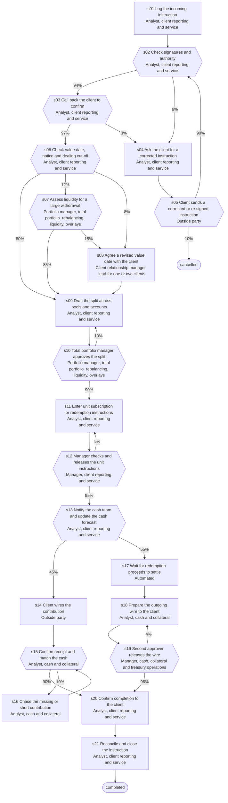

# Take in client contribution and withdrawal instructions

`pam-client-cash-flow-instructions` · Public sector institutional asset management · Client relations (client reporting and service) · part of `public-asset-manager`

Clients tell the asset manager when they have cash to invest, such as pension contributions or insurance set-asides, or need cash to pay pensions and benefits. A client reporting analyst logs the instruction, checks signatures and calls the client back on a pre-registered number, then splits the cash across pools and segregated accounts in line with the client's asset mix, which a total portfolio manager approves. Unit subscriptions or redemptions are keyed and released under maker-checker control, and the cash team matches incoming wires or sends outgoing ones with two approvers. Late, changed or very large instructions cause most of the rework and delay, and much of the work is re-keying between email, spreadsheets, the unitholder register and the custodian portal.

| | |
|---|---|
| Unit of work | one client cash instruction |
| Starts when | A client sends a signed notice of cash to invest or cash it needs, with amount, value date and authorisation. |
| Done when | The instruction is verified, turned into released pool and account instructions, the cash has arrived or been paid to the client's registered account, the client is told, and the log entry is reconciled and closed; or the client cancels. |
| Organisation | A provincial not-for-profit asset manager of about 240 staff that invests about $79 billion for a few public pension plans and an insurance board through pooled funds and segregated accounts, on a cost recovery basis. (242 employees, 2019-2022) |
| Volume | 16 cases a month (range 10 to 30) |

## Where it sits

- Starts with **client_cash_instruction** from client_pension_plan (60% of cases)
- Starts with **client_cash_instruction** from client_insurance_board (40% of cases)
- Sends **subscription_redemption_instruction** to pool-unit-transactions (outcome: completed)
- Sends **cash_forecast** to liquidity-forecasting (outcome: completed)
- Sends **funding_wire** to daily-cash-management (outcome: completed)

## Flow

## Roles

| Role | Department | Layer | FTE on this process | Loaded cost per hour | Evidence |
|---|---|---|---:|---:|---|
| Analyst, client reporting and service | Client reporting and service | individual contributor | 0.25 | 56 CAD | B [jobbank_11101] |
| Manager, client reporting and service | Client reporting and service | manager | 0.04 | 90 CAD | B [jobbank_10010] |
| Client relationship manager (lead for one or two clients) | Client relationship management | senior specialist | 0.02 | 160 CAD | B [jobbank_11101] |
| Portfolio manager, total portfolio (rebalancing, liquidity, overlays) | Total portfolio management and rebalancing | senior specialist | 0.05 | 195 CAD | B [jobbank_11101] |
| Analyst, cash and collateral | Cash, collateral and treasury operations | individual contributor | 0.08 | 56 CAD | C |
| Manager, cash, collateral and treasury operations | Cash, collateral and treasury operations | manager | 0.01 | 90 CAD | B [jobbank_10010] |

## Steps

Hands-on time and the wait before each step show the most common value. Evidence tier A is a sourced number, B a sourced description, C the author's estimate.

| Step | Who | Kind | Hands-on | Wait before | Control | Evidence |
|---|---|---|---:|---:|---|---|
| **s01 Log the incoming instruction.** A client reporting analyst picks up the signed instruction from the client service mailbox (a PDF on letterhead or a template sent by the client's treasury), records client, portfolio, contribution or withdrawal, amount, value date and signers in the instruction log, and saves the document. | Analyst, client reporting and service | intake | 15 min | 2.4 h |  | C |
| **s02 Check signatures and authority.** The analyst compares the signatures and names with the client's authorised signatory list from account set-up, checks the number of signers the client requires for the amount, and that the account and bank details match those on file. | Analyst, client reporting and service | validation | 10 min | 29 min | Client authorised signatory list and signing rules set at onboarding (IMA and account set-up) | C |
| **s03 Call back the client to confirm.** A second analyst phones a client contact on the pre-registered call-back list (never a number from the instruction itself), confirms amount, value date and account, and records the name, time and result in the log. | Analyst, client reporting and service | communication | 10 min | 1.9 h | Independent call-back on a pre-registered number by a person other than the one who logged the instruction (payment fraud control: verify through a separate channel with contact details already held) | B [cafc_spear], [ic3_bec_2022] |
| **s04 Ask the client for a corrected instruction.** The analyst emails and phones the client's treasury contact explaining the discrepancy and asks for a corrected or re-signed instruction; suspected fraud is escalated to the manager and compliance. | Analyst, client reporting and service | communication | 15 min | 1.2 h |  | C |
| **s05 Client sends a corrected or re-signed instruction.** The client's treasury staff obtain the missing signature, add a new signer to the authorised list or correct the details, and resend the instruction; a few cancel it instead. | Outside party | external wait | 0 min | 14.4 h |  | C |
| **s06 Check value date, notice and dealing cut-off.** The analyst checks that the instruction arrived within the agreed notice period and before the pool dealing cut-off for the value date, and flags withdrawals large enough to need the total portfolio team's liquidity view. | Analyst, client reporting and service | validation | 8 min | 29 min | Pool dealing cut-off and client notice periods in the IMA and subscription terms | C |
| **s07 Assess liquidity for a large withdrawal.** A total portfolio manager checks the client's liquidity report and cash forecast, decides which pools or segregated holdings to draw from without being a forced seller, and whether the amount can be met on the requested date or should be staged. | Portfolio manager, total portfolio (rebalancing, liquidity, overlays) | judgment | 1.0 h | 4.8 h |  | B [mgr_approach], [iclient_lri] |
| **s08 Agree a revised value date with the client.** The relationship manager calls the client to explain the cut-off or liquidity constraint and agrees a later or staged value date; the client confirms by email or a revised signed instruction. | Client relationship manager (lead for one or two clients) | communication | 30 min | 1.0 d |  | C |
| **s09 Draft the split across pools and accounts.** The analyst applies the client's current flow allocation template, built from its policy targets and the latest drift report, to split the cash between pools (unit subscriptions or redemptions) and segregated accounts or money market holdings. | Analyst, client reporting and service | analysis | 30 min | 1.2 h |  | B [client_manager] |
| **s10 Total portfolio manager approves the split.** A total portfolio manager reviews the split against the client's current weights and pending rebalancing, often using the flow to move the portfolio back toward target instead of trading, and approves or amends it. | Portfolio manager, total portfolio (rebalancing, liquidity, overlays) | approval | 15 min | 2.4 h | Client SIP&P targets and ranges, which the IMA requires the manager to follow | B [client_manager] |
| **s11 Enter unit subscription or redemption instructions.** The analyst keys one instruction per pool into the transfer agency template and unitholder register: client account, pool, subscription or redemption, amount and dealing date, with the call-back evidence attached. | Analyst, client reporting and service | data entry | 25 min | 1.2 h |  | C |
| **s12 Manager checks and releases the unit instructions.** The client service manager compares each keyed instruction with the signed client instruction, call-back record and approved split, and releases them to the transfer agency team before the dealing cut-off, or sends them back. | Manager, client reporting and service | approval | 15 min | 2.4 h | Maker-checker release of unit instructions; units issued only to member accounts on the register (OSC decision of 17 May 2017: pool units distributed only to accredited investor members; accurate books and records) | B [osc_mgr_2017] |
| **s13 Notify the cash team and update the cash forecast.** The analyst emails the cash and collateral team the expected incoming or outgoing amounts, accounts and value dates, and updates the client cash forecast that feeds the weekly liquidity forecast. | Analyst, client reporting and service | communication | 15 min | 43 min |  | B [pclient_ar_2021_cash], [iclient_lri] |
| **s14 Client wires the contribution.** On or before the value date the client's treasury wires the cash to its account at the custodian; the analyst waits for the custodian's cash report. | Outside party | external wait | 0 min | 1.5 d |  | C |
| **s15 Confirm receipt and match the cash.** A cash and collateral analyst checks the custodian portal for the incoming wire, matches amount, sender and account to the instruction and confirms to client service that the subscriptions can settle. | Analyst, cash and collateral | validation | 15 min | 2.4 h |  | C |
| **s16 Chase the missing or short contribution.** The cash analyst contacts the custodian and, through client service, the client's treasury to trace the wire, and tells the transfer agency team so subscriptions are held or adjusted. | Analyst, cash and collateral | communication | 20 min | 1.0 d |  | C |
| **s17 Wait for redemption proceeds to settle.** The pool redemptions are dealt at the next dealing date's unit price and settle to the client's account at the custodian, usually a day or two later. | Automated | system auto | 0 min | 1.5 d |  | C |
| **s18 Prepare the outgoing wire to the client.** The cash analyst creates a wire in the custodian portal from the client's account to the client's pre-registered bank account for the instructed amount and value date, attaching the instruction and call-back record. | Analyst, cash and collateral | data entry | 15 min | 2.4 h |  | C |
| **s19 Second approver releases the wire.** The cash and collateral manager checks the wire against the instruction and the pre-registered account, confirms it is to the client's own account, and releases it in the custodian portal; wires to new or changed bank details are refused until a fresh call-back is done. | Manager, cash, collateral and treasury operations | approval | 8 min | 2.4 h | Dual authorisation of outgoing wires and payment only to pre-registered client accounts; changed bank details need separate verification | B [ic3_bec_2022], [cafc_spear] |
| **s20 Confirm completion to the client.** The analyst emails the client confirming cash received or paid, the value date and the pool transactions, ahead of the formal unit confirmations from the transfer agency team. | Analyst, client reporting and service | communication | 15 min | 4.8 h |  | C |
| **s21 Reconcile and close the instruction.** At the end of the day the analyst ticks off the instruction against the custodian cash report and the unit confirmations, records any differences for follow-up and closes the log entry. | Analyst, client reporting and service | validation | 10 min | 7.2 h | Accurate books and records of member transactions (OSC decision of 17 May 2017, para 31(c)) | B [osc_mgr_2017] |

## Exceptions

| Exception | Share of cases | What happens |
|---|---:|---|
| Signature or detail discrepancy | 9% | A missing second signer, a new signer not yet on file, changed bank details or a failed call-back sends the instruction back to the client; some are cancelled. |
| Large or short-notice withdrawal | 12% | The total portfolio team must decide which pools or holdings to draw from without forced selling, and sometimes asks the client to stage the payment. |
| Late or changed instruction | 8% | The instruction arrives after the dealing cut-off or the client changes the amount, so the value date moves after a call with the client. |
| Contribution not received | 5% | The client's wire is late, short or sent to the wrong account and must be traced before subscriptions settle. |
| Suspected fraudulent instruction | 0% | An instruction with changed bank details fails the call-back; it is escalated to compliance and the client and not processed. |

## Benchmarks

| Metric | Value | Unit | Population | Evidence |
|---|---|---|---|---|
| cycle_time_days | p50 4, p90 8 | calendar days from receipt to instruction closed | Client cash instructions at a multi-client pooled fund manager | C |
| monthly_client_flow_scale | contributions_2021 1496000000, pension_payments_2021 1430000000 | CAD per year | Ontario Public Service Pension Plan | A [pclient_ar_2021_cash] |
| bec_exposed_losses | 43312749946 | USD, June 2016 to December 2021 | Business email compromise incidents reported worldwide to the FBI | A [ic3_bec_2022] |

## Pain points

- Instructions arrive as signed PDFs by email and are re-keyed into a log, a split template, the unitholder register and the custodian portal, with a check at each re-keying. (steps s01, s09, s11, s18; C)
- Call-backs depend on reaching a named client contact, which delays same-day processing when contacts are away. (steps s03; B [cafc_spear])
- Large or late withdrawals need a liquidity decision and sometimes a staged payment, which the client may not have planned for. (steps s06, s07, s08; B [iclient_lri], [mgr_approach])
- Several approvals (portfolio manager, client service manager, cash manager) each wait on a busy person's availability within a fixed dealing cut-off. (steps s10, s12, s19; C)

## Assumptions

- No public source describes the asset manager's cash instruction handling; the steps follow common practice at multi-client pooled fund managers and the controls named in the organisation file (call-back lists, two approvers on wires).
- Client notice periods of a few business days, next-day dealing and one to two days' settlement are author estimates; they set most of the elapsed time.
- Branch shares (6% signature discrepancies, 3% failed call-backs, 12% large withdrawals, 8% late or changed, 55% withdrawals) are author estimates.
- The second analyst who does the call-back is shown under the same role id, since the role covers three analysts.
- The outgoing wire is modelled here because the organisation file sends a funding wire to daily cash management; incoming cash matching is also shown so the case ends when cash has moved.
- Unit confirmations to the client are produced by the pool unit transaction process; this process sends an earlier email confirmation.
- Loaded costs are the organisation file's ranges (Job Bank wages, 1.35 loading).

## Sources

- [pclient_ar_2021_cash] The pension client 2021 Annual Report (contributions and pension payments) (link withheld) (The pension client, 2022). PSPP contributions from members and employers $1.496 billion in 2021 ($1.105 billion in 2020); pension payments $1.43 billion in 2021 ($1.37 billion in 2020); about 71% of pension payments since 1990 came from investment income
- [iclient_lri] Loss of retirement income fund (The insurance client web page) (link withheld) (The insurance client, 2025). The insurance client sets aside 5% of each loss of earnings payment (10% for some pre-1998 claims) plus optional worker contributions; pays out lump sums or monthly payments; net cash flow negative each year for the foreseeable future; the model manager sole investment manager; liquidity needed for benefit payments, capital calls, rebalancing and collateral, monitored at least monthly
- [pjpb_ar_2021] 2020/2021 Provincial Judges Pension Board annual report (link withheld) (Government of Ontario, 2021). The model manager engaged March 2020; $421 million transferred and held in money market until a long-term policy is adopted; SIP&P and SAA not finalised by 31 March 2021; province contributing just under $3 million a month to the RCA; member and sponsor contributions flow into the trusts
- [ic3_bec_2022] [Business Email Compromise: The $43 Billion Scam (Public Service Announcement I-050422-PSA)](https://www.ic3.gov/PSA/2022/PSA220504) (Federal Bureau of Investigation, Internet Crime Complaint Center, 2022). US$43.3 billion of exposed losses from 241,206 incidents June 2016 to December 2021, up 65% from July 2019 to December 2021; advises using secondary channels or two-factor authentication to verify requests to change account information
- [cafc_spear] [Spear phishing (Canadian Anti-Fraud Centre)](https://antifraudcentre-centreantifraude.ca/scams-fraudes/spear-phishing-harponnage-eng.htm) (Canadian Anti-Fraud Centre, 2024). Fraudsters spoof trusted senders to request payment changes or urgent wire transfers, often over $100,000; verify unusual requests through a separate channel using contact details already held
- [osc_mgr_2017] The model manager, Commission and Director decisions (exemptions for the model manager and its investment pools) (link withheld) (Ontario Securities Commission, 2017). IMA with each member under the manager's governing act s. 9(1)2; pool units only to accredited investor members; board-approved policies for KYC, restrictions set out in each IMA built into controls that prevent contraventions, fair allocation of opportunities among members and pools, books and records; PBA fiduciary standard applies to pension clients
- [client_manager] The model manager (The pension client investments page) (link withheld) (The pension client, 2024). The model manager invests under an investment management agreement and must comply with the pension client's SIP&P including the SAA; regular performance and risk reporting; cost recovery only
- [mgr_approach] Our Approach (The model manager web page) (link withheld) (The model manager, 2024). The model manager defines client objectives, risk tolerance and constraints with client boards, actuaries and advisers, runs sensitivity and stress tests including higher inflation, translates the strategic mix into the model manager strategies and keeps liquidity to avoid forced selling
- [jobbank_11101] [Wages: Financial Analyst (NOC 11101) in the Toronto Region](https://www.jobbank.gc.ca/marketreport/wages-occupation/12417/22437) (Job Bank, Government of Canada, 2024). Toronto hourly wages low 27.97, median 41.60, high 73.57 (reference period 2023-2024)
- [jobbank_10010] [Wages: Finance Director (NOC 10010) in the Toronto Region](https://www.jobbank.gc.ca/marketreport/wages-occupation/1225/22437) (Job Bank, Government of Canada, 2024). Toronto hourly wages low 41.21, median 62.37, high 96.15 (reference period 2023-2024)

Written by claude-opus on 2026-11-17.
