# Review a client's investment policy and asset mix

`pam-client-ips-asset-mix-review` · Public sector institutional asset management · Investments (portfolio construction) · part of `public-asset-manager`

Each client owns its statement of investment policies and procedures and its strategic asset mix, and its board must review and confirm or amend the policy at least once a year. The asset manager's portfolio construction team does the analysis: every few years a full asset-liability study with the client's actuary and board workshops, and in other years a lighter annual review against new capital market assumptions and the latest valuation. Recommendations pass internal review by the head of portfolio construction and the CIO, then the client's staff, investment committee and board, before the approved targets, ranges, benchmarks and restrictions are keyed into the rebalancing, risk, compliance and performance systems. Most elapsed time is spent waiting for the actuary's projections and for committee and board meeting dates, and board requests for more scenarios add whole rounds.

| | |
|---|---|
| Unit of work | one client portfolio's policy and asset mix review |
| Starts when | The client's annual policy review falls due on its governance calendar, or a full asset-liability study is due (every three to five years) or brought forward by a change in funding, plan design or capital market assumptions. |
| Done when | The client's board has approved or confirmed its policy and asset mix, and any changes are loaded and cross-checked in the rebalancing, risk, compliance and performance systems, with the client told when they take effect. |
| Organisation | A provincial not-for-profit asset manager of about 240 staff that invests about $79 billion for a few public pension plans and an insurance board through pooled funds and segregated accounts, on a cost recovery basis. (242 employees, 2019-2022) |
| Volume | 0.45 cases a month (range 0.3 to 0.8) |

## Where it sits

- Starts with **client_ips** from client_pension_plan (45% of cases)
- Starts with **client_ips** from client_insurance_board (25% of cases)
- Starts with **liability_projection** from client_actuary_advisor (10% of cases)
- Starts with **client_ips** from client-onboarding-transition (5% of cases)
- Starts with **capital_market_assumptions** from capital-market-assumptions (10% of cases)
- Starts with **risk_report** from risk-reporting-stress-testing (5% of cases)
- Sends **asset_mix_recommendation** to client_pension_plan (outcome: approved)
- Sends **asset_mix_recommendation** to client_insurance_board (outcome: approved)
- Sends **client_ips** to client-portfolio-rebalancing (outcome: approved)
- Sends **client_ips** to daily-risk-limit-monitoring (outcome: approved)
- Sends **client_ips** to investment-compliance-monitoring (outcome: approved)
- Sends **client_ips** to performance-attribution (outcome: approved)

## Flow

```mermaid
flowchart TD
    s01{{"s01 Open the review and agree scope with the client<br/>Client relationship manager  lead for one or two clients"}}
    s02["s02 Request liability projections from the client's actuary<br/>Principal, portfolio construction and asset mix advice"]
    s03["s03 Client actuary delivers liability projections<br/>Outside party"]
    s04{{"s04 Validate the liability data<br/>Associate, portfolio construction and research"}}
    s05["s05 Run asset-liability projections of candidate mixes<br/>Associate, portfolio construction and research"]
    s06["s06 Design and compare candidate asset mixes<br/>Principal, portfolio construction and asset mix advice"]
    s07{{"s07 Independent risk review of the study<br/>Senior manager, investment risk"}}
    s08{{"s08 Run an education workshop with the client's board<br/>Principal, portfolio construction and asset mix advice"}}
    s09["s09 Client supplies latest valuation and cash flow update<br/>Outside party"]
    s10["s10 Refresh the annual policy tests<br/>Associate, portfolio construction and research"]
    s11["s11 Draft the recommendation and policy mark-up<br/>Principal, portfolio construction and asset mix advice"]
    s12{{"s12 Head of portfolio construction reviews the advice<br/>Managing director, head of portfolio design and construction"}}
    s13{{"s13 CIO approves the advice<br/>Chief investment officer"}}
    s14["s14 Review client materials and send the pre-read<br/>Director, client relationships"]
    s15{{"s15 Client staff and consultant review the draft<br/>Outside party"}}
    s16["s16 Present the recommendation to the client's investment committee<br/>Principal, portfolio construction and asset mix advice"]
    s17{{"s17 Client board approves the policy and asset mix<br/>Outside party"}}
    s18["s18 Write the policy implementation memo<br/>Principal, portfolio construction and asset mix advice"]
    s19["s19 Update policy ranges and limits in the risk system<br/>Analyst, investment risk analytics"]
    s20["s20 Update the client's restrictions in the compliance engine<br/>Compliance analyst"]
    s21["s21 Update the policy benchmark in the performance system<br/>Analyst, performance measurement and attribution"]
    s22{{"s22 Load targets in the rebalancing model and cross-check all set-ups<br/>Analyst, total portfolio management"}}
    s23["s23 Confirm the outcome to the client<br/>Client relationship manager  lead for one or two clients"]
    s01 -->|"25%"| s02
    s01 -->|"75%"| s09
    s02 --> s03
    s03 --> s04
    s04 -->|"85%"| s05
    s04 -->|"15%"| s03
    s05 --> s06
    s06 --> s07
    s07 -->|"85%"| s08
    s07 -->|"15%"| s06
    s08 -->|"70%"| s11
    s08 -->|"30%"| s05
    s09 --> s10
    s10 --> s11
    s11 --> s12
    s12 -->|"85%"| s13
    s12 -->|"15%"| s11
    s13 -->|"93%"| s14
    s13 -->|"7%"| s11
    s14 --> s15
    s15 -->|"75%"| s16
    s15 -->|"25%"| s11
    s16 --> s17
    s17 -->|"60%"| s18
    s17 -->|"30%"| s23
    s17 -->|"10%"| s11
    s18 --> s19
    s19 --> s20
    s20 --> s21
    s21 --> s22
    s22 -->|"90%"| s23
    s22 -->|"10%"| s19
    s23 --> end0
    end0(["approved"])
```

## Roles

| Role | Department | Layer | FTE on this process | Loaded cost per hour | Evidence |
|---|---|---|---:|---:|---|
| Principal, portfolio construction and asset mix advice | Portfolio construction and asset mix advice | senior specialist | 0.25 | 195 CAD | B [jobbank_11101] |
| Associate, portfolio construction and research | Portfolio construction and asset mix advice | individual contributor | 0.18 | 85 CAD | B [jobbank_11101] |
| Managing director, head of portfolio design and construction | Total portfolio management | director | 0.03 | 420 CAD | C |
| Chief investment officer | Investments | executive | 0.008 | 1800 CAD | C |
| Senior manager, investment risk | Portfolio risk and analytics | senior specialist | 0.03 | 120 CAD | B [jobbank_11101] |
| Client relationship manager (lead for one or two clients) | Client relationship management | senior specialist | 0.03 | 160 CAD | B [jobbank_11101] |
| Director, client relationships | Client relationship management | director | 0.01 | 240 CAD | B [jobbank_11101] |
| Analyst, investment risk analytics | Portfolio risk and analytics | individual contributor | 0.005 | 65 CAD | B [jobbank_11101] |
| Compliance analyst | Compliance | individual contributor | 0.005 | 65 CAD | C |
| Analyst, performance measurement and attribution | Performance measurement and attribution | individual contributor | 0.005 | 56 CAD | B [jobbank_11101] |
| Analyst, total portfolio management | Total portfolio management and rebalancing | individual contributor | 0.005 | 85 CAD | B [jobbank_11101] |

## Steps

Hands-on time and the wait before each step show the most common value. Evidence tier A is a sourced number, B a sourced description, C the author's estimate.

| Step | Who | Kind | Hands-on | Wait before | Control | Evidence |
|---|---|---|---:|---:|---|---|
| **s01 Open the review and agree scope with the client.** The relationship manager checks the client's governance calendar, confirms with the client's staff whether this year is a routine annual review of the policy or a full asset-liability study (due every three to five years, or earlier after a large change in funded status or plan design), and books the investment committee and board dates the work must meet. | Client relationship manager (lead for one or two clients) | coordination | 2.0 h | 5.0 d |  | A [pclient_ar_2020], [iclient_if] |
| **s02 Request liability projections from the client's actuary.** The portfolio strategist sends the client's actuary a data request: projected benefit cash flows, liability duration and inflation sensitivity, contribution policy, the latest valuation assumptions and any plan changes, in a format the asset-liability model can load. | Principal, portfolio construction and asset mix advice | communication | 1.0 h | 2.0 d |  | B [mgr_approach], [pclient_ar_2021] |
| **s03 Client actuary delivers liability projections.** The client's actuary runs the projections from its valuation system and sends cash flow files and a covering note. The work is fitted around the actuary's valuation and funding work for the client. | Outside party | external wait | 0 min | 35.0 d |  | C |
| **s04 Validate the liability data.** A portfolio construction analyst loads the cash flows, checks totals against the last valuation, duration and inflation linkage against the actuary's note, and flags gaps or inconsistencies back to the actuary. | Associate, portfolio construction and research | validation | 5.0 h | 3.0 d |  | C |
| **s05 Run asset-liability projections of candidate mixes.** The analyst loads the house capital market assumptions, the client's current mix and the liabilities into the asset-liability model and projects assets, liabilities, funded status and contributions over 10 to 30 years under thousands of scenarios for the current mix and several candidate mixes, plus deterministic stress cases such as an inflation shock or equity crash. | Associate, portfolio construction and research | analysis | 3.3 d | 7.0 d |  | B [pclient_ar_2020], [mgr_approach] |
| **s06 Design and compare candidate asset mixes.** The portfolio strategist reviews the projections, shapes candidate mixes that respect the client's liquidity needs, private market pacing and leverage limits, compares expected return, funded status risk and contribution risk, and selects two or three options to show the client's board. | Principal, portfolio construction and asset mix advice | analysis | 1.7 d | 4.0 d |  | B [mgr_approach], [pclient_sipp_2025] |
| **s07 Independent risk review of the study.** A senior risk manager reviews the stress tests, liquidity coverage and leverage of each shortlisted mix with the risk system, checks the model assumptions against the house view and writes a short independent opinion, or sends the work back for corrections. | Senior manager, investment risk | review | 12.0 h | 5.0 d | The model manager second-line risk review of asset mix advice before it goes to a client board (common practice at Canadian public pension managers) | C |
| **s08 Run an education workshop with the client's board.** The portfolio strategist, with the relationship manager, takes the client's board or investment committee through the study: liabilities, capital market assumptions, the options and their trade-offs. Board members often ask for more scenarios or a further option, which sends the analysis back for another round. | Principal, portfolio construction and asset mix advice | communication | 15.0 h | 45.0 d |  | A [calpers_alm], [pclient_ar_2021] |
| **s09 Client supplies latest valuation and cash flow update.** For the annual review the client's staff send the latest funded status, contribution and benefit cash flow forecast and any plan or policy changes since last year, usually from the actuary's latest valuation or roll-forward. | Outside party | external wait | 0 min | 10.0 d |  | C |
| **s10 Refresh the annual policy tests.** The analyst updates the client's current mix, new capital market assumptions and valuation results in the model, re-runs expected return and risk for the approved mix, checks ranges, benchmarks and restrictions against how the portfolio was actually run during the year, and lists policy clauses that need updating. | Associate, portfolio construction and research | analysis | 20.0 h | 4.0 d |  | B [iclient_if], [pclient_sipp_2025] |
| **s11 Draft the recommendation and policy mark-up.** The portfolio strategist writes the recommendation paper (findings, recommended targets, ranges and benchmarks, expected return and risk, transition timetable for any change) and marks up the client's statement of investment policies and procedures, including how private asset under or overweights are remapped to public assets. | Principal, portfolio construction and asset mix advice | drafting | 16.0 h | 3.0 d |  | B [pclient_sipp_2025], [cfa_ips_2010] |
| **s12 Head of portfolio construction reviews the advice.** The managing director checks the recommendation against the house view and other clients' advice for consistency, challenges the reasoning and tables, and returns it for changes where needed. | Managing director, head of portfolio design and construction | review | 2.5 h | 3.0 d | The model manager internal review of client advice by the head of portfolio construction | C |
| **s13 CIO approves the advice.** The chief investment officer reads the paper, confirms the recommended mix is one the model manager can implement within its pools, leverage and private market pacing, and signs off before anything goes to the client. | Chief investment officer | approval | 1.0 h | 4.0 d | The model manager delegation of authority: asset mix advice to client boards approved by the chief investment officer | C |
| **s14 Review client materials and send the pre-read.** The director of client relationships checks the paper and presentation for the client's format and plain language, confirms the meeting agenda with the client's staff and sends the pre-read to staff and their investment consultant. | Director, client relationships | review | 1.5 h | 2.0 d |  | C |
| **s15 Client staff and consultant review the draft.** The client's investment staff, and often its own investment consultant or actuary, review the draft and send comments or questions; significant comments send the paper back for revision before the committee meeting. | Outside party | external wait | 0 min | 10.0 d |  | B [mgr_approach] |
| **s16 Present the recommendation to the client's investment committee.** The portfolio strategist and relationship manager present at the client's investment committee, answer questions and record the committee's decision to recommend the policy to the board, sometimes with amendments. | Principal, portfolio construction and asset mix advice | communication | 5.0 h | 14.0 d |  | A [pclient_sipp_2025] |
| **s17 Client board approves the policy and asset mix.** The client's board approves or confirms the statement of investment policies and procedures and the strategic asset allocation at its next meeting, or asks for changes. Pension plan clients then file the amended policy with the pension regulator within 60 days. | Outside party | approval | 0 min | 10.0 d | Pension Benefits Act s. 22 and Regulation 909 s. 78: the administrator sets the SIPP, reviews and confirms or amends it at least annually and files amendments within 60 days; the insurance client board approves its SIPP each fiscal year | A [iclient_if], [fsco_ign003], [pclient_sipp_2025] |
| **s18 Write the policy implementation memo.** The portfolio strategist turns the approved policy into implementation parameters: new targets and ranges by asset class and pool, policy benchmark weights, changed restrictions, the transition path from the old to the new mix and the date each change takes effect, and sends it to total portfolio management, risk, compliance and performance. | Principal, portfolio construction and asset mix advice | drafting | 8.0 h | 3.0 d |  | B [pclient_ar_2021], [pclient_sipp_2025], [client_manager] |
| **s19 Update policy ranges and limits in the risk system.** A risk analyst loads the new policy weights, ranges and benchmark into the risk system so daily limit monitoring tests the client portfolio against the approved policy and its transition path. | Analyst, investment risk analytics | data entry | 2.0 h | 2.0 d |  | C |
| **s20 Update the client's restrictions in the compliance engine.** A compliance analyst changes the coded rules for the client's account where the policy changed permitted investments, limits or leverage, tests them against current holdings and records the change. | Compliance analyst | data entry | 3.0 h | 2.0 d | OSC decision of 17 May 2017, para 31(e): restrictions set out in each client's IMA and policy are built into controls that prevent contraventions | B [osc_mgr_2017] |
| **s21 Update the policy benchmark in the performance system.** A performance analyst sets the new policy benchmark weights and effective date for the client portfolio so returns are measured against the approved mix from the right month. | Analyst, performance measurement and attribution | data entry | 2.0 h | 2.0 d |  | C |
| **s22 Load targets in the rebalancing model and cross-check all set-ups.** An analyst in total portfolio management loads the new targets, ranges and transition path into the rebalancing model, then compares the risk, compliance and performance set-ups line by line with the approved policy and memo; differences go back to the team that keyed them. | Analyst, total portfolio management | validation | 2.5 h | 1.0 d | Independent check of policy parameters keyed by another team (maker-checker; common practice) | C |
| **s23 Confirm the outcome to the client.** The relationship manager writes to the client confirming the approved policy, when each change takes effect and how the transition to any new mix will be reported, files the approved policy and board resolution, and closes the review in the CRM. | Client relationship manager (lead for one or two clients) | communication | 1.0 h | 2.0 d |  | C |

## Exceptions

| Exception | Share of cases | What happens |
|---|---:|---|
| Board asks for more scenarios in a full study | 8% | After an education workshop the board wants another option or stress case, sending the analysis back through modelling, risk review and a further workshop at a later meeting. |
| Actuary data queries | 4% | Projected cash flows do not tie to the valuation and go back to the actuary. |
| Client staff or consultant revisions | 25% | Comments from the client's staff or its own consultant require the paper to be reworked and re-approved internally before the committee. |
| Board sends the policy back | 10% | The board asks for changes, pushing approval to its next meeting, often a quarter later. |
| Policy confirmed without change | 30% | In a routine year the board confirms the existing policy and nothing needs to be re-keyed in systems. |
| Client policy not finalised for over a year | 2% | Governance disputes at the client stall approval, leaving assets in an interim mix, as with the judges' plan whose policy and SAA were still not final at March 2021. |

## Benchmarks

| Metric | Value | Unit | Population | Evidence |
|---|---|---|---|---|
| cycle_time_days | p50 110, p90 360 | calendar days from scoping to confirmed implementation | Annual policy reviews and periodic asset-liability studies for public pension and insurance clients | B [calpers_alm], [pclient_ar_2020], [pclient_ar_2021], [iclient_if] |
| full_study_initiation_to_board_vote_days | 365 | calendar days | CalPERS 2025 ALM cycle | A [calpers_alm] |
| asset_liability_study_frequency | low 3, high 5 | years between full studies | The pension client (three to five years) and the insurance client (at least every four years) | A [pclient_ar_2020], [iclient_if] |
| policy_review_frequency | 1 | reviews per year (minimum) | Ontario pension plan administrators and the insurance client | A [iclient_if], [pclient_sipp_2025], [fsco_ign003] |
| new_mix_implementation_period | 4 | years | The pension client SAA approved April 2021 | A [pclient_ar_2021] |
| policy_filing_deadline | 60 | days after amendment | Ontario registered pension plans | A [fsco_ign003] |

## Pain points

- Committee and board calendars set the pace: a comment or an extra scenario request moves approval to the next meeting, often a quarter later. (steps s08, s16, s17; B [calpers_alm], [pclient_ar_2021])
- The study waits on the client's actuary for liability projections that do not fit the actuary's own valuation cycle. (steps s03, s04; C)
- Each client wants its own format and process, so similar analysis is rebuilt five times and cross-client consistency needs a separate review. (steps s11, s12, s14; C)
- Approved policy changes are re-keyed separately into risk, compliance, performance and rebalancing tools, so a cross-check is needed to catch mismatches. (steps s19, s20, s21, s22; C)
- Disagreements inside a client's governance can stall approval for more than a year, leaving assets in an interim mix that the asset manager cannot change on its own. (steps s15, s17; A [pjpb_ar_2021])

## Assumptions

- One review in four is a full asset-liability study, from three to five year study cycles across five portfolios; the rest are annual reviews.
- The routing at s01 sends full studies through s02 to s08 and annual reviews through s09 and s10; both join at s11. The simulator draws branches independently, so loop counts are averages, not per-path rules.
- External steps (actuary, client staff, committee and board) carry zero touch time; client effort is inside the waits.
- Hands-on hours for a full study (about 250 to 400 hours including workshop rounds) and an annual review (about 60 to 100 hours) are author estimates; the asset manager publishes no effort data.
- The cycle time benchmark is derived from two dated full studies (CalPERS, the pension client) and the annual review requirement; there is no published distribution.
- risk_analyst, compliance_analyst, performance_analyst and tpm_analyst are organisation file roles not listed on this process_map entry; they are added for the system updates after approval.
- The pension regulator filing within 60 days is done by the client and is not on the asset manager's path, so it is described in s17 rather than modelled as a wait.
- Loaded costs are the organisation file's ranges (Job Bank wages, 1.35 loading).

## Sources

- [pclient_sipp_2025] Statement of Investment Policies and Procedures for the Public Service Pension Plan (approved 3 December 2025) (link withheld) (The pension client, 2025). The pension client delegates investment to the model manager, which must comply with the SIP&P; SAA with minimum, target and maximum by asset class after an asset liability study in 2024; private asset deviations are not violations, the model manager outlines a plan to reach targets and over or underweights are remapped to public assets under the model manager policy; transitions to a new mix may sit outside ranges; investment committee reviews and recommends the SIP&P to the board annually
- [pclient_ar_2020] The pension client 2020 Annual Report (link withheld) (The pension client, 2021). The pension client conducts an asset/liability study every three to five years, projecting assets and liabilities under many scenarios and modelling candidate portfolios; previous study 2017 with SAA changes phased in through 2020; new study initiated in 2020; the pension client sets the SAA and the model manager executes it
- [pclient_ar_2021] The pension client 2021 Annual Report (link withheld) (The pension client, 2022). Asset liability study completed working closely with the model manager; new SAA approved by the pension client board in April 2021 and implemented by the model manager over four years; funding risk study with the plan actuaries
- [iclient_if] Insurance fund: statement of investment policies and procedures (The insurance client web page) (link withheld) (The insurance client, 2025). The insurance client board approves the SIPP and reviews it at least once each fiscal year; detailed asset-liability study of the policy mix no less often than every four years; the model manager sole investment manager; derivatives may be used for rebalancing; liquidity coverage monitored at least monthly; performance, risk and compliance reviewed at least quarterly; policy asset mix with minimum, target and maximum by asset class; private over or underweights remapped to public assets and the model manager outlines a plan to reach targets when outside ranges; non-traded investments valued at least annually and reviewed quarterly, public investments at least monthly
- [fsco_ign003] [Investment Guidance Note IGN-003: SIPPs for member-directed defined contribution plans](https://www.fsrao.ca/media/8301/download) (Financial Services Commission of Ontario (now FSRA), 2015). Administrator must establish a SIPP under Regulation 909 s. 78, set a review and approval process and monitor compliance; SIPPs filed with the regulator from 2016 and amendments filed within 60 days; member-directed DC SIPPs exempt from the annual review requirement of PBSR s. 7.2 that applies to other plans
- [cfa_ips_2010] [Elements of an Investment Policy Statement for Institutional Investors](https://rpc.cfainstitute.org/-/media/documents/article/position-paper/investment-policy-statement-institutional-investors.pdf) (CFA Institute, 2010). An IPS should set the process for reviewing and updating it (example: review at each quarterly investment committee) and define a rebalancing process with allowable ranges (example: return to within 0 to 50% of the range within two business days of a breach)
- [calpers_alm] [Asset Liability Management (ALM) (CalPERS web page)](https://www.calpers.ca.gov/about/organization/facts-at-a-glance/asset-liability-management) (California Public Employees' Retirement System, 2025). Formal ALM process on a four-year cycle: cycle initiated November 2024, education day January 2025, strategy sessions, first reading September and board vote November 2025 on the reference portfolio, risk limits and discount rate; decisions effective 1 July 2026
- [mgr_approach] Our Approach (The model manager web page) (link withheld) (The model manager, 2024). The model manager defines client objectives, risk tolerance and constraints with client boards, actuaries and advisers, runs sensitivity and stress tests including higher inflation, translates the strategic mix into the model manager strategies and keeps liquidity to avoid forced selling
- [client_manager] The model manager (The pension client investments page) (link withheld) (The pension client, 2024). The model manager invests under an investment management agreement and must comply with the pension client's SIP&P including the SAA; regular performance and risk reporting; cost recovery only
- [osc_mgr_2017] The model manager, Commission and Director decisions (exemptions for the model manager and its investment pools) (link withheld) (Ontario Securities Commission, 2017). IMA with each member under the manager's governing act s. 9(1)2; pool units only to accredited investor members; board-approved policies for KYC, restrictions set out in each IMA built into controls that prevent contraventions, fair allocation of opportunities among members and pools, books and records; PBA fiduciary standard applies to pension clients
- [pjpb_ar_2021] 2020/2021 Provincial Judges Pension Board annual report (link withheld) (Government of Ontario, 2021). The model manager engaged March 2020; $421 million transferred and held in money market until a long-term policy is adopted; SIP&P and SAA not finalised by 31 March 2021; province contributing just under $3 million a month to the RCA; member and sponsor contributions flow into the trusts
- [jobbank_11101] [Wages: Financial Analyst (NOC 11101) in the Toronto Region](https://www.jobbank.gc.ca/marketreport/wages-occupation/12417/22437) (Job Bank, Government of Canada, 2024). Toronto hourly wages low 27.97, median 41.60, high 73.57 (reference period 2023-2024)

Written by claude-opus on 2026-11-17.
