# Produce monthly client reports

`pam-client-monthly-reporting` · public-sector asset management · client relations (client reporting and service) · part of `public-asset-manager`

Each month the client reporting team builds a report for each of five client portfolios showing market values by pool and asset class, units held, returns against benchmarks, asset mix against policy ranges, cash flows, rebalancing and compliance with the client's investment policy. The work cannot finish until fund accounting signs off the month-end books and the performance team releases approved returns, so most of the elapsed time is waiting. Analysts then reconcile figures across accounting, performance, private markets and risk sources in spreadsheets, a second analyst and the manager review, and the relationship manager releases it. Late private market values, restated returns and manual workbook assembly are the usual causes of delay and error.

| | |
|---|---|
| Unit of work | one client portfolio's monthly report |
| Starts when | Month end: the reporting cycle opens on the first business day; work proceeds as the signed-off accounting package and approved performance results arrive. |
| Done when | The approved report is delivered to the client's authorised contacts and the delivery is logged against the service level, or a corrected version is reissued. |
| Organisation | A Canadian provincial not-for-profit asset manager running pooled funds and segregated accounts for four public-sector clients with five portfolios, with a small client reporting team that assembles tailored reports from a data warehouse and spreadsheets. (242 employees, 2019-2022) |
| Volume | 5 cases a month (range 3 to 5) |

## Where it sits

- Starts with **performance_results** from performance-attribution (45% of cases)
- Starts with **pool_nav_package** from fund-accounting-close (25% of cases)
- Starts with **reporting_dataset** from data-warehouse-operations (10% of cases)
- Starts with **risk_report** from risk-reporting-stress-testing (10% of cases)
- Starts with **compliance_exception** from investment-compliance-monitoring (5% of cases)
- Starts with **rebalancing_proposal** from client-portfolio-rebalancing (5% of cases)
- Sends **client_monthly_report** to client_pension_plan (outcome: released)
- Sends **client_monthly_report** to client_insurance_board (outcome: released)

## Flow

```mermaid
flowchart TD
    s01["s01 Open the monthly cycle and roll forward report templates<br/>Analyst, client reporting and service"]
    s02["s02 Wait for signed-off month-end accounting package<br/>Analyst, client reporting and service"]
    s03["s03 Extract holdings, market values and units<br/>Analyst, client reporting and service"]
    s04{{"s04 Load private holdings values and commitments<br/>Analyst, client reporting and service"}}
    s05["s05 Chase missing private market values or cash flows<br/>Analyst, client reporting and service"]
    s06{{"s06 Reconcile values and units to the accounting package<br/>Analyst, client reporting and service"}}
    s07["s07 Resolve break with fund accounting<br/>Senior accountant, investment accounting"]
    s08{{"s08 Load approved returns and check returns, mix and ranges<br/>Analyst, client reporting and service"}}
    s09["s09 Explain or correct the return difference<br/>Analyst, performance measurement and attribution"]
    s10["s10 Add cash flows, unit transactions and rebalancing<br/>Analyst, client reporting and service"]
    s11["s11 Add risk summary and policy compliance section<br/>Analyst, client reporting and service"]
    s12{{"s12 Confirm the policy compliance statement<br/>Compliance analyst"}}
    s13{{"s13 Check for restated prior months<br/>Analyst, client reporting and service"}}
    s14["s14 Prepare restatement bridge and footnote<br/>Analyst, client reporting and service"]
    s15["s15 Draft performance and market commentary<br/>Analyst, client reporting and service"]
    s16["s16 Assemble the package and complete the checklist<br/>Analyst, client reporting and service"]
    s17{{"s17 Peer check by a second analyst<br/>Analyst, client reporting and service"}}
    s18{{"s18 Manager reviews and signs off<br/>Manager, client reporting and service"}}
    s19{{"s19 Relationship manager approves release<br/>Client relationship manager  lead for one or two clients"}}
    s20["s20 Finalise PDF and verify the distribution list<br/>Analyst, client reporting and service"]
    s21{{"s21 Send the report and log delivery<br/>Analyst, client reporting and service"}}
    s22["s22 Correct and reissue the report<br/>Analyst, client reporting and service"]
    s01 --> s02
    s02 --> s03
    s03 --> s04
    s04 -->|"85%"| s06
    s04 -->|"15%"| s05
    s05 --> s06
    s06 -->|"80%"| s08
    s06 -->|"20%"| s07
    s07 --> s06
    s08 -->|"84%"| s10
    s08 -->|"16%"| s09
    s09 --> s08
    s10 --> s11
    s11 --> s12
    s12 -->|"93%"| s13
    s12 -->|"7%"| s11
    s13 -->|"25%"| s14
    s13 -->|"75%"| s15
    s14 --> s15
    s15 --> s16
    s16 --> s17
    s17 -->|"86%"| s18
    s17 -->|"14%"| s16
    s18 -->|"85%"| s19
    s18 -->|"15%"| s16
    s19 -->|"90%"| s20
    s19 -->|"10%"| s15
    s20 --> s21
    s21 -->|"96%"| end0
    s21 -->|"4%"| s22
    s22 --> s18
    end0(["released"])
```

## Roles

| Role | Department | Layer | FTE on this process | Loaded cost per hour | Evidence |
|---|---|---|---:|---:|---|
| Analyst, client reporting and service | Client reporting and service | individual contributor | 0.8 | 56 CAD | B [ca_job], [jobbank_11101] |
| Manager, client reporting and service | Client reporting and service | manager | 0.15 | 90 CAD | B [jobbank_10010] |
| Client relationship manager (lead for one or two clients) | Client relationship management | senior specialist | 0.08 | 160 CAD | C |
| Analyst, performance measurement and attribution | Performance measurement and attribution | individual contributor | 0.05 | 56 CAD | B [jobbank_11101] |
| Compliance analyst | Compliance | individual contributor | 0.03 | 65 CAD | C |
| Senior accountant, investment accounting | Investment accounting (pools and client portfolios) | individual contributor | 0.04 | 56 CAD | B [jobbank_11100] |

## Steps

Hands-on time and the wait before each step show the most common value. Evidence tier A is a sourced number, B a sourced description, C the author's estimate.

| Step | Who | Kind | Hands-on | Wait before | Control | Evidence |
|---|---|---|---:|---:|---|---|
| **s01 Open the monthly cycle and roll forward report templates.** On the first business day after month end the analyst copies last month's report workbook and presentation shell for the client portfolio, updates dates and period labels, checks the client's current policy asset mix and ranges against the latest investment policy, and refreshes the reporting calendar tracker. | Analyst, client reporting and service | coordination | 45 min | 12.0 h |  | C [mgr_ar20] |
| **s02 Wait for signed-off month-end accounting package.** The analyst watches the close tracker and the fund accounting mailbox until the pools and the client's segregated accounts are signed off for the month. Nothing in the report can be finalised before accounting values and unit balances are approved, so the case waits on the fund accounting close. | Analyst, client reporting and service | lookup | 15 min | 9.0 d |  | B [nmerb_ps] |
| **s03 Extract holdings, market values and units.** The analyst runs the warehouse reports for the client portfolio: market value by pool and segregated strategy, units held in each pool from the unitholder register, accrued income and cash. The output is pasted into the report workbook, which still holds several manual mapping tabs. | Analyst, client reporting and service | lookup | 2.0 h | 1.0 h |  | B [ca_job], [cutter_cr2020] |
| **s04 Load private holdings values and commitments.** The analyst pulls the latest approved values, unfunded commitments, and the month's capital calls and distributions for the client's private market holdings from the private markets system. Most values are the last quarter-end valuation rolled forward for cash flows, which the report must footnote. | Analyst, client reporting and service | lookup | 40 min | 0 min |  | B [prim_rfp], [iclient_if] |
| **s05 Chase missing private market values or cash flows.** The analyst emails private markets operations and valuations with the list of holdings whose value or latest cash flow is missing or does not match the prior report, and waits for the corrected booking or a confirmation that the prior value stands. | Analyst, client reporting and service | coordination | 30 min | 1.5 d |  | C |
| **s06 Reconcile values and units to the accounting package.** The analyst ties the report's market values by pool and account to the signed-off NAV package and the units to the unitholder register, and checks that opening values equal last month's closing values. Differences above the tolerance are listed for fund accounting. | Analyst, client reporting and service | validation | 1.5 h | 1.0 h | The model manager SOC 1 report (CSAE 3416 / SSAE 18 examination): reconciliation and client reporting control objectives that statements show the correct holdings and market value | B [sifma_soc1], [mgr_ar21], [ca_job] |
| **s07 Resolve break with fund accounting.** A fund accountant investigates each listed difference, usually an accrual, a late trade, a private market booking or a unit transaction dated in the wrong period, and either corrects the books or explains it. The analyst then re-runs the reconciliation. | Senior accountant, investment accounting | analysis | 45 min | 1.0 d |  | C |
| **s08 Load approved returns and check returns, mix and ranges.** When the performance team releases approved returns, the analyst loads portfolio, asset class and benchmark returns for the month, quarter to date, year to date and longer periods, then checks that the asset mix sits within the client's policy ranges and that total fund return agrees with the sum of its parts. | Analyst, client reporting and service | validation | 2.0 h | 3.0 d |  | B [ocers_qa], [mgr_ar22] |
| **s09 Explain or correct the return difference.** A performance analyst checks the queried return or benchmark, typically a late private market cash flow, a cost accrual, a blended benchmark weight or a restated prior month, and either confirms the figure with an explanation or issues a corrected result. | Analyst, performance measurement and attribution | analysis | 1.0 h | 12.0 h |  | C |
| **s10 Add cash flows, unit transactions and rebalancing.** The analyst adds the month's client contributions and withdrawals, the pool units issued and redeemed with prices, and the rebalancing switches and overlay changes made by total portfolio management, taken from the register and the rebalancing log. | Analyst, client reporting and service | data entry | 45 min | 0 min |  | C |
| **s11 Add risk summary and policy compliance section.** The analyst inserts the risk team's monthly figures for the portfolio and the list of confirmed guideline or policy breaches with remediation from the compliance exception log, and drafts the compliance statement for the month. | Analyst, client reporting and service | data entry | 40 min | 8.0 h |  | B [iclient_if] |
| **s12 Confirm the policy compliance statement.** A compliance analyst compares the draft statement with the compliance engine's breach log and open cases for the client's accounts and pools and confirms or corrects the wording before the report goes further. | Compliance analyst | review | 25 min | 1.0 d | Client investment management agreement and statement of investment policies: The model manager reports compliance with the client's policies and restrictions | B [iclient_if], [pclient_ar21] |
| **s13 Check for restated prior months.** The analyst reads the performance team's release note to see whether new quarter-end private valuations restated earlier months. If so the report needs a bridge from the previously reported figures to the restated ones. | Analyst, client reporting and service | judgment | 15 min | 0 min |  | B [gips_ao], [ilpa_faq] |
| **s14 Prepare restatement bridge and footnote.** The analyst builds a table showing each affected month as first reported and as restated, with the cause, and writes a footnote. The bridge is checked against the performance team's restatement memo. | Analyst, client reporting and service | drafting | 2.0 h | 2.0 h |  | C |
| **s15 Draft performance and market commentary.** The analyst writes a page of commentary on the month: market moves, the portfolio's return against its benchmark by asset class, main contributors from the attribution, and any rebalancing or policy breaches, reusing house market views where available. | Analyst, client reporting and service | drafting | 1.5 h | 2.0 h |  | B [mgr_ar20] |
| **s16 Assemble the package and complete the checklist.** The analyst assembles tables, charts, commentary and footnotes into the client's format, then works the reporting checklist: totals foot, opening equals prior closing, periods and labels correct, every table ties to the reconciliation sheet. | Analyst, client reporting and service | validation | 1.5 h | 1.0 h |  | B [ca_job] |
| **s17 Peer check by a second analyst.** Another client reporting analyst re-performs a sample of tie-outs, reads every table against the reconciliation sheet and the performance release, and marks errors on the draft for the preparer to fix. | Analyst, client reporting and service | review | 1.0 h | 8.0 h | Maker-checker review of client reports before distribution under the client reporting procedures | B [sifma_soc1] |
| **s18 Manager reviews and signs off.** The manager of client reporting reads the report, focusing on commentary, unusual movements, restatements and the compliance statement, compares headline figures with the other client portfolios for consistency and signs the checklist. | Manager, client reporting and service | review | 45 min | 18.0 h | The model manager SOC 1 client reporting control: documented management review of client reports before distribution | B [sifma_soc1], [mgr_ar22] |
| **s19 Relationship manager approves release.** The client relationship manager reads the summary and commentary for messages the client may react to, such as underperformance, a breach or a restatement, and either approves release or asks for wording changes and prepares to call the client. | Client relationship manager (lead for one or two clients) | approval | 30 min | 1.0 d |  | C |
| **s20 Finalise PDF and verify the distribution list.** The analyst converts the approved files to a locked PDF, applies the version and confidentiality marking, and checks the recipient list against the client's authorised contacts recorded in the CRM before sending. | Analyst, client reporting and service | validation | 20 min | 1.0 h | The model manager confidentiality and information handling policy: client information sent only to authorised recipients | C |
| **s21 Send the report and log delivery.** The analyst sends the PDF and data file to the client through secure email or file transfer, records the delivery date against the service level in the CRM and files the final version with the checklist and reconciliation as evidence. | Analyst, client reporting and service | communication | 15 min | 1.0 h | Client service level agreement: content and timing of monthly reporting | B [pclient_ar21] |
| **s22 Correct and reissue the report.** When the client or a later process finds an error in a released report, the analyst corrects the affected tables, adds a note explaining the change and logs the error, and the corrected report goes back through manager sign-off. | Analyst, client reporting and service | drafting | 2.0 h | 5.0 d | Report error correction procedure: corrected reports reissued to every recipient of the erroneous report | B [gips_ao], [cfa_errors] |

## Exceptions

| Exception | Share of cases | What happens |
|---|---:|---|
| Accounting break at reconciliation | 20% | Report values or units do not agree with the signed-off accounting package; fund accounting explains or corrects before the report can continue. |
| Missing private market values or cash flows | 15% | Some private holdings lack a current value or a booked call or distribution, so the analyst chases private markets operations. |
| Restated prior months | 25% | Quarter-end private valuations approved this month restate earlier returns, and the report adds a bridge from reported to restated figures. |
| Return query to performance | 16% | A return, benchmark or total does not tie, and the performance team explains or corrects it. |
| Reissue after post-release error | 4% | An error is found after delivery; the report is corrected, re-signed and reissued to all recipients. |
| Warehouse load failure | 3% | The overnight warehouse load fails or is incomplete on extract day, and the analyst waits for data engineering to rerun it before extracting again. |

## Benchmarks

| Metric | Value | Unit | Population | Evidence |
|---|---|---|---|---|
| cycle_time_days | p50 20, p90 28 | calendar days from month end to delivery of the monthly client report | Author estimate for a multi-client public asset manager, anchored on public pension custody service levels | C [ocers_qa], [nmerb_ps] |
| preliminary_performance_deadline_business_days | 10 | business days after month end | Custody services RFP of a US county public pension system, 2022 | A [ocers_qa] |
| month_end_close_target_business_days | external_accounts 5, internal_and_commingled 10, alternatives 15 | business days after month end | Custody bank performance standards of a US state educational retirement board, 2024 | A [nmerb_ps] |
| share_of_firms_reporting_monthly_to_institutional_clients | 0.33 | share of surveyed firms | Cutter Associates 2020 Client Reporting Benchmarking Survey as reported in 2021 | A [cutter_freq] |
| share_of_firms_relying_on_manual_report_processing | 0.49 | share of surveyed firms | Cutter Associates 2020 Client Reporting Benchmarking Survey (firms with over USD 16 trillion AUM) | A [cutter_cr2020] |

## Pain points

- The report cannot be finished until accounting and performance sign off, so the team has idle days followed by a crunch, and any upstream delay passes straight to the client. (steps s02, s08; B [nmerb_ps], [ocers_qa])
- Assembly in spreadsheets with manual mapping and copy-paste between warehouse extracts, performance output and the client's format causes errors and repeated tie-outs. (steps s03, s16, s17; A [cutter_cr2020])
- Private market values lag by a quarter and are restated when final values arrive, so reports carry footnotes and bridges that clients query. (steps s04, s05, s13, s14; B [prim_rfp], [gips_ao])
- Data quality problems surface late in the cycle as reconciliation breaks between warehouse, accounting and performance figures. (steps s06, s07, s09; A [cutter_cr2020])

## Assumptions

- Volume is five client portfolio reports a month (the 2021 state in the organisation file); the low of three reflects 2019.
- The case starts at month end, so the cycle time includes waiting for the fund accounting close and performance release; these waits are modelled as wait_before_min on s02 and s08 rather than as separate upstream steps.
- Interface shares for triggered_by give the share of months in which each input is usually the last to arrive and so releases the work; every report uses all six inputs.
- The model manager's monthly report content, service levels and review chain are not published. Content follows the process map; the maker-checker, manager sign-off and relationship manager release are typical practice and consistent with the model manager's SOC 1 reports from 2021 (mgr_ar21, mgr_ar22).
- The compliance analyst and fund accountant are organisation file roles that the process map does not list for this process; they appear for short checks and break resolution.
- Loaded hourly costs are taken unchanged from the organisation file (Job Bank Toronto wages deflated to 2021, plus variable pay, times 1.35).
- Stated FTE (1.15) is above the hands-on time implied by five reports a month because analysts also produce ad hoc client data cuts at month end and maintain templates and the reporting calendar, which are not modelled as steps.
- Rework shares (20% reconciliation breaks, 16% return queries, 14% peer review returns, 15% manager changes, 4% post-release reissue) are author estimates for a spreadsheet-based process in 2019 to 2022.

## Sources

- [mgr_ar20] The model manager 2020 Annual Report (link withheld) (The model manager, 2021). New client reporting suite in 2020 with a core set of concise reports for all clients; quarterly performance recaps, positioning and commentary; KPI framework; a consistent core team for client management teams and investment committees; cost allocation policy and guidelines for fair, consistent allocation to the model manager products, segregated assets and clients, overseen by a Cost Allocation Committee; tiered approval authorities; costs reported regularly to senior management, the Finance and Audit Committee and clients; returns net of all costs, time-weighted, based on daily calculations; total benchmark daily weighted by clients' investment in each strategy; 2020 total costs $384.3 million (55.3 cents per $100).
- [mgr_ar21] The model manager 2021 Annual Report (link withheld) (The model manager, 2022). Clean SOC 1 Type I report on the design of controls as at 30 September 2021, with Type II planned for 2022; Board and client reporting redesigned in 2021 including a Quarterly Risk Insights report; full cost recovery without profit; the model manager allocates to and recovers all operational costs from clients based on agreed cost allocation principles; 2021 total costs $473.7 million (63.1 cents per $100 of AUM), investment management costs $317.2 million, operating expenses $156.5 million; recovery of costs revenue $216.6 million; year-end receivable from clients for cost recoveries $36.6 million plus HST (2020: $17.7 million); external fees paid as agent and collected from clients; amounts collected in advance held as deferred recovery of costs; financial statements authorised by the Board on 24 February 2022; CEM benchmarking of costs.
- [mgr_ar22] The model manager 2022 Annual Report (link withheld) (The model manager, 2023). Inaugural SOC 1 Type 2 report with a clean opinion that controls were designed and operated effectively from 1 October 2021 to 30 September 2022; returns net of all costs using the time-weighted rate of return; benchmark policy under which Risk researches and reviews benchmarks, the Management Investment Committee recommends them and the Board approves them; net value added defined against the IPS benchmark; interim private markets administration software and a new risk and total portfolio system implemented in 2022.
- [pclient_ar21] The pension client 2021 Annual Report (link withheld) (The pension client, 2022). The model manager manages Plan assets for a fee based on cost recovery and regularly reports on investment performance and risk to the pension client; an Investment Management Agreement, a Service Level Agreement setting the content and frequency of reporting and service levels, and an Implementation and Support Agreement covering budgeting and cost management; the pension client monitoring program; the model manager management fees of $97.7 million in 2021 representing the pension client's share of the model manager operating expenses charged back on a cost recovery basis, with external fees paid by the model manager on the pension client's behalf and reimbursed; the model manager costs 41 basis points against a target of 50 or lower; the Board and its committees met 37 times in 2021.
- [iclient_if] Insurance fund (The insurance client web page with the statement of investment policies) (link withheld) (The insurance client, 2025). The model manager is sole investment manager; fund performance, risk and compliance are reviewed at least quarterly and the model manager's performance annually; liquidity monitored at least monthly; fair value estimates for non-traded investments made at least annually and reviewed at least quarterly, with third-party valuations checked for reasonableness by the model manager; the model manager establishes strategy benchmarks and must advise the insurance client of total fund benchmark changes.
- [sifma_soc1] [Asset Manager's Guide to SOC 1 (June 2017)](https://www.sifma.org/wp-content/uploads/2017/08/SIFMA_AMG_asset-managers-guide-soc-2017.pdf) (SIFMA Asset Management Group and Grant Thornton, 2017). Baseline asset manager SOC 1 scope including reconciliation and client reporting; baseline control objective that account statements reflect the correct holdings and market value and are provided to clients in a complete and timely manner; reconciliation objective that discrepancies are researched and resolved timely; account performance listed as not baseline and fee calculation and billing as another area to consider; IT general controls over job scheduling, logical access and change management.
- [gips_ao] [2020 GIPS Standards for Asset Owners](https://www.gipsstandards.org/wp-content/uploads/2021/02/2020_gips_standards_asset_owners.pdf) (CFA Institute, 2019). Time-weighted returns required for total funds; valuation at least monthly, at month end and on large cash flows; monthly returns geometrically linked; private market investments valued and returns calculated at least quarterly; when preliminary or estimated values are used the difference to the final value must be assessed and adjusted when the final value arrives (22.A.18); net-of-fees returns deduct transaction costs, external fees and investment management costs (22.A.24); material errors must be corrected and corrected reports given to the oversight body (21.A.16); benchmarks must reflect the mandate; reports to oversight bodies updated within 12 months of each annual period end.
- [cutter_cr2020] [Cutter Associates releases 2020 Client Reporting Benchmarking Survey (news release)](https://www.cutterassociates.com/news/cutter-associates-releases-2020-client-reporting-benchmarking-survey-for-the-investment-management-industry) (Cutter Associates, 2020). Survey of firms with over USD 16 trillion AUM: 49% typically rely on manual processing; 15% have fully automated structured data collection; 30% of custom reporting is purely manual; lack of automation is the top challenge (63%) followed by customisation requests (61%); 5% say their data is consistently high quality and 56% typically high quality; 71% have a dedicated client reporting tool; 32% publish reports through a portal.
- [cutter_freq] [How often should asset managers share data with clients?](https://www.cutterassociates.com/insights/how-often-should-asset-managers-share-data-with-clients) (Cutter Associates, 2021). Monthly reporting to institutional clients is still commonplace; Cutter's 2020 survey found about two-thirds of firms report to clients quarterly and about one-third monthly; daily data can contain cancelled trades, unresolved corporate actions and bad prices.
- [cfa_errors] [How do firms treat errors in investment performance?](https://blogs.cfainstitute.org/marketintegrity/2023/08/24/how-do-firms-treat-errors-in-investment-performance/) (CFA Institute (Market Integrity Insights), 2023). Survey of 146 GIPS-compliant firms: most use a two-part materiality test with absolute thresholds of 11 to 50 basis points and relative thresholds of 5% to 10%; 78% keep an Excel error-correction log; 59% have a formal committee that reviews errors; errors occur even with tight controls.
- [prim_rfp] [Request for Proposals: Investment Performance Reporting Services](https://www.mapension.com/wp-content/uploads/2023/03/Performance-Reporting-Support-Services-RFP-2023.pdf) (Massachusetts Pension Reserves Investment Management Board (PRIM), 2023). Scope for a public pension investment manager's performance reporting: monthly and quarterly packages from the custodian performance book of record; gross and net of fee returns at account, asset class and total fund level; benchmark comparison; attribution at total fund, asset class, sub asset class, manager and security level; custom benchmarks and composites. Sample report notes: private equity returns use the latest partnership valuations, typically lagging one calendar quarter, adjusted for cash flows; property and timber benchmarks lagged one quarter because they are published 25 days after quarter end.
- [ocers_qa] [Custody Services RFP: Questions and Answers (October 2022)](https://www.ocers.org/sites/main/files/file-attachments/custodian_services_rfp_questions_and_answers.pdf) (Orange County Employees Retirement System (OCERS), 2022). Preliminary monthly performance report covering benchmark, portfolio and composite performance required no later than ten business days after month end; finalized performance report must be issued before the next month end.
- [nmerb_ps] [Custody Bank RFP, Appendix F: Performance Standards and Related Key Performance Indicators](https://www.erb.nm.gov/wp-content/uploads/2024/09/NMERB-Custody-Bank-RFP-2024-09-03-INV_Performance-Standards.pdf) (New Mexico Educational Retirement Board, 2024). Month-end close targets: 5th business day for externally managed and cash accounts, 10th for internally managed and commingled funds, 15th for alternative investment accounts; external manager position reconciliations typically received on business days 3 to 5; variances above 10 basis points of NAV explained; performance reporting due 5 business days after the month-end close; a performance revision above 5 basis points from custodian error counts as a failure; asset servicing invoices within 60 days of period end.
- [ca_job] [Analyst, Client Reporting (job posting)](https://www.builtinboston.com/job/analyst-client-reporting/9928066) (Cambridge Associates via Built In Boston, 2026). Produce monthly and quarterly performance reports across asset classes including data input, reconciliation, exhibits and quality control; reconcile all underlying investment data for each client before report generation (total portfolio reconciliation); investigate data gaps and discrepancies; coordinate with operations on transactions, data readiness and benchmark updates; base pay USD 63,700 to 82,800.
- [ilpa_faq] [ILPA Reporting Template and ILPA Performance Templates: Frequently Asked Questions (January 2025)](https://ilpa.org/wp-content/uploads/2025/02/ILPA-Template-FAQs-2024.pdf) (Institutional Limited Partners Association, 2025). Suggested delivery timeline, deferring to fund documents: direct funds 60 days after quarter end and 120 days after fiscal year end; funds of funds 120 and 180 days.
- [jobbank_11101] [Wages: Financial Analyst (NOC 11101) near Toronto (ON)](https://www.jobbank.gc.ca/marketreport/wages-occupation/12417/22437) (Job Bank, Government of Canada, 2025). Toronto region hourly wages low $27.97, median $41.60, high $73.57 (reference period 2023-2024).
- [jobbank_10010] [Wages: Finance Director (NOC 10010) near Toronto (ON)](https://www.jobbank.gc.ca/marketreport/wages-occupation/1225/22437) (Job Bank, Government of Canada, 2025). Toronto region hourly wages low $41.21, median $62.37, high $96.15 (reference period 2023-2024).
- [jobbank_11100] [Wages: Accountant (NOC 11100) in the Toronto Region](https://www.jobbank.gc.ca/marketreport/wages-occupation/113/geo9219) (Job Bank, Government of Canada, 2025). Toronto region hourly wages low $25.00, median $41.34, high $74.36 (reference period 2023-2024).

Written by claude-opus on 2026-11-17.
