# Onboard a new client and transition its assets

`pam-client-onboarding-transition` · Public sector institutional asset management · Client relations · part of `public-asset-manager`

This process takes a public body that has chosen the asset manager from that decision to having its assets moved, its accounts and systems set up and a day-one transition report in its hands. The relationship manager runs a cross-functional project: legal negotiates the investment management agreement, compliance checks KYC and codes the client's restrictions, operations opens custody and unitholder accounts, portfolio construction maps the client's policy to pools, and manager research plans how legacy mandates are kept, sold or moved in kind. Most of the elapsed time is waiting on outside parties: the client's lawyers and board calendar, a government regulation for new types of client, the custodian's account opening and the old custodian's deliveries. It happens about once a year, so few staff have done it before and the steps are coordinated by checklist and email.

| | |
|---|---|
| Unit of work | one new client portfolio |
| Starts when | A public body confirms it has selected the asset manager (after a proposal, a direct approach or a government decision) and the onboarding project is opened. |
| Done when | The IMA is signed, the client is a member, accounts and systems are live, legacy assets have been received and reconciled and placed in pools or segregated holdings, and the client has a transition report with day-one positions, values and costs; or the client withdraws. |
| Organisation | A provincial not-for-profit asset manager of about 240 staff that invests about $79 billion for a few public pension plans and an insurance board through pooled funds and segregated accounts, on a cost recovery basis. (242 employees, 2019-2022) |
| Volume | 0.08 cases a month (range 0.03 to 0.2) |

## Where it sits

- Starts with **client_proposal** from client-prospect-proposal (60% of cases)
- Starts with **client_ima** from client_other_public_body (25% of cases)
- Starts with **regulation_change** from ministry-relations-reporting (15% of cases)
- Sends **client_ips** to client-ips-asset-mix-review (outcome: onboarded)
- Sends **subscription_redemption_instruction** to pool-unit-transactions (outcome: onboarded)
- Sends **transition_plan** to ext-manager-termination-transition (outcome: onboarded)
- Sends **client_ima** to cost-allocation-billing (outcome: onboarded)
- Sends **client_account_setup** to investment-compliance-monitoring (outcome: onboarded)
- Sends **client_account_setup** to custodian (outcome: onboarded)
- Sends **transition_report** to client_other_public_body (outcome: onboarded)
- Sends **transition_report** to client_pension_plan (outcome: onboarded)

## Flow

```mermaid
flowchart TD
    s01["s01 Open the onboarding project<br/>Client relationship manager  lead for one or two clients"]
    s02["s02 Request KYC and onboarding documents<br/>Client relationship manager  lead for one or two clients"]
    s03["s03 Client gathers and returns documents<br/>Outside party"]
    s04{{"s04 Review KYC package and accredited investor status<br/>Chief compliance officer"}}
    s05["s05 Draft or revise the investment management agreement<br/>Senior legal counsel, investments"]
    s06{{"s06 Client and its counsel review the IMA<br/>Outside party"}}
    s07["s07 Prepare the cost recovery schedule<br/>Director, financial planning, cost allocation and client billing"]
    s08{{"s08 Client board approves the IMA<br/>Outside party"}}
    s09{{"s09 Wait for the regulation that makes the client eligible<br/>Outside party"}}
    s10["s10 Execute the IMA and admit the member<br/>Chief client officer"]
    s11["s11 Map the client's policy to pools and strategies<br/>Principal, portfolio construction and asset mix advice"]
    s12["s12 Review legacy managers and plan the transition<br/>Director, external manager research and operational due diligence"]
    s13["s13 Prepare the custody account opening package<br/>Vice president, investment operations"]
    s14{{"s14 Custodian opens accounts and market sub-accounts<br/>Outside party"}}
    s15["s15 Set up the client in the unitholder register<br/>Manager, pool unit pricing and transfer agency"]
    s16["s16 Code the client's restrictions in the compliance engine<br/>Compliance analyst"]
    s17{{"s17 Approve the coded restrictions<br/>Chief compliance officer"}}
    s18["s18 Set up the portfolio in the book of record, performance and data systems<br/>Manager, investment data management"]
    s19["s19 Set up accounting structure and close calendar<br/>Director, investment accounting"]
    s20{{"s20 Hold the transition readiness review<br/>Chief client officer"}}
    s21["s21 Client approves the transition plan and signs transfer directions<br/>Outside party"]
    s22["s22 Legacy custodian and managers deliver the assets<br/>Outside party"]
    s23{{"s23 Reconcile received assets to legacy statements<br/>Analyst, reconciliations and corporate actions"}}
    s24["s24 Legacy custodian or manager resolves breaks<br/>Outside party"]
    s25["s25 Instruct the initial pool subscriptions<br/>Manager, pool unit pricing and transfer agency"]
    s26["s26 Oversee transition trading and review the post-trade report<br/>Director, external manager research and operational due diligence"]
    s27["s27 Draft the transition report<br/>Client relationship manager  lead for one or two clients"]
    s28{{"s28 Review and release the transition report<br/>Director, client relationships"}}
    s29["s29 Hand over to steady-state service and close the project<br/>Client relationship manager  lead for one or two clients"]
    s01 --> s02
    s02 --> s03
    s03 --> s04
    s04 -->|"75%"| s05
    s04 -->|"25%"| s03
    s05 --> s06
    s06 -->|"40%"| s05
    s06 -->|"60%"| s07
    s07 --> s08
    s08 -->|"53%"| s10
    s08 -->|"35%"| s09
    s08 -->|"9%"| s05
    s08 -->|"3%"| end0
    s09 -->|"95%"| s10
    s09 -->|"5%"| end0
    s10 --> s11
    s11 --> s12
    s12 --> s13
    s13 --> s14
    s14 -->|"85%"| s15
    s14 -->|"15%"| s13
    s15 --> s16
    s16 --> s17
    s17 -->|"82%"| s18
    s17 -->|"18%"| s16
    s18 --> s19
    s19 --> s20
    s20 -->|"80%"| s21
    s20 -->|"20%"| s18
    s21 --> s22
    s22 --> s23
    s23 -->|"60%"| s25
    s23 -->|"40%"| s24
    s24 --> s23
    s25 --> s26
    s26 --> s27
    s27 --> s28
    s28 -->|"85%"| s29
    s28 -->|"15%"| s27
    s29 --> end1
    end0(["withdrawn"])
    end1(["onboarded"])
```

## Roles

| Role | Department | Layer | FTE on this process | Loaded cost per hour | Evidence |
|---|---|---|---:|---:|---|
| Client relationship manager (lead for one or two clients) | Client relationship management | senior specialist | 0.06 | 160 CAD | B [jobbank_11101] |
| Director, client relationships | Client relationship management | director | 0.01 | 240 CAD | B [jobbank_11101] |
| Chief client officer | Client relations | executive | 0.005 | 750 CAD | C |
| Senior legal counsel, investments | Legal services | senior specialist | 0.03 | 170 CAD | C |
| Chief compliance officer | Compliance | director | 0.01 | 190 CAD | C |
| Compliance analyst | Compliance | individual contributor | 0.01 | 65 CAD | C |
| Principal, portfolio construction and asset mix advice | Portfolio construction and asset mix advice | senior specialist | 0.02 | 195 CAD | B [jobbank_11101] |
| Director, external manager research and operational due diligence | External manager research | director | 0.02 | 300 CAD | C |
| Vice president, investment operations | Investment operations | director | 0.015 | 240 CAD | B [jobbank_10010] |
| Manager, pool unit pricing and transfer agency | Pool unit pricing and transfer agency | manager | 0.01 | 90 CAD | B [jobbank_10010] |
| Manager, investment data management | Investment data management | manager | 0.015 | 90 CAD | B [jobbank_10010] |
| Director, investment accounting | Investment accounting (pools and client portfolios) | director | 0.008 | 240 CAD | B [jobbank_10010] |
| Director, financial planning, cost allocation and client billing | Financial planning, cost allocation and client billing | director | 0.005 | 240 CAD | B [jobbank_10010] |
| Analyst, reconciliations and corporate actions | Reconciliations and corporate actions | individual contributor | 0.01 | 56 CAD | C |

## Steps

Hands-on time and the wait before each step show the most common value. Evidence tier A is a sourced number, B a sourced description, C the author's estimate.

| Step | Who | Kind | Hands-on | Wait before | Control | Evidence |
|---|---|---|---:|---:|---|---|
| **s01 Open the onboarding project.** After the public body confirms it has chosen the model manager, the relationship manager opens the client record in the CRM, names the cross-functional onboarding team (legal, compliance, portfolio construction, operations, finance, data) and drafts a project plan with the target transfer date. A kick-off call with the client's staff agrees the document list, the interim investment approach and the governance dates that will set the timeline. | Client relationship manager (lead for one or two clients) | intake | 8.0 h | 3.0 d |  | B [mgr_newclients_2023], [russell_meubel_2020] |
| **s02 Request KYC and onboarding documents.** The relationship manager sends the client a request list: governing statute or constating documents, board resolution and authorised signers with specimen signatures, accredited investor certificate, current investment policy or interim restrictions, latest custodian and manager statements, the list of legacy mandates and private fund interests, and contacts at the current custodian. | Client relationship manager (lead for one or two clients) | communication | 2.0 h | 1.0 d |  | B [osc_mgr_2017], [statestreet_acct_2025] |
| **s03 Client gathers and returns documents.** The client's finance and legal staff assemble the documents, obtain board extracts and signatures and ask their current custodian and managers for holdings files. They upload the package to the shared document site or email it in parts. | Outside party | external wait | 0 min | 12.0 d |  | C |
| **s04 Review KYC package and accredited investor status.** The chief compliance officer checks the client's legal capacity to appoint the model manager, the identity of the signers, the accredited investor category certified in the draft IMA and that the client's beneficiary reporting duties are confirmed. Missing or stale items go back to the client with a list. | Chief compliance officer | validation | 4.0 h | 3.0 d | OSC decision of 17 May 2017 on the model manager, paras 11 and 31(f): member certifies accredited investor status; the model manager KYC policy verifies identity, objectives and risk tolerance | B [osc_mgr_2017] |
| **s05 Draft or revise the investment management agreement.** Investment counsel drafts the discretionary IMA from the model manager's standard form: services, interim permitted investments until the client's policy is set, pools and segregated mandates, reporting, cost recovery, termination and withdrawal terms, the misrepresentation and pool risk disclosures, and escalation of complaints. On later rounds counsel marks up the client's comments. | Senior legal counsel, investments | drafting | 12.0 h | 5.0 d | The model manager Act, 2015 s. 9(1)2 requires an IMA with each member; OSC decision of 17 May 2017 requires termination, misrepresentation and risk disclosures in the IMA or subscription agreement | B [osc_mgr_2017], [pjpb_ar_2021] |
| **s06 Client and its counsel review the IMA.** The client's staff and outside counsel review the draft against their statute, policy and fiduciary duties and return a mark-up, often on liability, termination notice, reporting and cost recovery terms. Each round waits on the client's lawyers and internal sign-offs. | Outside party | external wait | 0 min | 12.0 d |  | B [mjhudson_tips_2019] |
| **s07 Prepare the cost recovery schedule.** The director of financial planning estimates the client's first-year share of the model manager's costs, sets the allocation keys that will apply to its portfolio and pools, and writes the cost recovery schedule and invoicing terms for the IMA. The client's finance staff usually ask for a worked example. | Director, financial planning, cost allocation and client billing | analysis | 6.0 h | 3.0 d |  | B [client_manager] |
| **s08 Client board approves the IMA.** The client's staff take the final IMA, the cost estimate and the interim investment approach to their board or investment committee at its next scheduled meeting. The board approves, asks for changes or defers. | Outside party | approval | 0 min | 21.0 d | Client's own governance: IMA approved under the member's internal governance (OSC decision of 17 May 2017, para 10); pension administrators' duty of care under Pension Benefits Act s. 22 | B [osc_mgr_2017], [mjhudson_tips_2019] |
| **s09 Wait for the regulation that makes the client eligible.** Where the client is not a Crown agency, university or municipality already eligible under the Act, it can only become a member once the government amends the regulation to prescribe it. The model manager's CEO office and legal track the amendment; signing waits until it is filed. | Outside party | external wait | 0 min | 45.0 d | The model manager Act, 2015 s. 9(1)3: qualifying bodies, with any other body to be prescribed by regulation (O. Reg. 212/17 as amended) | B [osc_mgr_2017], [mgr_newclients_2023] |
| **s10 Execute the IMA and admit the member.** The chief client officer checks that the board resolution, KYC approval and any regulation are in place, signs the IMA with the general counsel and has the client recorded as a member. The signed agreement is filed and sent to finance, compliance and operations. | Chief client officer | approval | 1.5 h | 4.0 d | The model manager Act, 2015 s. 9(1)2 (IMA with each member) and the model manager signing authorities | B [osc_mgr_2017], [pjpb_ar_2021] |
| **s11 Map the client's policy to pools and strategies.** A portfolio strategist translates the client's current policy, or the interim permitted investments, into the model manager pools, segregated mandates and money market holdings, notes holdings that cannot move (private fund interests needing general partner consent) and drafts the initial target positions and the hand-off to the full asset mix review. | Principal, portfolio construction and asset mix advice | analysis | 1.2 d | 3.0 d |  | B [mgr_approach], [pjpb_ar_2021] |
| **s12 Review legacy managers and plan the transition.** The head of manager research reviews each legacy mandate and fund: keep, terminate or move in kind into a pool. For a large liquid portfolio the team asks a transition manager for a pre-trade cost and risk estimate comparing in-kind transfer with liquidation, and writes the transition plan with dates, notices and currency hedging. | Director, external manager research and operational due diligence | analysis | 1.0 d | 2.0 d |  | B [russell_meubel_2020], [mjhudson_tips_2019] |
| **s13 Prepare the custody account opening package.** The head of investment operations completes the custodian's account opening forms for the client's segregated account and pool unit account: legal agreements, tax forms, authorised signers, standing settlement instructions, market sub-accounts and reporting access, and gets the client's signatures, some of which must be wet-signed or notarised. | Vice president, investment operations | data entry | 12.0 h | 2.0 d | OSC decision of 17 May 2017, paras 31(i) and 32: custodian due diligence and NI 81-102 custodian qualifications before a custodian holds member assets | B [statestreet_acct_2025], [osc_mgr_2017] |
| **s14 Custodian opens accounts and market sub-accounts.** The custodian runs its own KYC, has each file checked by two teams and opens the client accounts, sub-accounts in each market and reporting access. Queries on missing forms come back to operations and add days. | Outside party | external wait | 0 min | 21.0 d |  | B [statestreet_acct_2025] |
| **s15 Set up the client in the unitholder register.** The pool unit pricing manager creates the client's unitholder accounts in each pool it will hold, records the subscription agreement, authorised signers and the call-back list for cash instructions, and links the register to the new custody accounts. A second person checks the standing data against the signed documents. | Manager, pool unit pricing and transfer agency | data entry | 6.0 h | 1.0 d | Maker-checker review of unitholder and payment standing data (The model manager operations policy; common practice) | C |
| **s16 Code the client's restrictions in the compliance engine.** A compliance analyst turns the IMA's permitted investments, limits and prohibited holdings into pre-trade and post-trade rules for the client's account and its pool holdings, then runs them against the expected day-one positions to check for false alerts. | Compliance analyst | data entry | 15.0 h | 2.0 d |  | B [osc_mgr_2017] |
| **s17 Approve the coded restrictions.** The chief compliance officer compares the coded rules with the IMA clause by clause, reviews the test results and approves the rule set, or sends it back with corrections. | Chief compliance officer | review | 2.0 h | 2.0 d | OSC decision of 17 May 2017, para 31(e): prevent investments that contravene restrictions set out in the IMA | B [osc_mgr_2017] |
| **s18 Set up the portfolio in the book of record, performance and data systems.** The investment data manager, with a business systems analyst, creates the client portfolio hierarchy, accounts, benchmarks and asset class mapping in the book of record, the performance system and the warehouse, adds the custodian feeds and builds the client's monthly report template. | Manager, investment data management | data entry | 20.0 h | 2.0 d |  | C |
| **s19 Set up accounting structure and close calendar.** The director of investment accounting sets up the client's ledger structure, fiscal year end, month-end close and valuation calendar, audit confirmation contacts and the fields fund accounting needs to produce day-one values. | Director, investment accounting | data entry | 8.0 h | 1.0 d |  | C |
| **s20 Hold the transition readiness review.** The chief client officer chairs a go or no-go meeting where operations, compliance, legal, data and accounting confirm their set-up is complete and tested and the transfer date still suits the client and the market. Open items either get fixed first or the date moves. | Chief client officer | approval | 3.0 h | 5.0 d | The model manager onboarding governance: go or no-go sign-off before client assets move (common practice) | C |
| **s21 Client approves the transition plan and signs transfer directions.** The client's staff approve the transition plan and sign letters of direction to their current custodian and legacy managers to deliver securities and cash, terminate mandates on the agreed date and send final holdings files. | Outside party | external wait | 0 min | 7.0 d |  | C |
| **s22 Legacy custodian and managers deliver the assets.** On the transfer date, usually a month end, the old custodian delivers securities free of payment and wires cash to the new accounts, and legacy pooled funds redeem or re-register units. In-kind transfers settle over several days and some markets lag. | Outside party | external wait | 0 min | 10.0 d |  | B [russell_meubel_2020], [pjpb_ar_2021] |
| **s23 Reconcile received assets to legacy statements.** A reconciliation analyst compares every position, quantity, cost and cash balance received at the custodian with the legacy custodian's closing statement and the transition plan, loads the day-one book of record and sends any differences to the legacy custodian or manager. | Analyst, reconciliations and corporate actions | validation | 8.0 h | 1.0 d | Accurate books and records of member transactions (OSC decision of 17 May 2017, para 31(c)); reconciliation before positions are used | B [osc_mgr_2017] |
| **s24 Legacy custodian or manager resolves breaks.** The legacy custodian or manager answers the analyst's break list: missing securities still in transit, unsettled trades, income received after the transfer date or missing cost and tax lot data. Answers often take several chases. | Outside party | external wait | 0 min | 6.0 d |  | C |
| **s25 Instruct the initial pool subscriptions.** The pool unit pricing manager prepares the client's first subscriptions into each pool, in kind for transferred securities and in cash for the rest, at the agreed dealing date, and sends them for processing. Securities that stay segregated are left in the client account. | Manager, pool unit pricing and transfer agency | approval | 4.0 h | 1.0 d | OSC decision of 17 May 2017: pool units distributed only to members that are accredited investors and whose IMA or subscription agreement contains the required disclosures | B [osc_mgr_2017] |
| **s26 Oversee transition trading and review the post-trade report.** Where legacy assets are sold or rebalanced, the transition manager or the model manager's desk trades over several days; afterwards the head of manager research compares the post-trade report with the pre-trade estimate using implementation shortfall from the prior close and records the cost for the client report. Cash-only clients skip the trading but still wait for the first investment into pools. | Director, external manager research and operational due diligence | review | 6.0 h | 10.0 d | Transition cost reporting on the T-Standard implementation shortfall basis (T-Charter industry practice) | A [russell_meubel_2020], [russell_confessions] |
| **s27 Draft the transition report.** The relationship manager writes the report to the client: assets received, positions moved in kind or sold, transition costs, day-one positions and values by pool and account, holdings that remain segregated and what happens next. Fund accounting supplies the values after the first close. | Client relationship manager (lead for one or two clients) | drafting | 12.0 h | 6.0 d |  | B [russell_meubel_2020] |
| **s28 Review and release the transition report.** The director of client relationships ties the report's totals to the accounting values and the post-trade report, checks the wording and releases it to the client, or returns it for corrections. | Director, client relationships | review | 2.0 h | 3.0 d | Client reporting review before release (The model manager client reporting practice) | C |
| **s29 Hand over to steady-state service and close the project.** The relationship manager holds a close-out meeting with the client, confirms reporting and cash instruction contacts, hands the client to client service and portfolio construction for the full asset mix review, and records open items and lessons in the CRM. | Client relationship manager (lead for one or two clients) | coordination | 4.0 h | 10.0 d |  | C |

## Exceptions

| Exception | Share of cases | What happens |
|---|---:|---|
| Client needs a designation regulation | 35% | The client is not in an eligible category, so signing waits for the government to amend the regulation; in a few cases the amendment is not made in time and the client withdraws. |
| IMA reopened by the client board | 9% | The board asks for changes to liability, termination or cost terms, sending the agreement back to counsel and to the next board meeting. |
| Custodian returns the account package | 15% | Missing tax forms, unsigned or non-notarised documents or inconsistent signer data send the package back to operations. |
| Day-one reconciliation breaks | 40% | Securities in transit, unsettled legacy trades, late income or missing cost data mean positions do not agree with the legacy statement and must be chased. |
| Legacy private fund interests cannot move | 25% | Limited partnership interests need general partner consent to transfer, so they stay in a segregated client account managed by the asset manager and are excluded from the pool subscriptions. |
| Cash-only client held in money market | 30% | A client funded with cash and without an approved long-term policy is invested in money market instruments under an interim schedule until its asset mix is approved, as the judges' plan was from March 2020. |

## Benchmarks

| Metric | Value | Unit | Population | Evidence |
|---|---|---|---|---|
| cycle_time_days | p50 230, p90 400 | calendar days from selection to transition report | Public body clients of an Ontario public-sector asset manager | B [fsra_select_2023], [fsra_pbgf_2026], [mjhudson_tips_2019] |
| selection_to_assets_managed_days | 203 | calendar days | FSRA Pension Benefits Guarantee Fund, $1.2 billion, 2023-2024 | A [fsra_select_2023], [fsra_pbgf_2026] |
| assets_managed_to_policy_mix_implemented_days | 190 | calendar days | FSRA Pension Benefits Guarantee Fund | A [fsra_pbgf_2026] |
| engagement_to_cash_transfer_days | 6 | calendar days | Provincial Judges Pension Board, $421 million in cash, March 2020 | A [pjpb_ar_2021] |
| transition_trading_days | 6 | trading days | Multi-asset pension fund merger, nine legacy mandates, 2020 | A [russell_meubel_2020] |
| parties_coordinated | 17 | parties | Same transition case | A [russell_meubel_2020] |

## Pain points

- Legal negotiation of the IMA and the client's board calendar set the pace; each extra round of comments or a deferred board meeting adds weeks. (steps s05, s06, s08; B [mjhudson_tips_2019])
- New types of public body cannot sign until a regulation prescribes them, a step neither party controls. (steps s09; B [mgr_newclients_2023])
- Custody account opening needs paper, notarised and wet-signed documents and is reviewed twice by the custodian; returned packages restart the clock. (steps s13, s14; B [statestreet_acct_2025])
- Assets can sit in cash or money market for months while the client's long-term policy is still being approved, an unmeasured opportunity cost. (steps s11, s25; A [pjpb_ar_2021], [mjhudson_tips_2019])
- Many parties (client, two custodians, legacy managers, transition manager, internal teams) are coordinated by email and spreadsheets, and the process runs too rarely for staff to build routine. (steps s01, s20, s22, s23; A [russell_meubel_2020])

## Assumptions

- The process starts at selection and includes the IMA, because the organisation file lists the accepted proposal and regulation change as triggers; the proposal itself and the later full asset mix review are separate processes.
- Work that runs in parallel after signing (policy mapping, transition planning, custody, register, compliance, data and accounting set-up) is listed in sequence with short waits and marked concurrent_with, so the simulated cycle time follows the longest chain, which is the custodian's account opening.
- External steps carry zero touch time; client, custodian and government effort sits inside the waits, so hands-on time and cost cover the asset manager's staff only.
- Branch shares (35% need a regulation, 9% board changes, 3% plus 5% withdrawals, 40% reconciliation breaks) are author estimates; the regulation share reflects that the 2023 selections were new body types.
- Hands-on times are author estimates for a client with a few legacy mandates; a large pension plan with private holdings would take several times longer, and a cash-only client much less.
- The cycle time benchmark rests on one documented case (the guarantee fund in 2023-2024) because the asset manager does not publish onboarding timelines; it is after the reference period but uses the same process.
- compliance_analyst and reconciliation_analyst are organisation file roles that the process_map entry does not list; they are added because coding restrictions and reconciling day-one positions are analyst work.
- Loaded costs are the organisation file's ranges (Job Bank wages, 1.35 loading).

## Sources

- [osc_mgr_2017] The model manager, Commission and Director decisions (exemptions for the model manager and its investment pools) (link withheld) (Ontario Securities Commission, 2017). The model manager must enter into a discretionary IMA with each member (The model manager Act s. 9(1)2), approved under the member's own governance; member certifies accredited investor status in the IMA and the model manager confirms it periodically; pool units only to members that are accredited investors; IMA or subscription agreement must disclose termination and withdrawal terms, lack of misrepresentation remedy and pool risk factors; board-approved policies for KYC, restrictions coded to prevent contraventions, books and records, custodian due diligence before a custodian holds assets; PBA fiduciary standard applies to pension clients
- [mgr_newclients_2023] The model manager to add $2.6 billion in portfolio assets following selection by four new clients to provide investment management services (news release) (link withheld) (The model manager via Cision Newswire, 2023). Four public bodies selected the model manager after a competitive evaluation and RFP (FSRA PBGF $1.2 billion, Tarion $702 million, City of Ottawa OC Transpo plan $633 million, OCWA up to $50 million); onboarding to begin in 2024 after required regulatory changes and completion of contracts
- [fsra_select_2023] FSRA has selected the model manager to manage the Pension Benefits Guarantee Fund (PBGF) (link withheld) (Financial Services Regulatory Authority of Ontario, 2023). Selection announced 5 December 2023 for $1.2 billion of PBGF portfolio assets
- [fsra_pbgf_2026] Pension Benefits Guarantee Fund (PBGF) Report, year end March 31, 2026 (link withheld) (Financial Services Regulatory Authority of Ontario, 2026). PBGF assets managed by the model manager since 25 June 2024; new strategic asset allocation fully implemented on 1 January 2025; holdings by the model manager pool and bond bucket
- [pjpb_ar_2021] 2020/2021 Provincial Judges Pension Board annual report (link withheld) (Government of Ontario, 2021). The model manager engaged effective 17 March 2020; IMA agreed in March 2020 allowing only low-risk money market instruments until a longer-term strategy is adopted; with a new custodial services agreement, about $421 million transferred on 23 March 2020; SIP&P and strategic asset allocation not finalised by 31 March 2021 as expected
- [russell_meubel_2020] [Client case study: Managing transition costs when consolidating pension funds](https://russellinvestments.com/content/dam/ri/files/uk/Transition%20management%20case%20study.pdf) (Russell Investments, 2020). Multi-asset pension transition: nine legacy mandates, 17 parties, over 1,000 emails and weekly project calls; cost comparison of in-specie transfer versus liquidation; legacy asset list received 14 February, trading started 19 February and completed in six days in line with pre-trade estimate; post-transition report compares actual with estimated implementation shortfall
- [russell_confessions] [Confessions of a transition manager](https://russellinvestments.com/us/blog/confessions-transition-manager) (Russell Investments, 2023). T-Standard (2003) as the industry method for implementation shortfall measured from the prior close; T-Charter (2007) principles for transparency; value of project plans and pre-transition estimates
- [mjhudson_tips_2019] [Top Ten Tips For Transition Management (MJ Hudson, republished)](https://www.mondaq.com/uk/fund-management-reits/836798/top-ten-tips-for-transition-management) (Legal 500 / MJ Hudson, 2019). Delays from infrequent trustee meetings, manager searches, legal negotiation and operations; implementation shortfall as the standard cost measure; FX hedging during transitions; footnote citing State Street research that 70% of US transitions in 2015 had a delay or implementation period of 1 to 12 months
- [statestreet_acct_2025] [Transforming custody account opening with technology (roundtable)](https://www.statestreet.com/in/en/insights/transforming-custody-account-opening-with-technology) (State Street / Global Custodian, 2025). Custody account opening needs legal agreements, structure documents, tax forms and market registrations, some notarised or with wet signatures; each file reviewed by two people in separate teams; KYC run in parallel and account released only when complete; long timelines and market nuances are the main complaints
- [mgr_2020] The model manager posts solid 2020 return, meets benchmark index (news release) (link withheld) (The model manager via Cision Newswire, 2021). The model manager welcomed the Provincial Judges' Pension Board and WISE Trust as clients in 2020; first pool launched in 2020 and two more after year end
- [client_manager] The model manager (The pension client investments page) (link withheld) (The pension client, 2024). The pension client transferred PSPP investment management to the model manager in 2017; the model manager invests under an investment management agreement and must comply with the pension client's SIP&P including the SAA; regular performance and risk reporting; cost recovery only
- [mgr_approach] Our Approach (The model manager web page) (link withheld) (The model manager, 2024). The model manager defines client objectives, risk tolerance and constraints, works with client boards, actuaries and advisers, translates the strategic mix into the model manager strategies and moves current holdings toward the new mix
- [jobbank_11101] [Wages: Financial Analyst (NOC 11101) in the Toronto Region](https://www.jobbank.gc.ca/marketreport/wages-occupation/12417/22437) (Job Bank, Government of Canada, 2024). Toronto hourly wages low 27.97, median 41.60, high 73.57 (reference period 2023-2024)
- [jobbank_10010] [Wages: Finance Director (NOC 10010) in the Toronto Region](https://www.jobbank.gc.ca/marketreport/wages-occupation/1225/22437) (Job Bank, Government of Canada, 2024). Toronto hourly wages low 41.21, median 62.37, high 96.15 (reference period 2023-2024)

Written by claude-opus on 2026-11-17.
