# Rebalance client portfolios to their asset mix

`pam-client-portfolio-rebalancing` · Public sector institutional asset management · Investments (total portfolio management) · part of `public-asset-manager`

Market moves, client cash flows and private market calls and distributions pull each client portfolio away from the asset mix its board approved. Each month, and after large market moves, a total portfolio analyst calculates the portfolio's weights through its pool holdings, remaps private asset deviations to public targets and adds expected flows, and a risk analyst checks the exposures. A total portfolio manager decides whether to act and designs the cheapest fix: unit switches between pools, changes to segregated holdings, or futures and currency overlays, which pass a limit check and the head of total portfolio management before the switches are keyed and released. Stale private valuations, pool cut-offs and the need to keep several clients' switches in shared pools fair make it slower and more manual than it looks.

| | |
|---|---|
| Unit of work | one client portfolio rebalancing review |
| Starts when | The monthly rebalancing cycle after month-end positions are reconciled, or a drift alert from daily risk monitoring after a large market move, or a new policy mix that starts a transition path. |
| Done when | The review is logged with either a no-action decision or completed switches, overlays and trades that put the portfolio back within its ranges and near target, and the relationship and reporting teams are told. |
| Organisation | A provincial not-for-profit asset manager of about 240 staff that invests about $79 billion for a few public pension plans and an insurance board through pooled funds and segregated accounts, on a cost recovery basis. (242 employees, 2019-2022) |
| Volume | 5 cases a month (range 3 to 10) |

## Where it sits

- Starts with **liquidity_report** from liquidity-forecasting (50% of cases)
- Starts with **risk_report** from daily-risk-limit-monitoring (40% of cases)
- Starts with **client_ips** from client-ips-asset-mix-review (10% of cases)
- Sends **subscription_redemption_instruction** to pool-unit-transactions (outcome: rebalanced)
- Sends **rebalancing_proposal** to overlay-fx-leverage (outcome: rebalanced)
- Sends **rebalancing_proposal** to client-monthly-reporting (outcome: any)

## Flow

```mermaid
flowchart TD
    s01["s01 Pull positions and calculate current weights<br/>Analyst, total portfolio management"]
    s02["s02 Remap private asset deviations to public targets<br/>Analyst, total portfolio management"]
    s03{{"s03 Independently check exposures in the risk system<br/>Analyst, investment risk analytics"}}
    s04["s04 Add expected client flows, capital calls and liquidity<br/>Analyst, total portfolio management"]
    s05{{"s05 Review drift and decide whether to act<br/>Portfolio manager, total portfolio  rebalancing, liquidity, overlays"}}
    s06["s06 Design the rebalancing proposal<br/>Portfolio manager, total portfolio  rebalancing, liquidity, overlays"]
    s07{{"s07 Check limits, leverage and margin capacity<br/>Analyst, investment risk analytics"}}
    s08["s08 Confirm timing and capacity with pool managers<br/>Portfolio manager, public equities"]
    s09{{"s09 Head of total portfolio management approves<br/>Managing director, total portfolio management"}}
    s10["s10 Prepare unit switch instructions<br/>Analyst, total portfolio management"]
    s11{{"s11 Check and release the switch instructions<br/>Portfolio manager, total portfolio  rebalancing, liquidity, overlays"}}
    s12["s12 Send overlay and segregated trade requests<br/>Portfolio manager, total portfolio  rebalancing, liquidity, overlays"]
    s13["s13 Wait for dealing and execution<br/>Automated"]
    s14{{"s14 Confirm post-rebalance weights<br/>Analyst, total portfolio management"}}
    s15["s15 Record the rebalance in the log<br/>Analyst, total portfolio management"]
    s16["s16 Tell client relationship and reporting teams<br/>Portfolio manager, total portfolio  rebalancing, liquidity, overlays"]
    s17["s17 Record the no-action decision<br/>Analyst, total portfolio management"]
    s18["s18 Write a plan to bring private assets back to target<br/>Portfolio manager, total portfolio  rebalancing, liquidity, overlays"]
    s19["s19 Head reviews the plan and sends it to the relationship manager<br/>Managing director, total portfolio management"]
    s01 --> s02
    s02 --> s03
    s03 -->|"90%"| s04
    s03 -->|"10%"| s01
    s04 --> s05
    s05 -->|"50%"| s17
    s05 -->|"42%"| s06
    s05 -->|"8%"| s18
    s06 --> s07
    s07 -->|"35%"| s08
    s07 -->|"53%"| s09
    s07 -->|"12%"| s06
    s08 --> s09
    s09 -->|"92%"| s10
    s09 -->|"8%"| s06
    s10 --> s11
    s11 -->|"95%"| s12
    s11 -->|"5%"| s10
    s12 --> s13
    s13 --> s14
    s14 -->|"90%"| s15
    s14 -->|"10%"| s06
    s15 --> s16
    s16 --> end0
    s17 --> end1
    s18 --> s19
    s19 --> s06
    end0(["rebalanced"])
    end1(["no_action"])
```

## Roles

| Role | Department | Layer | FTE on this process | Loaded cost per hour | Evidence |
|---|---|---|---:|---:|---|
| Portfolio manager, total portfolio (rebalancing, liquidity, overlays) | Total portfolio management and rebalancing | senior specialist | 0.25 | 195 CAD | B [jobbank_11101] |
| Analyst, total portfolio management | Total portfolio management and rebalancing | individual contributor | 0.22 | 85 CAD | B [jobbank_11101] |
| Managing director, total portfolio management | Total portfolio management and rebalancing | director | 0.03 | 420 CAD | C |
| Analyst, investment risk analytics | Portfolio risk and analytics | individual contributor | 0.05 | 65 CAD | B [jobbank_11101] |
| Portfolio manager, public equities | Public equities | senior specialist | 0.01 | 195 CAD | B [jobbank_11101] |

## Steps

Hands-on time and the wait before each step show the most common value. Evidence tier A is a sourced number, B a sourced description, C the author's estimate.

| Step | Who | Kind | Hands-on | Wait before | Control | Evidence |
|---|---|---|---:|---:|---|---|
| **s01 Pull positions and calculate current weights.** A total portfolio analyst pulls the client portfolio's reconciled positions from the book of record, its units in each pool with a look-through to asset classes, the latest private asset values (often a quarter old) and overlay exposures, and calculates weights against the policy targets and the current step of any transition path. | Analyst, total portfolio management | lookup | 1.5 h | 1.5 d |  | B [pclient_sipp_2025], [mgr_2022] |
| **s02 Remap private asset deviations to public targets.** The analyst applies the manager's remapping rules: private equity, real estate and infrastructure that sit above or below target because they cannot be traded are offset by adjusting the targets for public equities and bonds, so the client keeps roughly its intended risk. | Analyst, total portfolio management | analysis | 1.0 h | 4.8 h | Client SIP&P clause: private asset over or underweights remapped to public assets under the manager's policy (The pension client SIP&P section 4; the insurance client SIPP) | A [pclient_sipp_2025], [iclient_if], [iclient_lri] |
| **s03 Independently check exposures in the risk system.** A risk analyst compares the analyst's weights and drift with the risk system's daily exposures for the same portfolio and date and flags differences above a small tolerance, usually from timing of private values, pending trades or overlay exposures. | Analyst, investment risk analytics | validation | 45 min | 7.2 h | Independent risk function checks exposures used for client rebalancing decisions (daily monitoring against client policy ranges) | C |
| **s04 Add expected client flows, capital calls and liquidity.** The analyst adds the client's expected contributions and withdrawals, capital calls and distributions and margin needs from the weekly liquidity forecast, so flows can be used to rebalance instead of trading and the proposal leaves enough liquid assets. | Analyst, total portfolio management | lookup | 45 min | 2.4 h |  | B [iclient_lri], [mgr_approach] |
| **s05 Review drift and decide whether to act.** A total portfolio manager reviews each asset class against its range and target, the cost of trading and expected flows, and decides: no action, rebalance now (outside a range or drifted past the internal trigger), or, for private assets outside their range, write a plan to reach target. | Portfolio manager, total portfolio (rebalancing, liquidity, overlays) | judgment | 45 min | 7.2 h | Client SIP&P targets and ranges, which the IMA requires the manager to follow | B [client_manager], [cfa_ips_2010], [mgr_2020] |
| **s06 Design the rebalancing proposal.** The portfolio manager chooses how to move back toward target at least cost: switch units between pools, change segregated bond or money market holdings, or adjust futures and currency overlays where assets cannot be traded quickly, netting with expected client flows and with other clients' switches in the same pools. | Portfolio manager, total portfolio (rebalancing, liquidity, overlays) | analysis | 2.0 h | 4.8 h |  | B [pclient_ar_2020_fs], [iclient_if], [mgr_2022] |
| **s07 Check limits, leverage and margin capacity.** A risk analyst runs the proposed trades and overlays through the client's restrictions, leverage limit and counterparty and margin capacity, and the post-trade weights through the risk system, and returns the proposal if anything breaches. | Analyst, investment risk analytics | validation | 45 min | 4.8 h | OSC decision of 17 May 2017, para 31(e): prevent investments that contravene restrictions in the client's IMA and policy | B [osc_mgr_2017] |
| **s08 Confirm timing and capacity with pool managers.** For a large switch the portfolio manager warns the public equity pool managers, who confirm they can invest or raise the cash in their mandates on the dealing date or ask for the switch to be spread over several days. | Portfolio manager, public equities | coordination | 30 min | 7.2 h |  | C |
| **s09 Head of total portfolio management approves.** The managing director reviews the proposals for all clients together, checks consistency with the house view and fairness between clients sharing pools, and approves, amends or holds them. | Managing director, total portfolio management | approval | 20 min | 7.2 h | Delegated trading authority and fair treatment of clients sharing pools (OSC decision of 17 May 2017, para 31(d)) | B [osc_mgr_2017] |
| **s10 Prepare unit switch instructions.** The analyst keys the approved pool switches as redemption and subscription instructions for the client account on the next dealing date in the transfer agency template. | Analyst, total portfolio management | data entry | 45 min | 2.4 h |  | C |
| **s11 Check and release the switch instructions.** The portfolio manager checks each keyed switch against the approved proposal and releases them to transfer agency before the dealing cut-off, or sends them back. | Portfolio manager, total portfolio (rebalancing, liquidity, overlays) | approval | 15 min | 1.2 h | Maker-checker release of unit instructions | C |
| **s12 Send overlay and segregated trade requests.** The portfolio manager sends the overlay team the futures and currency changes, and the fixed income team the segregated bond or money market changes, as part of the approved proposal, with sizes and timing. | Portfolio manager, total portfolio (rebalancing, liquidity, overlays) | communication | 30 min | 1.2 h |  | B [pclient_ar_2020_fs], [mgr_2022] |
| **s13 Wait for dealing and execution.** The switches are dealt at the next dealing date's unit prices, overlays and segregated trades are executed by the desk, and confirmations and new unit balances arrive. | Automated | system auto | 0 min | 1.0 d |  | C |
| **s14 Confirm post-rebalance weights.** The analyst recalculates the client's weights from the confirmed unit balances and executed overlays and compares them with the intended result; a residual drift from price moves or partial fills goes back for a top-up decision. | Analyst, total portfolio management | validation | 45 min | 12.0 h |  | C |
| **s15 Record the rebalance in the log.** The analyst records the drift, decision, trades, costs and rationale in the rebalancing log used for the client's monthly report and for audit. | Analyst, total portfolio management | drafting | 20 min | 4.8 h |  | C |
| **s16 Tell client relationship and reporting teams.** The portfolio manager emails the relationship manager and client reporting a short note on what was rebalanced and why, including any range breaches and how they were cured, for the monthly report and client questions. | Portfolio manager, total portfolio (rebalancing, liquidity, overlays) | communication | 15 min | 4.8 h |  | C |
| **s17 Record the no-action decision.** The analyst records that the portfolio was within its ranges and why no trade was made, with the weights, in the rebalancing log for the monthly report. | Analyst, total portfolio management | drafting | 15 min | 4.8 h |  | C |
| **s18 Write a plan to bring private assets back to target.** Where a private asset class sits outside its range because of valuations, calls or distributions, the portfolio manager writes a short plan: commitment pacing changes, secondary sales or purchases, and the public remapping in the meantime, for the client. | Portfolio manager, total portfolio (rebalancing, liquidity, overlays) | drafting | 3.0 h | 2.0 d | Client SIP&P: if private allocations deviate outside ranges the manager outlines its plan to reach targets (The pension client SIP&P section 4; the insurance client SIPP) | A [pclient_sipp_2025], [iclient_if] |
| **s19 Head reviews the plan and sends it to the relationship manager.** The managing director reviews the plan with the private markets heads, approves it and sends it to the relationship manager for the client, then the public side of the portfolio is rebalanced against the remapped targets. | Managing director, total portfolio management | review | 45 min | 2.0 d |  | C |

## Exceptions

| Exception | Share of cases | What happens |
|---|---:|---|
| Exposure differences between teams | 10% | The analyst's weights and the risk system disagree because of pending trades, private valuation timing or overlay exposures, and the data must be fixed before deciding. |
| Proposal fails the limit or capacity check | 5% | A proposed overlay would breach a leverage, counterparty or margin limit, or a switch would breach a client restriction, so it is redesigned. |
| Private asset outside its range | 8% | Valuation changes, capital calls or distributions push a private asset class outside its range; the manager writes a plan to reach target and rebalances the public side against remapped targets. |
| Large switch spread over several days | 15% | A switch too large for a pool to absorb in one day is split, with the pool managers' agreement, over several dealing dates. |
| Residual drift after execution | 4% | Prices move between decision and dealing, or overlays are partly filled, and a top-up is needed. |

## Benchmarks

| Metric | Value | Unit | Population | Evidence |
|---|---|---|---|---|
| cycle_time_days | p50 6, p90 12 | calendar days from month-end data to logged decision or completed rebalance | Monthly client portfolio rebalancing reviews at a multi-client pooled fund manager | C |
| range_breach_response | 2 | business days to return within range (example policy) | CFA Institute IPS example | A [cfa_ips_2010] |
| policy_range_width_private_equity | min 7.5, target 12.5, max 20 | percent of fund | The pension client PSPP SIP&P 2025 | A [pclient_sipp_2025] |
| new_mix_transition_period | 4 | years | The pension client SAA approved April 2021 | A [pclient_ar_2021] |

## Pain points

- Private assets are valued quarterly with a lag, so weights used for monthly decisions are partly stale and remapping rules have to fill the gap. (steps s01, s02, s18; B [pclient_sipp_2025], [iclient_if])
- Weights are built in spreadsheets from several systems (book of record, unitholder register, private markets system) and checked against the risk system, so differences must be chased before any decision. (steps s01, s03; C)
- Each client's mix differs, so one market move creates several separate decisions, and switches by several clients in the same pool must be netted and treated fairly. (steps s06, s08, s09; B [osc_mgr_2017], [mgr_2022])
- Unit switches can only be dealt at pool dealing points, so overlays are often used as a bridge and later unwound. (steps s12, s13; B [pclient_ar_2020_fs], [iclient_if])

## Assumptions

- The unit is one monthly review of one client portfolio, as in the organisation file; daily drift monitoring is part of daily risk monitoring and only its alerts start a case here.
- Half of monthly reviews end with no action because the portfolio is within its ranges; 42% lead to a rebalance and 8% to a plan for a private asset breach. These shares are author estimates.
- Overlay execution, trading and unit dealing are separate processes; this workflow waits for their confirmations in s13.
- No public source gives the manager's rebalancing thresholds, approval limits or timing; steps, times and the cycle time benchmark are author estimates checked against client policy documents and the CFA Institute example.
- pm_public_equities is an organisation file role not listed on this process_map entry; it is added for capacity checks on large pool switches.
- Loaded costs are the organisation file's ranges (Job Bank wages, 1.35 loading).

## Sources

- [pclient_sipp_2025] Statement of Investment Policies and Procedures for the Public Service Pension Plan (approved 3 December 2025) (link withheld) (The pension client, 2025). The pension client delegates investment to the model manager, which must comply with the SIP&P; SAA with minimum, target and maximum by asset class after an asset liability study in 2024; private asset deviations are not violations, the model manager outlines a plan to reach targets and over or underweights are remapped to public assets under the model manager policy; transitions to a new mix may sit outside ranges; investment committee reviews and recommends the SIP&P to the board annually
- [iclient_if] Insurance fund: statement of investment policies and procedures (The insurance client web page) (link withheld) (The insurance client, 2025). The insurance client board approves the SIPP and reviews it at least once each fiscal year; detailed asset-liability study of the policy mix no less often than every four years; the model manager sole investment manager; derivatives may be used for rebalancing; liquidity coverage monitored at least monthly; performance, risk and compliance reviewed at least quarterly; policy asset mix with minimum, target and maximum by asset class; private over or underweights remapped to public assets and the model manager outlines a plan to reach targets when outside ranges; non-traded investments valued at least annually and reviewed quarterly, public investments at least monthly
- [iclient_lri] Loss of retirement income fund (The insurance client web page) (link withheld) (The insurance client, 2025). Separate fund with its own policy mix; private asset over or underweights remapped to public assets under the model manager policy; liquidity needed for benefit payments, capital calls, rebalancing and collateral, monitored at least monthly; net cash flow negative
- [cfa_ips_2010] [Elements of an Investment Policy Statement for Institutional Investors](https://rpc.cfainstitute.org/-/media/documents/article/position-paper/investment-policy-statement-institutional-investors.pdf) (CFA Institute, 2010). An IPS should set the process for reviewing and updating it (example: review at each quarterly investment committee) and define a rebalancing process with allowable ranges (example: return to within 0 to 50% of the range within two business days of a breach)
- [mgr_2022] The model manager posts a -8.1% return in 2022, outperforms benchmark (news release) (link withheld) (The model manager via Cision Newswire, 2023). CIO cites systematic rebalancing and liquidity management; money market and other holdings include strategies for portfolio rebalancing and asset allocation; client leverage applied at the total portfolio level; client results differ with their asset mixes
- [mgr_2020] The model manager posts solid 2020 return, meets benchmark index (news release) (link withheld) (The model manager via Cision Newswire, 2021). Managed client liquidity without any forced selling and rebalanced into equities and credit in 2020; avoids large asset class overweights; first pool (Canadian public equities, $3.5 billion) and two more pools after year end, about $26.8 billion pooled
- [pclient_ar_2020_fs] The pension client 2020 Annual Report, note 5 derivative contracts (link withheld) (The pension client, 2021). Derivatives used to facilitate asset allocation and manage risk; futures used to modify exposures efficiently without buying or selling the underlying assets; FX forwards used to modify currency exposure
- [pclient_ar_2021] The pension client 2021 Annual Report (link withheld) (The pension client, 2022). Asset liability study completed working closely with the model manager; new SAA approved by the pension client board in April 2021 and implemented by the model manager over four years; funding risk study with the plan actuaries
- [client_manager] The model manager (The pension client investments page) (link withheld) (The pension client, 2024). The model manager invests under an investment management agreement and must comply with the pension client's SIP&P including the SAA; regular performance and risk reporting; cost recovery only
- [osc_mgr_2017] The model manager, Commission and Director decisions (exemptions for the model manager and its investment pools) (link withheld) (Ontario Securities Commission, 2017). IMA with each member under the manager's governing act s. 9(1)2; pool units only to accredited investor members; board-approved policies for KYC, restrictions set out in each IMA built into controls that prevent contraventions, fair allocation of opportunities among members and pools, books and records; PBA fiduciary standard applies to pension clients
- [mgr_approach] Our Approach (The model manager web page) (link withheld) (The model manager, 2024). The model manager defines client objectives, risk tolerance and constraints with client boards, actuaries and advisers, runs sensitivity and stress tests including higher inflation, translates the strategic mix into the model manager strategies and keeps liquidity to avoid forced selling
- [jobbank_11101] [Wages: Financial Analyst (NOC 11101) in the Toronto Region](https://www.jobbank.gc.ca/marketreport/wages-occupation/12417/22437) (Job Bank, Government of Canada, 2024). Toronto hourly wages low 27.97, median 41.60, high 73.57 (reference period 2023-2024)

Written by claude-opus on 2026-11-17.
