# Report quarterly to each client's board

`pam-client-quarterly-reporting` · public-sector asset management · client relations (client relationship management) · part of `public-asset-manager`

Each quarter the manager prepares a full report and presentation for the investment committee or board of each of its five client portfolios: total fund and asset class performance including private markets on quarter-end values, risk and stress tests, liquidity, compliance, costs charged, stewardship and outlook. Many teams contribute sections, the report waits for quarter-end private valuations that arrive 45 to 90 days after quarter end, and it passes through several review layers up to the chief investment officer and chief client officer before the paper deadline. Relationship managers then present it with portfolio construction and risk staff at the client's meeting and track follow-up questions. The fixed meeting calendar, the private valuation lag and late rewrites of commentary make it slow and labour intensive.

| | |
|---|---|
| Unit of work | one client portfolio's quarterly report and presentation |
| Starts when | Quarter end: the cycle starts as soon as the quarter closes and the client's meeting date is known. |
| Done when | The report has been delivered by the paper deadline and presented at the client's meeting, and any follow-up questions have been answered. |
| Organisation | A Canadian provincial not-for-profit asset manager reporting quarterly to the boards and investment committees of four public-sector clients with five portfolios, each governed by an investment management agreement and a service level agreement. (242 employees, 2019-2022) |
| Volume | 1.67 cases a month (range 1.3 to 2) |

## Where it sits

- Starts with **performance_results** from performance-attribution (40% of cases)
- Starts with **risk_report** from risk-reporting-stress-testing (20% of cases)
- Starts with **reporting_dataset** from data-warehouse-operations (15% of cases)
- Starts with **cost_allocation_statement** from cost-allocation-billing (15% of cases)
- Starts with **stewardship_report** from proxy-voting-engagement (10% of cases)
- Sends **client_quarterly_report** to client_pension_plan (outcome: any)
- Sends **client_quarterly_report** to client_insurance_board (outcome: any)

## Flow

```mermaid
flowchart TD
    s01["s01 Confirm the client's meeting date and agenda<br/>Client relationship manager  lead for one or two clients"]
    s02["s02 Send content requests and the internal timetable<br/>Analyst, client reporting and service"]
    s03["s03 Wait for quarter-end performance and accounting sign-off<br/>Analyst, client reporting and service"]
    s04["s04 Build performance, asset mix, liquidity and cash flow exhibits<br/>Analyst, client reporting and service"]
    s05{{"s05 Reconcile quarterly exhibits to monthly reports and accounting<br/>Analyst, client reporting and service"}}
    s06["s06 Resolve data differences with performance or accounting<br/>Analyst, performance measurement and attribution"]
    s07["s07 Prepare the risk, liquidity and stress test section<br/>Senior manager, investment risk"]
    s08["s08 Insert the stewardship and responsible investing summary<br/>Analyst, client reporting and service"]
    s09["s09 Insert the costs section from the cost allocation statement<br/>Analyst, client reporting and service"]
    s10["s10 Draft portfolio positioning and outlook<br/>Principal, portfolio construction and asset mix advice"]
    s11["s11 Wait for approved private valuations and updated quarter returns<br/>Analyst, client reporting and service"]
    s12["s12 Update private market values, returns and total fund figures<br/>Analyst, client reporting and service"]
    s13{{"s13 Recheck updated totals against restated performance<br/>Analyst, client reporting and service"}}
    s14["s14 Draft the executive summary and key messages<br/>Client relationship manager  lead for one or two clients"]
    s15["s15 Assemble the deck and run the quality checklist<br/>Analyst, client reporting and service"]
    s16{{"s16 Manager signs off the numbers<br/>Manager, client reporting and service"}}
    s17{{"s17 Compliance confirms the policy compliance certificate<br/>Compliance analyst"}}
    s18{{"s18 Director of client relationships reviews<br/>Director, client relationships"}}
    s19{{"s19 CIO reviews investment messages<br/>Chief investment officer"}}
    s20{{"s20 Chief client officer approves the report<br/>Chief client officer"}}
    s21["s21 Deliver the package by the paper deadline<br/>Analyst, client reporting and service"]
    s22["s22 Prepare briefing notes, answer pre-read questions and rehearse<br/>Client relationship manager  lead for one or two clients"]
    s23["s23 Wait for the client's committee meeting<br/>Outside party"]
    s24["s24 Present at the client's committee meeting<br/>Client relationship manager  lead for one or two clients"]
    s25["s25 Portfolio strategist presents positioning and outlook<br/>Principal, portfolio construction and asset mix advice"]
    s26["s26 Risk manager presents risk and stress results<br/>Senior manager, investment risk"]
    s27{{"s27 Log questions and follow-up actions<br/>Client relationship manager  lead for one or two clients"}}
    s28["s28 Prepare answers to committee follow-up questions<br/>Analyst, client reporting and service"]
    s29["s29 Review and send follow-up answers<br/>Client relationship manager  lead for one or two clients"]
    s30["s30 Revise positioning and outlook after CIO comments<br/>Principal, portfolio construction and asset mix advice"]
    s01 --> s02
    s02 --> s03
    s03 --> s04
    s04 --> s05
    s05 -->|"85%"| s07
    s05 -->|"15%"| s06
    s06 --> s05
    s07 --> s08
    s08 --> s09
    s09 --> s10
    s10 --> s11
    s11 --> s12
    s12 --> s13
    s13 -->|"90%"| s14
    s13 -->|"10%"| s12
    s14 --> s15
    s15 --> s16
    s16 -->|"85%"| s17
    s16 -->|"15%"| s15
    s17 -->|"95%"| s18
    s17 -->|"5%"| s15
    s18 -->|"80%"| s19
    s18 -->|"20%"| s14
    s19 -->|"85%"| s20
    s19 -->|"15%"| s30
    s20 -->|"92%"| s21
    s20 -->|"8%"| s14
    s21 --> s22
    s22 --> s23
    s23 --> s24
    s24 --> s25
    s25 --> s26
    s26 --> s27
    s27 -->|"60%"| end0
    s27 -->|"40%"| s28
    s28 --> s29
    s29 --> end1
    s30 --> s15
    end0(["presented"])
    end1(["presented_with_followups"])
```

## Roles

| Role | Department | Layer | FTE on this process | Loaded cost per hour | Evidence |
|---|---|---|---:|---:|---|
| Client relationship manager (lead for one or two clients) | Client relationship management | senior specialist | 0.25 | 160 CAD | C |
| Director, client relationships | Client relationship management | director | 0.05 | 240 CAD | C |
| Chief client officer | Client relations | executive | 0.02 | 750 CAD | C |
| Analyst, client reporting and service | Client reporting and service | individual contributor | 0.3 | 56 CAD | B [ca_job], [jobbank_11101] |
| Principal, portfolio construction and asset mix advice | Portfolio construction and asset mix advice | senior specialist | 0.1 | 195 CAD | C |
| Senior manager, investment risk | Portfolio risk and analytics | senior specialist | 0.08 | 120 CAD | C |
| Chief investment officer | Investments | executive | 0.01 | 1800 CAD | C |
| Manager, client reporting and service | Client reporting and service | manager | 0.04 | 90 CAD | B [jobbank_10010] |
| Analyst, performance measurement and attribution | Performance measurement and attribution | individual contributor | 0.03 | 56 CAD | B [jobbank_11101] |
| Compliance analyst | Compliance | individual contributor | 0.01 | 65 CAD | C |

## Steps

Hands-on time and the wait before each step show the most common value. Evidence tier A is a sourced number, B a sourced description, C the author's estimate.

| Step | Who | Kind | Hands-on | Wait before | Control | Evidence |
|---|---|---|---:|---:|---|---|
| **s01 Confirm the client's meeting date and agenda.** In the first days after quarter end the relationship manager confirms with the client's investment staff the date of the investment committee or board meeting, the paper deadline, the time slot for the model manager and any topics the committee asked for, such as a deep dive on an asset class. | Client relationship manager (lead for one or two clients) | coordination | 1.0 h | 12.0 h |  | B [pclient_ar21] |
| **s02 Send content requests and the internal timetable.** The analyst sends section owners in performance, risk, portfolio construction, responsible investing and finance a timetable working back from the paper deadline, with the template pages each must fill and the date they are due. | Analyst, client reporting and service | coordination | 45 min | 4.0 h |  | C |
| **s03 Wait for quarter-end performance and accounting sign-off.** The analyst waits until fund accounting signs off the quarter-end books and the performance team releases quarter returns for public assets, with private assets still at the previous quarter's values rolled forward for cash flows. | Analyst, client reporting and service | lookup | 20 min | 12.0 d |  | B [ocers_qa], [nmerb_ps] |
| **s04 Build performance, asset mix, liquidity and cash flow exhibits.** The analyst refreshes the quarterly deck's data workbook from the warehouse and performance system: total fund and asset class returns over standard periods against benchmarks, value added, asset mix against policy ranges, liquidity coverage, cash flows and pool unit holdings, and updates every chart. | Analyst, client reporting and service | data entry | 7.0 h | 4.0 h |  | B [ca_job], [cutter_cr2020] |
| **s05 Reconcile quarterly exhibits to monthly reports and accounting.** The analyst ties quarter returns to the three monthly reports already sent, market values to the accounting package and pool units to the register, and lists any differences, such as late corrections, for the performance team. | Analyst, client reporting and service | validation | 2.0 h | 1.0 h | The model manager SOC 1 client reporting control objective: reports show correct holdings and market values (CSAE 3416 / SSAE 18 examination) | B [sifma_soc1], [mgr_ar21] |
| **s06 Resolve data differences with performance or accounting.** A performance analyst traces each difference to a late correction, a restated month or a cost accrual, corrects the result or provides an explanation and a footnote, and returns it to the analyst. | Analyst, performance measurement and attribution | analysis | 1.5 h | 1.0 d |  | C |
| **s07 Prepare the risk, liquidity and stress test section.** A senior risk manager produces the client-specific pages: total and active risk, exposures by factor and asset class, limit use, liquidity coverage and results of standard stress tests such as an equity crash or inflation shock, with a page of commentary, in the format that client prefers. | Senior manager, investment risk | drafting | 5.0 h | 12.0 h |  | B [mgr_ar21], [iclient_if] |
| **s08 Insert the stewardship and responsible investing summary.** The analyst adds the quarter's proxy voting statistics, notable votes and engagements for the client's holdings from the responsible investing team's stewardship report and checks the counts against the voting platform export. | Analyst, client reporting and service | data entry | 1.0 h | 0 min |  | B [pclient_ar21] |
| **s09 Insert the costs section from the cost allocation statement.** Once finance issues the quarter's cost allocation statement, the analyst adds the client's operating and investment costs for the quarter and year to date, in dollars and basis points, against budget, and copies finance's variance explanations. | Analyst, client reporting and service | data entry | 45 min | 1.0 d |  | B [pclient_ar21], [mgr_ar20] |
| **s10 Draft portfolio positioning and outlook.** A portfolio construction principal writes the pages on how the client's portfolio is positioned against its policy mix, rebalancing done in the quarter, progress on moving assets into pools and private markets, and the model manager's market outlook, tailored to the client's liabilities and objectives. | Principal, portfolio construction and asset mix advice | drafting | 5.0 h | 12.0 h |  | B [mgr_ar20] |
| **s11 Wait for approved private valuations and updated quarter returns.** The report holds until the valuation committee approves most quarter-end private values from general partner statements and appraisals and the performance team restates the quarter's total fund return. The analyst tracks the share of private value received each week. | Analyst, client reporting and service | lookup | 30 min | 19.0 d |  | A [ilpa_faq], [iclient_if] |
| **s12 Update private market values, returns and total fund figures.** The analyst reloads private market values, private asset class returns and the restated total fund return and value added, refreshes every affected chart and table, and adds a footnote stating which holdings still use rolled-forward values. | Analyst, client reporting and service | data entry | 4.0 h | 4.0 h |  | B [gips_ao], [prim_rfp] |
| **s13 Recheck updated totals against restated performance.** The analyst ties the updated total fund and asset class figures to the restated performance release and confirms the commentary numbers still hold, sending changed figures to the authors of affected pages. | Analyst, client reporting and service | validation | 1.0 h | 1.0 h |  | C |
| **s14 Draft the executive summary and key messages.** The relationship manager writes the summary pages: how the portfolio did against its benchmark and objectives, what drove the result, key risks, policy compliance, costs and the decisions or information the committee should note, in the client's preferred style. | Client relationship manager (lead for one or two clients) | drafting | 5.0 h | 12.0 h |  | C |
| **s15 Assemble the deck and run the quality checklist.** The analyst merges all sections into the client's template, harmonises formatting, numbers pages, checks cross-references and footnotes, and completes the quarterly checklist with links to the reconciliation evidence. | Analyst, client reporting and service | validation | 2.0 h | 4.0 h |  | B [ca_job] |
| **s16 Manager signs off the numbers.** The manager of client reporting reviews every table against the checklist and reconciliation evidence, samples tie-outs and checks consistency with the other clients' reports, and signs off the figures or returns them for correction. | Manager, client reporting and service | review | 1.5 h | 1.0 d | Maker-checker review of client reports before distribution (The model manager client reporting procedures within the SOC 1 control framework) | B [sifma_soc1], [mgr_ar22] |
| **s17 Compliance confirms the policy compliance certificate.** A compliance analyst checks the compliance pages and certificate against the breach log for the quarter and confirms that every breach and its remediation is disclosed as the client's policy requires. | Compliance analyst | review | 30 min | 1.0 d | Client statement of investment policies: performance, risk and compliance reviewed at least quarterly | A [iclient_if] |
| **s18 Director of client relationships reviews.** The director reads the whole report for clarity, tone and consistency with what other clients receive, checks that requested topics are covered, and sends comments, usually on the executive summary and the explanation of underperformance. | Director, client relationships | review | 1.5 h | 2.0 d |  | C |
| **s19 CIO reviews investment messages.** The chief investment officer reviews the performance explanation, positioning and outlook pages so that investment messages match what the board and other clients hear, and either clears them or asks for changes. | Chief investment officer | review | 45 min | 2.0 d |  | C |
| **s20 Chief client officer approves the report.** The chief client officer gives final approval for release, focusing on anything sensitive for the relationship such as underperformance, a policy breach, a cost increase or a restatement. | Chief client officer | approval | 30 min | 1.0 d | The model manager client communication approval authority: executive sign-off of reports to client boards | C |
| **s21 Deliver the package by the paper deadline.** The analyst produces the final PDF and supporting data file, verifies the recipients against the client's authorised list and sends the package to the client's board or committee secretary by the agreed paper deadline, logging delivery in the CRM. | Analyst, client reporting and service | communication | 45 min | 2.0 h | Client service level agreement: content, frequency and timing of quarterly reporting | B [pclient_ar21] |
| **s22 Prepare briefing notes, answer pre-read questions and rehearse.** The relationship manager prepares speaking notes and likely questions, answers any questions the client's staff send after reading the package, and holds a rehearsal with the portfolio strategist and risk manager. | Client relationship manager (lead for one or two clients) | coordination | 2.5 h | 2.0 d |  | C |
| **s23 Wait for the client's committee meeting.** The package sits with the client's committee members until the scheduled meeting date. The meeting date is set by the client's governance calendar, not by the model manager, so this wait does not shrink if the report is early. | Outside party | external wait | 0 min | 6.0 d |  | C |
| **s24 Present at the client's committee meeting.** The relationship manager leads the model manager's agenda item, walks the committee through results, risks, costs and outlook, takes questions and notes requests for follow-up information, attending in person or by video. | Client relationship manager (lead for one or two clients) | communication | 2.5 h | 0 min |  | B [mgr_ar20], [pclient_ar21] |
| **s25 Portfolio strategist presents positioning and outlook.** The portfolio construction principal attends the same meeting and presents the positioning and outlook pages and answers asset mix questions, so this time runs alongside the relationship manager's. | Principal, portfolio construction and asset mix advice | communication | 2.0 h | 0 min |  | C |
| **s26 Risk manager presents risk and stress results.** The senior risk manager attends to present the risk and stress test pages and answer questions on limits and liquidity; like the strategist's, this time runs alongside the relationship manager's presentation. | Senior manager, investment risk | communication | 1.5 h | 0 min |  | C |
| **s27 Log questions and follow-up actions.** After the meeting the relationship manager records the committee's questions, requests and any decisions in the CRM action log with owners and due dates, and circulates them internally. | Client relationship manager (lead for one or two clients) | data entry | 45 min | 4.0 h |  | C |
| **s28 Prepare answers to committee follow-up questions.** The analyst, with performance, risk or finance as needed, prepares the requested analysis, such as a return breakdown by manager, a cost comparison or an extra stress scenario, and drafts a short memo. | Analyst, client reporting and service | drafting | 3.0 h | 3.0 d |  | C |
| **s29 Review and send follow-up answers.** The relationship manager reviews the memo, checks it answers what the committee asked and sends it to the client's staff, closing the actions in the CRM. | Client relationship manager (lead for one or two clients) | communication | 30 min | 1.0 d |  | C |
| **s30 Revise positioning and outlook after CIO comments.** The portfolio construction principal rewrites the positioning or outlook pages to reflect the CIO's comments, usually to align the market view with the latest house view or soften a forecast, and sends the pages back for reassembly. | Principal, portfolio construction and asset mix advice | drafting | 1.0 h | 12.0 h |  | C |

## Exceptions

| Exception | Share of cases | What happens |
|---|---:|---|
| Data difference between quarterly and monthly figures | 15% | The quarterly exhibits do not tie to the monthly reports or accounting, and the performance team explains or corrects them. |
| Executive summary rewritten after director review | 20% | The director asks for the summary or the underperformance explanation to be rewritten, which repeats assembly and sign-off. |
| Outlook revised after CIO review | 15% | The CIO's comments change the positioning or outlook pages, which are rewritten, reassembled and pass the numbers and compliance checks again. |
| Committee follow-up questions | 40% | The committee asks for more analysis at the meeting, and the team answers in a memo within a few days. |
| Private values late for the paper deadline | 15% | General partner statements or appraisals for a large holding are not approved in time, so the report goes with rolled-forward values and a footnote, and the restated figures follow in the next report. |

## Benchmarks

| Metric | Value | Unit | Population | Evidence |
|---|---|---|---|---|
| cycle_time_days | p50 65, p90 85 | calendar days from quarter end to presentation at the client's committee | Author estimate for a multi-client public asset manager that reports private assets on quarter-end values | C [ilpa_faq], [iclient_if] |
| private_fund_quarterly_report_delivery_days | direct_funds 60, funds_of_funds 120 | days after quarter end | ILPA suggested timeline for general partner reporting | A [ilpa_faq] |
| board_and_committee_meetings_per_year | 37 | meetings in 2021 | One the model manager client (The pension client) board and committees | A [pclient_ar21] |
| client_review_frequency | at least quarterly | frequency of performance, risk and compliance review | The insurance client insurance fund investment policy | A [iclient_if] |

## Pain points

- The report waits for quarter-end private valuations, so much of it is built twice: first on rolled-forward values, then again after the valuation committee approves final values. (steps s11, s12, s13; B [ilpa_faq], [gips_ao])
- Five clients each want their own format and topics, so risk, positioning and summary pages are rewritten per client rather than reused. (steps s07, s10, s14; C [mgr_ar20])
- Four review layers in sequence (numbers, director, CIO, chief client officer) depend on executive availability close to the paper deadline, and late comments force rework of already checked pages. (steps s16, s18, s19, s20; C)
- Many contributors send sections by email into a manually assembled deck, so version mix-ups and stale charts are common checklist findings. (steps s04, s15; A [cutter_cr2020])

## Assumptions

- Volume is five quarterly reports a quarter (1.67 a month), one per client portfolio; the insurance client's two funds are assumed to be covered in two reports to the same committee.
- The case runs from quarter end to the client meeting. The wait for the client's meeting is set by the client's calendar and is modelled as an external wait.
- Private assets are reported on approved quarter-end values once most are available, as the process map states; holdings still missing at the deadline use rolled-forward values with a footnote.
- Concurrent work (risk pages alongside exhibits, the outlook alongside the risk pages, three presenters in one meeting) is listed in sequence with near-zero waits, so the simulator slightly overstates elapsed time.
- The review chain (manager of client reporting, compliance, director, CIO, chief client officer) is an author assumption from the process map's role list; the model manager does not publish its approval chain.
- Loaded hourly costs are from the organisation file. The chief client officer and CIO costs reflect estimated total pay and dominate labour cost even with little time.
- Stated FTE (0.89) exceeds the hands-on time implied by 1.67 cases a month because contributors also attend client staff meetings between quarters and maintain templates, which are not modelled.

## Sources

- [mgr_ar20] The model manager 2020 Annual Report (link withheld) (The model manager, 2021). New client reporting suite in 2020 with a core set of concise reports for all clients; quarterly performance recaps, positioning and commentary; KPI framework; a consistent core team for client management teams and investment committees; cost allocation policy and guidelines for fair, consistent allocation to the model manager products, segregated assets and clients, overseen by a Cost Allocation Committee; tiered approval authorities; costs reported regularly to senior management, the Finance and Audit Committee and clients; returns net of all costs, time-weighted, based on daily calculations; total benchmark daily weighted by clients' investment in each strategy; 2020 total costs $384.3 million (55.3 cents per $100).
- [mgr_ar21] The model manager 2021 Annual Report (link withheld) (The model manager, 2022). Clean SOC 1 Type I report on the design of controls as at 30 September 2021, with Type II planned for 2022; Board and client reporting redesigned in 2021 including a Quarterly Risk Insights report; full cost recovery without profit; the model manager allocates to and recovers all operational costs from clients based on agreed cost allocation principles; 2021 total costs $473.7 million (63.1 cents per $100 of AUM), investment management costs $317.2 million, operating expenses $156.5 million; recovery of costs revenue $216.6 million; year-end receivable from clients for cost recoveries $36.6 million plus HST (2020: $17.7 million); external fees paid as agent and collected from clients; amounts collected in advance held as deferred recovery of costs; financial statements authorised by the Board on 24 February 2022; CEM benchmarking of costs.
- [mgr_ar22] The model manager 2022 Annual Report (link withheld) (The model manager, 2023). Inaugural SOC 1 Type 2 report with a clean opinion that controls were designed and operated effectively from 1 October 2021 to 30 September 2022; returns net of all costs using the time-weighted rate of return; benchmark policy under which Risk researches and reviews benchmarks, the Management Investment Committee recommends them and the Board approves them; net value added defined against the IPS benchmark; interim private markets administration software and a new risk and total portfolio system implemented in 2022.
- [pclient_ar21] The pension client 2021 Annual Report (link withheld) (The pension client, 2022). The model manager manages Plan assets for a fee based on cost recovery and regularly reports on investment performance and risk to the pension client; an Investment Management Agreement, a Service Level Agreement setting the content and frequency of reporting and service levels, and an Implementation and Support Agreement covering budgeting and cost management; the pension client monitoring program; the model manager management fees of $97.7 million in 2021 representing the pension client's share of the model manager operating expenses charged back on a cost recovery basis, with external fees paid by the model manager on the pension client's behalf and reimbursed; the model manager costs 41 basis points against a target of 50 or lower; the Board and its committees met 37 times in 2021.
- [iclient_if] Insurance fund (The insurance client web page with the statement of investment policies) (link withheld) (The insurance client, 2025). The model manager is sole investment manager; fund performance, risk and compliance are reviewed at least quarterly and the model manager's performance annually; liquidity monitored at least monthly; fair value estimates for non-traded investments made at least annually and reviewed at least quarterly, with third-party valuations checked for reasonableness by the model manager; the model manager establishes strategy benchmarks and must advise the insurance client of total fund benchmark changes.
- [sifma_soc1] [Asset Manager's Guide to SOC 1 (June 2017)](https://www.sifma.org/wp-content/uploads/2017/08/SIFMA_AMG_asset-managers-guide-soc-2017.pdf) (SIFMA Asset Management Group and Grant Thornton, 2017). Baseline asset manager SOC 1 scope including reconciliation and client reporting; baseline control objective that account statements reflect the correct holdings and market value and are provided to clients in a complete and timely manner; reconciliation objective that discrepancies are researched and resolved timely; account performance listed as not baseline and fee calculation and billing as another area to consider; IT general controls over job scheduling, logical access and change management.
- [gips_ao] [2020 GIPS Standards for Asset Owners](https://www.gipsstandards.org/wp-content/uploads/2021/02/2020_gips_standards_asset_owners.pdf) (CFA Institute, 2019). Time-weighted returns required for total funds; valuation at least monthly, at month end and on large cash flows; monthly returns geometrically linked; private market investments valued and returns calculated at least quarterly; when preliminary or estimated values are used the difference to the final value must be assessed and adjusted when the final value arrives (22.A.18); net-of-fees returns deduct transaction costs, external fees and investment management costs (22.A.24); material errors must be corrected and corrected reports given to the oversight body (21.A.16); benchmarks must reflect the mandate; reports to oversight bodies updated within 12 months of each annual period end.
- [cutter_cr2020] [Cutter Associates releases 2020 Client Reporting Benchmarking Survey (news release)](https://www.cutterassociates.com/news/cutter-associates-releases-2020-client-reporting-benchmarking-survey-for-the-investment-management-industry) (Cutter Associates, 2020). Survey of firms with over USD 16 trillion AUM: 49% typically rely on manual processing; 15% have fully automated structured data collection; 30% of custom reporting is purely manual; lack of automation is the top challenge (63%) followed by customisation requests (61%); 5% say their data is consistently high quality and 56% typically high quality; 71% have a dedicated client reporting tool; 32% publish reports through a portal.
- [prim_rfp] [Request for Proposals: Investment Performance Reporting Services](https://www.mapension.com/wp-content/uploads/2023/03/Performance-Reporting-Support-Services-RFP-2023.pdf) (Massachusetts Pension Reserves Investment Management Board (PRIM), 2023). Scope for a public pension investment manager's performance reporting: monthly and quarterly packages from the custodian performance book of record; gross and net of fee returns at account, asset class and total fund level; benchmark comparison; attribution at total fund, asset class, sub asset class, manager and security level; custom benchmarks and composites. Sample report notes: private equity returns use the latest partnership valuations, typically lagging one calendar quarter, adjusted for cash flows; property and timber benchmarks lagged one quarter because they are published 25 days after quarter end.
- [ocers_qa] [Custody Services RFP: Questions and Answers (October 2022)](https://www.ocers.org/sites/main/files/file-attachments/custodian_services_rfp_questions_and_answers.pdf) (Orange County Employees Retirement System (OCERS), 2022). Preliminary monthly performance report covering benchmark, portfolio and composite performance required no later than ten business days after month end; finalized performance report must be issued before the next month end.
- [nmerb_ps] [Custody Bank RFP, Appendix F: Performance Standards and Related Key Performance Indicators](https://www.erb.nm.gov/wp-content/uploads/2024/09/NMERB-Custody-Bank-RFP-2024-09-03-INV_Performance-Standards.pdf) (New Mexico Educational Retirement Board, 2024). Month-end close targets: 5th business day for externally managed and cash accounts, 10th for internally managed and commingled funds, 15th for alternative investment accounts; external manager position reconciliations typically received on business days 3 to 5; variances above 10 basis points of NAV explained; performance reporting due 5 business days after the month-end close; a performance revision above 5 basis points from custodian error counts as a failure; asset servicing invoices within 60 days of period end.
- [ca_job] [Analyst, Client Reporting (job posting)](https://www.builtinboston.com/job/analyst-client-reporting/9928066) (Cambridge Associates via Built In Boston, 2026). Produce monthly and quarterly performance reports across asset classes including data input, reconciliation, exhibits and quality control; reconcile all underlying investment data for each client before report generation (total portfolio reconciliation); investigate data gaps and discrepancies; coordinate with operations on transactions, data readiness and benchmark updates; base pay USD 63,700 to 82,800.
- [ilpa_faq] [ILPA Reporting Template and ILPA Performance Templates: Frequently Asked Questions (January 2025)](https://ilpa.org/wp-content/uploads/2025/02/ILPA-Template-FAQs-2024.pdf) (Institutional Limited Partners Association, 2025). Suggested delivery timeline, deferring to fund documents: direct funds 60 days after quarter end and 120 days after fiscal year end; funds of funds 120 and 180 days.
- [jobbank_11101] [Wages: Financial Analyst (NOC 11101) near Toronto (ON)](https://www.jobbank.gc.ca/marketreport/wages-occupation/12417/22437) (Job Bank, Government of Canada, 2025). Toronto region hourly wages low $27.97, median $41.60, high $73.57 (reference period 2023-2024).
- [jobbank_10010] [Wages: Finance Director (NOC 10010) near Toronto (ON)](https://www.jobbank.gc.ca/marketreport/wages-occupation/1225/22437) (Job Bank, Government of Canada, 2025). Toronto region hourly wages low $41.21, median $62.37, high $96.15 (reference period 2023-2024).

Written by claude-opus on 2026-11-17.
