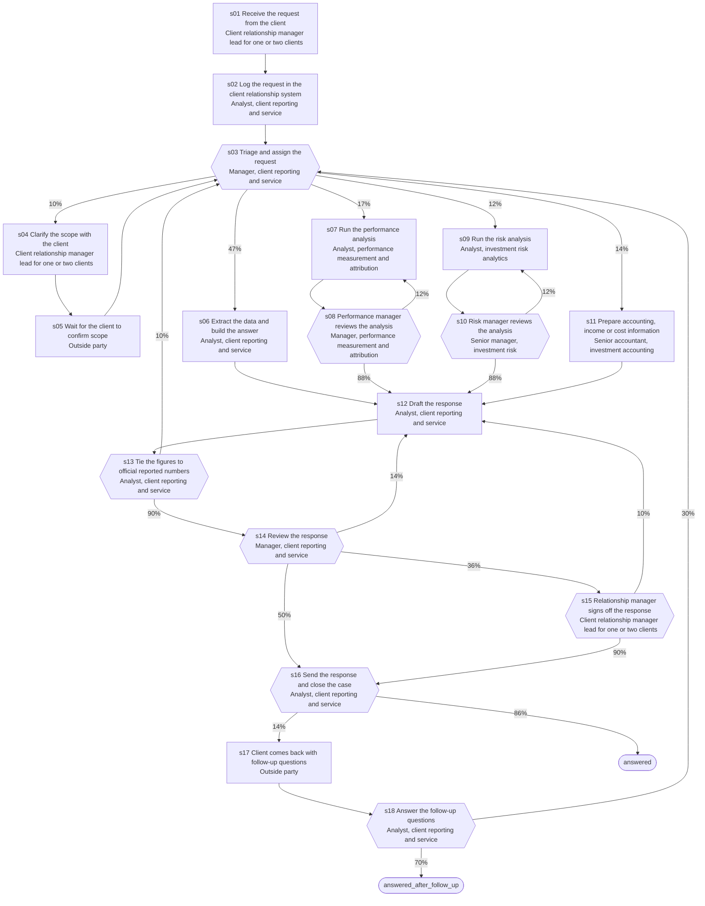

# Handle client service and information requests

`pam-client-service-requests` · public sector asset management · client relations · part of `public-asset-manager`

Between the regular monthly and quarterly reports, the pension plan and workers' compensation clients ask for holdings for their financial statements, data for actuarial valuations, analysis for board meetings, explanations of returns or costs and answers for their regulators. Client service logs each request, routes analysis to performance, risk or investment accounting, ties the answer to the official numbers and reviews it before sending, with the relationship manager signing off sensitive replies. Requests bunch around client board cycles and year end and compete with the month-end cycle for specialists' time, so most elapsed time is queueing.

| | |
|---|---|
| Unit of work | one client request |
| Starts when | A client's staff ask their relationship manager or the client service mailbox for data, an explanation or analysis outside the regular reports. |
| Done when | A reviewed answer has been sent and logged, including any follow-up questions answered. |
| Organisation | A provincial public-sector asset manager of about 240 staff serving four client institutions with five portfolios through a four-person client reporting and service team. (242 employees, 2019-2022) |
| Volume | 25 cases a month (range 15 to 45) |

## Where it sits

- Starts with **client_service_request** from client_pension_plan (70% of cases)
- Starts with **client_service_request** from client_insurance_board (30% of cases)
- Relies on **reporting_dataset** from data-warehouse-operations (a standing input; it does not start a case)
- Relies on **risk_report** from risk-reporting-stress-testing (a standing input; it does not start a case)
- Relies on **performance_results** from performance-attribution (a standing input; it does not start a case)
- Sends **client_service_response** to client_pension_plan (outcome: any)
- Sends **client_service_response** to client_insurance_board (outcome: any)
- Sends **client_service_request** to performance-attribution (outcome: any)
- Sends **client_service_request** to risk-reporting-stress-testing (outcome: any)

## Flow

## Roles

| Role | Department | Layer | FTE on this process | Loaded cost per hour | Evidence |
|---|---|---|---:|---:|---|
| Analyst, client reporting and service | Client reporting and service | individual contributor | 0.8 | 56 CAD | B [cutter_cr2020] |
| Manager, client reporting and service | Client reporting and service | manager | 0.22 | 90 CAD | B [mgr_ar20] |
| Client relationship manager (lead for one or two clients) | Client relationship management | senior specialist | 0.1 | 160 CAD | B [pclient_ar21], [mgr_ar21] |
| Analyst, performance measurement and attribution | Performance measurement and attribution | individual contributor | 0.2 | 56 CAD | C |
| Manager, performance measurement and attribution | Performance measurement and attribution | manager | 0.03 | 90 CAD | C |
| Analyst, investment risk analytics | Portfolio risk and analytics | individual contributor | 0.18 | 65 CAD | B [iclient_if] |
| Senior manager, investment risk | Portfolio risk and analytics | senior specialist | 0.02 | 120 CAD | C |
| Senior accountant, investment accounting | Investment accounting (pools and client portfolios) | individual contributor | 0.11 | 56 CAD | C |

## Steps

Hands-on time and the wait before each step show the most common value. Evidence tier A is a sourced number, B a sourced description, C the author's estimate.

| Step | Who | Kind | Hands-on | Wait before | Control | Evidence |
|---|---|---|---:|---:|---|---|
| **s01 Receive the request from the client.** A client's investment staff email or call their relationship manager, or the client service mailbox, asking for data, an explanation or analysis. The relationship manager acknowledges it, notes the purpose (financial statements, actuarial valuation, board meeting, regulator) and deadline and forwards it to client service. | Client relationship manager (lead for one or two clients) | intake | 10 min | 2.0 h | Client engagement protocol: accountable owner, logging and review of client communications | B [mgr_ar20], [nmerb_ps] |
| **s02 Log the request in the client relationship system.** The client reporting analyst opens a case with the client, portfolio, request type, requester, purpose and the due date agreed in the service level agreement, and attaches the client's email. | Analyst, client reporting and service | data entry | 10 min | 4.0 h |  | B [pclient_ar21] |
| **s03 Triage and assign the request.** The client service manager checks whether an existing report already answers the question, classifies the request and assigns it: client reporting for data extracts, performance for return questions, risk for exposures and stress tests, investment accounting for holdings, income and cost detail. Unclear requests go back to the relationship manager. | Manager, client reporting and service | judgment | 15 min | 8.0 h |  | C |
| **s04 Clarify the scope with the client.** The relationship manager calls or emails the client to agree exactly what is needed, the as-of date, gross or net basis, format and the real deadline. | Client relationship manager (lead for one or two clients) | communication | 20 min | 8.0 h |  | C |
| **s05 Wait for the client to confirm scope.** The client's staff confirm the scope, often after checking with their actuary, auditor or board chair, and the case returns to triage. | Outside party | external wait | 0 min | 2.0 d |  | C |
| **s06 Extract the data and build the answer.** The client reporting analyst queries the data warehouse, book of record, custodian records or unit register for holdings, transactions, cash flows, unit balances or asset mix at the requested date and builds the tables in the client's format. | Analyst, client reporting and service | analysis | 1.5 h | 1.0 d |  | B [cutter_cr2020], [prim_rfp] |
| **s07 Run the performance analysis.** A performance analyst calculates returns for the requested periods and segments, explains differences against the benchmark with attribution and reconciles to the official monthly results, fitting the work around the month-end cycle. | Analyst, performance measurement and attribution | analysis | 3.0 h | 2.0 d |  | C |
| **s08 Performance manager reviews the analysis.** The performance manager checks the numbers against official results and the wording of the explanation before it goes back to client service. | Manager, performance measurement and attribution | review | 30 min | 1.0 d | Performance team policy: second review of results released outside the team | C |
| **s09 Run the risk analysis.** A risk analyst runs exposures, stress tests or liquidity scenarios for the client's portfolio in the risk system, often for a client board or investment committee discussion, and writes a short explanation. | Analyst, investment risk analytics | analysis | 4.0 h | 2.0 d |  | B [iclient_if] |
| **s10 Risk manager reviews the analysis.** The senior risk manager checks that the scenarios match the request, that the numbers agree with the official risk report and that the wording is clear, before release to client service. | Senior manager, investment risk | review | 30 min | 1.0 d | Risk team policy: manager review of analysis released to clients | C |
| **s11 Prepare accounting, income or cost information.** An investment accountant pulls holdings by fair value level, income, fees and cost allocation detail from the accounting records for the client's financial statements, auditors' questions or cost queries. | Senior accountant, investment accounting | analysis | 2.5 h | 2.0 d |  | B [iclient_if] |
| **s12 Draft the response.** The client reporting analyst assembles the data or specialist analysis into the reply, writes the explanation in plain terms, notes the basis and as-of date and states any caveats such as preliminary private asset values. | Analyst, client reporting and service | drafting | 45 min | 8.0 h |  | C |
| **s13 Tie the figures to official reported numbers.** The analyst compares values, returns and unit balances in the draft with the latest official monthly report and accounting package and explains or fixes any difference before review. | Analyst, client reporting and service | validation | 20 min | 1.0 h | SOC 1 control objective: client statements reflect correct holdings and values | B [sifma_soc1], [cutter_cr2020] |
| **s14 Review the response.** The client service manager reviews the reply for accuracy, consistency with earlier answers and reports, confidentiality of other clients' information and tone, then releases it or sends it to the relationship manager when it is sensitive. | Manager, client reporting and service | review | 30 min | 1.0 d | Client engagement protocol: accountable owner, logging and review of client communications | B [mgr_ar20], [osc_registration] |
| **s15 Relationship manager signs off the response.** For answers going to a client board, regulator or actuary, or explaining underperformance or costs, the relationship manager checks the message fits the relationship and earlier commitments and signs off. | Client relationship manager (lead for one or two clients) | review | 30 min | 1.0 d |  | B [pclient_ar21], [mgr_ar21] |
| **s16 Send the response and close the case.** The analyst sends the reply by secure email or the client portal, logs the date and time against the service level in the case and closes it. | Analyst, client reporting and service | communication | 15 min | 1.0 h |  | B [mgr_client] |
| **s17 Client comes back with follow-up questions.** The client's staff read the answer, often while preparing a board paper, and send follow-up questions or ask for a different cut of the data. | Outside party | external wait | 0 min | 2.0 d |  | C |
| **s18 Answer the follow-up questions.** The analyst answers simple follow-ups directly from the work already done; questions needing new analysis go back to triage as a reopened case. | Analyst, client reporting and service | communication | 45 min | 1.0 d |  | C |

## Exceptions

| Exception | Share of cases | What happens |
|---|---:|---|
| Scope unclear | 10% | The request is ambiguous on date, basis or format and goes back to the client before work starts. |
| Figures do not tie to official reports | 10% | The draft disagrees with the monthly report or accounting package and the specialist must rework it. |
| Sensitive response | 36% | Answers for client boards, regulators or about underperformance and costs need the relationship manager's sign-off. |
| Follow-up questions | 14% | The client asks for more after the first answer; three in ten need new analysis. |

## Benchmarks

| Metric | Value | Unit | Population | Evidence |
|---|---|---|---|---|
| cycle_time_days | p50 6, p90 15 | calendar days from request to answer sent | Ad hoc client requests at an institutional asset manager | C [nmerb_ps] |
| share_of_firms_ranking_customisation_requests_a_top_three_challenge | 0.61 | share of firms | Cutter Associates 2020 client reporting survey | A [cutter_cr2020] |
| share_of_firms_doing_custom_reporting_entirely_by_hand | 0.3 | share of firms | Cutter Associates 2020 client reporting survey | A [cutter_cr2020] |

## Pain points

- Specialists in performance, risk and accounting answer client requests around their month-end and quarter-end cycles, so requests queue for days. (steps s07, s09, s11; C)
- Custom data requests are built by hand from several systems and must be tied back to official numbers, which is slow and error-prone. (steps s06, s13; A [cutter_cr2020])
- Requests arrive through relationship managers' inboxes as well as the mailbox, so some are logged late and service levels are hard to track. (steps s01, s02; B [mgr_ar20])
- Year-end and board-cycle peaks nearly double the load on a small team. (steps s03, s06; C)

## Assumptions

- Routing shares (47% data extracts, 17% performance, 12% risk, 14% accounting, 10% clarification first) are the author's estimates from the request types the organisation file names.
- Client auditor confirmations are excluded; they follow the client year-end audit support process.
- Performance and risk analysis requested here also appear as inputs to those teams' own processes; the hands-on time is counted here.
- Waits include the elapsed spread of multi-hour analysis because the simulator adds hands-on minutes as elapsed time without working-day calendars.
- Roles, titles and hourly costs come from the organisation file; full-time equivalents are set from simulated hands-on time times volume.

## Sources

- [mgr_ar20] The model manager 2020 Annual Report (link withheld) (The model manager, 2021). 200 fund managers (including underlying funds) in mid-2019, 124 at end 2020 and a plan for about 80 to 85 by mid-2021; fund-of-funds eliminated; one-time manager transition costs in 2020 from repositioning public equity portfolios; hedge fund portfolio moved from fund-of-funds to direct hedge fund investments on a managed account platform; senior roles filled to support more direct and co-investing; a client engagement protocol rolled out to all employees in December 2020 setting guidelines and accountability for client communications.
- [mgr_ar21] The model manager 2021 Annual Report (link withheld) (The model manager, 2022). Private equity: eight new co-investments or direct deals and two follow-on investments in 2021, four new fund partners committing $1.47 billion, two co-investments alongside Ardian and one alongside GI Partners; an ESG framework with sector-specific standards is used to assess fund managers and direct investments in due diligence. Infrastructure: over $3 billion of transactions in 2021, first control acquisition (100% of Pulse Clean Energy), about 10% of AusNet Services in a take-private alongside Brookfield and Canadian peers, direct investing alongside funds or strategic partners. Real estate: $225 million committed to 12 industrial development projects with WPT REIT, a multi-family joint venture, first life sciences co-investment, four properties sold. First Client Forum and an evolved client relationship management framework.
- [pclient_ar21] The pension client 2021 Annual Report (link withheld) (The pension client, 2022). The model manager manages Plan assets at cost recovery and reports regularly on performance and risk; an Investment Management Agreement, a Service Level Agreement setting the content and frequency of reporting and service levels, and an Implementation and Support Agreement; the pension client monitoring programme; asset-liability study done with the model manager in 2021; legally required funding valuations filed with the regulator.
- [iclient_if] Insurance fund: statement of investment policies and procedures (The insurance client web page) (link withheld) (The insurance client, undated). Fund performance, risk and compliance reviewed at least quarterly and the model manager's performance at least annually; the model manager must advise the insurance client of benchmark changes and outline plans when allocations leave ranges; liquidity monitored monthly; non-traded fair values estimated at least annually and reviewed quarterly, with valuations on segregated assets available for the insurance client review.
- [cutter_cr2020] [Cutter Associates releases 2020 Client Reporting Benchmarking Survey (news release)](https://www.cutterassociates.com/news/cutter-associates-releases-2020-client-reporting-benchmarking-survey-for-the-investment-management-industry) (Cutter Associates, 2020). 49% of firms usually process by hand and 30% do custom reporting entirely by hand; 61% rank managing customisation requests and 63% lack of automation among their top three challenges; 5% call their data consistently high quality; 61% have centrally managed client reporting teams; 32% publish reports on a portal.
- [mgr_client] Our Commitment to Client Success (The model manager web page) (link withheld) (The model manager, undated). Service tailored to each client with strategic advice and hands-on support from a responsive team; timely, relevant and accessible reporting; daily risk review; a client engagement and education programme.
- [nmerb_ps] [Custody Bank RFP, Appendix F: Performance Standards and Related Key Performance Indicators](https://www.erb.nm.gov/wp-content/uploads/2024/09/NMERB-Custody-Bank-RFP-2024-09-03-INV_Performance-Standards.pdf) (New Mexico Educational Retirement Board, 2024). Service provider to respond to queries from the pension fund within 24 hours, with a penalty per day of late response; performance reporting due five business days after month-end close.
- [prim_rfp] [Request for Proposals: Investment Performance Reporting Services](https://www.mapension.com/wp-content/uploads/2023/03/Performance-Reporting-Support-Services-RFP-2023.pdf) (Massachusetts Pension Reserves Investment Management Board, 2023). A public pension investment manager asks its performance reporting provider for enhanced reporting including data download and export and ad hoc reporting, alongside monthly and quarterly packages.
- [osc_registration] The model manager, Commission and Director decisions (exemption order, June 2017) (link withheld) (Ontario Securities Commission, 2017). Board-approved policies required for: a compliance system and a chief compliance officer; books and records; conflicts including insider trading and front running; prevention of any investment that contravenes the investment restrictions set out in each member's IMA; a KYC policy; an escalation process for member concerns or complaints that may be set out in the IMA; a due diligence process for vetting and monitoring sub-advisers; due diligence on custodians and brokers before they hold or access assets.
- [sifma_soc1] [Asset Manager's Guide to SOC 1 (June 2017)](https://www.sifma.org/wp-content/uploads/2017/08/SIFMA_AMG_asset-managers-guide-soc-2017.pdf) (SIFMA Asset Management Group, 2017). Baseline control objectives: documentation for opening and modifying accounts is received, authenticated and set up accurately and timely; trades follow portfolio guidelines and account restrictions (client investment guideline and restriction compliance); positions and cash reconcile to custodian records with breaks researched and resolved; client account statements are complete, correct and timely; fee calculation and billing listed as an area to consider.

Written by claude-opus on 2026-11-17.
