# Allocate costs to clients and bill them

`pam-cost-allocation-billing` · public-sector asset management · finance (financial planning, cost allocation and client billing) · part of `public-asset-manager`

The manager charges its clients only what it costs to run, so each quarter finance allocates actual operating costs to pools, segregated accounts and client portfolios with agreed keys such as assets by strategy and team time, adds external manager fees, custody and deal costs that belong to specific accounts, and issues each client portfolio a cost allocation statement and invoice. The work waits for the corporate ledger close and for external managers' quarterly fee invoices, runs in a spreadsheet model that must allocate every dollar with nothing left over, and passes director, committee and CFO review. Client finance staff scrutinise the statements against budget and query keys, the fourth-quarter statement waits for the audited true-up, and the case ends when the client pays.

| | |
|---|---|
| Unit of work | one client portfolio's quarterly cost allocation statement |
| Starts when | Quarter end, with work starting when the corporate ledger is closed for the quarter. |
| Done when | The approved statement and invoice have been issued, the charges are posted to the client's portfolios and pools, and the client's payment has been applied. |
| Organisation | A Canadian provincial not-for-profit asset manager recovering about $217 million of its own operating costs a year (2021) plus agency external fees from four public-sector clients with five portfolios, with a four-person planning and cost allocation team using an ERP and spreadsheets. (242 employees, 2019-2022) |
| Volume | 1.67 cases a month (range 1.3 to 2) |

## Where it sits

- Starts with **pool_nav_package** from fund-accounting-close (25% of cases)
- Starts with **investment_cost_data** from manager-fee-validation-payment (25% of cases)
- Starts with **ledger_postings** from accounts-payable (15% of cases)
- Starts with **ledger_postings** from payroll-benefits (15% of cases)
- Starts with **annual_budget** from annual-cost-budget (5% of cases)
- Starts with **client_ima** from client-onboarding-transition (5% of cases)
- Starts with **client_payment** from client_pension_plan (5% of cases)
- Starts with **client_payment** from client_insurance_board (5% of cases)
- Sends **cost_allocation_statement** to client_pension_plan (outcome: any)
- Sends **cost_allocation_statement** to client_insurance_board (outcome: any)
- Sends **cost_allocation_statement** to client-quarterly-reporting (outcome: any)
- Sends **ledger_postings** to fund-accounting-close (outcome: any)

## Flow

```mermaid
flowchart TD
    s01["s01 Wait for the quarter-end corporate ledger close<br/>Analyst, budgeting, cost allocation and billing"]
    s02["s02 Extract actual costs by cost centre and tie to the trial balance<br/>Analyst, budgeting, cost allocation and billing"]
    s03{{"s03 Update the allocation drivers<br/>Analyst, budgeting, cost allocation and billing"}}
    s04["s04 Chase managers for missing time-allocation returns<br/>Analyst, budgeting, cost allocation and billing"]
    s05["s05 Run the allocation model<br/>Analyst, budgeting, cost allocation and billing"]
    s06["s06 Assign directly attributable investment costs<br/>Analyst, budgeting, cost allocation and billing"]
    s07{{"s07 Reconcile allocated totals to the ledger and monthly accruals<br/>Analyst, budgeting, cost allocation and billing"}}
    s08["s08 Investigate and correct the allocation difference<br/>Analyst, budgeting, cost allocation and billing"]
    s09["s09 Explain variances to budget and the prior quarter<br/>Analyst, budgeting, cost allocation and billing"]
    s10{{"s10 Director reviews the allocation and explanations<br/>Director, financial planning, cost allocation and client billing"}}
    s11{{"s11 Decide whether allocation keys or methods changed<br/>Director, financial planning, cost allocation and client billing"}}
    s12{{"s12 Cost Allocation Committee approves the change<br/>Chief financial officer"}}
    s13{{"s13 Check whether a year-end true-up is due<br/>Analyst, budgeting, cost allocation and billing"}}
    s14["s14 Compute the annual true-up to audited costs<br/>Analyst, budgeting, cost allocation and billing"]
    s15["s15 Prepare the cost allocation statement and invoice<br/>Analyst, budgeting, cost allocation and billing"]
    s16{{"s16 CFO approves statements and invoices<br/>Chief financial officer"}}
    s17["s17 Relationship manager previews the statement with the client<br/>Client relationship manager  lead for one or two clients"]
    s18["s18 Issue the statement and invoice and record the receivable<br/>Analyst, budgeting, cost allocation and billing"]
    s19["s19 Post the quarter's cost recovery charges to portfolios and pools<br/>Senior accountant, investment accounting"]
    s20{{"s20 Client finance reviews the statement<br/>Outside party"}}
    s21{{"s21 Answer the client's queries on allocations<br/>Analyst, budgeting, cost allocation and billing"}}
    s22["s22 Wait for the client's payment<br/>Outside party"]
    s23{{"s23 Apply the payment and clear the receivable<br/>Accountant, corporate accounting and reporting"}}
    s24["s24 Chase a short or late payment<br/>Analyst, budgeting, cost allocation and billing"]
    s01 --> s02
    s02 --> s03
    s03 -->|"70%"| s05
    s03 -->|"30%"| s04
    s04 --> s05
    s05 --> s06
    s06 --> s07
    s07 -->|"82%"| s09
    s07 -->|"18%"| s08
    s08 --> s05
    s09 --> s10
    s10 -->|"85%"| s11
    s10 -->|"15%"| s05
    s11 -->|"20%"| s12
    s11 -->|"80%"| s13
    s12 -->|"90%"| s13
    s12 -->|"10%"| s05
    s13 -->|"25%"| s14
    s13 -->|"75%"| s15
    s14 --> s15
    s15 --> s16
    s16 -->|"92%"| s17
    s16 -->|"8%"| s15
    s17 --> s18
    s18 --> s19
    s19 --> s20
    s20 -->|"78%"| s22
    s20 -->|"22%"| s21
    s21 -->|"88%"| s22
    s21 -->|"12%"| s15
    s22 --> s23
    s23 -->|"95%"| end0
    s23 -->|"5%"| s24
    s24 --> s23
    end0(["paid"])
```

## Roles

| Role | Department | Layer | FTE on this process | Loaded cost per hour | Evidence |
|---|---|---|---:|---:|---|
| Analyst, budgeting, cost allocation and billing | Financial planning, cost allocation and client billing | individual contributor | 0.45 | 56 CAD | B [jobbank_11100] |
| Director, financial planning, cost allocation and client billing | Financial planning, cost allocation and client billing | director | 0.08 | 240 CAD | C |
| Chief financial officer | Finance | executive | 0.01 | 750 CAD | C |
| Client relationship manager (lead for one or two clients) | Client relationship management | senior specialist | 0.02 | 160 CAD | C |
| Senior accountant, investment accounting | Investment accounting (pools and client portfolios) | individual contributor | 0.05 | 56 CAD | B [jobbank_11100] |
| Accountant, corporate accounting and reporting | Financial reporting and corporate accounting | individual contributor | 0.02 | 56 CAD | B [jobbank_11100] |

## Steps

Hands-on time and the wait before each step show the most common value. Evidence tier A is a sourced number, B a sourced description, C the author's estimate.

| Step | Who | Kind | Hands-on | Wait before | Control | Evidence |
|---|---|---|---:|---:|---|---|
| **s01 Wait for the quarter-end corporate ledger close.** The cost allocation analyst waits until corporate accounting closes the model manager's own ledger for the quarter: payroll and incentive accruals, vendor invoices, data and technology costs and premises costs posted, and the trial balance released. | Analyst, budgeting, cost allocation and billing | lookup | 20 min | 8.0 d |  | C |
| **s02 Extract actual costs by cost centre and tie to the trial balance.** The analyst exports the quarter's operating costs by cost centre and expense type from the ERP into the allocation workbook and ties the totals to the trial balance, separating compensation, IT and data, professional fees, premises and other costs. The extract serves all five statements, so per-statement time is a share. | Analyst, budgeting, cost allocation and billing | data entry | 1.0 h | 2.0 h |  | B [mgr_ar21] |
| **s03 Update the allocation drivers.** The analyst updates the keys: average assets by pool and segregated strategy for each client portfolio from the month-end accounting packages, team time-allocation percentages by strategy, trade counts by account and the number of private holdings, and checks each against the prior quarter. | Analyst, budgeting, cost allocation and billing | lookup | 1.2 h | 1.0 d |  | B [mgr_ar20], [bci_pooled], [bci_car22] |
| **s04 Chase managers for missing time-allocation returns.** The analyst emails department heads whose teams have not returned the quarterly estimate of time spent by strategy and asset class, and uses last quarter's split if nothing arrives by the cut-off. | Analyst, budgeting, cost allocation and billing | coordination | 30 min | 2.0 d |  | C |
| **s05 Run the allocation model.** The analyst runs the spreadsheet model: shared operating costs are spread first to investment strategies and support functions, then to pools and segregated accounts by assets and activity keys, then to each client portfolio by its holdings, and the client's share by cost category is produced. | Analyst, budgeting, cost allocation and billing | analysis | 2.0 h | 2.0 h |  | B [mgr_ar20], [mgr_ar21], [bci_car22] |
| **s06 Assign directly attributable investment costs.** The analyst adds costs that belong to specific accounts: external manager fees validated by fund accounting, custody fees and deal-related legal and due diligence costs, each charged to the pool or segregated account that incurred it and so to its owners. | Analyst, budgeting, cost allocation and billing | data entry | 1.2 h | 2.0 d |  | B [mgr_ar21], [pclient_ar21], [nmerb_ps] |
| **s07 Reconcile allocated totals to the ledger and monthly accruals.** The analyst checks that the total allocated to all clients equals total costs in the ledger with nothing left over, and compares each client's quarterly total with the three monthly accruals already booked in its portfolios and pools. | Analyst, budgeting, cost allocation and billing | validation | 1.2 h | 1.0 h | Cost recovery principle in the client agreements: all costs allocated and recovered, without profit | B [mgr_ar21], [client_manager] |
| **s08 Investigate and correct the allocation difference.** The analyst traces the difference to a mapping error, a missing driver, a late journal or a formula break, corrects the workbook and reruns the model. | Analyst, budgeting, cost allocation and billing | analysis | 1.0 h | 4.0 h |  | C |
| **s09 Explain variances to budget and the prior quarter.** The analyst compares each client's costs with its share of the approved annual budget and with the prior quarter, in dollars and basis points of assets, and drafts explanations for the main movements such as new hires, technology projects or a change in asset mix toward private markets. | Analyst, budgeting, cost allocation and billing | drafting | 1.2 h | 2.0 h |  | B [mgr_ar20], [pclient_ar21] |
| **s10 Director reviews the allocation and explanations.** The director of financial planning reviews the allocation results, key movements and variance explanations, compares each client's share with the budget forecast shared with clients, and approves or sends back for correction. | Director, financial planning, cost allocation and client billing | review | 1.0 h | 1.0 d | Preparer and reviewer separation for cost allocation under the model manager's cost allocation policy and guidelines | B [mgr_ar20], [sifma_soc1] |
| **s11 Decide whether allocation keys or methods changed.** The director checks whether this quarter introduces a new key, a change in method or a material shift in allocation, such as a new pool launch or a new client, which needs committee approval and advance explanation to clients. | Director, financial planning, cost allocation and client billing | judgment | 15 min | 1.0 h |  | C |
| **s12 Cost Allocation Committee approves the change.** The Cost Allocation Committee, chaired by the CFO, reviews the proposed change with its effect on each client and confirms it is consistent with the cost allocation policy before it is used in statements. | Chief financial officer | approval | 45 min | 7.0 d | The model manager cost allocation policy and guidelines: Cost Allocation Committee ensures allocation is consistent with the policy | B [mgr_ar20] |
| **s13 Check whether a year-end true-up is due.** For the fourth quarter the analyst flags that the statement must include the annual true-up of the year's charges to the model manager's audited costs; other quarters go straight to statement preparation. | Analyst, budgeting, cost allocation and billing | judgment | 15 min | 0 min |  | C |
| **s14 Compute the annual true-up to audited costs.** After the external auditor signs off the model manager's financial statements, the analyst compares the year's charges to each client with its share of audited costs, including deferred recoveries for capital assets, and calculates the true-up amount. | Analyst, budgeting, cost allocation and billing | analysis | 2.0 h | 35.0 d | Client agreements: annual charges trued up to the model manager's audited financial statements | A [mgr_ar21] |
| **s15 Prepare the cost allocation statement and invoice.** The analyst produces the client's statement: operating costs by category, investment costs by pool and account, allocation keys and their values, year to date against budget, any true-up, and the invoice with HST, using the standard template. | Analyst, budgeting, cost allocation and billing | drafting | 1.2 h | 4.0 h | Excise Tax Act (Canada): HST charged on the cost recovery invoice | B [mgr_ar21] |
| **s16 CFO approves statements and invoices.** The chief financial officer reviews the summary of all clients' charges, the variance explanations and any true-up, and approves the statements and invoices for issue under the delegation of authority. | Chief financial officer | approval | 30 min | 2.0 d | The model manager delegation of authority: tiered approval of client charges | B [mgr_ar20] |
| **s17 Relationship manager previews the statement with the client.** The relationship manager walks the client's finance or investment lead through the main changes before the invoice arrives, especially a rise in costs, a key change or a true-up, so there are no surprises at the client's committee. | Client relationship manager (lead for one or two clients) | communication | 30 min | 1.0 d |  | C |
| **s18 Issue the statement and invoice and record the receivable.** The analyst sends the statement and invoice to the client's accounts payable and finance contacts and records the receivable and cost recovery revenue in the ERP. | Analyst, budgeting, cost allocation and billing | communication | 30 min | 2.0 h |  | B [mgr_ar21] |
| **s19 Post the quarter's cost recovery charges to portfolios and pools.** A fund accountant books the final quarterly charges in each client portfolio's and pool's accounts, reversing the three monthly accruals, so that pool unit prices and net-of-cost returns reflect actual costs. | Senior accountant, investment accounting | data entry | 45 min | 4.0 h |  | B [bci_pooled], [gips_ao] |
| **s20 Client finance reviews the statement.** The client's finance staff check the charges against the budget the model manager shared, their own accruals and prior quarters, and either approve the invoice for payment or send questions on allocation keys or particular costs. | Outside party | external wait | 0 min | 8.0 d |  | B [pclient_ar21] |
| **s21 Answer the client's queries on allocations.** The analyst, with the director for policy questions, prepares backup for the queried items, such as the key values or invoices behind a cost, and replies; occasionally the review finds an error and a corrected statement or credit note is needed. | Analyst, budgeting, cost allocation and billing | communication | 2.0 h | 1.0 d |  | C |
| **s22 Wait for the client's payment.** The approved invoice goes through the client's own payables run and approval; payment arrives by electronic transfer or as an authorised deduction under the agreement. | Outside party | external wait | 0 min | 18.0 d |  | B [mgr_ar21] |
| **s23 Apply the payment and clear the receivable.** A corporate accountant matches the payment to the invoice in the ERP, clears the receivable and flags any short payment to the cost allocation team. | Accountant, corporate accounting and reporting | data entry | 15 min | 1.0 d |  | C |
| **s24 Chase a short or late payment.** The analyst contacts the client's payables team about the shortfall or delay, usually a disputed line or an internal approval delay at the client, and agrees when the balance will be paid. | Analyst, budgeting, cost allocation and billing | coordination | 30 min | 10.0 d |  | C |

## Exceptions

| Exception | Share of cases | What happens |
|---|---:|---|
| Missing time-allocation returns | 30% | Department heads have not returned their teams' time split by strategy, so the analyst chases and falls back on last quarter's split. |
| Allocation does not reconcile | 18% | Allocated totals differ from the ledger or from the monthly accruals; the analyst finds the cause and reruns the model. |
| Allocation key or method change | 20% | A pool launch, new client or new key needs Cost Allocation Committee approval before statements go out. |
| Fourth-quarter audited true-up | 25% | The year-end statement waits for the audited financial statements and includes the true-up of the year's charges. |
| Client queries on the statement | 22% | Client finance staff question keys or costs; the team provides backup and occasionally reissues a corrected statement. |
| Short or late payment | 5% | The client pays late or short over a disputed line, and finance chases the balance. |

## Benchmarks

| Metric | Value | Unit | Population | Evidence |
|---|---|---|---|---|
| cycle_time_days | p50 50, p90 85 | calendar days from quarter end to payment applied | Author estimate for a cost-recovery public asset manager invoicing quarterly | C [mgr_ar21] |
| recovery_of_costs_revenue | 216615000 | CAD per year (2021) | The model manager statement of operations | A [mgr_ar21] |
| receivable_from_clients_for_cost_recoveries_at_year_end | 2021 36575000, 2020 17735000 | CAD plus HST | The model manager financial statements, related party note | A [mgr_ar21] |
| total_costs_per_100_dollars_of_aum | 2020 55.3, 2021 63.1 | cents (basis points) | The model manager total costs including external fees | A [mgr_ar20], [mgr_ar21] |
| mgr_costs_charged_to_one_client | bp_2021 41, target_bp 50, imco_management_fees_cad_2021 97717000 | basis points of the client's average net assets and CAD | The pension client, 2021 | A [pclient_ar21] |

## Pain points

- The allocation runs in a large spreadsheet with several stages and keys; new pools and clients break formulas and every rerun repeats the reconciliation. (steps s05, s07, s08; C [mgr_ar21], [mgr_ar22])
- Time-allocation keys depend on department heads' estimates, which arrive late and are hard for clients to verify. (steps s03, s04; C)
- Clients pay every dollar and compare their share with targets and peers, so statements draw detailed queries and key changes need careful advance explanation. (steps s17, s20, s21; B [pclient_ar21], [mgr_ar20])
- External manager fees arrive quarterly in arrears from many managers, and the year-end statement waits about two months for the audited true-up. (steps s06, s14; B [mgr_ar21])

## Assumptions

- The organisation file assumes monthly allocation and quarterly invoicing with a year-end true-up; the model manager publishes only that it allocates and recovers all costs under agreed principles. The year-end receivable (about 62 days of recoveries) is consistent with either quarterly or monthly invoicing.
- The case covers one client portfolio's quarterly statement. Batch work done once for all five statements (ledger extract, driver update, model run) is shown at a fifth of its total time per case.
- Monthly accruals for the first two months of each quarter are booked outside this case; the third month's accrual is replaced by the final quarterly allocation at s19.
- Client payments are listed in triggered_by to match the process map, but in this file they close the case (s22) rather than start it; their shares are kept small.
- The Cost Allocation Committee is named in the model manager's 2020 annual report; the CFO as chair, its meeting frequency and the share of quarters needing its approval are author assumptions.
- The fourth-quarter statement is held for the audited true-up, which lengthens one case in four by about five weeks; some cost-recovery managers instead issue the true-up as a separate statement.
- Loaded hourly costs are from the organisation file. Stated FTE (0.63) is above the hands-on time implied by 1.67 statements a month because the team also books monthly accruals, forecasts and answers ad hoc cost questions.

## Sources

- [mgr_ar20] The model manager 2020 Annual Report (link withheld) (The model manager, 2021). New client reporting suite in 2020 with a core set of concise reports for all clients; quarterly performance recaps, positioning and commentary; KPI framework; a consistent core team for client management teams and investment committees; cost allocation policy and guidelines for fair, consistent allocation to the model manager products, segregated assets and clients, overseen by a Cost Allocation Committee; tiered approval authorities; costs reported regularly to senior management, the Finance and Audit Committee and clients; returns net of all costs, time-weighted, based on daily calculations; total benchmark daily weighted by clients' investment in each strategy; 2020 total costs $384.3 million (55.3 cents per $100).
- [mgr_ar21] The model manager 2021 Annual Report (link withheld) (The model manager, 2022). Clean SOC 1 Type I report on the design of controls as at 30 September 2021, with Type II planned for 2022; Board and client reporting redesigned in 2021 including a Quarterly Risk Insights report; full cost recovery without profit; the model manager allocates to and recovers all operational costs from clients based on agreed cost allocation principles; 2021 total costs $473.7 million (63.1 cents per $100 of AUM), investment management costs $317.2 million, operating expenses $156.5 million; recovery of costs revenue $216.6 million; year-end receivable from clients for cost recoveries $36.6 million plus HST (2020: $17.7 million); external fees paid as agent and collected from clients; amounts collected in advance held as deferred recovery of costs; financial statements authorised by the Board on 24 February 2022; CEM benchmarking of costs.
- [mgr_ar22] The model manager 2022 Annual Report (link withheld) (The model manager, 2023). Inaugural SOC 1 Type 2 report with a clean opinion that controls were designed and operated effectively from 1 October 2021 to 30 September 2022; returns net of all costs using the time-weighted rate of return; benchmark policy under which Risk researches and reviews benchmarks, the Management Investment Committee recommends them and the Board approves them; net value added defined against the IPS benchmark; interim private markets administration software and a new risk and total portfolio system implemented in 2022.
- [pclient_ar21] The pension client 2021 Annual Report (link withheld) (The pension client, 2022). The model manager manages Plan assets for a fee based on cost recovery and regularly reports on investment performance and risk to the pension client; an Investment Management Agreement, a Service Level Agreement setting the content and frequency of reporting and service levels, and an Implementation and Support Agreement covering budgeting and cost management; the pension client monitoring program; the model manager management fees of $97.7 million in 2021 representing the pension client's share of the model manager operating expenses charged back on a cost recovery basis, with external fees paid by the model manager on the pension client's behalf and reimbursed; the model manager costs 41 basis points against a target of 50 or lower; the Board and its committees met 37 times in 2021.
- [client_manager] The model manager (The pension client investments page) (link withheld) (The pension client, 2026). The model manager is the pension client's sole investment manager under an Investment Management Agreement, regularly reports on investment performance and risk management, the pension client runs an ongoing program to monitor the model manager's investment performance, and the model manager operates on a cost-recovery basis only.
- [sifma_soc1] [Asset Manager's Guide to SOC 1 (June 2017)](https://www.sifma.org/wp-content/uploads/2017/08/SIFMA_AMG_asset-managers-guide-soc-2017.pdf) (SIFMA Asset Management Group and Grant Thornton, 2017). Baseline asset manager SOC 1 scope including reconciliation and client reporting; baseline control objective that account statements reflect the correct holdings and market value and are provided to clients in a complete and timely manner; reconciliation objective that discrepancies are researched and resolved timely; account performance listed as not baseline and fee calculation and billing as another area to consider; IT general controls over job scheduling, logical access and change management.
- [gips_ao] [2020 GIPS Standards for Asset Owners](https://www.gipsstandards.org/wp-content/uploads/2021/02/2020_gips_standards_asset_owners.pdf) (CFA Institute, 2019). Time-weighted returns required for total funds; valuation at least monthly, at month end and on large cash flows; monthly returns geometrically linked; private market investments valued and returns calculated at least quarterly; when preliminary or estimated values are used the difference to the final value must be assessed and adjusted when the final value arrives (22.A.18); net-of-fees returns deduct transaction costs, external fees and investment management costs (22.A.24); material errors must be corrected and corrected reports given to the oversight body (21.A.16); benchmarks must reflect the mandate; reports to oversight bodies updated within 12 months of each annual period end.
- [nmerb_ps] [Custody Bank RFP, Appendix F: Performance Standards and Related Key Performance Indicators](https://www.erb.nm.gov/wp-content/uploads/2024/09/NMERB-Custody-Bank-RFP-2024-09-03-INV_Performance-Standards.pdf) (New Mexico Educational Retirement Board, 2024). Month-end close targets: 5th business day for externally managed and cash accounts, 10th for internally managed and commingled funds, 15th for alternative investment accounts; external manager position reconciliations typically received on business days 3 to 5; variances above 10 basis points of NAV explained; performance reporting due 5 business days after the month-end close; a performance revision above 5 basis points from custodian error counts as a failure; asset servicing invoices within 60 days of period end.
- [bci_pooled] [Pooled funds (BCI web page)](https://www.bci.ca/investments-performance/pooled-funds) (British Columbia Investment Management Corporation, 2026). Expenses of pooled funds are recovered through a reduction in unit value so costs are shared in proportion to ownership (a client owning 5% of a pool pays 5% of its costs); unit price is market value divided by units outstanding; EY performs the SOC 1 audit and KPMG audits the corporation and the pools.
- [bci_car22] [BCI 2021-2022 Corporate Annual Report](https://www.bci.ca/wp-content/uploads/2023/07/2021-2022-Corporate-Annual-Report.pdf) (British Columbia Investment Management Corporation, 2022). A peer provincial manager operating on a cost recovery basis: investment management fees are charged to the investment pools and clients; it recovers all of its expenses through the pooled portfolios and segregated client accounts it manages; the primary drivers of investment management costs are assets under management and each client's asset mix; revenue from recoveries of costs equals costs incurred under management contracts; costs split into internal, external direct and external indirect and benchmarked with CEM.
- [jobbank_11100] [Wages: Accountant (NOC 11100) in the Toronto Region](https://www.jobbank.gc.ca/marketreport/wages-occupation/113/geo9219) (Job Bank, Government of Canada, 2025). Toronto region hourly wages low $25.00, median $41.34, high $74.36 (reference period 2023-2024).

Written by claude-opus on 2026-11-17.
